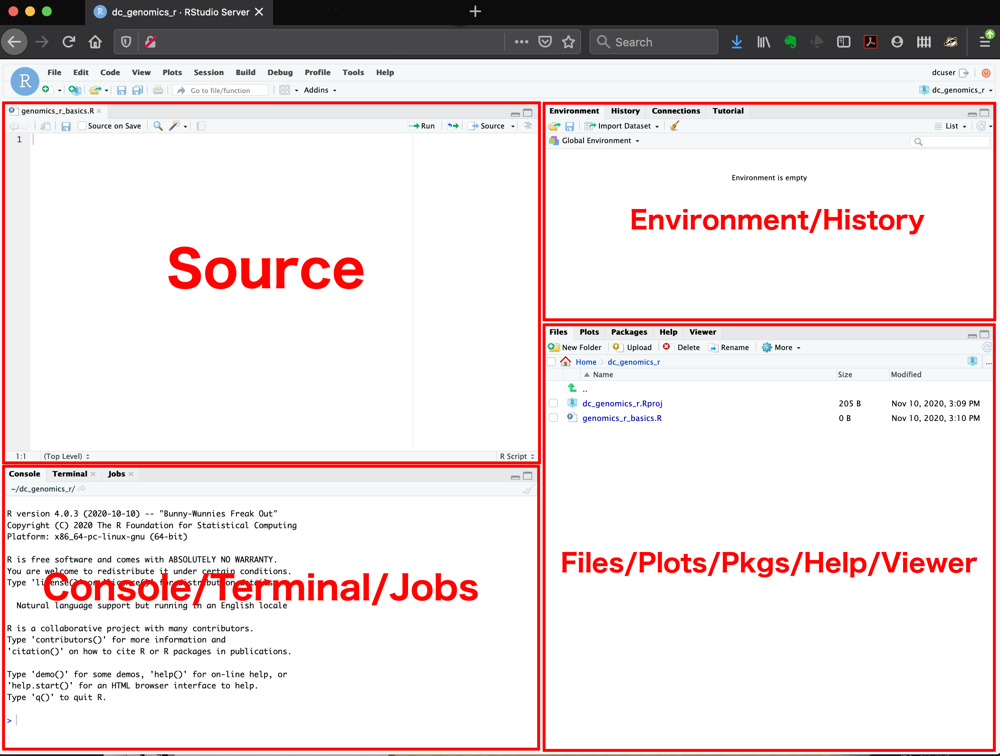
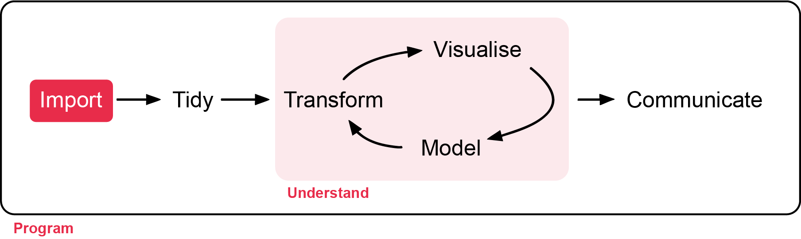
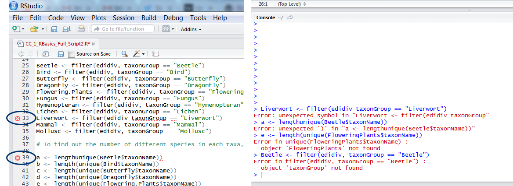

# Introduction to R {.unnumbered}

Before the first workshop in Week 1, you need to be familiar with **R**, **RStudio**
and the basics of coding. Work through this page before class. It takes about an hour.

# Before we start {.unnumbered}

Skip this step if R and RStudio are already installed on your computer.

### Murdoch computers {.unnumbered}

All Murdoch computers have R and RStudio installed. Log in and open RStudio.

### Your own computer {.unnumbered}

1. **Install R**: go to [https://cran.r-project.org](https://cran.r-project.org),
   choose your operating system and follow the instructions.
2. **Install RStudio**: go to [https://posit.co/download/rstudio-desktop/](https://posit.co/download/rstudio-desktop/)
   and download and install the free RStudio Desktop.

### Set up a workshop folder {.unnumbered}

Keep everything for this unit in one folder. This saves a lot of time hunting for
files later.

1. Create a folder called `ECS200` (avoid spaces in folder and file names).
2. Inside it, create a folder called `data`. Save every dataset from the workshops here.
3. Save your R scripts in the `ECS200` folder.

```
ECS200/
├── data/
│   ├── plant_calcium.csv
│   └── ...
├── week01_quality_check.R
└── ...
```

In every workshop, the code imports data with a path such as `"data/plant_calcium.csv"`,
which means "the file `plant_calcium.csv` inside the `data` folder". This works as
long as your **working directory** is your `ECS200` folder (Step 3 below).

# Step 1: Open RStudio {.unnumbered}

RStudio has four panels:

- **Source** (top left): where you write and save your code (scripts).
- **Console** (bottom left): where code runs and results appear.
- **Environment/History** (top right): the objects (data, variables) currently
  loaded, and the commands you have run.
- **Files/Plots/Packages/Help** (bottom right): browse files, view plots, manage
  packages and read help pages.

{width=100%}

# Step 2: First R commands {.unnumbered}

Click **File > New File > R Script** to start a new script. At the top, write who is
writing the script, the date and its purpose:

```{r}
#| label: header

# Introduction to R
# Getting familiar with R
# Written by Nicholas Wu, 06/02/2027, Murdoch University
```

The **#** (hash) tells R to ignore the rest of the line. Use it to write **comments**
that explain what your code does.

:::{.callout-note}
Comment often and in detail. Someone else should be able to understand what you
did and why, and that includes future you.
:::

To run a line of code, put the cursor on it and press **Ctrl + Enter** (Windows) or
**Cmd + Enter** (Mac). The result appears in the Console.

## Objects {.unnumbered}

```{r}
#| label: objects

# Number of frogs counted at a pond
frogs <- 18

# Add 5 frogs observed the next day
frogs_total <- frogs + 5

# Print the result
frogs_total
```

`<-` is the **assignment operator**: it stores the value on the right in an
**object** with the name on the left (`object_name <- value`). The object then
appears in the Environment panel.

## Vectors {.unnumbered}

A **vector** is a list of values of the same type, created with `c()` (for
"combine"):

```{r}
#| label: vectors

# Leaf lengths (cm) of 5 Eucalyptus trees
leaf_sizes <- c(23.4, 21.8, 25.1, 19.7, 22.5)

# Average leaf size
mean(leaf_sizes)
```

`mean()` is a **function**. Functions take inputs (*arguments*) inside the brackets
and return a result.

## Data frames {.unnumbered}

A **data frame** is a table with **rows** (observations) and **columns** (variables).
It is the object you will use most often in this unit.

```{r}
#| label: data-frame

# A small data frame of species and their body mass (g)
example_data <- data.frame(
  species = c("Lizard", "Bird", "Bat"),
  mass    = c(15, 120, 35)
)

example_data
```

### Exercise (1 min) {.unnumbered}

🧪 **How would you find the largest leaf size?** (Hint: try the `max()` function.)

<details>
<summary><strong>Show answer</strong></summary>

```{r}
#| label: ans-max
max(leaf_sizes)
```

</details>

# Step 3: Packages and the working directory {.unnumbered}



A **package** is a bundle of functions that adds extra abilities to R, for example
for tidying data or making maps. You **install** a package once with
`install.packages("package-name")`, typed in the Console. You then **load** it with
`library(package-name)` at the start of every script.

In this unit we mostly use the **tidyverse**, a collection of packages for
importing, tidying and plotting data.

```{r}
#| label: packages
#| eval: false

# Install the tidyverse (only once, in the Console)
install.packages("tidyverse")

# Load it (at the top of every script)
library(tidyverse)
```

::: {.callout-important}
## Package names in front of functions

Throughout this unit, functions that come from a package are written with the package
name in front, separated by two colons: `readr::read_csv()`, `dplyr::filter()`,
`ggplot2::ggplot()`. This tells you **which package each function comes from**, and
avoids confusion when two packages have functions with the same name.

Functions written **without** a prefix, such as `mean()`, `sd()`, `lm()` and
`t.test()`, are built into R and are always available.
:::

The **working directory** is the folder where R looks for files and saves outputs.
Check where it is with `getwd()`, and change it to your `ECS200` folder with
`setwd()`:

```{r}
#| label: setwd
#| eval: false

# Where is R looking at the moment?
getwd()

# Change the working directory to your ECS200 folder (change this to your own path)
setwd("C:/Users/YOUR-NAME/Documents/ECS200")
```

:::{.callout-note}
- Use quotation marks around a package name when installing it, but not when loading it.
- **Windows** file paths copied from File Explorer use backslashes (`\`), which R does
  not accept. Change them to forward slashes (`/`): `"C:/Users/YOUR-NAME/Documents/ECS200"`.
- An easy alternative: in RStudio, go to **Session > Set Working Directory > Choose
  Directory...** and pick your `ECS200` folder.
:::

:::{.callout-warning}
If you see an error like this:

```
library(ggrepel)
#> Error in library(ggrepel) : there is no package called 'ggrepel'
```

the package is not installed yet. Run `install.packages("ggrepel")` in the Console.
:::

# Step 4: Import data {.unnumbered}

Imagine we measured leaf traits of sugar maple seedlings from an **untreated**
watershed and a **calcium-treated** watershed, to test whether adding calcium
improves seedling growth. The background to this study is
[here](https://lter.github.io/lterdatasampler/articles/hbr_maples_vignette.html).

Download `plant_calcium.csv` and save it in your `data` folder.

[<i class="bi bi-download"></i> plant_calcium.csv](data/plant_calcium.csv){.btn .btn-outline-danger .btn-sm .download-btn download="plant_calcium.csv"}

```{r}
#| label: import
#| message: false

library(tidyverse)

# Import the CSV file and store it in an object called plant_calcium_data
plant_calcium_data <- readr::read_csv("data/plant_calcium.csv")

# First 6 rows
head(plant_calcium_data)

# Last 6 rows
tail(plant_calcium_data)

# Structure: the type of every column
dplyr::glimpse(plant_calcium_data)
```

In the output of `dplyr::glimpse()`, `<dbl>` means numbers and `<chr>` means text
(characters).

:::{.callout-warning}
Two common errors when importing data:

```
plant_calcium_data <- read_csv("data/plant_calcium.csv")
#> Error in read_csv("data/plant_calcium.csv") : could not find function "read_csv"
```

The package that contains the function is not loaded. Run `library(tidyverse)`
first, or write `readr::read_csv()`.

```
plant_calcium_data <- readr::read_csv("data/plant_calcium.csv")
#> Error: 'data/plant_calcium.csv' does not exist in current working directory
```

R cannot find the file. Check that:

1. the file name is spelt exactly right (capital letters, underscores, spaces, `.csv`);
2. the file is in the `data` folder;
3. your working directory is your `ECS200` folder (`getwd()`).
:::

:::{.callout-note}
Save your script regularly, in your `ECS200` folder, with a meaningful name such as
`intro_to_r.R`.
:::

# Step 5: Explore the data {.unnumbered}

Analyses often go wrong because R thinks a variable is a different type from what
you intended. For example, if four treatment groups were coded "1, 2, 3, 4", R will
read them as **numbers** rather than **categories**. **Always check your data structure!**

| Type | Description | Examples | Use |
|:-----|:------------|:---------|:----|
| numeric (`dbl`) | Numbers that can take any value in a range | 3.14, −2.5, 100.5 | Length, mass, temperature |
| integer (`int`) | Whole numbers | 1, 10, 0, −42 | Counts |
| factor (`fct`) | Categories with a limited set of values (levels) | "low", "medium", "high" | Grouping data, treatments |
| character (`chr`) | Text | "Site A", "hello" | Names, labels, notes |

In `plant_calcium_data`, `watershed` was imported as text (`chr`), but it is a
categorical variable with two levels: *Reference* (untreated) and *W1*
(calcium-treated). We convert it to a **factor**. The `$` sign picks one column from a
data frame.

```{r}
#| label: factor

# The first few values of the watershed column
head(plant_calcium_data$watershed)

# What type is it?
class(plant_calcium_data$watershed)

# Convert it to a factor and save it back into the same column
plant_calcium_data$watershed <- as.factor(plant_calcium_data$watershed)

# Check: it should now say <fct>
dplyr::glimpse(plant_calcium_data)
```

`as.factor()` converts whatever you give it into a factor. Running only the right
side of `<-` would show the result once without changing the data. Assigning it with
`<-` **overwrites** the column, so the change is stored.

```{r}
#| label: explore

# Number of rows and columns
dim(plant_calcium_data)

# Summary of every column
summary(plant_calcium_data)

# Summary of one column: number of seedlings in each watershed
summary(plant_calcium_data$watershed)
```

In Week 2 you will learn a tidier way to change columns with `dplyr::mutate()`.

# Terminology {.unnumbered}

| Term | Meaning | Example |
|:-----|:--------|:--------|
| Console | Where R runs commands immediately | Typing `mean(c(1, 2, 3))` |
| Script | A saved file of R code | `week01_quality_check.R` |
| Environment | The objects currently stored in R's memory | `frogs`, `plant_calcium_data` |
| Object | Anything stored in R: data, values, models | `frogs <- 18` |
| Assignment operator | Stores a value in an object | `<-` |
| Function | A command that does a task | `mean()` |
| Argument | An input to a function | `mean(x, na.rm = TRUE)` |
| Package | A bundle of extra functions | `dplyr`, `ggplot2` |
| Vector | A set of values of the same type | `c(1, 2, 3)` |
| Data frame | A table of rows and columns | `data.frame()` |
| Logical | TRUE or FALSE | `TRUE` |
| Comment | A note that R ignores | `# this is a comment` |

# Why is my code not working? {.unnumbered}

Computers are only as smart as the people using them. Most errors are small typing
mistakes that are easy to fix.

{width=100%}

When your code does not work, take a breath, then check for:

- spelling mistakes in object, column or function names;
- inconsistent capital letters (R is case-sensitive: `Mass` is not `mass`);
- missing or extra brackets, commas or quotation marks;
- a package that has not been loaded;
- a step you skipped (e.g. an object that was never created);
- old, broken versions of the same code earlier in your script. Keep your scripts tidy!

## Common problems and how to fix them {.unnumbered}

Click through the tabs. Each one shows an error you are likely to meet, why it
happens and how to fix it.

::: {.panel-tabset}

### Object not found

```r
mean(leaf_size)
#> Error: object 'leaf_size' not found
```

**Why:** R cannot find an object with that name. Either it is spelt differently
(`leaf_sizes`, `Leaf_sizes`), or the line that creates it was never run.

**Fix:** check the name in the **Environment** panel and copy it exactly. If it is
not there, run the line that creates it (`leaf_sizes <- c(...)`) first. After you
restart RStudio, run your script again **from the top**.

```r
mean(leaf_sizes)  # correct name, created earlier
```

### Could not find function

```r
plant_calcium_data <- read_csv("data/plant_calcium.csv")
#> Error in read_csv(...) : could not find function "read_csv"
```

**Why:** the function belongs to a package that has not been loaded, or the
function name is misspelt (`Read_csv`, `read.csv` vs `read_csv`).

**Fix:** run `library(tidyverse)` at the top of the script, or write the package
name in front: `readr::read_csv()`. If you see *there is no package called ...*,
install it first with `install.packages("package-name")`.

### Stuck with a `+`

```r
mean(c(23.4, 21.8, 25.1)
+
```

**Why:** the Console shows `+` instead of `>` when R thinks your command is not
finished. Usually a bracket `)` or a quotation mark `"` is missing.

**Fix:** press **Esc** in the Console to cancel, add the missing bracket or quote
in your script, then run the line again. RStudio highlights the matching bracket
when you click next to one, which helps you check pairs.

```r
mean(c(23.4, 21.8, 25.1))  # two opening and two closing brackets
```

### Unexpected symbol

```r
leaf_sizes <- c(23.4 21.8 25.1)
#> Error: unexpected numeric constant in "leaf_sizes <- c(23.4 21.8"
```

**Why:** something is missing between two values or words, most often a
**comma**. Other causes are a space in an object name (`leaf sizes`) or a curly
quote (`“data”`) pasted from Word or a PDF.

**Fix:** look at the spot R points to. Add the comma, use underscores instead of
spaces in names, and retype any quotation marks in RStudio.

```r
leaf_sizes <- c(23.4, 21.8, 25.1)
```

### Answer is NA

```r
masses <- c(15, 120, NA, 35)
mean(masses)
#> [1] NA
```

**Why:** one value is missing (`NA`). R does not know the missing value, so it
cannot know the mean either.

**Fix:** tell the function to ignore missing values with `na.rm = TRUE`. Also ask
*why* the value is missing; you will deal with this properly in Week 1.

```r
mean(masses, na.rm = TRUE)
#> [1] 56.66667
```

### Numbers read as text

```r
mean(plant_calcium_data$leaf_dry_mass)
#> Warning: argument is not numeric or logical: returning NA
```

**Why:** the column was imported as text (`<chr>`), usually because the
spreadsheet had a word, a unit or a stray symbol in a number column (e.g. `"12 g"`,
`"n/a"`, `"<0.1"`).

**Fix:** check the column type with `dplyr::glimpse()`. Find the odd values with
`unique(plant_calcium_data$leaf_dry_mass)`, correct them in the raw data (or in R), then
convert the column with `as.numeric()`.

### Column not found

```r
plant_calcium_data %>% dplyr::select(Watershed)
#> Error: Can't select columns that don't exist.
#> ✖ Column `Watershed` doesn't exist.
```

**Why:** column names are case-sensitive and must match exactly. Spreadsheet
column names often contain spaces or capitals you did not notice.

**Fix:** print the exact names with `names(plant_calcium_data)` and copy them. If a
name has a space, wrap it in backticks (`` `leaf mass` ``), or rename the column to
something simple such as `leaf_mass`.

### ggplot `+` in the wrong place

```r
ggplot2::ggplot(example_data, ggplot2::aes(x = species, y = mass))
  + ggplot2::geom_col()
#> Error: Cannot use `+` with a single argument.
```

**Why:** each line of a ggplot must **end** with `+`. If `+` starts the next line,
R thinks the first line is already a complete command.

**Fix:** move the `+` to the end of the line. (The same applies to the pipe `%>%`
in Week 2.)

```r
ggplot2::ggplot(example_data, ggplot2::aes(x = species, y = mass)) +
  ggplot2::geom_col()
```

:::

::: {.callout-tip}
## Still stuck?

1. Read the error message slowly. It usually names the object, function or line
   that caused the problem.
2. Run your code **one line at a time** to find the line that breaks.
3. Copy the error message into a search engine. Someone has almost certainly had
   the same problem.
4. Type `?function_name` (e.g. `?mean`) in the Console to read its help page and
   examples.
5. Ask a classmate or your demonstrator, and show them the code **and** the error.
:::

{width=70%}

### Exercise {.unnumbered}

🧪 **Why does this code not work?**

```{r}
#| label: code-error
#| eval: false

my_variable <- 10
my_varıable
#> Error: object 'my_varıable' not found
```

Look carefully! Training your eyes to spot tiny differences pays off when coding.

<details>
<summary><strong>Show answer</strong></summary>

The second line uses a dotless "ı" instead of "i" in `my_varıable`, so R looks for
an object that does not exist.

</details>

# Additional resources {.unnumbered}

- Coding Club: [Getting started with R and RStudio](https://ourcodingclub.github.io/tutorials/intro-to-r/),
  a more detailed version of this tutorial.
- Coding Club: [Troubleshooting and how to find help](https://ourcodingclub.github.io/tutorials/troubleshooting/).
- [R Programming for Data Science (R. D. Peng)](https://bookdown.org/rdpeng/rprogdatascience/),
  a free book if you want to understand how R works in more depth.
- [A Portable Introduction to Data Analysis](https://uq.pressbooks.pub/portable-introduction-data-analysis/front-matter/title-page/),
  a free, beginner-friendly book on data analysis.
