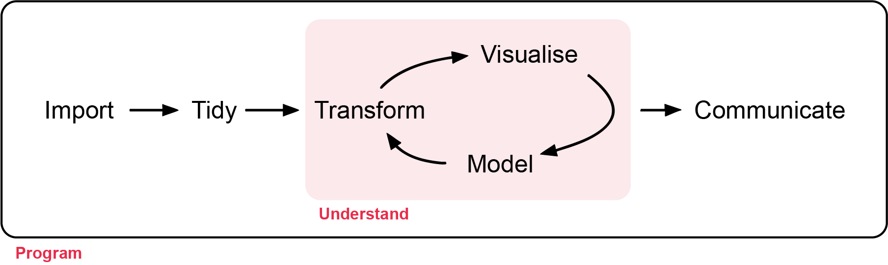

All workshop materials are provided in the GitHub repository [ECS200](https://github.com/nicholaswunz/ECS200-Workshop),
and the contents were developed by [Nicholas Wu](https://researchportal.murdoch.edu.au/esploro/profile/nicholas_wu/overview)
and [Alethea Rea](https://researchportal.murdoch.edu.au/esploro/profile/alethea_rea/overview).

# Welcome {.unnumbered}

The [ECS200 - Research Methods in Ecology](https://handbook.murdoch.edu.au/units/07/ecs200)
workshops go through the steps of a typical research project, which look something
like **Figure 1**.

First, you must **import** your data into R ([Introduction to R](R_intro.qmd)). This
usually means loading data stored in a file into a data frame in R. If you can't get
your data into R, you can't analyse it!

Once your data are imported, **check their quality** ([Week 1](week01_quality_check.qmd))
and **tidy** them ([Week 2](week02_tidy_data.qmd)). Tidying means putting the data
into a consistent format where each column is a variable and each row is an
observation. This makes analysis far easier: you can focus on answering questions
rather than reformatting data for each new task.

Next, you will often **transform** your data ([Week 2](week02_tidy_data.qmd)): for
example, keeping observations from one site, creating new variables (e.g. speed from
distance and time) or calculating summaries (e.g. counts or averages). Together,
tidying and transforming are called *wrangling*, because getting data into a usable
form can feel like a fight!

Once you have tidy, relevant data, you will use two main tools: visualisation and
modelling. They complement each other, and most analyses move back and forth between
them.

- **Visualisation** ([Weeks 3 and 4](week03_descriptive_stats.qmd)) is fundamental.
  A good plot can reveal unexpected patterns, raise new questions, or show that you
  are asking the wrong question or need better data.

- **Models** ([Weeks 5 to 13](week05_inference.qmd)) answer clearly defined
  questions. Models are mathematical, so they scale well, but they come with
  assumptions that you need to check. Each modelling workshop follows the same five
  steps:

  1. **Background**: what is the model doing? (with an interactive app)
  2. **Visualise**: plot the data as a sanity check.
  3. **Check assumptions**: is the model appropriate for these data, and what should
     you do if it is not?
  4. **Model**: fit the model in R.
  5. **Interpret**: what do the numbers mean, and how do you write them up?

The final step is **communication**. Even the best model or figure is useless unless
you can explain your findings clearly to others.

Surrounding all of these is **programming**. You will use code at every step. You
don't need to be an expert programmer, but better coding skills will help you work
faster and solve problems more easily.

## How the workshops work {.unnumbered}

Each workshop is **2 hours**. Spend about the first hour working through the page
(reading, running the code and doing the 🧪 exercises), and the second hour on the
**assessment**. Each assessment is an R script template that you download, complete
and submit before the end of class.

::: {.callout-note}
The optional workshops (time series, spatial data and movement data) are not assessed, 
but instead provide additional learning experience if you want to work with environmental,
occupancy, and movement data.
:::

## Unit learning objectives {.unnumbered}

At the end of the unit, students should be able to:

1. **Design** ecological research using appropriate sampling strategies and
   analytical methods.
2. Apply appropriate **statistical methods** to test ecological hypotheses.
3. Apply **R programming** to process, analyse and visualise ecological datasets
   to professional standards.
4. Critically **evaluate** the strengths and limitations of research designs under
   different ecological conditions.
5. **Communicate** the findings of ecological research to professional standards.

:::{.callout-important}
## Important

When using R, make sure your code works on both your personal laptop and the Murdoch
desktops. The mid-semester test will **ONLY use Murdoch desktops (no laptops
allowed)**. The R practicals and your research report can be done on your personal
laptop or on the Murdoch desktops.
:::

# Schedule {.unnumbered}

If you are not familiar with R, please work through the [Introduction to R](R_intro.qmd)
before the first workshop.

| Week | Topic | Date | Time | Room |
|:----:|:------|:----:|:----:|:----:|
| 1  | [Quality check](week01_quality_check.qmd)                          | 25-Feb | 13:30–16:30 | 450.2.001 |
| 2  | [Tidy data](week02_tidy_data.qmd)                                  | 04-Mar | 13:30–16:30 | 450.2.001 |
| 3  | [Descriptive statistics and figures](week03_descriptive_stats.qmd) | 11-Mar | 13:30–16:30 | 450.2.001 |
| 4  | [Diversity indices](week04_diversity.qmd)                          | 18-Mar | 13:30–16:30 | 450.2.001 |
| 5  | [Statistical inference: *t*-tests and ANOVA](week05_inference.qmd) | 25-Mar | 13:30–16:30 | 450.2.001 |
| 6  | **Study week**: [Optional: time series](week06_time_series.qmd)    | – | – | – |
| 7  | [Linear and multiple regression](week07_regression.qmd)            | 08-Apr | 13:30–16:30 | 450.2.001 |
| 8  | [GLMs: count data](week08_glm_counts.qmd)                          | 15-Apr | 13:30–16:30| 450.2.001 |
| 9  | **Study week**: [Optional: spatial data](week09_spatial.qmd)       | – | – | – |
| 10 | Mid-semester test. [Optional: movement data](week10_movement.qmd)  | 29-Apr | 13:30–16:30 | 450.2.001 |
| 11 | [GLMs: binary data](week11_glm_binary.qmd)                         | 06-May | 13:30–16:30 | 450.2.001 |
| 12 | [Mixed-effects models](week12_mixed_models.qmd)                    | 13-May | 13:30–16:30 | 450.2.001 |
| 13 | [Survival analysis](week13_survival.qmd)                           | 20-May | 13:30–16:30 | 450.2.001 |

The appendices cover [The Islands](the_islands.qmd) (the virtual environment for your
group project) and [Research Design](research_design.qmd), including how to choose
your sample size.

# Contact {.unnumbered}

If you spot an error in the workshop material, please let the unit coordinator know
at nicholas.wu@murdoch.edu.au.
