# Research Design {.unnumbered}

Good analysis cannot rescue a poor design. Most of the problems you will meet in
Weeks 5–13 (non-independent data, confounded treatments, too few replicates, false
zeros) are much easier to prevent when you plan a study than to fix after the data
are collected. This appendix adds to the lecture notes on research design, with a
focus on designing studies that are **easy to analyse**.

```{r}
#| label: setup
#| include: false
library(tidyverse)
```

## From question to analysis {.unnumbered}

Plan your analysis **before** you collect data. Four principles for sound
statistical ecology [@Popovic2024]:

1. **Define a focused research question**, then plan the sampling and the analysis
   to answer it.
2. **Use a model that accounts for the distribution and dependence of your data**
   (counts → Week 8, yes/no → Week 11, grouped or repeated measurements → Week 12).
3. **Emphasise effect sizes** (how big is the effect, with a confidence interval)
   rather than only whether *p* < 0.05.
4. **Report your methods and results in enough detail** that someone else could
   repeat the study and use your results [@Davis2023; @Gerstner2017].

A useful exercise: before collecting any data, **sketch the figure** you expect to
make and **write the R model formula** you plan to fit, e.g.
`lm(sprint_speed ~ temperature * population)`. If you cannot write the formula, the
design is not finished yet.

### Who or what are you making conclusions about? {.unnumbered}

The **scope of inference** is the "population" your conclusions apply to. Define it
in three dimensions before you sample:

- **Spatial**: one wetland, all wetlands on the Swan Coastal Plain, or all of south-west WA?
- **Temporal**: one breeding season, or long-term conditions? A question about a
  10-year cycle needs more than one year of data.
- **Ecological**: one species, one life stage, or a whole community?

Your sample can only represent the population you actually sampled from. Larger and
more variable populations need more samples.

### Replicate at the right scale {.unnumbered}

The most important design decision is the **experimental (or sampling) unit**: the
smallest unit to which a treatment is **independently** applied, or that is
independently sampled. Replication must happen at the same scale as the treatment
[@Marshall2024; @Hurlbert1984].

| Design | Treatment applied to | True replicate | Pseudoreplicates (subsamples) |
|:-------|:---------------------|:---------------|:------------------------------|
| Nutrients added to individual pots | Pot | Pot | Several leaves per plant |
| Water heated in a tank holding 5 snails | Tank | Tank | The 5 snails |
| Fire applied to whole plots | Plot | Plot | Quadrats within each plot |
| Comparing burnt and unburnt *sites* | Site | Site | Traps within each site |
| Comparing high and low pH *populations* | Population | Population | Individuals within a population |

Subsamples are useful (they give a better estimate for each unit), but they are not
independent replicates. Either average them for each experimental unit, or include the
unit as a random effect (Week 12).

::: {.callout-note}
## Link to your project

On [The Islands](the_islands.qmd), each plot is the experimental unit for a nutrient
treatment. Ten plants measured in one plot are not ten replicates. And if you compare
islands, you have only **one** field station per island, so island and climate are
completely confounded: any difference could be caused by climate, soil, or anything
else that differs between the islands. Say so clearly in your report.
:::

### Randomise, intersperse and block {.unnumbered}

- **Randomise** which units get which treatment, so unmeasured differences (soil,
  shade, observer) are spread evenly among treatments. Use R to do it:

```{r}
#| label: randomise

# Randomly assign 3 nutrient treatments to 36 plots (12 plots each)
set.seed(2027)  # makes the randomisation repeatable; change the number for your own design
plot_design <- data.frame(
  plot      = 1:36,
  treatment = sample(rep(c("control", "low N", "high N"), each = 12)) # shuffle the 36 labels
)
head(plot_design)
```

- **Intersperse** treatments in space and time. Putting all the controls in one row,
  or measuring all controls in the morning and all treatments in the afternoon,
  confounds the treatment with location or time.
- **Block** when there is a known gradient (e.g. slope, distance from the coast).
  Group similar units into blocks and assign every treatment within each block. Block
  then becomes a random effect (Week 12) or a fixed factor in the analysis.

### Controls and before–after designs {.unnumbered}

To measure the effect of an impact (mining, fire, restoration), you need to know
what would have happened **without** it. Simple designs often give wrong answers: an
analysis of hundreds of ecological datasets found that before–after or
control–impact designs alone can be very inaccurate, and that **before–after
control–impact (BACI)** and randomised designs were much more reliable
[@Christie2019; @Christie2020]. Where possible, collect data **before** the impact
at both impact and control sites, and use **several** control sites. Experiments built
into management actions are one of the best ways to get this evidence
[@Ockendon2021]. The *Controls* app below shows why.

### Design decisions determine the analysis {.unnumbered}

| If your design has... | ...you will need | Week |
|:----------------------|:-----------------|:----:|
| Two or more groups and a continuous response | *t*-test or ANOVA | 5 |
| A numeric predictor (gradient) | Linear regression | 7 |
| Several correlated predictors | Choose predictors carefully, check VIF | 7 |
| Counts (individuals, species, seeds) | Poisson or negative binomial GLM | 8 |
| Unequal effort among samples (trap nights, area) | An offset in a GLM: **record the effort!** | 8 |
| Yes/no responses (present, survived, bleached) | Logistic regression | 11 |
| Several measurements per individual, site or tank | Mixed-effects model | 12 |
| Time until an event, with some individuals not reaching it | Survival analysis | 13 |

## How many samples do I need? {.unnumbered}

**Statistical power** is the probability that a study will detect an effect (*p* <
0.05) if the effect is real. Studies with low power often miss real effects, and when
they do find something, they tend to overestimate it. A common target is **80%
power**.

Power depends on four things:

1. **Effect size**: the smallest difference that would matter biologically. Decide
   this from the literature or from what would matter for management, not from
   what you hope to find.
2. **Variability** (SD) of the response. Estimate it from a pilot study, previous
   studies or similar data.
3. **Sample size** (*n*).
4. **Significance level** (α, usually 0.05).

Choose three of them, and you can calculate the fourth. Use the app to see how
they trade off.

::: {.app-box .column-body-outset}
::: {.app-title}
App: statistical power and sample size (two-group comparison)
:::
```{ojs}
//| echo: false
//| output: false
import {rng, rnorm, mean, sd, cor, lm1, qt975, powerT, fmt, fmtp, red, grey, dark, blue} from "./apps/ecs200.js"
```
::: {.app-grid}
::: {.app-controls}
```{ojs}
//| echo: false
viewof pw_delta = Inputs.range([0.05, 1], {value: 0.3, step: 0.05, label: "Difference you want to detect (e.g. m/s)"})
viewof pw_sd = Inputs.range([0.05, 1], {value: 0.25, step: 0.05, label: "Standard deviation within groups"})
viewof pw_target = Inputs.range([0.5, 0.95], {value: 0.8, step: 0.05, label: "Target power"})
```
:::
::: {.app-output}
```{ojs}
//| echo: false
pw_curve = Array.from({length: 99}, (_, i) => ({n: i + 2, power: powerT(i + 2, pw_delta, pw_sd)}))
pw_need = pw_curve.find((d) => d.power >= pw_target)

html`<div>${Plot.plot({
  width: 560, height: 320, marginLeft: 45,
  x: {label: "Sample size per group (n)", domain: [0, 100]},
  y: {label: "Power", domain: [0, 1], grid: true},
  marks: [
    Plot.ruleY([pw_target], {stroke: dark, strokeDasharray: "4,3"}),
    pw_need ? Plot.ruleX([pw_need.n], {stroke: red, strokeDasharray: "4,3"}) : null,
    Plot.line(pw_curve, {x: "n", y: "power", stroke: red, strokeWidth: 3})
  ]
})}
<div class="app-verdict">Standardised effect size (difference / SD) = <b>${fmt(pw_delta / pw_sd)}</b>.
${pw_need ? `You need about <b>${pw_need.n}</b> replicates per group for ${fmt(pw_target * 100, 0)}% power.` : "Even 100 per group is not enough: reduce the variability or reconsider the effect size."}
Halving the SD (better measurements, blocking, more uniform study units) reduces the sample size you need by about four times.</div></div>`
```
:::
:::
:::

### Power analysis in R {.unnumbered}

Base R has functions for the simplest designs. Leave out the one quantity you want R
to calculate.

**Two groups (*t*-test)**: the lizard experiment in Week 5. Suppose a pilot study gave
an SD in sprint speed of 0.25 m/s, and a difference of 0.3 m/s between temperatures
would be biologically important. How many lizards per temperature?

```{r}
#| label: power-t

power.t.test(delta = 0.3, sd = 0.25, power = 0.8, sig.level = 0.05)
```

Round **up**: 12 lizards per group. And what power would you have with only 10 per group?

```{r}
#| label: power-t-n

power.t.test(n = 10, delta = 0.3, sd = 0.25, sig.level = 0.05)
```

**Three or more groups (one-way ANOVA)**: give the expected group means and the
within-group variance (SD^2^):

```{r}
#| label: power-anova

# Expected mean sprint speed at 20, 28 and 36 C, and a within-group SD of 0.25
expected_means <- c(1.2, 1.8, 1.6)

power.anova.test(groups      = 3,
                 between.var = var(expected_means),  # variance among the expected means
                 within.var  = 0.25^2,                # SD squared
                 power       = 0.8)
```

::: {.callout-tip collapse="true"}
## Going further: power by simulation (click to expand)

For GLMs, mixed models and other complex designs there is no simple formula. Instead,
**simulate** the study many times with your planned sample size and effect, analyse
each simulated dataset, and count how often the effect is significant. This is
optional, but it is a very powerful way to plan a study.

Example: will 20 plots per treatment detect a 30% increase in fruit number (from a
mean of 5 to 6.5 fruits per plant) with a Poisson GLM?

```{r}
#| label: power-sim

set.seed(1)
n_per_group <- 20       # plots per treatment
n_sims      <- 500      # number of simulated studies
p_values    <- numeric(n_sims)  # empty vector to store each study's p-value

for (i in 1:n_sims) {
  # 1. Simulate one study
  sim_data <- data.frame(treatment = rep(c("control", "fertilised"), each = n_per_group))
  sim_data$fruits <- rpois(n = 2 * n_per_group,
                           lambda = ifelse(sim_data$treatment == "control", 5, 6.5))
  # 2. Analyse it
  sim_model <- glm(fruits ~ treatment, family = poisson, data = sim_data)
  # 3. Store the p-value for the treatment effect
  p_values[i] <- summary(sim_model)$coefficients["treatmentfertilised", "Pr(>|z|)"]
}

# Power = proportion of simulated studies with p < 0.05
mean(p_values < 0.05)
```

Only about half of the simulated studies detect the effect, so 20 plots per
treatment is not enough. Increase `n_per_group` and run it again to find the sample
size that gives 80% power. Real counts are usually overdispersed (Week 8), so you
would need even more.
:::

### How much survey effort? {.unnumbered}

For surveys, "sample size" also means **effort**: how many visits, traps or quadrats.

**Detecting a species that is present.** If a species is detected with probability
*p* on a single visit when it is present, the chance of missing it on *k* visits is
(1 − *p*)^*k*^. To be 95% sure of detecting it:

$$
k = \frac{\log(1 - 0.95)}{\log(1 - p)}
$$

```{r}
#| label: visits

# Number of visits needed to be 95% sure of detecting a species that is present,
# for single-visit detection probabilities of 0.1 to 0.9
detection <- data.frame(p_detect = seq(0.1, 0.9, by = 0.1)) %>%
  dplyr::mutate(visits_needed = ceiling(log(1 - 0.95) / log(1 - p_detect)))

detection
```

A cryptic frog detected on 30% of visits needs 9 visits per site before "not
detected" reasonably means "absent". With fewer visits, many of your zeros will be
**false zeros** (see below). Occupancy designs that repeat visits only where a species
has not yet been detected can save a lot of effort for rare species [@Specht2017].

**Finding most of the species in a community.** A **species accumulation curve**
shows how many species you find as you add samples. When the curve flattens, extra
samples add few new species.

```{r}
#| label: specaccum
#| fig-width: 5.5
#| fig-height: 3.5

# Invertebrate pitfall data from Week 4: one row per trap, one column per order
invert_matrix <- readr::read_csv("data/invert_exp_survey.csv") %>%
  dplyr::select(Blattodea:Annelida)

# Expected number of orders found for 1, 2, 3... traps (random order of traps)
invert_accum <- vegan::specaccum(invert_matrix, method = "random")

accum_data <- data.frame(traps    = invert_accum$sites,
                         richness = invert_accum$richness,
                         sd       = invert_accum$sd)

ggplot2::ggplot(accum_data, ggplot2::aes(x = traps, y = richness)) +
  ggplot2::geom_ribbon(ggplot2::aes(ymin = richness - sd, ymax = richness + sd), fill = "grey85") +
  ggplot2::geom_line(linewidth = 1) +
  ggplot2::labs(x = "Number of pitfall traps", y = "Number of orders found") +
  ggplot2::theme_classic()
```

Here, about 20 traps find most of the orders, and the remaining traps add only rare
ones.

::: {.callout-note}
## Link to your project

Each Island field station has **36 plots**. More treatment levels means fewer
replicates per treatment: 2 treatments give 18 plots each, 3 give 12, 4 give 9 and 6
give 6. Use `power.t.test()` or `power.anova.test()`, with an SD from the literature or
a pilot run, to check whether your design has a reasonable chance of detecting the
effect you care about **before** you plant anything.
:::

## Zeros and NAs in R {.unnumbered}

Ecological data are messy, but R doesn't care: *rubbish in, rubbish out*. When
designing surveys, it is essential to **distinguish carefully between "0" and "NA"**
in your data sheet, because they mean completely different things.

- Record a **0** only when a site was actually sampled with adequate effort and the
  species was not detected. Sampling happened, detection was possible, and the count
  was zero. **A zero is data.**
- Record an **NA** when the site was not sampled, sampling failed, effort was
  inadequate, or the value is otherwise missing. **An NA means "we do not know".**

Mixing them up causes real problems:

- Coding a missing value as **0** claims a confirmed absence. This biases occupancy
  or abundance estimates downwards, adds extra zeros and can lead you to fit the wrong
  model (e.g. a zero-inflated model when the real problem is missing data). If your pH
  meter broke, the pH of those samples is unknown, not 0.
- Coding a true zero as **NA** means R drops that observation from many analyses
  (e.g. `tidyr::drop_na()`), reducing your sample size and biasing results.

Zeros can arise in different ways [@Blasco2019]. In the example below (herbivorous 
insect species on a plant species), zeros caused by an inexperienced observer 
(**a–b**) or by a poor design (**c–h**) are **false zeros**, which should be 
minimised through good design. **Structural zeros**, caused by the biology of the 
system (**i–k**), and **random zeros** from sampling variation (**l**) are 
**true zeros**.

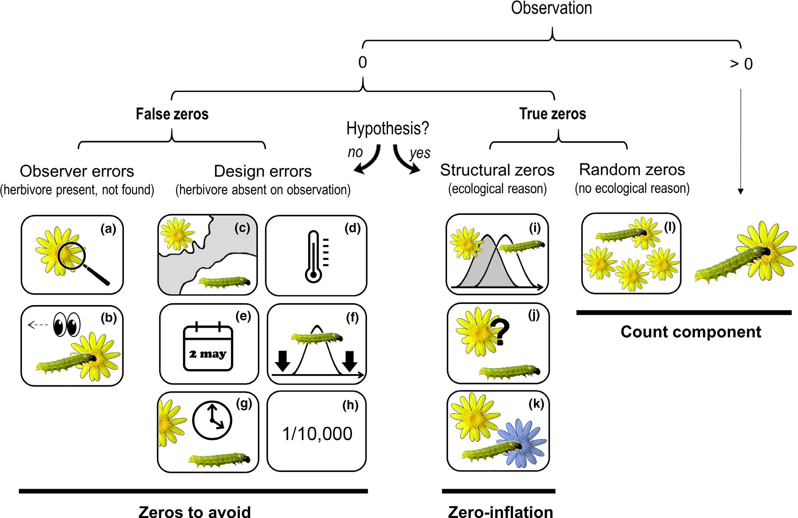{width=100%}

The scenarios that produce a zero, and how to minimise false zeros:

|       | Scenario | Type | How to reduce it |
|:-----:|:---------|:----:|:-----------------|
| 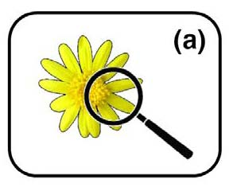 | The insects or their damage are too small for the observer to detect | False | Sample when insects are well developed |
| 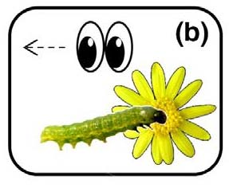 | The observer misses the herbivore (e.g. mistakes it for a seed) or attributes damage to another cause | False | Train observers |
| 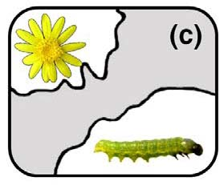 | The distributions of the herbivore and the plant do not overlap | False | Know the species' distributions before sampling |
| 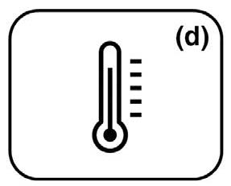 | The herbivore is absent from a location within its range (e.g. unsuitable microclimate) | False | Sample suitable habitats, or replicate surveys across areas |
| 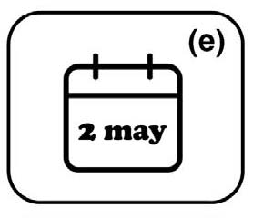 | A single survey does not coincide with the herbivore's life cycle | False | Know the life cycle, or survey repeatedly |
| 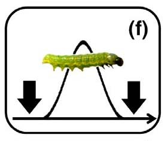 | A long-term survey samples too infrequently to catch the herbivore | False | Sample more often |
| 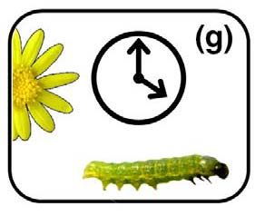 | Herbivores are absent at the time of sampling | False | Record plant damage instead of insects |
| 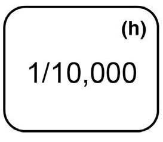 | Herbivores are so rare that the design cannot detect them | False | Sample more extensively, with more replicates |
| 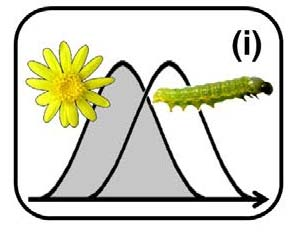 | Plant and herbivore phenologies do not overlap | True (structural) | – |
| 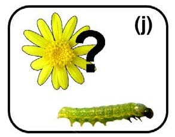 | Herbivores do not recognise the plant as a host | True (structural) | – |
| 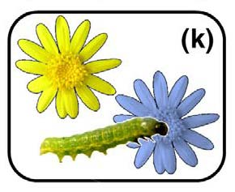 | Herbivores prefer another host species | True (structural) | – |
| 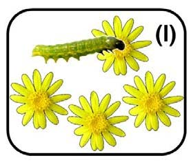 | The herbivore population is too small to use all the plants | True (random) | – |

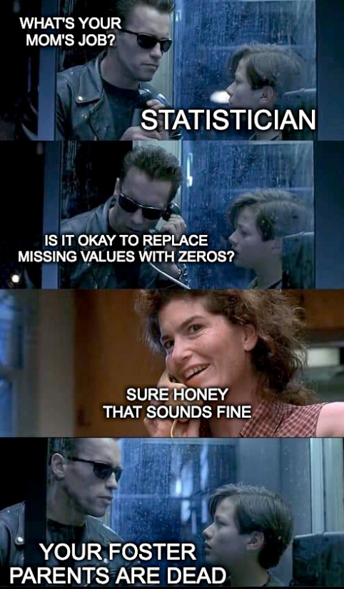{width=60%}

## Common statistical mistakes {.unnumbered}

Most mistakes in published research are not failures of advanced mathematics. They
are everyday errors of design and interpretation that are easy to make and easy to
miss [@Makin2019]. Each tab below has an app: move the sliders, press *Resample* and
watch how the conclusion can change, often dramatically, from nothing more than
chance, sample size or a decision made by the researcher. The apps were inspired by
[BIOL 3P96 Biostatistics](https://gtatters.github.io/CommonStatisticalMistakes/).

::: {.panel-tabset .nav-pills}

### Controls {.unnumbered}

> Mistaking a change over time for a real treatment effect.

Does mining increase feral cat activity (e.g. because of more human activity)? A
before–after, control–impact (BACI) design compares four groups:

- **Control before**: the reference (unmined) site before mining started.
- **Control after**: the reference site after mining started elsewhere.
- **Impact before**: the mine site before mining.
- **Impact after**: the mine site after mining.

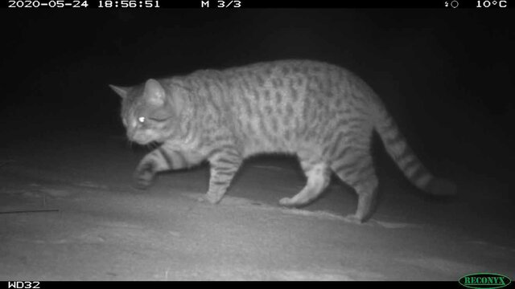{width=90%}

Cat activity can change over time for reasons that have nothing to do with mining
(e.g. season or rainfall). Only the control site tells you how big that background
change is.

::: {.app-box}
::: {.app-grid}
::: {.app-controls}
```{ojs}
//| echo: false
viewof bc_eff = Inputs.range([0, 4], {value: 1, step: 0.25, label: "True effect of mining on cat activity"})
viewof bc_drift = Inputs.range([0, 4], {value: 1.5, step: 0.25, label: "Change over time at all sites (e.g. season)"})
viewof bc_n = Inputs.range([5, 50], {value: 20, step: 1, label: "Number of cameras per site"})
viewof bc_seed = Inputs.button("Resample")
```
:::
::: {.app-output}
```{ojs}
//| echo: false
bc = {
  const r = rng(101 + bc_seed);
  const ctrlPre = rnorm(r, bc_n, 10, 2);
  const ctrlPost = ctrlPre.map((v) => v + bc_drift + rnorm(r, 1, 0, 2)[0]);
  const trtPre = rnorm(r, bc_n, 10, 2);
  const trtPost = trtPre.map((v) => v + bc_drift + bc_eff + rnorm(r, 1, 0, 2)[0]);
  const groups = [[ctrlPre, 1, "control"], [ctrlPost, 2, "control"], [trtPre, 4, "impact"], [trtPost, 5, "impact"]];
  const pts = groups.flatMap(([g, x, s]) => g.map((v) => ({x: x + (r() - 0.5) * 0.3, y: v})));
  const ms = groups.map(([g, x, s]) => {
    const m = mean(g), h = qt975(g.length - 1) * sd(g) / Math.sqrt(g.length);
    return {x, m, lo: m - h, hi: m + h, site: s};
  });
  const apparent = ms[3].m - ms[2].m, control = ms[1].m - ms[0].m;
  return {pts, ms, apparent, control, real: apparent - control};
}

html`<div>${Plot.plot({
  width: 560, height: 320, marginLeft: 45,
  x: {domain: [0.4, 5.6], ticks: [1, 2, 4, 5], tickFormat: (d) => ({1: "Control before", 2: "Control after", 4: "Impact before", 5: "Impact after"})[d], label: null},
  y: {label: "Cat activity (detections)", grid: true},
  color: {domain: ["control", "impact"], range: [grey, red]},
  marks: [
    Plot.dot(bc.pts, {x: "x", y: "y", fill: "#d6d6d6", r: 2.5}),
    Plot.line(bc.ms, {x: "x", y: "m", z: "site", stroke: "site", strokeWidth: 2}),
    Plot.ruleX(bc.ms, {x: "x", y1: "lo", y2: "hi", stroke: "site", strokeWidth: 3}),
    Plot.dot(bc.ms, {x: "x", y: "m", fill: "site", r: 6})
  ]
})}
<div class="app-verdict">At the mine site alone, cat activity increased by <b>${fmt(bc.apparent)}</b>. But the control site changed by <b>${fmt(bc.control)}</b> without any mining.
The estimated effect of mining is the difference: <b>${fmt(bc.real)}</b>. Without a control site, the whole increase would have been blamed on mining.</div></div>`
```
:::
:::
:::

### Fake correlation {.unnumbered}

> How a single outlier, or two groups pooled together, can create a correlation.

A correlation can look real but be created by **one extreme point** (e.g. a data
entry error, Week 1) or by **two groups pooled together**.

For example, you might study how body mass affects home range size. Without
recording sex, `lm(home_range ~ mass)` shows a positive relationship. But if the
species is sexually dimorphic (males are bigger) and males have larger home ranges
for other reasons, the relationship within each sex may be flat. Accounting for sex,
`lm(home_range ~ mass + sex)`, reveals this.

::: {.app-box}
::: {.app-grid}
::: {.app-controls}
```{ojs}
//| echo: false
viewof fc_type = Inputs.radio(new Map([["A single outlier", "outlier"], ["Two groups pooled together", "groups"]]), {value: "outlier", label: "Cause"})
viewof fc_size = Inputs.range([0, 8], {value: 4, step: 0.5, label: "Distance of the outlier / separation of the groups"})
viewof fc_seed = Inputs.button("Resample")
```
:::
::: {.app-output}
```{ojs}
//| echo: false
fc = {
  const r = rng(40 + fc_seed);
  const X = rnorm(r, 20), Y = rnorm(r, 20);
  let pts;
  if (fc_type === "outlier") {
    pts = X.map((v, i) => ({x: v, y: Y[i], g: "data"}));
    pts.push({x: fc_size, y: fc_size, g: "special"});
  } else {
    pts = X.map((v, i) => {
      const shift = i < 10 ? 0 : fc_size * 0.75;
      return {x: v + shift, y: Y[i] + shift, g: i < 10 ? "data" : "special"};
    });
  }
  const xs = pts.map((d) => d.x), ys = pts.map((d) => d.y);
  const fit = lm1(xs, ys);
  // bootstrap 95% CI for r
  const boots = [];
  for (let b = 0; b < 500; b++) {
    const idx = Array.from({length: xs.length}, () => Math.floor(r() * xs.length));
    const rb = cor(idx.map((i) => xs[i]), idx.map((i) => ys[i]));
    if (Number.isFinite(rb)) boots.push(rb);
  }
  boots.sort((a, b) => a - b);
  const xr = [Math.min(...xs) - 0.5, Math.max(...xs) + 0.5];
  return {pts, r: cor(xs, ys), lo: boots[Math.floor(0.025 * boots.length)], hi: boots[Math.floor(0.975 * boots.length)],
          line: xr.map((x) => ({x, y: fit.b0 + fit.b1 * x}))};
}

html`<div>${Plot.plot({
  width: 560, height: 290, marginLeft: 45,
  x: {label: fc_type === "groups" ? "Body mass (standardised)" : "X"},
  y: {label: fc_type === "groups" ? "Home range (standardised)" : "Y", grid: true},
  color: {domain: ["data", "special"], range: [grey, red]},
  marks: [
    Plot.line(fc.line, {x: "x", y: "y", stroke: dark, strokeDasharray: "6,4", strokeWidth: 2}),
    Plot.dot(fc.pts, {x: "x", y: "y", fill: "g", r: 5})
  ]
})}
<div class="app-verdict">Pearson's <i>r</i> = <b>${fmt(fc.r)}</b> (bootstrap 95% CI ${fmt(fc.lo)} to ${fmt(fc.hi)}).
${fc_type === "outlier"
  ? "The grey points are unrelated random numbers. As the single red point moves away, the correlation increases, although nothing about the relationship between the other points has changed. Always plot your data."
  : "Within each group (grey = females, red = males) there is no relationship. Pooling two groups that differ in both variables creates a correlation. Include the grouping variable in the model."}</div></div>`
```
:::
:::
:::

### Confounders {.unnumbered}

> A shared cause can create a relationship.

A correlation between two variables does not mean one causes the other. Both may be
driven by a third, often unmeasured, variable: a **confounder**. Once you account for
it, the apparent link can disappear.

- **Chocolate and Nobel prizes**: across countries, chocolate consumption is correlated
  with the number of Nobel laureates. Chocolate does not make scientists. Wealthier
  countries simply have more chocolate *and* more research funding.
- **Speed and predation**: you track animals with GPS and find that faster animals are
  less likely to be killed by predators (`lm(risk ~ speed)`). But larger animals are
  both faster *and* better at defending themselves. After accounting for body mass
  (`lm(risk ~ speed + mass)`), the link between speed and risk disappears. Body mass
  is the confounder.

::: {.app-box}
::: {.app-grid}
::: {.app-controls}
```{ojs}
//| echo: false
viewof cf_ex = Inputs.radio(new Map([["Chocolate and Nobel prizes", "choc"], ["Speed and predation risk", "pred"]]), {value: "pred", label: "Example"})
viewof cf_str = Inputs.range([0, 0.95], {value: 0.7, step: 0.05, label: "Strength of the confounder"})
viewof cf_adj = Inputs.toggle({label: "Account for the confounder", value: false})
```
:::
::: {.app-output}
```{ojs}
//| echo: false
cf = {
  const r = rng(1010);
  const n = 60, s = cf_str;
  const Z = rnorm(r, n);
  const e1 = rnorm(r, n), e2 = rnorm(r, n);
  const X = Z.map((z, i) => s * z + Math.sqrt(1 - s * s) * e1[i]);
  const sign = cf_ex === "pred" ? -1 : 1;
  const Y = Z.map((z, i) => sign * s * z + Math.sqrt(1 - s * s) * e2[i]);
  const rx = lm1(Z, X).resid, ry = lm1(Z, Y).resid;
  const xs = cf_adj ? rx : X, ys = cf_adj ? ry : Y;
  const fit = lm1(xs, ys);
  const xr = [Math.min(...xs), Math.max(...xs)];
  return {pts: xs.map((x, i) => ({x, y: ys[i]})), r: cor(xs, ys), line: xr.map((x) => ({x, y: fit.b0 + fit.b1 * x}))};
}

cf_labels = cf_ex === "choc"
  ? {x: "Chocolate consumption", y: "Nobel laureates per capita", z: "national wealth"}
  : {x: "Movement speed", y: "Predation risk", z: "body mass"}

html`<div>${Plot.plot({
  width: 560, height: 290, marginLeft: 45,
  x: {label: cf_labels.x + (cf_adj ? ` (after removing ${cf_labels.z})` : "")},
  y: {label: cf_labels.y + (cf_adj ? " (adjusted)" : ""), grid: true},
  marks: [
    Plot.line(cf.line, {x: "x", y: "y", stroke: dark, strokeDasharray: "6,4", strokeWidth: 2}),
    Plot.dot(cf.pts, {x: "x", y: "y", fill: cf_adj ? red : grey, r: 4})
  ]
})}
<div class="app-verdict">Correlation <i>r</i> = <b>${fmt(cf.r)}</b>.
${cf_adj
  ? `After accounting for ${cf_labels.z}, the correlation is close to zero: the apparent link was entirely caused by ${cf_labels.z} driving both variables.`
  : `In these simulated data, ${cf_labels.x.toLowerCase()} has <b>no</b> effect on ${cf_labels.y.toLowerCase()}. Both are driven by ${cf_labels.z}. Tick the box to account for it.`}</div></div>`
```
:::
:::
:::

### Non-significant results {.unnumbered}

> Absence of evidence is not evidence of absence.

A non-significant *p*-value cannot tell the difference between "there is no effect"
and "the study was not sensitive enough to detect the effect" (too few independent
replicates, too much noise, a poor design). A real effect studied with small samples
gives a wide confidence interval that includes zero.

The app simulates five studies of the same real effect with different sample sizes.
**Report the effect size and its confidence interval, not just the *p*-value**, and
plan your sample size in advance (see above).

::: {.app-box}
::: {.app-grid}
::: {.app-controls}
```{ojs}
//| echo: false
viewof ns_eff = Inputs.range([0, 1], {value: 0.4, step: 0.05, label: "True effect size"})
viewof ns_seed = Inputs.button("Resample")
```
:::
::: {.app-output}
```{ojs}
//| echo: false
ns = {
  const r = rng(909 + ns_seed);
  const pool = rnorm(r, 100, ns_eff, 1);
  return [5, 10, 20, 50, 100].map((n, i) => {
    const x = pool.slice(0, n), m = mean(x), h = qt975(n - 1) * sd(x) / Math.sqrt(n);
    return {study: `n = ${n}`, m, lo: m - h, hi: m + h, sig: m - h > 0 || m + h < 0 ? "significant" : "not significant"};
  });
}

html`<div>${Plot.plot({
  width: 560, height: 250, marginLeft: 70,
  x: {label: "Estimated effect (95% CI)", grid: true},
  y: {domain: ["n = 5", "n = 10", "n = 20", "n = 50", "n = 100"], label: null},
  color: {domain: ["significant", "not significant"], range: [grey, red], legend: true},
  marks: [
    Plot.ruleX([0], {stroke: dark}),
    Plot.ruleX([ns_eff], {stroke: blue, strokeDasharray: "5,4", strokeWidth: 2}),
    Plot.link(ns, {x1: "lo", x2: "hi", y1: "study", y2: "study", stroke: "sig", strokeWidth: 3}),
    Plot.dot(ns, {x: "m", y: "study", fill: "sig", r: 6})
  ]
})}
<div class="app-verdict">${ns_eff === 0
  ? "The true effect is zero here. Even so, the small studies cannot prove it: their intervals are wide. A non-significant result from a small study is uninformative, not proof of no effect."
  : `The true effect is <b>${ns_eff}</b> (blue dashed line), so it really exists. Small studies give wide intervals that often include zero (red, "not significant"). The effect did not disappear: those studies were just too small to detect it.`}</div></div>`
```
:::
:::
:::

:::

## Recording and reporting {.unnumbered}

- **Design your data sheet for analysis**: one row per observation, one column per
  variable (Week 1), with a unique ID for every sampling unit and columns for the
  grouping structure (site, plot, individual, block) and effort (trap nights, area,
  minutes).
- **Keep a metadata file** that explains every column, its units, and how NAs and
  zeros were recorded.
- **Write methods that someone else could repeat**: the sampling unit, sample sizes,
  the model (response, predictors, distribution, random effects), how assumptions were
  checked, and the software and packages used [@Davis2023; @Rowe2023].
- **Report results that others can reuse**: means, SDs and sample sizes for each
  group, effect sizes with confidence intervals and exact *p*-values, even for
  non-significant results. This lets your study be included in future meta-analyses
  [@Gerstner2017].

## Additional resources {.unnumbered}

- @Marshall2024 *Principles of experimental design for ecology and evolution*: a short,
  clear guide to choosing the right scale of replication.
- @Popovic2024 *Four principles for improved statistical ecology*.
- @Steel2013 *Applied statistics in ecology: common pitfalls and simple solutions*, and
  @Steel2019 on thinking statistically rather than just calculating.
- @Christie2019: why BACI and randomised designs give more accurate answers.
- @Ockendon2021: how to build experiments into conservation management.
- @Blasco2019: understanding false, random and structural zeros.
- @Makin2019: ten common statistical mistakes to watch out for.
- Quinn & Keough [-@Quinn2002], chapter 7 (design and power analysis).
- Coding Club: [Intro to model design](https://ourcodingclub.github.io/tutorials/model-design/).
