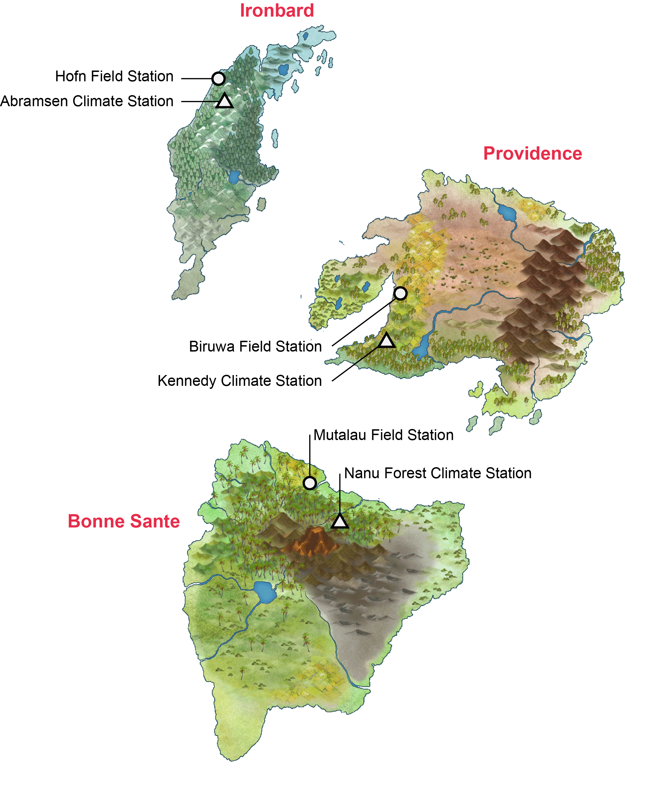
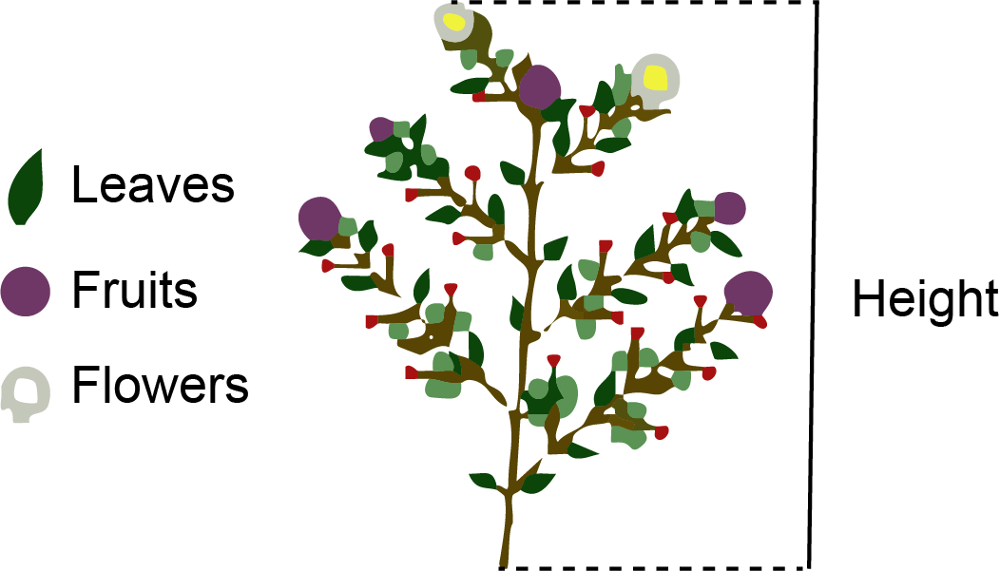

# The Islands {.unnumbered}

The Island is a virtual environment where the original intention was for students 
to collect data for addressing questions in epidemiology. However, the Island 
has since been updated to include field stations that allow for plant growth. 
The plants can represent any plant species, either an agriculturally significant 
plant, an indigenous significant plant, a species of conservation concern, or a 
pest species. **You will decide on what plant it is and how it is related to your topic**.

**Note**, the plants grow in real time, and typically take at least 14 days to 
fully grow, depending on the local climate.

Access 'The Island' from [myMurdoch Learning](https://moodleprod.murdoch.edu.au/course/view.php?id=28681) 
under the 'Group Project' tab

{width=85%}

There are three islands in this world, all occupied by human settlers with a plant field and weather station (**Fig. 1**):

1. **Ironbard**: Ironbard is the most northern island and has a temperate climate (equivalent to Tasmania’s climate). 
The plant field station in Ironbard is called **Hofn Field Station**. 
The local weather station is called **Abramsen Climate Station**.

2. **Providance**: Providance is the island located on the east and has a semi-arid climate (equivalent to Perth’s climate). 
The plant field station in Providance is called **Biruwa Field Station**. 
The local weather station is called **Kennedy Climate Station**.

3. **Bonne Sante**: Bonne Sante is the most southern island and has a subtropical climate (equivalent to Brisbane’s climate). 
The plant field station in Bonne Sante is called **Mutalau Field Station**. 
The local weather station is called **Nanu Forest Climate Station**.

Altogether, there are three field stations from three islands with differing climates. 
Each station has **36 plots**.

## Design your project

First, you are designing your experiment as if it was a real experiment. So chose 
a plant species of your choice to tell your story. 

Next, you can manipulate Nitrogen (N) and Phosphorus (P) levels in the soil prior 
to growing the plants. The level of N and P are represented by 'blocks'. Two blocks 
are the default settling, so we would consider this normal level of N and P 
(**Fig. 2**). No blocks means no N or P, four blocks means twice the concentration 
of normal levels, and five blocks is the maximum allowed (represents 2.5 times 
normal levels). Give the blocks some values (e.g. milligram nitrogen per kilogram 
of soil; mg/kg). **Use realistic values based on the literature** and what is 
considered normal for the plant of interest.

{width=45%}

Because there are three stations that span across different climates, you can 
compare the effect of temperature or rainfall on plant growth, fruit production etc. 
All stations provide the date, maximum temperature in degrees Celsius and rainfall 
in millimetres (**Table 1**). You can use this data to correlate with your 
dependent variables. You have the option to look at the interaction of N or P 
with temperature or rainfall (factorial design).

| Date   | Max Temp (°C) | Rainfall (mm) |
|:------:|:-------------:|:-------------:|
| 01/064 | 18.8          | 1.0           |
| 02/064 | 23.7          | 0.8           |
| 03/064 | 25.3          | 0.8           |
| 04/064 | 29.3          | 0.0           |
| 05/064 | 29.7          | 14.1          |

: **Table 1**: Example table output from the Kennedy Climate Station on 
Providence Island. Date is based on the simulation and presented by day, 
Max Temp is the maximum temperature (°C) recorded on the day, and Rainfall is 
the cumulative rainfall of the day (mm).

For the 36 plots per site, it means you can have 18 replicate plots/treatment 
if you have **two treatments**, 12 replicate plots/treatment if you have 
**three treatments**, 9 replicate plots/treatment if you have **four treatments**, 
and 6 replicate plots/treatment if you have **five treatments**. Balance between 
number of treatments and number of replicates. The [Research Design](research_design.qmd#how-many-samples-do-i-need) 
appendix shows how to check whether your design has enough replicates (power analysis).

### Randomisation

Take note that the 36 plots are laid out with potential spatial autocorrelation 
to replicate real landscapes. Meaning neighboring plots will have similar soil 
composition than distant plots.

This can be a problem if you don't randomise because if you put all your control 
treatments on the top row, it is impossible  to know whether differences across 
are due to the actual treatment effects or due to spatial autocorrelation. 
This is why randomisation is important in research designs. See the second lecture 
slides, and the [Research Design](research_design.qmd#randomise-intersperse-and-block) 
appendix for R code to randomise your design.

## What you can measure?

Your plant will look like this (**Fig. 3**). 

{width=60%}

The green parts represent leaves, the purple circles represent fruits, and the 
white circles represent flowers. You can measure the following as response 
dependent variables:

**1. Height**: You can use a ruler to measure height on your screen.

**2. Growth rate**: If you measure height over time, you can calculate absolute 
growth rate (AGR) as:

$$
\text{AGR}=\frac{H_{2}-H_{1}}{t_{2}-t_{1}}
$$
where $H_{1}$ is the initial measured height at time $t_{1}$, and $H_{2}$ is the 
final or next measured height at time $t_{2}$. Note, make sure your screen is the 
same size to ensure consistency in your measurements over time.

**3. Number of leaves**: Count the number of green parts at specific time point.

**4. Number of fruits**: Count the number of purple circles at specific time 
point.

**5. Number of flowers**: Count the number of white spots at specific time point.

**6. Branches**: Count the number of diverging branches from the main stem at 
specific time point.

**7. Time to first flowering**: The time difference from the start of the 
experiment to the first observed flower in the experimental plot.

**8. Time to first fruit**: The time difference from the start of the experiment 
to the first observed fruit in the experimental plot.

**9. Yield**: Once harvested, you will get a number in the “Harvest” tab 
(**Table 2**). The data table will include Date of harvest, the row and column 
of the plot, and the yield or biomass (g). Once harvested, the plant doesn’t 
grow again (ONE time, destructive). So, be careful on when you plan to harvest 
the plant.

| Date   | Row | Column | Yield |
|:------:|:---:|:------:|:-----:|
| 01/064 | 1   | 1      | 320   |
| 02/064 | 1   | 2      | 269   |
| 03/064 | 1   | 3      | 327   |
| 04/064 | 1   | 4      | 390   |
| 05/064 | 1   | 5      | 307   |

: **Table 2**: Example yield table output from Hofn Field Station on Ironbard. 
Date is based on the simulation and presented by day, Row and Column are the 
positon of the plant in the field grid, and Yield is total biomass value (g).

I have no idea what the **red circles** are. You can count them and assign a name to them if you like (e.g. berries, fungal pathogen).

## Which analysis suits which measurement? {.unnumbered}

Think about how you will analyse each response **before** you start your experiment.

| Response | Type of data | Workshop |
|:---------|:-------------|:---------|
| Height, growth rate, yield (biomass) | Continuous | *t*-test / ANOVA (Week 5), regression (Week 7) |
| Number of leaves, flowers, fruits or branches | Counts | GLM for counts (Week 8) |
| Flowered or not, fruited or not | Binary (yes/no) | Logistic regression (Week 11) |
| Height measured repeatedly on the same plots | Repeated measures | Mixed-effects model (Week 12) |
| Time to first flowering or fruiting | Time-to-event (plots that never flowered are censored) | Survival analysis (Week 13) |
