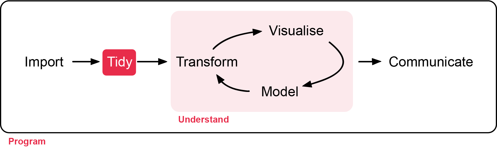
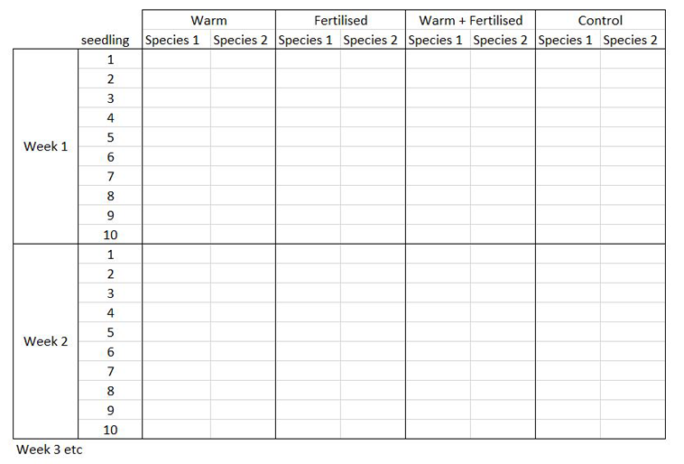
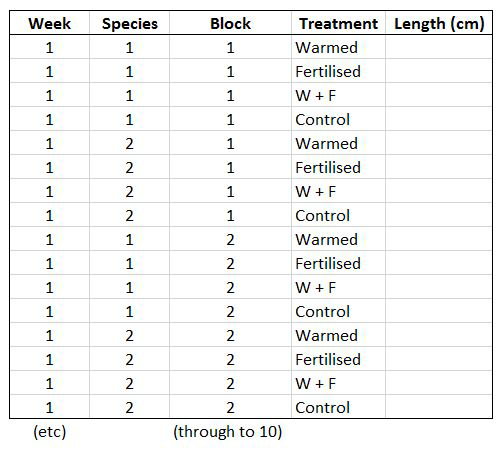
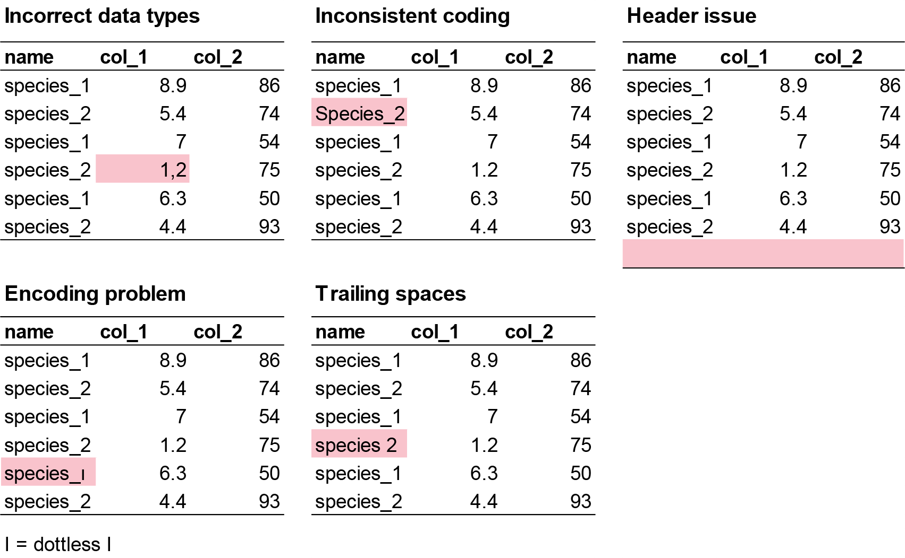
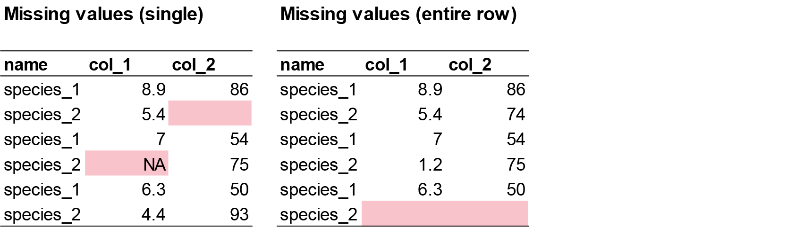

# Quality Check

**Week 1**: Quality checks and data exploration

In this workshop you will learn how to check the quality of raw data after you
import it into R, and how to fix common errors. Workshop materials are available
in the GitHub repository [ECS200](https://github.com/nicholaswunz/ECS200-Workshop).

> All statistical techniques have in common the problem of '*rubbish in, rubbish out*'.



::: {.callout-tip}
## Learning outcomes

By the end of this workshop you should be able to:

1. Check that each column of a dataset has been imported as the right type.
2. Find and deal with missing values, duplicates and inconsistent labels.
3. Use plots to find outliers and decide whether they are errors.
4. Save a cleaned dataset for later analysis.
:::

## Background {.unnumbered}

How do we know the data are ready for analysis? Before any analysis, check the raw
data for the following:

- **Data structure and types**: is each column the type you expect (number,
  category, text, date)? Use `str()` or `dplyr::glimpse()`.
- **Missing values**: where are they, and how many? Use `colSums(is.na())` or
  `visdat::vis_miss()`.
- **Duplicates**: are any rows accidentally entered twice?
- **Categorical variables**: are categories spelt consistently (e.g. "Male",
  "male" and "M" are three different categories to R)?
- **Outliers or impossible values**: negative lengths, a 50 kg frog, a date in the
  future.
- **Column names**: meaningful, with no spaces or special characters.
- **Extra rows or columns**: notes, totals or empty columns copied from a
  spreadsheet.

These checks make sure your data are reliable and suitable for analysis, and they
make you a trustworthy researcher.

## The tidyverse {.unnumbered}

In this unit we use the `tidyverse` style of coding. The tidyverse is a collection
of R packages for importing, cleaning, transforming and plotting data that share the
same grammar, so once you learn one package the others feel familiar. It is widely
used in ecology because ecological data are often large and messy, collected across
space and time, and have replicates nested within sites.

::: {.panel-tabset .nav-pills}

### Pipes {.unnumbered}

The pipe operator `%>%` passes the result of one step into the next step. Read it
as "**and then**".

```{r}
#| label: pipes
#| eval: false

data %>%     # start with your data, and then...
  step_1() %>%  # do the first thing, and then...
  step_2()      # do the second thing

# Without pipes you read from the inside out
mean(log(c(1, 10, 100)))

# With pipes you read from top to bottom
c(1, 10, 100) %>%
  log() %>%
  mean()
```

Pipes make ecological workflows easier to read, because analyses usually involve
several steps: import data, filter sites, remove missing values, calculate
summaries, plot results.

::: {.callout-note}
You may also see the "native" pipe `|>`. It does the same job. We use `%>%` in this
unit because you will see it in most online help.
:::

### Tidy data {.unnumbered}

The tidyverse works best when the data look like this:

{width=100%}

- Each **row** is one observation.
- Each **column** is one variable.
- Each **cell** is one value.

The way you record data in the field is often different from the way R needs it.
For example, if you measured seedling height in a factorial experiment with warming
and fertiliser treatments, your field sheet might look like this:

{width=100%}

**You know how your experiment is set up, but R doesn't!** With eight measurements
per row (all treatments and species for one block), R cannot tell which column is
which treatment. In tidy format, each measurement gets its own row and each
treatment gets its own column:

{width=70%}

This is called **long format**. Now R can split the data by treatment, species or
block. You will learn how to convert between formats in Week 2.

```{r}
#| label: example-data

# A small example of tidy data made with the data.frame() function
example_data <- data.frame(
  site        = c("A", "A", "B", "B"),
  species     = c("Skink", "Agamid", "Skink", "Frog"),
  temperature = c(28, 31, 26, 22),
  abundance   = c(5, 2, 8, 4)
)

example_data
```

:::

# Before we start {.unnumbered}

Create a new R script (**File > New File > R Script**). At the top, write the name of
the workshop, your name, student number and the date. Do this every time you start
a new script.

```{r}
#| label: header

# Week 1 workshop - Data quality check
# Written by Nicholas Wu, 1234578, 25/02/2027
```

Download the data and save it in the `data` folder inside your workshop folder.

[<i class="bi bi-download"></i> plant_calcium.csv](data/plant_calcium.csv){.btn .btn-outline-danger .btn-sm .download-btn download="plant_calcium.csv"}

### Exercise (5 min) {.unnumbered}

🧪 **Set up your workflow**

Load the `tidyverse` package and the `visdat` package (for visualising missing
data), set your working directory, and import `plant_calcium.csv` with
`readr::read_csv()`. Call the imported object `plant_calcium_data`.

Details on installing and loading packages, setting your working directory and
importing a CSV file are in the [Introduction to R](R_intro.qmd).

<details>
<summary><strong>Show answer</strong></summary>

```{r}
#| label: setup

# Install packages (only once, in the console)
# install.packages("visdat")

# Load packages
library(tidyverse)
library(visdat)

# Set your working directory to your workshop folder
# setwd("C:/Users/YOUR-NAME/Documents/ECS200")

# Import the CSV file from the data folder
plant_calcium_data <- readr::read_csv("data/plant_calcium.csv")
```

</details>

The dataset contains sugar maple seedlings from a calcium-treated watershed (`W1`)
and an untreated `Reference` watershed at Hubbard Brook, USA. You will learn more
about the study in Week 2.

# Step 1: Data quality check {.unnumbered}

## 1.1. Initial check {.unnumbered}

First, check that every variable was imported as the right type. Common problems
include:

- **Incorrect data types**: a numeric column is read as text (`chr`) because it
  contains a symbol, a word, a comma instead of a decimal point, or an empty string.
- **Inconsistent coding**: one category spelt several ways ("Male", "male", "M"),
  which R treats as different categories.
- **Header issues**: a missing header row, or extra rows of notes at the top or
  bottom of the file.
- **Encoding problems**: special characters (e.g. °, µ, accents) that display
  incorrectly.
- **Trailing spaces**: "site A " and "site A" are different to R.

{width=100%}

```{r}
#| label: structure

# Check the structure of your data (two ways to do the same thing)
str(plant_calcium_data)
dplyr::glimpse(plant_calcium_data)

# Summary of every variable (min, max, mean, number of NAs...)
summary(plant_calcium_data)
```

For small datasets like the ones in this workshop, it is often easiest to fix
mistakes in Excel and import the CSV again. Fixing them in R is better practice,
though, because the code records exactly what you changed. For example, suppose you
have three sites (A, B and C) but one was mislabelled "E". `dplyr::if_else()`
replaces values that match a condition:

```{r}
#| label: fix-label

# Example data with sites A, B and C, but one site was mislabelled as E
fake_data <- data.frame(
  site      = c("A", "A", "A", "B", "E", "B", "C", "C", "C"),
  species_1 = c(3, 7, 5, 2, 9, 4, 6, 1, 8)
)

fake_data %>%
  dplyr::mutate(site = dplyr::if_else(site == "E", "B", site)) # if site is "E" make it "B", otherwise keep it
```

If a number was typed as a word (e.g. "nine" instead of 9), the whole column is read
as text. Fix the value, then convert the column to numeric with `as.numeric()`:

```{r}
#| label: fix-number

# Example data where one count was typed as a word
fake_data <- data.frame(
  site      = c("A", "A", "A", "B", "B", "B", "C", "C", "C"),
  species_1 = c(3, 7, 5, 2, "nine", 4, 6, 1, 8)
)

# Replace "nine" with "9", then change species_1 from text to numbers
fake_clean_data <- fake_data %>%
  dplyr::mutate(species_1 = dplyr::if_else(species_1 == "nine", "9", species_1),
                species_1 = as.numeric(species_1))

# Check that species_1 is now numeric (<dbl>)
dplyr::glimpse(fake_clean_data)
```

### Exercise (5 min) {.unnumbered}

🧪 **Find the three problems in this dataset**

```{r}
#| label: ex-fake

fake_data <- data.frame(
  site = c("A", "B", "C", "A", "B", "A", "B", "C", "a", "B", "A", "B", "A", "B", "C", "C",
           "B", "A", "A", "C", "B", "C", "C", "A", "A", "A", "A", "B", "C", "C", "C"),
  species_1 = c(7, 25, 30, 50, 38, 13, 5, 31, 34, 22, 41, 25, 22, 37, 39, 13,
                45, 10, 40, 7, 28, 36, 19, 2, 12, 5, 16, 38, 27, 44, 44),
  species_2 = c(9.3, 8.6, 0.8, 7.5, 9, 9.1, 4.3, 8.6, 0.1, 7.8, 1.2, 6.2, 0.4, 0.4, 7.4, 1.9,
                8.3, 7.8, 2.9, 9.3, 9.1, 2.3, 6.3, 8.5, 6.5, 6.6, "1,7", 1.8, 8.4, 4.7, 4.7),
  species_3 = c(190, 160, 70, 430, 310, 99, 530, 420, 371, 357, 198, 171, 463, 124, 254, 484,
                435, 409, 122, 305, 410, 162, 473, 200, 401, 273, 421, 419, 293, 487, 487),
  species_4 = c(2, 0, 4, 8, 6.7, 3, 7.2, 4.3, 2, NA, 10, 10, 6, 4, 8, 1.7,
                1, 0, NA, 4, 6, 8.2, 10, 6, 2, 5, 10, 7, NA, NA, NA)
)
```

<details>
<summary><strong>Show answer</strong></summary>

1. `site` has an inconsistent label: "a" should be "A". (`site` should also be
   converted to a factor before analysis.)
2. `species_2` was read as text (`chr`) because one value was typed as "1,7"
   instead of 1.7.
3. `species_4` has 5 missing values (`NA`).

</details>

## 1.2. Identify missing values {.unnumbered}

Missing data can appear as blank cells, "NA", ".", "-" or other placeholders. If
they are not handled properly, they cause errors or misleading results.

{width=100%}

```{r}
#| label: missing

# Count the missing values in each column
colSums(is.na(plant_calcium_data))
```

`visdat::vis_dat()` shows the whole data frame at once, coloured by the type of each
column, with missing values in grey. `visdat::vis_miss()` shows only whether values
are missing, and the percentage missing in each column.

```{r}
#| label: vis-miss
#| fig-width: 7
#| fig-height: 4

visdat::vis_dat(plant_calcium_data)
visdat::vis_miss(plant_calcium_data)
```

**What should you do with missing values?** It depends on which columns they are in
and on your question. `tidyr::drop_na()` removes rows with missing values:

```{r}
#| label: drop-na

# Removes every row that has an NA in ANY column. Usually too harsh: here it
# would remove all of 2004, because elevation was not recorded that year.
plant_data_all_complete <- plant_calcium_data %>%
  tidyr::drop_na()

# Removes rows with an NA in the leaf2area column only. Use this when you are
# about to analyse leaf2area.
plant_data_clean <- plant_calcium_data %>%
  tidyr::drop_na(leaf2area)

# Compare the number of rows
nrow(plant_calcium_data)
nrow(plant_data_all_complete)
nrow(plant_data_clean)
```

Only remove missing values from the columns you actually need. Remember that a
missing value (`NA`) is not the same as a zero. See [Research Design](research_design.qmd#zeros-and-nas-in-r).

### Exercise (5 min) {.unnumbered}

🧪 **Identify and handle missing values in `fake_data`**

- Which column contains missing values, and how many are there?
- Remove the rows with missing values in that column, and call the result `fake_data_clean`.
- Check the result with `visdat::vis_miss(fake_data_clean)`.

<details>
<summary><strong>Show answer</strong></summary>

```{r}
#| label: ans-missing
#| eval: false

# Count missing values in each column: species_4 has 5
colSums(is.na(fake_data))

# Remove rows where species_4 is missing
fake_data_clean <- fake_data %>%
  tidyr::drop_na(species_4)

# Check that the NAs have gone
visdat::vis_miss(fake_data_clean)
```

</details>

## 1.3. Checking duplicates {.unnumbered}

{width=100%}

There are two kinds of duplicates:

1. **Row duplicates**: two rows are identical in every column. This is almost
   always an error (e.g. copy and paste) and should be removed.

```{r}
#| label: dup-rows

# Number of rows that are exact copies of an earlier row
sum(duplicated(plant_calcium_data))

# Show the duplicated rows (none here, so this returns an empty table)
plant_calcium_data[duplicated(plant_calcium_data), ]
```

There are no duplicated rows in `plant_calcium_data`.

2. **Value duplicates**: the same value appears more than once in a column. This is
   usually real (e.g. two seedlings with a leaf mass of 0.03 g, especially after
   rounding). Be suspicious if there is a *pattern*, e.g. 2, 2, 6, 1, 2, 2, 9, 4, 2, 2,
   which suggests values were copied into the next row by accident. You, the
   researcher, have to decide whether duplicated values are real.

```{r}
#| label: dup-values

# Number of values in leaf_dry_mass that repeat an earlier value
sum(duplicated(plant_calcium_data$leaf_dry_mass))
```

There are `r sum(duplicated(plant_calcium_data$leaf_dry_mass))` repeated values in
`leaf_dry_mass`, which is expected for masses rounded to four decimal places.

### Exercise (3 min) {.unnumbered}

🧪 **Find the duplicate row in `fake_data`**

- Which row is duplicated?
- Remove it, either in Excel (easy) or with `dplyr::distinct()` (challenge).
- Are there duplicated *values* in the species columns? Are they likely to be real?

<details>
<summary><strong>Show answer</strong></summary>

```{r}
#| label: ans-dup
#| eval: false

sum(duplicated(fake_data))      # 1 duplicated row
fake_data[duplicated(fake_data), ] # row 31 is a copy of row 30

# Keep only unique rows
fake_data_unique <- fake_data %>%
  dplyr::distinct()

# Repeated values within each column (common for counts, so probably real)
sum(duplicated(fake_data$species_1))
sum(duplicated(fake_data$species_3))
```

</details>

# Step 2: Visualising data {.unnumbered}

## 2.1. Check for outliers {.unnumbered}

Outliers are not automatically "bad", but they can cause problems. They can:

1. **Distort results**: a single extreme value can drag the mean, inflate the
   variation, and change the slope of a regression line.
2. **Hide patterns**: one extreme value squashes the rest of the data on a plot.
3. **Reveal errors**: data entry mistakes (typing 1000 instead of 100), faulty
   equipment, or mixed-up units (metres and centimetres).

Two simple plots will reveal most outliers.

::: {.panel-tabset .nav-pills}

### Boxplot {.unnumbered}

`ggplot2::geom_boxplot()` draws a boxplot. Points beyond the whiskers are potential
outliers (more than 1.5 × the interquartile range from the box).

```{r}
#| label: boxplot
#| fig-width: 3
#| fig-height: 3

# Boxplot of leaf2area to look for potential outliers
ggplot2::ggplot(plant_data_clean, ggplot2::aes(y = leaf2area)) +
  ggplot2::geom_boxplot(fill = "lightgrey") +
  ggplot2::labs(y = "Area of leaf 2 (cm²)") +
  ggplot2::theme_bw()
```

### Histogram {.unnumbered}

`ggplot2::geom_histogram()` shows how the values are distributed.

```{r}
#| label: histogram
#| fig-width: 6
#| fig-height: 3

# Histogram of leaf2area to look for potential outliers
ggplot2::ggplot(plant_data_clean, ggplot2::aes(x = leaf2area)) +
  ggplot2::geom_histogram(bins = 30) +
  ggplot2::labs(x = "Area of leaf 2 (cm²)", y = "Count") +
  ggplot2::theme_bw()
```

:::

There is one clear outlier above 100 cm^2^. Every other leaf is smaller than
25 cm^2^. You can list potential outliers with the interquartile range (IQR) rule:

```{r}
#| label: iqr

# Quartiles and interquartile range of leaf2area
q1  <- quantile(plant_data_clean$leaf2area, 0.25)
q3  <- quantile(plant_data_clean$leaf2area, 0.75)
iqr <- q3 - q1

# Rows with leaf2area more than 1.5 x IQR below Q1 or above Q3
plant_data_clean %>%
  dplyr::filter(leaf2area < q1 - 1.5 * iqr | leaf2area > q3 + 1.5 * iqr)
```

The IQR rule flags a few leaves, but only the 100 cm^2^ leaf is biologically
unrealistic for a sugar maple seedling, so it is almost certainly a data entry
error. Always use your biological knowledge (and the literature) to decide. **Do not
remove values just because a rule flags them.**

## 2.2. Is the data normally distributed? {.unnumbered}

Many statistical tests (*t*-tests, ANOVA, linear regression) assume that the data
(or, more precisely, the model's residuals) are roughly normally distributed, with
constant variance. If the data are strongly skewed, have outliers or have
unequal variances, those tests can give **biased estimates and wrong conclusions**.
You will learn how to check this properly in Weeks 5 and 7, and how to transform
data in Week 2.

Let's look at `leaf2area` again after removing the impossible value.

```{r}
#| label: after-outlier
#| fig-width: 6
#| fig-height: 3

# Remove the data-entry error (the one leaf above 100 cm2)
plant_data_clean <- plant_data_clean %>%
  dplyr::filter(leaf2area < 100)

ggplot2::ggplot(plant_data_clean, ggplot2::aes(x = leaf2area)) +
  ggplot2::geom_histogram(bins = 30) +
  ggplot2::labs(x = "Area of leaf 2 (cm²)", y = "Count") +
  ggplot2::theme_bw()
```

The distribution is now roughly symmetrical and bell-shaped.

# Assessment {.unnumbered}

Task to complete before the end of the workshop.

[<i class="bi bi-download"></i> week01_assessment.R](assessments/week01_assessment.R){.btn .btn-danger .btn-sm .download-btn download="week01_assessment.R"}
[<i class="bi bi-download"></i> plant_calcium_task.csv](data/plant_calcium_task.csv){.btn .btn-outline-danger .btn-sm .download-btn download="plant_calcium_task.csv"}

`plant_calcium_task.csv` is a modified version of `plant_calcium.csv`. Some errors
have been introduced. Run a quality check, fix the problems, and save a clean
version that you will use again in Weeks 2 and 3.

To make it easier, here are hints about where the errors are. With your own data,
you will need to check everything thoroughly.

1. One of the **numeric** columns has **missing values**. Decide whether you really
   need to remove these rows, and explain why.
2. One of the **categorical** variables has an **inconsistent label**. Correct it.
   You can do this in Excel or in R, but say in a comment which one you used.
3. **Two numeric columns** each contain an extreme value. One is biologically
   realistic and the other is a data entry mistake. Decide which is the mistake
   and remove it.
4. Convert `watershed` and `transect` to factors.
5. Plot the distribution of `stem_dry_mass` in your clean data as a **density
   plot** (`ggplot2::geom_density()`).
6. **Interpretation**: in two or three sentences (as comments), explain how you
   decided which extreme value was an error, and why it matters to remove it
   before analysing the data.
7. Save the clean data as `plant_task_data_clean.csv` in your `data` folder:

```{r}
#| label: save
#| eval: false

# Save the cleaned data (it will be saved inside the data folder)
readr::write_csv(plant_task_data_clean, "data/plant_task_data_clean.csv")
```



## For the adventurous {.unnumbered}

- Write a single pipe that imports `plant_calcium_task.csv`, fixes the label,
  converts the categorical columns to factors and removes the error, all in one
  step.
- Plot the density of `stem_dry_mass` separately for the two watersheds (hint:
  `fill = watershed`).

# Additional resources {.unnumbered}

- R for Data Science: [importing other file types](https://r4ds.hadley.nz/data-import.html#other-file-types)
  such as Excel files.
- @Zuur2010 *A protocol for data exploration to avoid common statistical problems*:
  steps 1–3 (outliers, distributions, zeros) go with this workshop.
- CrashCourse Statistics: [Plots, Outliers, and Justin Timberlake](https://youtu.be/HMkllhBI91Y?si=B2oEhfrOjoaVPWyD),
  with examples of when (not) to remove outliers.
- [`visdat` package guide](https://docs.ropensci.org/visdat/): more ways to visualise
  your data at a glance.
