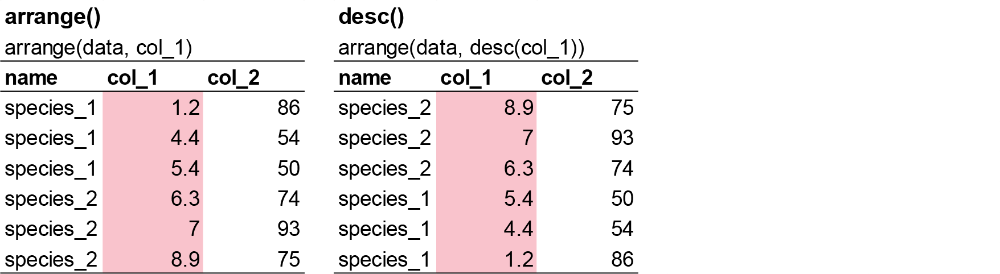

# Tidy Data

**Week 2**: Transforming and reshaping data, and writing tidy code

Raw data are rarely in exactly the form you need. Usually you need to keep some
rows, drop some columns, calculate new variables, summarise by group or change the
layout of the table. In this workshop you will learn the `dplyr` and `tidyr`
functions that handle almost all of these jobs, and how to write code that other
people (including future you) can read. Workshop materials are available in the
GitHub repository [ECS200](https://github.com/nicholaswunz/ECS200-Workshop).


::: {.callout-tip}
## Learning outcomes

By the end of this workshop you should be able to:

1. Use `filter()`, `arrange()`, `select()`, `mutate()` and `summarise()` with `group_by()`.
2. Reshape data between wide and long format with `pivot_longer()` and `pivot_wider()`.
3. Chain several steps together with the pipe `%>%`.
4. Write clean, consistent and well-annotated code.
:::

## Background {.unnumbered}

Five key `dplyr` functions (*verbs*) solve most data manipulation problems:

| Verb | What it does | Example |
|:-----|:-------------|:--------|
| `dplyr::filter()` | Keeps **rows** that meet a condition | Keep seedlings from 2004 |
| `dplyr::arrange()` | **Reorders** rows | Sort from the tallest to the shortest seedling |
| `dplyr::select()` | Keeps (or drops) **columns** by name | Keep only `watershed` and `stem_length` |
| `dplyr::mutate()` | **Creates** new columns from existing ones | Total mass = leaf mass + stem mass |
| `dplyr::summarise()` | **Collapses** many rows into a summary | Mean stem length |

All of them can be combined with `dplyr::group_by()`, which makes the next function
work **group by group** (e.g. one mean per watershed instead of one overall mean).

All the verbs work the same way:

- The first argument is a data frame (usually supplied by the pipe `%>%`).
- The next arguments describe what to do, using column names **without quotes**.
- The result is a new data frame.

### Study context {.unnumbered}

We continue with the sugar maple data from Week 1. The dataset comes from the
[Hubbard Brook Experimental Forest](https://lter.github.io/lterdatasampler/articles/hbr_maples_vignette.html)
in New Hampshire, USA.

The growth of sugar maples (*Acer saccharum*) can be stunted by soil acidification
from [acid rain](https://news.cornell.edu/stories/2006/05/acid-rain-causing-decline-sugar-maples-say-researchers),
which washes calcium (an important nutrient) out of the soil. To test whether
adding calcium helps, researchers at the Hubbard Brook Long Term Ecological Research
(LTER) site recorded "general sugar maple germinant health by height, leaf area,
biomass, and chlorophyll content" [@Juice2006] for seedlings in an untreated
watershed (**Reference**) and a watershed treated with calcium in 1999 (**W1**)
[@Peters2004].

{width=50%}

# Part 1: Data manipulation {.unnumbered}

Start a new script and import the clean data you saved at the end of Week 1. If you
did not finish Week 1, the code below recreates it from the raw file.

```{r}
#| label: setup

# Week 2 workshop - Tidying data
# Written by Nicholas Wu, 1234578, 04/03/2027

library(tidyverse)

# setwd("C:/Users/YOUR-NAME/Documents/ECS200")

# Option 1: import the clean data you saved in Week 1
# plant_task_data_clean <- readr::read_csv("data/plant_task_data_clean.csv")

# Option 2: recreate the clean data from the raw file
plant_task_data_clean <- readr::read_csv("data/plant_calcium_task.csv") %>%
  dplyr::mutate(watershed = dplyr::if_else(watershed == "W2", "W1", watershed), # fix the mislabelled watershed
                watershed = factor(watershed),
                transect  = factor(transect)) %>%
  dplyr::filter(stem_dry_mass < 1)                                              # remove the data entry error
```

::: {.panel-tabset .nav-pills}

## `filter()` {.unnumbered}

{width=100%}

`dplyr::filter()` keeps the rows that meet one or more conditions. For example, all
seedlings from 2004 in the calcium-treated watershed (W1):

```{r}
#| label: filter
#| results: hide

# Rows from the year 2004 AND the W1 watershed
plant_task_data_clean %>%
  dplyr::filter(year == 2004, watershed == "W1")
```

::: {.callout-note}
Use **two** equal signs (`==`) to test whether something is equal. One equal sign
(`=`) is used for setting the value of an argument.
:::

To keep rows that match any value in a list, use `%in%`:

```{r}
#| label: filter-in
#| results: hide

# Rows from transect R1 or transect W1-1
plant_task_data_clean %>%
  dplyr::filter(transect %in% c("R1", "W1-1"))
```

You can also filter by numeric thresholds or ranges:

```{r}
#| label: filter-num
#| results: hide

# Stem dry mass of 0.05 g or less
plant_task_data_clean %>%
  dplyr::filter(stem_dry_mass <= 0.05)

# Stem dry mass between 0.01 and 0.02 g
plant_task_data_clean %>%
  dplyr::filter(stem_dry_mass > 0.01 & stem_dry_mass < 0.02)
```

## `arrange()` {.unnumbered}

{width=100%}

`dplyr::arrange()` changes the order of the rows. Give it the column(s) to sort by.
`dplyr::desc()` sorts from largest to smallest. Missing values always go at the end.

```{r}
#| label: arrange
#| results: hide

# Shortest to tallest seedling
plant_task_data_clean %>%
  dplyr::arrange(stem_length)

# Tallest to shortest seedling
plant_task_data_clean %>%
  dplyr::arrange(dplyr::desc(stem_length))
```

## `select()` {.unnumbered}

{width=100%}

Datasets can have hundreds of columns. `dplyr::select()` keeps only the ones you
name. A minus sign drops a column instead.

```{r}
#| label: select
#| results: hide

# Keep three columns
plant_task_data_clean %>%
  dplyr::select(year, watershed, stem_dry_mass)

# Keep everything except the sample number
plant_task_data_clean %>%
  dplyr::select(-sample)
```

## `mutate()` {.unnumbered}

{width=100%}

`dplyr::mutate()` adds new columns calculated from existing ones (new columns are
added at the end). Here we calculate the total dry mass of each seedling. The masses
are in grams and very small, so we also convert them to milligrams (mg).

```{r}
#| label: mutate

plant_task_data_clean <- plant_task_data_clean %>%
  dplyr::mutate(total_dry_mass    = leaf_dry_mass + stem_dry_mass, # total mass in grams
                total_dry_mass_mg = total_dry_mass * 1000)          # grams to milligrams
```

`mutate()` is also how you **transform** a variable, for example to reduce skew or
to make a curved relationship straight (you will use this in Week 7):

```{r}
#| label: log
#| results: hide

plant_task_data_clean %>%
  dplyr::mutate(log_stem_length = log(stem_length)) %>%   # natural log
  dplyr::select(stem_length, log_stem_length)
```

## `summarise()` with `group_by()` {.unnumbered}

{width=100%}

`dplyr::summarise()` collapses many rows into one row of summary values. It becomes
really useful with `dplyr::group_by()`, which gives you **one row per group**:

```{r}
#| label: summarise

# Mean, standard deviation and sample size of total dry mass for each watershed
plant_task_data_clean %>%
  dplyr::group_by(watershed) %>%
  dplyr::summarise(mean = mean(total_dry_mass_mg),
                   sd   = sd(total_dry_mass_mg),
                   n    = dplyr::n())
```

::: {.callout-note}
## What happens with missing values?

```{r}
#| label: na-example

# A small example with one missing value
na_data <- data.frame(site    = c("A", "B", "A", "B", "A", "B"),
                      species = c(3, 4, 6, 2, 4, NA))

# The mean for site B is NA
na_data %>%
  dplyr::group_by(site) %>%
  dplyr::summarise(mean = mean(species))

# na.rm = TRUE removes the missing value before calculating
na_data %>%
  dplyr::group_by(site) %>%
  dplyr::summarise(mean = mean(species, na.rm = TRUE))
```

If any value is missing, the result is missing. Summary functions such as `mean()`,
`sd()`, `min()` and `max()` have an `na.rm = TRUE` argument to remove them first.
:::

:::

### Exercise (15 min) {.unnumbered}

🧪 **Use the functions above on `fake_data`**

```{r}
#| label: ex1-data

fake_data <- data.frame(
  site = c("A", "B", "C", "A", "B", "A", "B", "C", "A", "B", "A", "B", "A", "B", "C", "C",
           "B", "A", "b", "C", "B", "C", "C", "A", "A", "A", "A", "B", "C", "C", "C"),
  species_1 = c(7, 25, 30, 50, 38, 13, 5, 31, 34, 22, 41, 25, 22, 37, 39, 13,
                45, 10, 40, 7, 28, 36, 19, 2, 12, 5, 16, 38, 27, 44, 44),
  species_2 = c(9, 8, 1, 7, 9, 9, 4, 8, 1, 7, 1, 6, 4, 4, 7, 2,
                8, 7, 2, 9, 9, 2, 6, 8, 6, 6, 17, 1, 8, 4, 4),
  species_3 = c(190, 160, 70, 430, 310, 99, 530, 420, 371, 357, 198, 171, 463, 124, 254, 484,
                435, 409, 122, 305, 410, 162, 473, 200, 401, 273, 421, 419, 293, 487, 487),
  species_4 = c(2, 0, 4, 8, 6, 3, 7, 4, 2, NA, 35, 10, 6, 4, 8, 1,
                1, 0, NA, 4, 6, 8, 10, 6, 2, 5, 10, 7, NA, NA, NA)
)
```

- Run the usual **quality check** (the mistakes are slightly different from Week 1).
- Create a new column called `total_sp` that adds up all four species.
- Keep only the `site` and `total_sp` columns.
- Calculate the mean, minimum, maximum and number of samples of `total_sp` for each site.

Questions:

1. What is the mean total abundance at site B?
2. These are counts of individuals. Is the mean a sensible summary? (Hint: think about decimals.)
3. Which site has the highest average abundance?
4. Which site has the most samples?

<details>
<summary><strong>Show answer</strong></summary>

```{r}
#| label: ex1-answer

# Quality check: "b" should be "B", species_4 has NAs and one extreme value (35)
fake_data_clean <- fake_data %>%
  dplyr::mutate(site = dplyr::if_else(site == "b", "B", site), # fix the label
                site = factor(site)) %>%
  dplyr::filter(species_4 < 30) %>%                             # removes the extreme value AND the NA rows
  dplyr::mutate(total_sp = species_1 + species_2 + species_3 + species_4) %>%
  dplyr::select(site, total_sp)

fake_data_clean %>%
  dplyr::group_by(site) %>%
  dplyr::summarise(mean = mean(total_sp),
                   min  = min(total_sp),
                   max  = max(total_sp),
                   n    = dplyr::n())

# 1. 361.25
# 2. A mean of a count can be a decimal (e.g. 361.25 individuals). The median
#    is often a better summary for counts, especially if they are skewed.
# 3. Site B
# 4. Site A
```

Note that `filter(species_4 < 30)` also removes rows where `species_4` is `NA`,
because R cannot tell whether `NA < 30`. That is fine here, but be aware of it.

</details>

# Part 2: Reshaping data {.unnumbered}

Recall from Week 1 that tidy data have one row per observation. Field data sheets
are often in **wide format** (e.g. one column per species or per month), while most
tidyverse functions, and every statistical model, need **long format**.

`tidyr::pivot_longer()` turns wide data into long data. The column names become
values in a new column (`names_to`) and the cell values go into another new column
(`values_to`).

{width=100%}

```{r}
#| label: pivot-longer

# A wide table: one column per month
wide_data <- data.frame(site = c("A", "B"),
                        jan  = c(10, 20),
                        feb  = c(15, 25))
wide_data

# Long format: one row per site and month
long_data <- wide_data %>%
  tidyr::pivot_longer(cols      = jan:feb,   # the columns to stack
                      names_to  = "month",   # new column for the old column names
                      values_to = "count")   # new column for the values
long_data
```

`tidyr::pivot_wider()` does the opposite. It is useful for making summary tables
that are easy to read in a report.

{width=100%}

```{r}
#| label: pivot-wider

long_data %>%
  tidyr::pivot_wider(names_from  = month,  # the column whose values become new column names
                     values_from = count)  # the column whose values fill the cells
```

{width=60%}

### Exercise (5 min) {.unnumbered}

🧪 **Convert `fake_data` to long format**, with one row per sample and species and
columns called `species` and `abundance`. How many rows does the long version have,
and why?

<details>
<summary><strong>Show answer</strong></summary>

```{r}
#| label: ex2-answer

fake_long <- fake_data %>%
  tidyr::pivot_longer(cols      = species_1:species_4,
                      names_to  = "species",
                      values_to = "abundance")

nrow(fake_long) # 31 samples x 4 species = 124 rows
```

</details>

# Part 3: Tidy code {.unnumbered}

Good coding style is like correct punctuation: you can manage without it,
butitsuremakesthingseasiertoread. The most important rule is to **be consistent**.
We follow the [tidyverse style guide](https://style.tidyverse.org/).

::: {.panel-tabset .nav-pills}

## File names {.unnumbered}

File names should be **machine readable** (no spaces or special characters, lower
case, words joined with `_` or `-`) and **human readable** (describe what is in the file).

```{r}
#| label: file-names
#| eval: false

# Good
fit_models.R
week02_tidy_data.R
fig_stem_length.png

# Bad
fit models.R
foo.r
Final FINAL version2.R
```

## Script layout {.unnumbered}

Use commented lines with `-` to split your script into sections. Here is a template
you can use for your own projects:

```{r}
#| label: layout
#| eval: false

# Title
# Short description of what the script does
# Author, date

## Set up ## ------------------------------------------------------------------
# Load packages and set the working directory

## Load and clean data ## -----------------------------------------------------
# Import, quality check and transform the data

## Analysis ## ----------------------------------------------------------------
# Fit and check models

## Figures ## -----------------------------------------------------------------
# Make figures for your report
```

## Names and spacing {.unnumbered}

Use lower case letters, numbers and underscores (`snake_case`) for object names.
Names should be short but meaningful.

```{r}
#| label: names
#| eval: false

# Good
stem_data
day_1

# Bad
StemData
x2
first_day_of_the_month_of_the_survey
```

Put spaces around operators (`<-`, `=`, `+`, `==`) and after commas, but not inside
brackets. Use `<-`, not `=`, to create objects.

```{r}
#| label: spacing
#| eval: false

# Good
total_mass <- leaf_mass + stem_mass
mean(x, na.rm = TRUE)

# Bad
total_mass<-leaf_mass+stem_mass
mean(x,na.rm=TRUE)
```

Avoid reusing the names of existing functions (`mean`, `c`, `T`, `data`), which
causes confusing errors.

## Pipes and long lines {.unnumbered}

Put each step of a pipe on its own line, and each argument on its own line if a
function call gets long. Keep lines shorter than about 80 characters.

```{r}
#| label: long-lines
#| eval: false

# Good
plant_task_data_clean %>%
  dplyr::group_by(watershed) %>%
  dplyr::summarise(mean = mean(stem_length),
                   sd   = sd(stem_length))

# Bad
plant_task_data_clean %>% dplyr::group_by(watershed) %>% dplyr::summarise(mean = mean(stem_length), sd = sd(stem_length))
```

## Package conflicts {.unnumbered}

When you load the tidyverse, it prints a list of **conflicts**: functions with the
same name in two packages. For example, `stats::filter()` and `dplyr::filter()` do
completely different things. Writing the package name in front, `dplyr::filter()`,
removes any doubt, which is why we do it throughout this unit.

:::

### Exercise (15 min) {.unnumbered}

🧪 **Clean someone else's code**

Your colleague has left for a new job and you have taken over their project. They
ran a quick analysis but did not do a quality check, the code does not run, and the
comments are unclear. Fix the code so it runs, add a quality check, and improve the
comments.

```{r}
#| label: messy-code
#| eval: false

# Exercise 2
# Cleaning code and tidying dataset
# John Smith, 25-03/2025

## Set up ## ----------------------------------------------------------------
library(tiderVerse)

# Set my directory
setwd("YOUR DIRECTORY")

## Loading and cleaning data ## ---------------------------------------------

# Load raw data
plant data <- read_csv("data/plant_calcium.csv")
str(plant data)

## Analysis ## -------------------------------------------------------------

# Fit model: height explained by elevation
model <- lm(stem_dry_mass ~ stem_length, data = plant_data)

# Check model summary
summary(model)

## Visualisation ## --------------------------------------------------------

# Creating scatterplot figure
plant_data %>%
  ggplot() +
  geom_point(aes(x = stem_length, y = Stem_dry_mass)) +
  labs(
    x = "Stem Length (mm)",
    y = "Stem Dry Mass (g)",
    title = "Stem Dry Mass vs. Stem Length in Sugar Maple Seedlings",
    subtitle = "Hubbard Brook LTER"
  ) +
  theme_minimal()
```

<details>
<summary><strong>Show answer</strong></summary>

```{r}
#| label: clean-code
#| eval: false

# Relationship between stem length and stem dry mass in sugar maple seedlings
# Cleaned version of John Smith's script (original 25/03/2025)
# YOUR NAME, DATE

## Set up ## ------------------------------------------------------------------
library(tidyverse)          # fixed the package name (was "tiderVerse")

# setwd("YOUR-WORKSHOP-FOLDER")

## Load and clean data ## -----------------------------------------------------

# Object names cannot contain spaces (was "plant data")
plant_data <- readr::read_csv("data/plant_calcium.csv")
dplyr::glimpse(plant_data)

# Categorical variables to factors
plant_data <- plant_data %>%
  dplyr::mutate(watershed = factor(watershed),
                elevation = factor(elevation))

# Quality check: missing values, duplicates and outliers
colSums(is.na(plant_data))      # NAs in elevation and the leaf area columns, but not in the columns we analyse
sum(duplicated(plant_data))     # no duplicated rows

ggplot2::ggplot(plant_data, ggplot2::aes(x = stem_dry_mass)) +
  ggplot2::geom_histogram(bins = 30)  # no impossible values

## Analysis ## ----------------------------------------------------------------

# Linear model: stem dry mass explained by stem length (the old comment was wrong)
stem_mass_lm <- lm(stem_dry_mass ~ stem_length, data = plant_data)
summary(stem_mass_lm)

## Figures ## -----------------------------------------------------------------

# Scatterplot (column names are case sensitive: stem_dry_mass, not Stem_dry_mass)
plant_data %>%
  ggplot2::ggplot() +
  ggplot2::geom_point(ggplot2::aes(x = stem_length, y = stem_dry_mass)) +
  ggplot2::labs(x        = "Stem length (mm)",
                y        = "Stem dry mass (g)",
                title    = "Stem dry mass vs. stem length in sugar maple seedlings",
                subtitle = "Hubbard Brook LTER") +
  ggplot2::theme_minimal()
```

</details>

# Assessment {.unnumbered}

Task to complete before the end of the workshop.

[<i class="bi bi-download"></i> week02_assessment.R](assessments/week02_assessment.R){.btn .btn-danger .btn-sm .download-btn download="week02_assessment.R"}

Use your `plant_task_data_clean.csv` from Week 1 (or recreate it with the code at the
top of this page).

1. Keep only these columns: `year`, `watershed`, `elevation`, `stem_length`,
   `leaf_dry_mass` and `stem_dry_mass`.
2. Create a new column, `total_mass_mg`, with the total dry mass (leaf + stem) of
   each seedling in **milligrams**.
3. Create a summary table with the mean, standard deviation and sample size of
   `total_mass_mg` for each combination of `watershed` and `year`.
4. Use `tidyr::pivot_wider()` to turn the means from your summary table into a table
   with one row per watershed and one column per year.
5. **Interpretation**: did seedlings in the calcium-treated watershed (W1) have a
   higher mean total mass than seedlings in the Reference watershed in both years?
   By roughly how much? (Answer as comments.)
6. Save this script. In Week 3 you will continue from it under a new header:
   "*Week 3 workshop - Descriptive statistics*".



## For the adventurous {.unnumbered}

1. Write **one pipe** that keeps W1 seedlings from 2004, calculates `total_mass_mg`,
   keeps only `total_mass_mg` and `stem_length`, keeps seedlings taller than 100 mm,
   and sorts from heaviest to lightest.
2. In one pipe, group by `watershed` and `year` and calculate the mean, the
   coefficient of variation (SD / mean × 100) and the sample size of `total_mass_mg`.

# Extra: operators and joins {.unnumbered}

Common operators used inside `dplyr::filter()`:

| Operator | Meaning |
|:---------|:--------|
| `==` | Equal to |
| `!=` | Not equal to |
| `<`, `<=` | Less than, less than or equal to |
| `>`, `>=` | Greater than, greater than or equal to |
| `%in%` | Matches any value in a list, e.g. `site %in% c("A", "B")` |
| `&` | AND: both conditions must be true |
| `|` | OR: at least one condition must be true |
| `!` | NOT, e.g. `!is.na(x)` keeps non-missing values |

**Joins** combine two data frames that share a "key" column, e.g. a table of plots
and a separate table of plot soil properties.

::: {.panel-tabset .nav-pills}

## `left_join()` {.unnumbered}

Keeps every row of the left (first) table and adds matching columns from the right
table (`NA` if there is no match). This is the join you will use most often.

{width=50%}

```{r}
#| label: left-join

plots <- data.frame(plot = c(1, 2, 3), habitat = c("forest", "grassland", "forest"))
soils <- data.frame(plot = c(2, 3, 4), soil_ph = c(5.8, 6.4, 7.1))

dplyr::left_join(plots, soils, by = "plot")
```

## `inner_join()` {.unnumbered}

Keeps only rows with a match in both tables.

{width=50%}

```{r}
#| label: inner-join
dplyr::inner_join(plots, soils, by = "plot")
```

## `full_join()` {.unnumbered}

Keeps every row from both tables.

{width=50%}

```{r}
#| label: full-join
dplyr::full_join(plots, soils, by = "plot")
```

## `bind_rows()` {.unnumbered}

Stacks data frames with the same columns on top of each other, e.g. data sheets from
different field trips.

{width=100%}

```{r}
#| label: bind-rows
trip_1 <- data.frame(site = c("A", "B"), count = c(4, 7))
trip_2 <- data.frame(site = c("C"), count = c(2))

dplyr::bind_rows(trip_1, trip_2)
```

:::

# Additional resources {.unnumbered}

- R for Data Science: [data transformation](https://r4ds.hadley.nz/data-transform.html)
  and [data tidying](https://r4ds.hadley.nz/data-tidy.html).
- [Animated tidyverse functions](https://www.garrickadenbuie.com/project/tidyexplain/)
  (joins and pivots).
- Coding Club: [basic](https://ourcodingclub.github.io/tutorials/data-manip-intro/),
  [efficient](https://ourcodingclub.github.io/tutorials/data-manip-efficient/) and
  [creative](https://ourcodingclub.github.io/tutorials/data-manip-creative-dplyr/)
  data manipulation.
- [The tidyverse style guide](https://style.tidyverse.org/).
