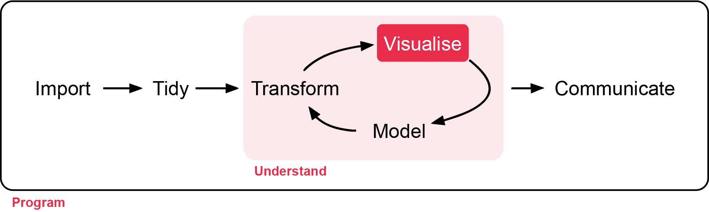
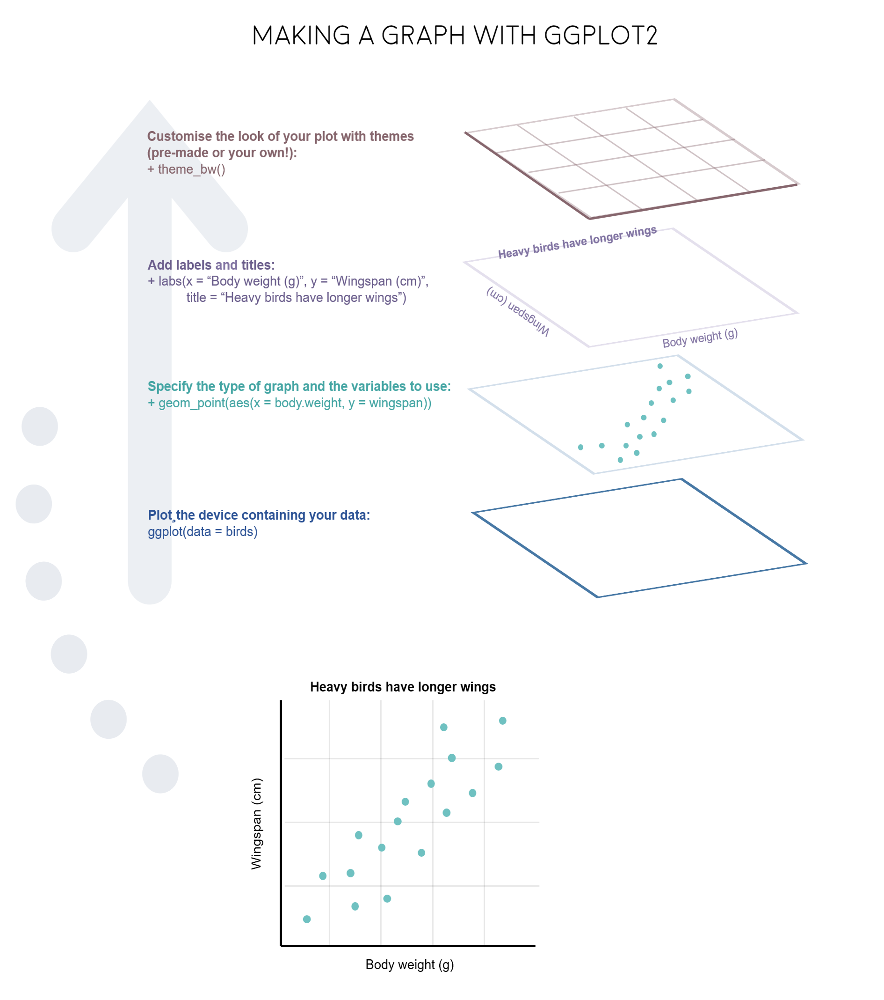
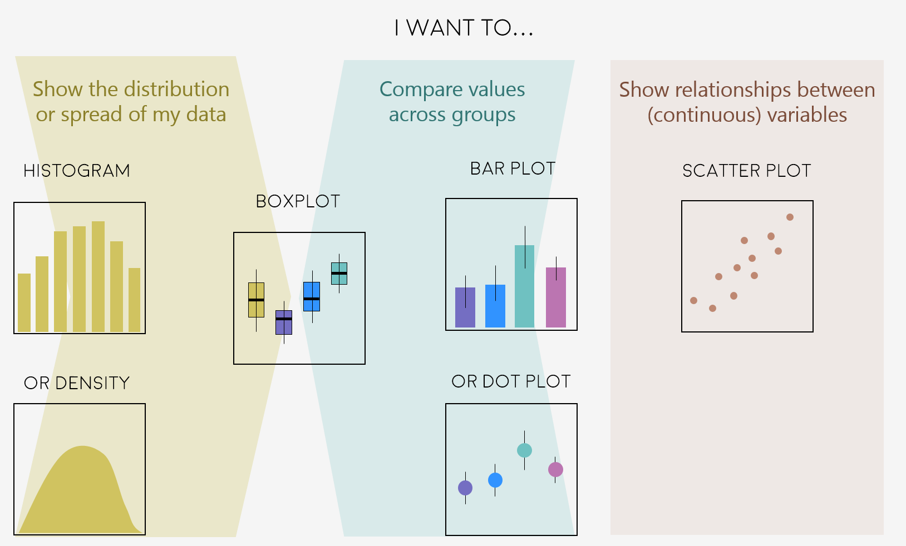
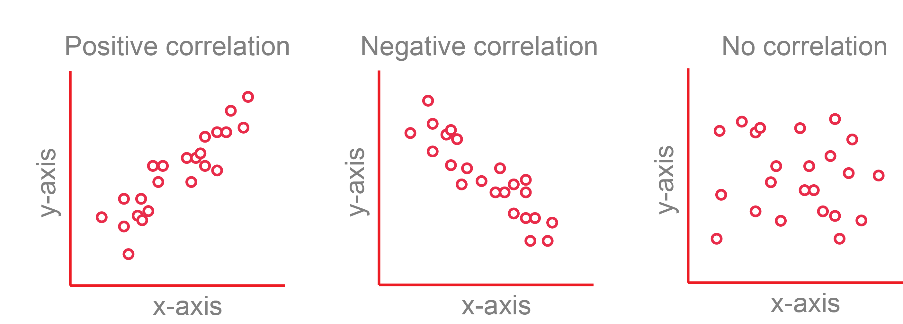
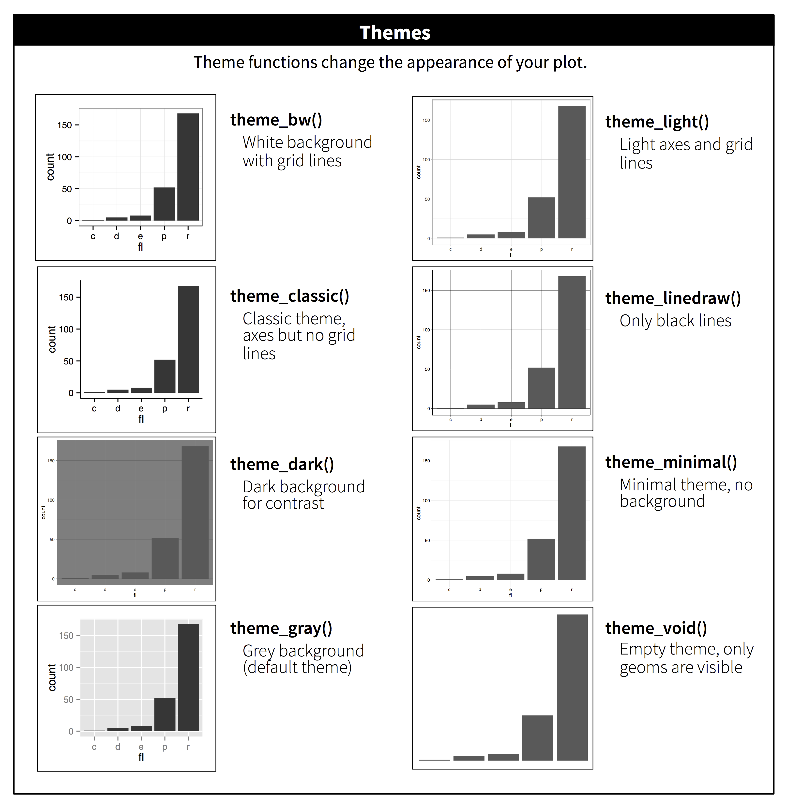

# Descriptive Statistics and Figures

**Week 3**: Summarising data and producing figures with ggplot2

Before testing any hypothesis, you need to describe your data: where the centre is,
how spread out the values are, and what the data look like. In this workshop you
will learn which summary statistics suit which kinds of data, and how to build clear,
publication-quality figures with `ggplot2`. Workshop materials are available in the
GitHub repository [ECS200](https://github.com/nicholaswunz/ECS200-Workshop).



::: {.callout-tip}
## Learning outcomes

By the end of this workshop you should be able to:

1. Choose suitable measures of centre and spread for different types of variables.
2. Explain the difference between a standard deviation, a standard error and a confidence interval.
3. Calculate summary statistics for groups with `group_by()` and `summarise()`.
4. Build histograms, boxplots, dot plots and scatterplots with `ggplot2`, and polish them for a report.
:::

## Background {.unnumbered}

The right summary depends on the **scale** of the variable:

| Scale | Type | Definition | Examples | Centre | Spread |
|:------|:-----|:-----------|:---------|:-------|:-------|
| Nominal | Categorical | Named categories with no order | Sex, species, habitat | Mode | Counts, proportions |
| Ordinal | Categorical | Categories with a natural order | Life stage (egg, juvenile, adult), damage score 0–5 | Median, mode | Range, IQR |
| Interval | Numeric | Equal intervals, no true zero | Temperature (°C), pH, dates | Mean, median | SD, SE, CI |
| Ratio | Numeric | Equal intervals and a true zero | Length, mass, age, counts | Mean, median | SD, SE, CV, IQR, CI |

When you design a data sheet, think about what type each column will be. Here is an
example colour-coded by type: [nominal]{style="background-color: #fadbfa;"},
[continuous]{style="background-color: #cce8ff;"}, [ordinal]{style="background-color: #fff2c0;"}
and [binary]{style="background-color: #c6fbf5;"}.

{width=100%}

Key terms used in this workshop.

Central tendancy:

- **Mean**: the average. Best for roughly symmetrical data.
- **Median**: the middle value. Robust to outliers and skew.
- **Mode**: the most frequent value (useful for categories).

Spread:

- **Standard deviation (SD)**: how spread out the **data** are around the mean.
- **Standard error (SE)**: SD / √*n*. How precisely the **mean** has been estimated.
- **95% confidence interval (CI)**: a range that is likely to contain the true mean
  (mean ± about 2 × SE).
- **Coefficient of variation (CV)**: SD / mean. Compares variability between
  variables measured on different scales.
- **Interquartile range (IQR)**: the range of the middle 50% of the data (Q3 − Q1).
- **Variance**: SD². The average squared distance from the mean.

CrashCourse Statistics has short videos on
[measures of central tendency](https://youtu.be/kn83BA7cRNM?si=qzoPZk44hZRlzo9P) and
[measures of spread](https://youtu.be/R4yfNi_8Kqw?si=9QO_QzRmLG5oyQjH) if you would
like a refresher.

# Before we start {.unnumbered}

```{r}
#| label: setup

# Week 3 workshop - Descriptive statistics
# Written by Nicholas Wu, 1234578, 11/03/2027

# install.packages("patchwork")  # run once in the console if needed

library(tidyverse)  # data wrangling and ggplot2
library(patchwork)  # combine several ggplots into one figure

# setwd("C:/Users/YOUR-NAME/Documents/ECS200")
```

# Part 1: Descriptive statistics {.unnumbered}

::: {.panel-tabset .nav-pills}

## Centre {.unnumbered}

Whether to use the mean or the median depends on the shape of the distribution. In
skewed data, a few extreme values pull the mean towards the long tail, while the
median stays in the middle.

{width=85%}

```{r}
#| label: centre

# Simulate a symmetrical (normal) and a right-skewed variable, 100 values each
set.seed(1) # makes the random numbers the same every time
dist_data <- data.frame(normal = rnorm(100, mean = 10, sd = 2),
                        skewed = rexp(100, rate = 0.2))

dist_data %>%
  dplyr::summarise(normal_mean   = mean(normal),
                   normal_median = median(normal),
                   skewed_mean   = mean(skewed),
                   skewed_median = median(skewed))
```

For the normal data the mean and median are almost the same (about 10). For the
skewed data the mean (about 4.7) is much larger than the median (about 3).

## Spread {.unnumbered}

```{r}
#| label: spread

dist_data %>%
  dplyr::summarise(n        = dplyr::n(),
                   mean     = mean(skewed),
                   variance = var(skewed),
                   sd       = sd(skewed),                         # standard deviation
                   se       = sd / sqrt(n),                       # standard error
                   ci_lower = mean - qt(0.975, df = n - 1) * se,  # lower 95% confidence limit
                   ci_upper = mean + qt(0.975, df = n - 1) * se,  # upper 95% confidence limit
                   cv       = sd / mean)                          # coefficient of variation
```

`qt(0.975, df = n - 1)` is the number of standard errors needed for a 95% CI. It is
close to 2 for large samples and gets bigger for small samples.

- The **SD** describes the spread of the **data**, and does not shrink as you
  collect more data.
- The **SE** and **CI** describe the uncertainty in the **mean**, and get smaller as
  the sample size grows.

The SD and CI assume the data are roughly symmetrical, so for skewed data a boxplot
(median and quartiles) is often a better summary.

```{r}
#| label: spread-plot
#| fig-width: 8
#| fig-height: 4

# Long format: one column says which distribution, one column holds the value
dist_long <- dist_data %>%
  tidyr::pivot_longer(cols = everything(), names_to = "data_type", values_to = "value")

dist_stats <- dist_long %>%
  dplyr::group_by(data_type) %>%
  dplyr::summarise(mean = mean(value),
                   sd   = sd(value))

# Histograms with the mean (solid) and mean +/- 1 SD (dashed)
ggplot2::ggplot(dist_long, ggplot2::aes(x = value)) +
  ggplot2::geom_histogram(bins = 30, fill = "grey80") +
  ggplot2::geom_vline(data = dist_stats, ggplot2::aes(xintercept = mean), linewidth = 1) +
  ggplot2::geom_vline(data = dist_stats, ggplot2::aes(xintercept = mean - sd), linetype = "dashed") +
  ggplot2::geom_vline(data = dist_stats, ggplot2::aes(xintercept = mean + sd), linetype = "dashed") +
  ggplot2::facet_wrap(~ data_type, scales = "free") +
  ggplot2::labs(x = "Value", y = "Frequency",
                subtitle = "Mean ± SD: for skewed data, mean − SD can even fall below zero") +
  ggplot2::theme_classic()
```

## Quantiles {.unnumbered}

Quantiles split sorted data into equal parts. The quartiles (25%, 50% and 75%) are
what a boxplot shows.

```{r}
#| label: quantiles

# Min, quartiles and max with base R
quantile(dist_data$skewed)

# The same with dplyr (this also works with group_by())
dist_data %>%
  dplyr::summarise(min    = min(skewed),
                   q1     = quantile(skewed, probs = 0.25),
                   median = median(skewed),
                   q3     = quantile(skewed, probs = 0.75),
                   max    = max(skewed),
                   iqr    = IQR(skewed))
```

:::

The app below shows why it matters whether you plot the SD, SE or CI. Increase the
sample size and see what happens to each.

::: {.callout-note collapse="true"}
## What happens, and why? (try the app first, then open this)

The three error bars answer **different questions**:

| | Formula | Question it answers | When *n* increases | When the true SD increases |
|:--|:--|:--|:--|:--|
| **SD** | $\sqrt{\frac{\sum(x - \bar{x})^2}{n - 1}}$ | How much do individual measurements vary? | Stays about the same | Gets wider |
| **SE** | $\frac{SD}{\sqrt{n}}$ | How precisely do we know the mean? | Shrinks | Gets wider |
| **95% CI** | $\bar{x} \pm t \times SE$ | Where is the true population mean likely to be? | Shrinks, fastest at small *n* | Gets wider |

**Increasing the sample size**

- **SD stays about the same.** The SD describes the spread of the population, and
  that does not change because you measured more individuals. With a larger sample,
  your estimate of the SD just gets closer to the true value (it jumps around less
  when you press *Resample*).
- **SE shrinks.** The SE divides the SD by $\sqrt{n}$. More data gives a more
  precise estimate of the mean, but with diminishing returns: to halve the SE you
  need **four times** as many samples (e.g. from 10 to 40).
- **The CI shrinks even faster at small *n*.** The CI is the SE multiplied by a
  value from the *t* distribution. With very few samples, *t* is large (4.3 when
  *n* = 3) because we are unsure about the SD as well as the mean. As *n* grows, *t*
  drops towards about 2 (2.26 at *n* = 10, 1.98 at *n* = 100), so the 95% CI ends up
  at roughly **2 × SE**.

**Increasing the true SD**

- **All three get wider in proportion.** If individuals vary more, the data are
  more spread out (larger SD), and the mean is harder to pin down (larger SE and CI).
  Doubling the SD doubles all three bars.
- The y-axis of the app rescales with the SD, so the bars may *look* similar. Read
  the numbers under the plot.

**Why it matters**

- Use the **SD** when you want to show how variable the organisms or sites are
  (e.g. "lizards weighed 15.2 ± 2.1 g, mean ± SD").
- Use the **SE** or **95% CI** when you want to show how precisely you have
  estimated the mean, or to compare groups. The CI is the easier one to interpret.
- A small SE does not mean the data have little variation; it may just mean a large
  sample. This is why you must **always state which one your error bars show**.
:::

::: {.app-box .column-body-outset}
::: {.app-title}
App: standard deviation, standard error and confidence interval
:::
```{ojs}
//| echo: false
//| output: false
import {rng, rnorm, mean, sd, qt975, fmt, red, grey, dark, blue} from "./apps/ecs200.js"
```
::: {.app-grid}
::: {.app-controls}
```{ojs}
//| echo: false
viewof ds_n = Inputs.range([3, 200], {value: 10, step: 1, label: "Sample size (n)"})
viewof ds_sd = Inputs.range([0.5, 5], {value: 2, step: 0.1, label: "True SD of the population"})
viewof ds_seed = Inputs.button("Resample")
```
:::
::: {.app-output}
```{ojs}
//| echo: false
ds_data = {
  const r = rng(33 + ds_seed);
  const x = rnorm(r, ds_n, 20, ds_sd);
  const m = mean(x), s = sd(x), se = s / Math.sqrt(ds_n), ci = qt975(ds_n - 1) * se;
  const pts = x.map((v) => ({x: 1 + (r() - 0.5) * 0.5, y: v}));
  const bars = [
    {x: 2.2, lo: m - s, hi: m + s, lab: "Mean ± SD"},
    {x: 3.0, lo: m - se, hi: m + se, lab: "Mean ± SE"},
    {x: 3.8, lo: m - ci, hi: m + ci, lab: "Mean ± 95% CI"}
  ];
  return {pts, bars, m, s, se, ci};
}

html`<div>${Plot.plot({
  width: 560, height: 300, marginLeft: 45,
  x: {domain: [0.5, 4.3], ticks: [1, 2.2, 3.0, 3.8], tickFormat: (d) => ({1: "Raw data", 2.2: "± SD", 3: "± SE", 3.8: "± 95% CI"})[d], label: null},
  y: {label: "Measurement", grid: true, domain: [20 - 3.5 * ds_sd, 20 + 3.5 * ds_sd]},
  marks: [
    Plot.dot(ds_data.pts, {x: "x", y: "y", fill: grey, fillOpacity: 0.5, r: 2.5}),
    Plot.ruleX(ds_data.bars, {x: "x", y1: "lo", y2: "hi", stroke: red, strokeWidth: 3}),
    Plot.dot(ds_data.bars, {x: "x", y: () => ds_data.m, fill: red, r: 5})
  ]
})}
<div class="app-verdict">Mean = <b>${fmt(ds_data.m)}</b>, SD = <b>${fmt(ds_data.s)}</b>, SE = <b>${fmt(ds_data.se)}</b>, 95% CI half-width = <b>${fmt(ds_data.ci)}</b>.
The SD stays about the same as <i>n</i> grows (it describes the data), while the SE and CI shrink (they describe how precisely we know the mean). Always say which one your error bars show.</div></div>`
```
:::
:::
:::

### Exercise 1 (5 min) {.unnumbered}

🧪 **Summarise species 3 in this survey**

```{r}
#| label: ex1-data

survey_data <- data.frame(
  site      = c("A", "A", "A", "B", "B", "B", "C", "C", "C"),
  plot      = c(1, 2, 3, 1, 2, 3, 1, 2, 3),
  species_1 = c(12, 7, 15, 4, 9, 6, 20, 18, 25),
  species_2 = c(5, 2, 1, 10, 7, 4, 3, 1, 0),
  species_3 = c(0, 3, 2, 6, 4, 5, 0, 1, 2),
  species_4 = c(8, 6, 3, 1, 4, 2, 10, 7, 5)
)
```

- Calculate the mean, standard deviation and sample size of `species_3`.
- Does a mean make sense for count data like these? What else could you report?

<details>
<summary><strong>Show answer</strong></summary>

```{r}
#| label: ex1-answer

survey_data %>%
  dplyr::summarise(mean   = mean(species_3),
                   sd     = sd(species_3),
                   median = median(species_3),
                   n      = dplyr::n())

# mean = 2.56, SD = 2.13, n = 9. A mean of 2.56 individuals is not a possible
# count, but it is still a valid average. The median (2) and range (0 to 6)
# are also useful for small counts.
```

</details>

## By groups {.unnumbered}

Most of the time you want summaries for each group, e.g. each site, species or
treatment. Convert the data to long format, then use `group_by()`.

```{r}
#| label: groups
#| fig-width: 6
#| fig-height: 3.5

survey_long <- survey_data %>%
  tidyr::pivot_longer(cols      = species_1:species_4,
                      names_to  = "species",
                      values_to = "abundance")

# Mean, SD and sample size of abundance for each site and species
survey_summary <- survey_long %>%
  dplyr::group_by(site, species) %>%
  dplyr::summarise(mean = mean(abundance),
                   sd   = sd(abundance),
                   n    = dplyr::n(),
                   .groups = "drop") # remove the grouping afterwards

survey_summary

# Mean +/- SD for each species at each site
ggplot2::ggplot(survey_summary,
                ggplot2::aes(x = site, y = mean, ymin = mean - sd, ymax = mean + sd, colour = species)) +
  ggplot2::geom_pointrange(position = ggplot2::position_dodge(width = 0.6)) + # dodge so species don't overlap
  ggplot2::labs(x = "Site", y = "Abundance (mean ± SD)", colour = "Species") +
  ggplot2::theme_classic()
```

# Part 2: Figures with ggplot2 {.unnumbered}

The "gg" in `ggplot2` stands for *grammar of graphics*. You build a plot in
**layers**, joined with `+`:

1. `ggplot2::ggplot(data, ggplot2::aes(x = ..., y = ...))` sets the data and which
   columns go on which axis (the *aesthetics*).
2. `geom_...()` layers draw the data: points, lines, boxes, bars.
3. `labs()`, `scale_...()`, `theme_...()` and `facet_...()` adjust labels, colours,
   the overall look and panels.

{width=100%}

Before plotting, decide which variable is the **independent** (predictor, on the
*x*-axis) and which is the **dependent** (response, on the *y*-axis) variable.

{width=100%}

### Plot types {.unnumbered}

Which plot to use depends on the types of variables you have:

{width=90%}

We will use the clean sugar maple data from Weeks 1 and 2 to compare stem length
between the calcium-treated (**W1**) and untreated (**Reference**) watersheds.

```{r}
#| label: load-plant

plant_data <- readr::read_csv("data/plant_calcium_task.csv") %>%
  dplyr::mutate(watershed     = dplyr::if_else(watershed == "W2", "W1", watershed),
                watershed     = factor(watershed),
                total_mass_mg = (leaf_dry_mass + stem_dry_mass) * 1000) %>%
  dplyr::filter(stem_dry_mass < 1)
```

::: {.panel-tabset .nav-pills}

## Histogram or density {.unnumbered}

{width=90%}

A [histogram](https://r-graph-gallery.com/histogram) cuts a numeric variable into
bins and shows how many observations fall in each. A
[density plot](https://r-graph-gallery.com/density-plot) is a smoothed version.

```{r}
#| label: hist
#| fig-width: 8
#| fig-height: 3

ggplot2::ggplot(plant_data, ggplot2::aes(x = stem_length, fill = watershed)) +
  ggplot2::geom_histogram(alpha = 0.5, position = "identity", bins = 30) + # alpha makes overlapping bars see-through
  ggplot2::labs(x = "Stem length (mm)", y = "Count", fill = "Watershed") +
  ggplot2::theme_classic()

ggplot2::ggplot(plant_data, ggplot2::aes(x = stem_length, fill = watershed)) +
  ggplot2::geom_density(alpha = 0.5) +
  ggplot2::labs(x = "Stem length (mm)", y = "Density", fill = "Watershed") +
  ggplot2::theme_classic()
```

## Boxplot {.unnumbered}

{width=90%}

A [boxplot](https://r-graph-gallery.com/89-box-and-scatter-plot-with-ggplot2.html)
summarises a numeric variable:

- the thick **line** is the median;
- the **box** spans the lower (Q1) and upper (Q3) quartiles, so it contains the middle 50% of the data (the IQR);
- the **whiskers** extend to the most extreme values within 1.5 × IQR of the box;
- **points** beyond the whiskers are potential outliers.

```{r}
#| label: boxplot
#| fig-width: 5
#| fig-height: 3.5

ggplot2::ggplot(plant_data, ggplot2::aes(x = watershed, y = stem_length)) +
  ggplot2::geom_boxplot() +
  ggplot2::labs(x = "Watershed", y = "Stem length (mm)") +
  ggplot2::theme_classic()
```

## Bar plot or dot plot {.unnumbered}

{width=90%}

Bar plots of means hide the data, so a **dot plot** of the mean ± SD (or SE or CI)
over the raw data is usually a better choice. You need a summary table and the raw
data, so each layer gets its own `data =`.

```{r}
#| label: dot
#| fig-width: 9
#| fig-height: 3.5

plant_summary <- plant_data %>%
  dplyr::group_by(watershed) %>%
  dplyr::summarise(mean = mean(stem_length),
                   sd   = sd(stem_length))

# Bar plot of the mean +/- SD
bar_plot <- ggplot2::ggplot(plant_summary, ggplot2::aes(x = watershed, y = mean)) +
  ggplot2::geom_col(fill = "grey70") +
  ggplot2::geom_errorbar(ggplot2::aes(ymin = mean - sd, ymax = mean + sd), width = 0.1) +
  ggplot2::labs(x = "Watershed", y = "Stem length (mm)", title = "Bar plot") +
  ggplot2::theme_classic()

# Raw data with the mean +/- SD on top
dot_plot <- ggplot2::ggplot() +
  ggplot2::geom_jitter(data = plant_data, ggplot2::aes(x = watershed, y = stem_length),
                       width = 0.15, alpha = 0.2) +
  ggplot2::geom_pointrange(data = plant_summary,
                           ggplot2::aes(x = watershed, y = mean, ymin = mean - sd, ymax = mean + sd),
                           colour = "#e12744") +
  ggplot2::labs(x = "Watershed", y = "Stem length (mm)", title = "Dot plot with raw data") +
  ggplot2::theme_classic()

# patchwork: put two plots side by side with +
bar_plot + dot_plot
```

## Scatterplot {.unnumbered}

{width=90%}

A [scatterplot](https://r-graph-gallery.com/scatterplot) shows the relationship
between two numeric variables.

```{r}
#| label: scatter
#| fig-width: 8
#| fig-height: 4

ggplot2::ggplot(plant_data, ggplot2::aes(x = stem_length, y = stem_dry_mass, colour = watershed)) +
  ggplot2::geom_point() +
  ggplot2::labs(x = "Stem length (mm)", y = "Stem dry mass (g)", colour = "Watershed") +
  ggplot2::theme_classic()
```

:::

### Polishing plots {.unnumbered}

::: {.panel-tabset .nav-pills}

## Themes {.unnumbered}

Themes change the overall look in one line, e.g. `theme_classic()`, `theme_bw()` or
`theme_minimal()`.

{width=100%}

## Labels {.unnumbered}

Always give axes informative labels **with units**. `labs()` sets the axis, legend
and title labels in one place.

```{r}
#| label: labels
#| fig-width: 5
#| fig-height: 3.5

ggplot2::ggplot(plant_data, ggplot2::aes(x = watershed, y = stem_length)) +
  ggplot2::geom_boxplot() +
  ggplot2::labs(title    = "Your title",
                subtitle = "Your subtitle",
                x        = "Treatment",          # use x = NULL to remove a label
                y        = "Stem length (mm)") +
  ggplot2::theme_classic()
```

## Shapes and sizes {.unnumbered}

{width=70%}

```{r}
#| label: shapes
#| fig-width: 7
#| fig-height: 3

ggplot2::ggplot(plant_data, ggplot2::aes(x = stem_length, y = stem_dry_mass, shape = watershed)) +
  ggplot2::geom_point(size = 2) +
  ggplot2::scale_shape_manual(values = c(1, 16)) +   # open and filled circles
  ggplot2::labs(x = "Stem length (mm)", y = "Stem dry mass (g)", shape = "Watershed") +
  ggplot2::theme_classic()
```

## Colours {.unnumbered}

`colour` changes outlines, points and lines, and `fill` changes the inside of
shapes. Set one colour for everything inside the `geom`, or map a variable inside
`aes()` and choose the colours with `scale_colour_manual()` or `scale_fill_manual()`.
You can use [R colour names](https://www.nceas.ucsb.edu/sites/default/files/2020-04/colorPaletteCheatsheet.pdf)
(e.g. `"tomato"`) or hex codes (e.g. `"#e12744"`). Choose colours that are
colour-blind friendly, such as those in the
[`colorspace`](https://cran.r-project.org/web/packages/colorspace/vignettes/colorspace.html) package.

```{r}
#| label: colours
#| fig-width: 8
#| fig-height: 3.5

# One fill colour for every box
one_colour <- ggplot2::ggplot(plant_data, ggplot2::aes(x = watershed, y = stem_length)) +
  ggplot2::geom_boxplot(fill = "#F5C4B8") +
  ggplot2::labs(x = "Watershed", y = "Stem length (mm)", subtitle = "One colour") +
  ggplot2::theme_classic()

# Fill colour by group
group_colour <- ggplot2::ggplot(plant_data, ggplot2::aes(x = watershed, y = stem_length, fill = watershed)) +
  ggplot2::geom_boxplot() +
  ggplot2::scale_fill_manual(values = c("Reference" = "#B8CEF5", "W1" = "#F5C4B8")) +
  ggplot2::labs(x = "Watershed", y = "Stem length (mm)", fill = "Watershed", subtitle = "Colour by group") +
  ggplot2::theme_classic()

one_colour + group_colour
```

A numeric variable mapped to colour gives a colour gradient:

```{r}
#| label: gradient
#| fig-width: 7
#| fig-height: 3

ggplot2::ggplot(plant_data, ggplot2::aes(x = stem_length, y = stem_dry_mass, colour = leaf_dry_mass)) +
  ggplot2::geom_point() +
  ggplot2::scale_colour_viridis_c() +  # a colour-blind-friendly gradient
  ggplot2::labs(x = "Stem length (mm)", y = "Stem dry mass (g)", colour = "Leaf dry\nmass (g)") +
  ggplot2::theme_classic()
```

## Panels (facets) {.unnumbered}

`facet_wrap()` splits a plot into panels, one for each level of a variable.
Decide which variable to put in panels and which to show with colour based on the
comparison you want readers to make.

```{r}
#| label: facets
#| fig-width: 8
#| fig-height: 3.5

ggplot2::ggplot(plant_data, ggplot2::aes(x = stem_length, y = stem_dry_mass, colour = watershed)) +
  ggplot2::geom_point(alpha = 0.7) +
  ggplot2::scale_colour_manual(values = c("Reference" = "grey40", "W1" = "#e12744")) +
  ggplot2::labs(x = "Stem length (mm)", y = "Stem dry mass (g)", colour = "Watershed") +
  ggplot2::facet_wrap(~ year) + # one panel per year
  ggplot2::theme_classic()
```

## Combining plots {.unnumbered}

The `patchwork` package combines separate ggplots: `+` or `|` puts them side by
side, and `/` stacks them. `plot_annotation()` adds panel letters.

```{r}
#| label: patchwork
#| fig-width: 8
#| fig-height: 7

(one_colour + group_colour) / bar_plot +
  patchwork::plot_annotation(tag_levels = "a") # label panels a, b, c
```

To save a figure for your report, use `ggplot2::ggsave("figures/fig1.png", width = 16, height = 10, units = "cm", dpi = 300)`.

`width` is the width of the plot in cm, `height` is the height of the plot in cm, and `dpi` (dots per inch) is the resolution of the figure

:::

# Assessment {.unnumbered}

Task to complete before the end of the workshop.

[<i class="bi bi-download"></i> week03_assessment.R](assessments/week03_assessment.R){.btn .btn-danger .btn-sm .download-btn download="week03_assessment.R"}

Continue in the script you started in Week 2 (with `total_mass_mg`), under the header
"*Week 3 workshop - Descriptive statistics*".

1. Plot the distribution of `total_mass_mg`. Is it symmetrical or skewed?
2. Based on your answer to Q1, choose suitable measures of centre and spread, and
   calculate them, together with the sample size, for each combination of
   `watershed` and `year`. Explain your choice in a comment.
3. What are the centre, spread and sample size for W1 seedlings in 2003? Are they
   similar for W1 seedlings in 2004? If not, describe the difference.
4. Make a publication-ready figure that shows the raw data and your chosen centre
   and spread for each watershed and year. Use colour, label the axes with units,
   and use `facet_wrap()` for the years.
5. In one or two sentences, describe what the figure shows about the effect of
   calcium on seedling mass.

The figure could look something like either of these:

```{r}
#| label: target-figure
#| echo: false
#| fig-width: 8
#| fig-height: 3.5

target_summary <- plant_data %>%
  dplyr::group_by(watershed, year) %>%
  dplyr::summarise(median = median(total_mass_mg),
                   q1     = quantile(total_mass_mg, 0.25),
                   q3     = quantile(total_mass_mg, 0.75),
                   .groups = "drop")

option_1 <- ggplot2::ggplot() +
  ggplot2::geom_jitter(data = plant_data, ggplot2::aes(x = watershed, y = total_mass_mg),
                       width = 0.15, alpha = 0.15) +
  ggplot2::geom_pointrange(data = target_summary,
                           ggplot2::aes(x = watershed, y = median, ymin = q1, ymax = q3, colour = watershed)) +
  ggplot2::scale_colour_manual(values = c("black", "#e12744")) +
  ggplot2::labs(title = "Option 1", x = NULL, y = "Total dry mass (mg)") +
  ggplot2::facet_wrap(~ year) +
  ggplot2::theme_classic() +
  ggplot2::theme(legend.position = "none")

option_2 <- ggplot2::ggplot(plant_data, ggplot2::aes(x = watershed, y = total_mass_mg, colour = watershed)) +
  ggplot2::geom_boxplot() +
  ggplot2::scale_colour_manual(values = c("black", "#e12744")) +
  ggplot2::labs(title = "Option 2", x = NULL, y = "Total dry mass (mg)") +
  ggplot2::facet_wrap(~ year) +
  ggplot2::theme_classic() +
  ggplot2::theme(legend.position = "none")

option_1 + option_2
```



## For the adventurous {.unnumbered}

[<i class="bi bi-download"></i> pie_crab.csv](data/pie_crab.csv){.btn .btn-outline-danger .btn-sm .download-btn download="pie_crab.csv"}

`pie_crab.csv` contains carapace widths (`size`, mm) of Atlantic marsh fiddler crabs
(*Minuca pugnax*) from 13 salt marshes on the east coast of the USA, collected to
test **Bergmann's rule** (animals are larger in colder places, at higher latitudes).
Other columns: `latitude`, `site`, mean air and water temperature (`air_temp`,
`water_temp`) and their SDs.

{width=80%}

1. Run a quality check. Are there missing values or duplicated rows? Are the
   duplicates real?
2. Calculate the mean, SD and sample size of `size` for each site. Which site has
   the largest crabs, and which has the fewest crabs measured?
3. Plot carapace width against latitude, showing the raw data and the site means
   (coloured by air temperature). What pattern do you see? You will analyse these
   data in Week 7.

# Additional resources {.unnumbered}

- [Levels of measurement](https://www.scribbr.com/statistics/levels-of-measurement/)
  (nominal, ordinal, interval and ratio) explained.
- R for Data Science: [data visualisation](https://r4ds.hadley.nz/data-visualize.html).
- Coding Club: [beautiful and informative data visualisation](https://ourcodingclub.github.io/tutorials/datavis/)
  and [turning default ggplots into publication-ready figures](https://ourcodingclub.github.io/tutorials/dataviz-beautification-synthesis/).
- [The R Graph Gallery](https://r-graph-gallery.com/): hundreds of example figures with code.
- [`patchwork` documentation](https://patchwork.data-imaginist.com/) for combining plots.

{width=100%}
