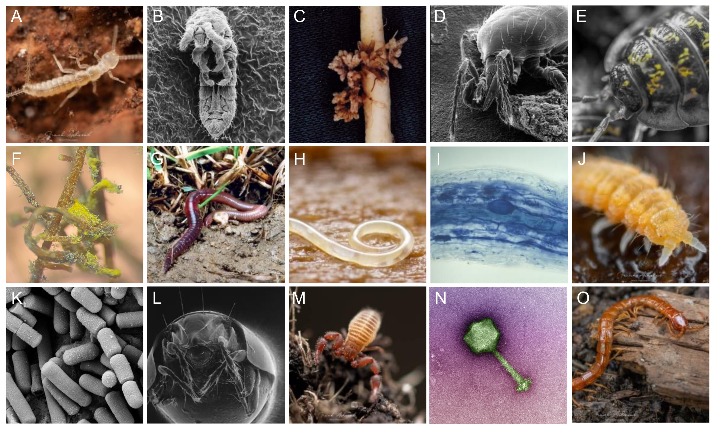

# Diversity Indices

**Week 4**: Measuring abundance, richness and diversity

How many individuals are there? How many species? How evenly are individuals spread
among those species? In this workshop you will calculate the most common measures of
abundance, species richness and diversity from survey data. These skills are
essential for field-based projects and for jobs in ecological consulting and
monitoring. Workshop materials are available in the GitHub repository
[ECS200](https://github.com/nicholaswunz/ECS200-Workshop).

{width=100%}

::: {.callout-tip}
## Learning outcomes

By the end of this workshop you should be able to:

1. Calculate absolute abundance, relative abundance and density.
2. Calculate species richness, and explain when rarefied richness is needed.
3. Calculate and interpret the Shannon and Simpson diversity indices.
4. Choose a suitable metric for a survey design and justify your choice.
:::

## Background {.unnumbered}

Biodiversity has two main components: **richness** (how many species) and
**evenness** (how equally individuals are spread among the species). Different
metrics capture different combinations of these.

| Metric | What it measures | Watch out for |
|:-------|:-----------------|:--------------|
| [Absolute abundance](#absolute) ($N_i$) | Number of individuals of a species | Depends on sampling effort. Only compare surveys with the same effort |
| [Relative abundance](#relative) ($p_i$) | Proportion of all individuals that belong to a species | Hides differences in total abundance |
| [Density](#density) ($d_i$) | Individuals per unit area or effort | Needs an accurate measure of area or effort |
| [Species richness](#richness) ($S$) | Number of species | Increases with sampling effort and is sensitive to rare species |
| [Rarefied richness](#rarefied) | Richness standardised to the same number of individuals | Throws away information when samples differ a lot in size |
| [Shannon index](#shannon) ($H'$) | Richness and evenness together | Hard to interpret in real-world terms. Moderately sensitive to rare species |
| [Simpson index](#simpson) ($D$) | Mostly evenness and dominance | Not very sensitive to rare species |

Other measures, such as *alpha*, *beta* and *gamma* diversity (diversity within a
site, between sites and across a region) and taxonomic diversity, can be calculated
with the [`vegan`](https://vegandevs.r-universe.dev/vegan/doc/diversity-vegan.pdf) package.

Use the app to see how richness and evenness change the Shannon and Simpson indices.

::: {.app-box .column-body-outset}
::: {.app-title}
App: richness, evenness and diversity
:::
```{ojs}
//| echo: false
//| output: false
import {fmt, red, grey} from "./apps/ecs200.js"
```
::: {.app-grid}
::: {.app-controls}
```{ojs}
//| echo: false
viewof dv_s = Inputs.range([1, 12], {value: 5, step: 1, label: "Number of species (richness, S)"})
viewof dv_dom = Inputs.range([0, 0.95], {value: 0, step: 0.05, label: "Dominance of the most common species (0 = perfectly even)"})
```
:::
::: {.app-output}
```{ojs}
//| echo: false
dv = {
  // the first species takes a share set by the slider; the rest is split evenly
  const s = dv_s;
  let p;
  if (s === 1) p = [1];
  else {
    const first = 1 / s + dv_dom * (1 - 1 / s);
    p = [first, ...Array(s - 1).fill((1 - first) / (s - 1))];
  }
  const rows = p.map((v, i) => ({species: `sp${i + 1}`, p: v}));
  const H = -p.filter((v) => v > 0).reduce((a, v) => a + v * Math.log(v), 0);
  const simpson = 1 - p.reduce((a, v) => a + v * v, 0);
  const inv = 1 / p.reduce((a, v) => a + v * v, 0);
  return {rows, H, simpson, inv, Hmax: Math.log(s)};
}

html`<div>${Plot.plot({
  width: 560, height: 250, marginLeft: 45,
  x: {label: null, domain: dv.rows.map((d) => d.species)},
  y: {label: "Relative abundance (pᵢ)", domain: [0, 1], grid: true},
  marks: [Plot.barY(dv.rows, {x: "species", y: "p", fill: (d, i) => (i === 0 ? red : grey)}), Plot.ruleY([0])]
})}
<div class="app-verdict">Shannon H′ = <b>${fmt(dv.H)}</b> (the maximum possible for ${dv_s} species is ln(S) = ${fmt(dv.Hmax)}) ·
Simpson's 1 − D = <b>${fmt(dv.simpson)}</b> · Inverse Simpson = <b>${fmt(dv.inv)}</b> "effective species".
Both indices are highest when all species are equally common, and fall as one species dominates, even though richness stays the same.</div></div>`
```
:::
:::
:::

# Before we start {.unnumbered}

```{r}
#| label: setup

# Week 4 workshop - Diversity indices
# Written by Nicholas Wu, 1234578, 18/03/2027

# install.packages("vegan")  # run once in the console if needed

library(tidyverse)  # data wrangling and plotting
library(vegan)      # rarefied richness (and many other community ecology tools)

# setwd("C:/Users/YOUR-NAME/Documents/ECS200")
```

We start with a small example survey: five samples at each of three sites, with the
number of individuals of five species in each sample.

```{r}
#| label: data

survey_data <- data.frame(
  site      = c("A", "A", "A", "A", "A", "B", "B", "B", "b", "B", "C", "C", "C", "C", "C"),
  species_1 = c(57, 73, 20, 75, 83, 41, 6, 61, 45, 2, 0, 93, 0, 0, 86),
  species_2 = c(31, 12, 4, 41, 4, 49, 2, 7, 7, 9, 54, 64, 35, 38, 53),
  species_3 = c(0, 38, 3, 0, 39, 0, 29, 24, 15, 23, 10, 0, 1, 5, 2),
  species_4 = c(11, 28, 19, 0, 1, 34, 7, 0, 1, 0, 1, 0, 12, 45, 5),
  species_5 = c(0, 0, 0, 0, 0, 4, 5, 0, 0, 0, 3, 1, 0, 1, 2)
)

# Quality check: one site was entered as "b" instead of "B"
survey_clean <- survey_data %>%
  dplyr::mutate(site = dplyr::if_else(site == "b", "B", site),
                site = factor(site))

# Long format (Week 2): one row per sample and species. This makes
# group-by-group calculations much easier.
survey_long <- survey_clean %>%
  dplyr::mutate(sample = dplyr::row_number()) %>%     # give each sample (row) a number
  tidyr::pivot_longer(cols      = species_1:species_5,
                      names_to  = "species",
                      values_to = "abundance")

head(survey_long)
```

# Part 1: Abundance {.unnumbered}

::: {.panel-tabset .nav-pills}

## Absolute abundance {#absolute .unnumbered}

$$
N_i = \sum_{j=1}^{k} n_{ij}
$$

where $n_{ij}$ is the number of individuals of species *i* in sample *j*. In other
words, the total number of individuals of that species counted.

```{r}
#| label: absolute
#| fig-width: 6
#| fig-height: 3.5

# Total abundance of each species at each site
abundance_sum <- survey_long %>%
  dplyr::group_by(site, species) %>%
  dplyr::summarise(total = sum(abundance), .groups = "drop")

abundance_sum

ggplot2::ggplot(abundance_sum, ggplot2::aes(x = species, y = total, fill = site)) +
  ggplot2::geom_col(position = "dodge") +  # bars side by side for each site
  ggplot2::labs(x = NULL, y = "Total abundance", fill = "Site") +
  ggplot2::theme_classic()
```

## Relative abundance {#relative .unnumbered}

$$
p_i = \frac{N_i}{N}
$$

where $N_i$ is the abundance of species *i* and $N$ is the total abundance of all
species. If 10 of the 50 individuals in a quadrat are species A, then
$p_A$ = 10/50 = 0.20, so species A makes up 20% of the community.

```{r}
#| label: relative
#| fig-width: 6
#| fig-height: 3.5

# Relative abundance of each species within each site
relative_sum <- abundance_sum %>%
  dplyr::group_by(site) %>%                            # within each site...
  dplyr::mutate(site_total   = sum(total),             # ...total of all species
                rel_abundance = total / site_total) %>% # ...each species' share
  dplyr::ungroup()

relative_sum

ggplot2::ggplot(relative_sum, ggplot2::aes(x = site, y = rel_abundance, fill = species)) +
  ggplot2::geom_col() +  # stacked bars add up to 1 for each site
  ggplot2::labs(x = "Site", y = "Relative abundance", fill = "Species") +
  ggplot2::theme_classic()
```

Species 1 makes up about 57% of the individuals at site A. Because relative
abundances always add up to 1, they remove differences in total abundance between
sites.

## Density {#density .unnumbered}

$$
d_i = \frac{N_i}{A}
$$

where $A$ is the area (or effort) sampled. For example, 42 lizards counted in a
0.5 ha plot gives $d$ = 42 / 0.5 = 84 lizards per hectare. When every sample covers
the same area, the mean count per sample is a measure of density (individuals per
sample).

```{r}
#| label: density

# Mean number of individuals per sample, for each species at each site
survey_long %>%
  dplyr::group_by(site, species) %>%
  dplyr::summarise(density = mean(abundance), .groups = "drop") %>%
  tidyr::pivot_wider(names_from = species, values_from = density) # easier-to-read table
```

:::

### Exercise 1 (10 min) {.unnumbered}

🧪 **Calculate abundance metrics for this survey**

```{r}
#| label: ex1

exercise_data <- data.frame(
  site      = c("A", "A", "A", "B", "B", "B", "C", "C", "C"),
  plot      = c(1, 2, 3, 1, 2, 3, 1, 2, 3),
  species_1 = c(12, 7, 15, 4, 9, 6, 20, 18, 25),
  species_2 = c(5, 2, 1, 10, 7, 4, 3, 1, 0),
  species_3 = c(0, 3, 2, 6, 4, 5, 0, 1, 2),
  species_4 = c(8, 6, 3, 1, 4, 2, 10, 7, 5)
)
```

1. What is the total (absolute) abundance of species 1 across all sites?
2. What proportion of all individuals at site B belong to species 2?
3. What is the mean density (individuals per plot) of species 3 at each site?

<details>
<summary><strong>Show answer</strong></summary>

```{r}
#| label: ex1-answer

exercise_long <- exercise_data %>%
  tidyr::pivot_longer(cols = species_1:species_4, names_to = "species", values_to = "abundance")

# 1. Total abundance of species 1
exercise_long %>%
  dplyr::filter(species == "species_1") %>%
  dplyr::summarise(total = sum(abundance))         # 116

# 2. Relative abundance of each species at site B
exercise_long %>%
  dplyr::filter(site == "B") %>%
  dplyr::group_by(species) %>%
  dplyr::summarise(total = sum(abundance)) %>%
  dplyr::mutate(rel_abundance = total / sum(total)) # species_2 = 21 / 62 = 0.34

# 3. Mean density of species 3 per plot at each site
exercise_long %>%
  dplyr::filter(species == "species_3") %>%
  dplyr::group_by(site) %>%
  dplyr::summarise(density = mean(abundance))      # A = 1.67, B = 5, C = 1
```

</details>

# Part 2: Species richness {.unnumbered}

::: {.panel-tabset .nav-pills}

## Species richness {#richness .unnumbered}

$$
S = \text{number of species observed}
$$

Count the species with an abundance **greater than zero**. If you forget to remove
the zeros, every site gets every species in the dataset.

```{r}
#| label: richness

survey_long %>%
  dplyr::group_by(site, species) %>%
  dplyr::summarise(total = sum(abundance), .groups = "drop") %>%
  dplyr::filter(total > 0) %>%                   # keep only species that were found
  dplyr::group_by(site) %>%
  dplyr::summarise(richness = dplyr::n_distinct(species)) # count the different species
```

Site A has 4 species and sites B and C have all 5.

## Rarefied richness {#rarefied .unnumbered}

The more individuals you count, the more species you find. If sites were sampled
with different effort, differences in richness may just reflect differences in
sample size. **Rarefaction** estimates how many species you would have found if every
site had the same number of individuals (the smallest total among the sites).

```{r}
#| label: rarefy

# Total of each species per site, in wide format (one row per site)
site_totals <- survey_clean %>%
  dplyr::group_by(site) %>%
  dplyr::summarise(dplyr::across(species_1:species_5, sum))

# The smallest number of individuals counted at any site
n_min <- min(rowSums(site_totals[, -1])) # [, -1] drops the site column

# Expected number of species in a sample of n_min individuals
site_totals %>%
  dplyr::mutate(rarefied_richness = vegan::rarefy(site_totals[, -1], sample = n_min)) %>%
  dplyr::select(site, rarefied_richness)
```

Here the rarefied values are almost the same as the raw richness, because the three
sites had similar totals. Rarefaction matters most when effort differs a lot, or
when there are many rare species. Always justify which metric you use in your report.

:::

# Part 3: Diversity indices {.unnumbered}

::: {.panel-tabset .nav-pills}

## Shannon index {#shannon .unnumbered}

$$
H' = -\sum_{i=1}^{S} p_i \ln(p_i)
$$

where $p_i$ is the relative abundance of species *i* and $S$ is the number of
species. $H'$ = 0 when only one species is present. It increases with more species
and with more even abundances.

Because we already calculated relative abundances, the formula translates directly
into R:

```{r}
#| label: shannon
#| fig-width: 5
#| fig-height: 3

shannon_sum <- relative_sum %>%
  dplyr::filter(rel_abundance > 0) %>%   # log(0) is undefined, and absent species add nothing
  dplyr::group_by(site) %>%
  dplyr::summarise(shannon = -sum(rel_abundance * log(rel_abundance)))

shannon_sum

ggplot2::ggplot(shannon_sum, ggplot2::aes(x = site, y = shannon)) +
  ggplot2::geom_col(fill = "grey60") +
  ggplot2::labs(x = "Site", y = "Shannon diversity (H')") +
  ggplot2::theme_classic()
```

Site B has the highest diversity: it has the most species and the most even
distribution of individuals among them.

## Simpson index {#simpson .unnumbered}

$$
D = \sum_{i=1}^{S} p_i^2 \qquad \text{Simpson's diversity} = 1 - D \qquad \text{Inverse Simpson} = \frac{1}{D}
$$

$D$ is the probability that two individuals picked at random belong to the **same**
species, so **1 − D** (the probability they are different species) increases with
diversity. The **inverse Simpson** index (1/D) can be read as the "effective number
of equally common species".

```{r}
#| label: simpson

relative_sum %>%
  dplyr::group_by(site) %>%
  dplyr::summarise(simpson     = 1 - sum(rel_abundance^2),
                   inv_simpson = 1 / sum(rel_abundance^2))
```

::: {.callout-note}
## A shortcut with `vegan`

`vegan::diversity()` calculates the same indices from wide data (one row per site,
one column per species):

```{r}
#| label: vegan-diversity
vegan::diversity(site_totals[, -1], index = "shannon")
vegan::diversity(site_totals[, -1], index = "simpson")
vegan::diversity(site_totals[, -1], index = "invsimpson")
```
:::

:::

### Exercise 2 (10 min) {.unnumbered}

🧪 **Calculate richness and diversity for `exercise_data`**

1. What is the species richness at each site?
2. What is the Shannon diversity of site A?
3. What is the inverse Simpson index of site B?

<details>
<summary><strong>Show answer</strong></summary>

```{r}
#| label: ex2-answer

exercise_rel <- exercise_long %>%
  dplyr::group_by(site, species) %>%
  dplyr::summarise(total = sum(abundance), .groups = "drop") %>%
  dplyr::group_by(site) %>%
  dplyr::mutate(p = total / sum(total)) %>%
  dplyr::filter(p > 0)

exercise_rel %>%
  dplyr::summarise(richness    = dplyr::n_distinct(species),
                   shannon     = -sum(p * log(p)),
                   inv_simpson = 1 / sum(p^2))

# 1. A = 4, B = 4, C = 4 species
# 2. Shannon (site A) = 1.15
# 3. Inverse Simpson (site B) = 3.57
```

</details>

# Assessment {.unnumbered}

Task to complete before the end of the workshop.

[<i class="bi bi-download"></i> week04_assessment.R](assessments/week04_assessment.R){.btn .btn-danger .btn-sm .download-btn download="week04_assessment.R"}
[<i class="bi bi-download"></i> invert_exp_survey.csv](data/invert_exp_survey.csv){.btn .btn-outline-danger .btn-sm .download-btn download="invert_exp_survey.csv"}

**Does drought change soil invertebrate communities?** This real dataset comes from a
field experiment in which rain-out shelters created an experimental **drought**, next
to **control** plots, in 5 blocks. Invertebrates were caught in pitfall traps (3 traps
per plot, sampled in several months) [@Farkas2025]. Invertebrates were identified
to order, except Crustacea (subphylum), Diplopoda and Chilopoda (class) and
Annelida (phylum). We will call these groups "orders".

{width=100%}

1. Import the data and run a quality check (structure, missing values, duplicates).
2. Convert the data to long format with one row per sample and order. Leave out the
   `unidentified` column. Why should unidentified individuals not be counted as a
   separate group when calculating richness?
3. Calculate the relative abundance of each order in the control and drought
   treatments, and plot it. Which order dominates both treatments?
4. Calculate the richness (number of orders with at least one individual) in each
   treatment.
5. Calculate the Shannon diversity index for each treatment and plot it.
6. **Interpretation**: in two or three sentences, describe how drought affected the
   invertebrate community, using your answers to Q3–Q5.

The relative abundance figure might look like this:

```{r}
#| label: target-fig
#| echo: false
#| fig-width: 6
#| fig-height: 5

invert_target <- readr::read_csv("data/invert_exp_survey.csv") %>%
  tidyr::pivot_longer(cols = Blattodea:Annelida, names_to = "order", values_to = "abundance") %>%
  dplyr::group_by(treatment, order) %>%
  dplyr::summarise(total = sum(abundance), .groups = "drop") %>%
  dplyr::group_by(treatment) %>%
  dplyr::mutate(rel_abundance = total / sum(total))

ggplot2::ggplot(invert_target, ggplot2::aes(x = order, y = rel_abundance, fill = treatment)) +
  ggplot2::geom_col(position = "dodge") +
  ggplot2::scale_fill_manual(values = c("Control" = "grey50", "Drought" = "#e12744")) +
  ggplot2::labs(x = NULL, y = "Relative abundance", fill = "Treatment") +
  ggplot2::coord_flip() +
  ggplot2::theme_classic()
```



## For the adventurous {.unnumbered}

Calculate the Shannon index for each **treatment × block** combination and plot the
values for each treatment. This shows the variation among experimental blocks, which
is what your report should show, rather than a single value per treatment.

# Additional resources {.unnumbered}

- D. Zelený's [Analysis of community ecology data in R](https://www.davidzeleny.net/anadat-r/doku.php/en:diversity_analysis):
  more on [diversity and evenness indices](https://www.davidzeleny.net/anadat-r/doku.php/en:div-ind),
  with R code.
- [`vegan` diversity vignette](https://vegandevs.r-universe.dev/vegan/doc/diversity-vegan.pdf)
  for rarefaction curves, beta diversity and more.
- Coding Club: [Introduction to ordination](https://ourcodingclub.github.io/tutorials/ordination/),
  a next step for comparing whole communities with `vegan`.
