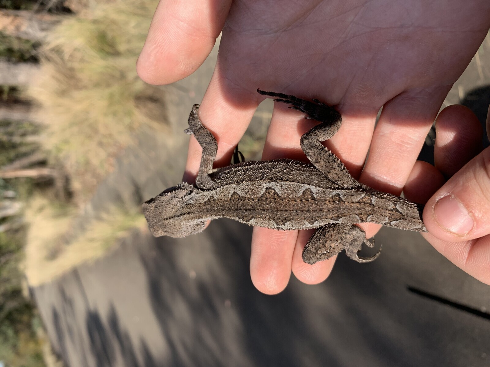
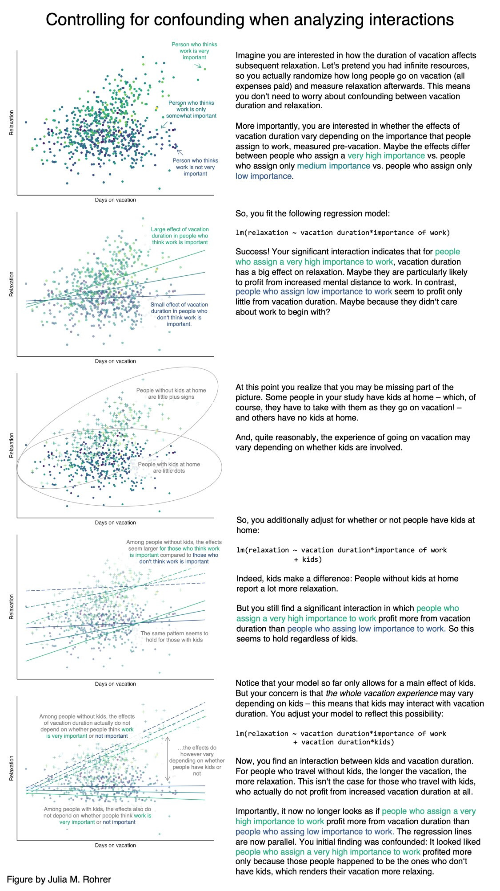

# Statistical Inference

**Week 5**: Comparing groups with t-tests, one-way ANOVA and two-way ANOVA

In this workshop you will learn the three most common tests for comparing
**groups**: the two-sample *t*-test, the one-way ANOVA and the two-way ANOVA.
They might look like three different tests, but they are all the same idea, a
**linear model with categorical predictors**, so learning one makes the next one
easy. Workshop materials are available in the GitHub repository
[ECS200](https://github.com/nicholaswunz/ECS200-Workshop).


::: {.callout-tip}
## Learning outcomes

By the end of this workshop you should be able to:

1. Choose between a *t*-test, one-way ANOVA and two-way ANOVA for a research question.
2. Visualise group data and check the assumptions of these tests.
3. Run each test in R and find the important numbers in the output.
4. Write a results sentence that reports the direction, size and statistical
   support of an effect.
:::

## Before we start {.unnumbered}

Download this week's data and save it in the `data` folder of your workshop
folder (see [Introduction to R](R_intro.qmd) for how the folder is set up).

[<i class="bi bi-download"></i> lizard_sprint.csv](data/lizard_sprint.csv){.btn .btn-outline-danger .btn-sm .download-btn download="lizard_sprint.csv"}

Create a new R script with the usual header and load the packages. We will use
one new package this week, `performance`, which draws all the assumption-checking
plots for a model in one line (the plots themselves come from its partner
package, `see`).

```{r}
#| label: setup

# Week 5 workshop - Statistical inference
# Written by Nicholas Wu, 1234578, 25/03/2027

# Install new packages (only needed once, run in the console)
# install.packages("performance")
# install.packages("see")

# Load packages
library(tidyverse)   # data import, wrangling and plotting
library(performance) # checking model assumptions
library(see)         # draws the plots for the performance package

# Set your working directory to your workshop folder
# setwd("C:/Users/YOUR-NAME/Documents/ECS200")
```

### Study context {.unnumbered}

Lizards are ectotherms, so their body temperature, and therefore how fast they can
run, depends on the temperature around them. Performance usually increases with
temperature up to an optimum and then drops off quickly (a *thermal performance
curve*). Populations from hotter places often have a higher optimum.

To test this, 72 adult dragons were collected from a **coastal** (mild) and an
**inland** (hot) population. In the lab, each lizard was randomly assigned to one
test temperature (**20, 28 or 36 °C**), warmed to that temperature, and raced once
along a 1 m racetrack to measure its maximum **sprint speed** (m/s). Each lizard
was used only once, so every row is an independent lizard.

{width=70%}

```{r}
#| label: load-data

# Load the data
lizard_data <- readr::read_csv("data/lizard_sprint.csv")

# Check the structure: temperature is stored as a number, but in this
# experiment it is a treatment group, so we convert it to a factor.
lizard_data <- lizard_data %>%
  dplyr::mutate(temperature = factor(temperature, levels = c(20, 28, 36)),
                population  = factor(population))

dplyr::glimpse(lizard_data)
```

### Which test do I use? {.unnumbered}

All three tests ask the same question: *is the difference between group means
bigger than we would expect from random variation alone?* They differ only in how
many groups and how many predictors you have.

| Research question | Predictor(s) | Test | R function |
|:------------------|:-------------|:-----|:-----------|
| Do **two** groups differ? | 1 categorical variable with 2 levels | Two-sample *t*-test | `t.test()` |
| Do **three or more** groups differ? | 1 categorical variable with 3+ levels | One-way ANOVA | `aov()` |
| Do **two** factors affect the response, and does the effect of one depend on the other? | 2 categorical variables | Two-way ANOVA | `aov(y ~ A * B)` |

::: {.callout-note}
Functions without a package name in front, such as `t.test()`, `aov()` and `lm()`,
come with R itself (the `stats` package), so you never need to install or load them.
:::

# Part A: Two groups (*t*-test) {.unnumbered}

**Question**: Do lizards sprint faster at 28 °C than at 20 °C?

## 1. Background {.unnumbered}

A two-sample *t*-test compares the **means of two independent groups**. It
calculates a *t* value:

$$
t = \frac{\text{difference between the two group means}}{\text{standard error of that difference}} = \frac{\text{signal}}{\text{noise}}
$$

A large *t* (a big difference relative to the variation within groups) gives a
small *p*-value. Three things make a difference easier to detect:

- a **bigger difference** between the means (more signal);
- **less variation** within each group (less noise);
- a **larger sample size** (the standard error shrinks as *n* grows).

R uses **Welch's *t*-test** by default. It does not assume the two groups have
equal variances, so it is a safe default for ecological data.

Use the app below to see how these three ingredients change the result. Every time
you move a slider, a new experiment is simulated in your browser.

::: {.app-box .column-body-outset}
::: {.app-title}
App: signal versus noise in a *t*-test
:::
::: {.app-grid}
::: {.app-controls}
```{ojs}
//| echo: false
//| output: false
import {rng, rnorm, mean, sd, welch, qt975, fmt, fmtp, red, grey, dark} from "./apps/ecs200.js"
```

```{ojs}
//| echo: false
viewof tt_diff = Inputs.range([0, 1], {value: 0.4, step: 0.05, label: "True difference between means (m/s)"})
viewof tt_sd = Inputs.range([0.05, 0.8], {value: 0.3, step: 0.05, label: "Variation within groups (SD)"})
viewof tt_n = Inputs.range([3, 50], {value: 10, step: 1, label: "Lizards per group (n)"})
viewof tt_seed = Inputs.button("Resample")
```
:::
::: {.app-output}
```{ojs}
//| echo: false
tt_data = {
  const r = rng(101 + tt_seed);
  const a = rnorm(r, tt_n, 1.2, tt_sd);
  const b = rnorm(r, tt_n, 1.2 + tt_diff, tt_sd);
  const pts = [
    ...a.map((v) => ({group: "20 °C", x: 1 + (r() - 0.5) * 0.25, y: v})),
    ...b.map((v) => ({group: "28 °C", x: 2 + (r() - 0.5) * 0.25, y: v}))
  ];
  const summ = [[a, 1], [b, 2]].map(([g, x]) => {
    const m = mean(g), half = qt975(g.length - 1) * sd(g) / Math.sqrt(g.length);
    return {x: x + 0.3, m, lo: m - half, hi: m + half};
  });
  return {a, b, pts, summ, test: welch(a, b)};
}

Plot.plot({
  width: 560, height: 300, marginLeft: 50,
  x: {domain: [0.5, 2.7], ticks: [1, 2], tickFormat: (d) => (d === 1 ? "20 °C" : "28 °C"), label: null},
  y: {label: "Sprint speed (m/s)", grid: true},
  marks: [
    Plot.dot(tt_data.pts, {x: "x", y: "y", fill: grey, fillOpacity: 0.6, r: 3.5}),
    Plot.ruleX(tt_data.summ, {x: "x", y1: "lo", y2: "hi", stroke: red, strokeWidth: 2.5}),
    Plot.dot(tt_data.summ, {x: "x", y: "m", fill: red, r: 6})
  ]
})

html`<div class="app-verdict">Welch's <i>t</i> = <b>${fmt(tt_data.test.t)}</b>, df = ${fmt(tt_data.test.df, 1)}, <i>p</i> <b>${fmtp(tt_data.test.p)}</b>.
${tt_data.test.p < 0.05
  ? "The difference is <b>statistically significant</b>: it is large compared with the noise."
  : "The difference is <b>not statistically significant</b>: we cannot separate it from random noise with this sample."}
Red points and bars show each group's mean and 95% confidence interval.</div>`
```
:::
:::
:::

**Try this**: set the true difference to 0 and press *Resample* many times. About
1 in 20 experiments will still be "significant" just by chance. That is what a
significance level of α = 0.05 means.

**Hypotheses**:

- Null hypothesis (H~0~): mean sprint speed is the same at 20 °C and 28 °C.
- Alternative hypothesis (H~1~): mean sprint speed differs between 20 °C and 28 °C.
- Significance level: α = 0.05.

## 2. Visualise {.unnumbered}

First keep only the two temperatures we want to compare, then plot the raw data.
A boxplot with the raw points on top shows the centre, spread, shape and any
extreme values of each group.

```{r}
#| label: ttest-vis
#| fig-width: 5
#| fig-height: 4

# Keep only the 20 and 28 degree lizards for the t-test
lizard_two <- lizard_data %>%
  dplyr::filter(temperature %in% c("20", "28")) %>%
  dplyr::mutate(temperature = droplevels(temperature)) # drop the unused 36 level

# Boxplot with the raw data
ggplot2::ggplot(lizard_two, ggplot2::aes(x = temperature, y = sprint_speed)) +
  ggplot2::geom_boxplot(outlier.shape = NA, fill = "grey90") + # hide boxplot outliers (raw points show them)
  ggplot2::geom_jitter(width = 0.1, alpha = 0.6) +             # raw data, spread sideways
  ggplot2::labs(x = "Test temperature (°C)", y = "Sprint speed (m/s)") +
  ggplot2::theme_classic()
```

```{r}
#| label: ttest-summary

# Descriptive statistics for each group
lizard_two %>%
  dplyr::group_by(temperature) %>%
  dplyr::summarise(mean = mean(sprint_speed),
                   sd   = sd(sprint_speed),
                   n    = dplyr::n())
```

Lizards at 28 °C look faster than lizards at 20 °C, both groups have a similar
spread and there are no extreme values.

## 3. Check assumptions {.unnumbered}

| Assumption | How to check | Here |
|:-----------|:-------------|:-----|
| **Independence**: each observation is from a different, unrelated unit | Think about the study design | ✅ Each lizard was raced once at one temperature. |
| **Normality**: the data in each group are roughly bell-shaped | Histogram or Q-Q plot for each group | ✅ See below. |
| **Equal variances** (only for the classic *t*-test) | Compare the SDs. If the largest SD is less than 2 × the smallest, they are similar enough | ✅ Similar SDs, and Welch's test does not need this anyway. |

```{r}
#| label: ttest-qq
#| fig-width: 6
#| fig-height: 3

# Q-Q plot for each group: points should fall close to the line
ggplot2::ggplot(lizard_two, ggplot2::aes(sample = sprint_speed)) +
  ggplot2::stat_qq() +
  ggplot2::stat_qq_line() +
  ggplot2::facet_wrap(~ temperature) +
  ggplot2::labs(x = "Theoretical quantiles", y = "Sprint speed (m/s)") +
  ggplot2::theme_classic()
```

::: {.callout-warning collapse="true"}
## When is a *t*-test NOT appropriate? (click to expand)

| What you see | Why it is a problem | What to do instead |
|:-------------|:--------------------|:-------------------|
| Strongly skewed data or big outliers, especially with small samples | The mean is pulled around by extreme values | Log-transform the response (Week 2), or use the non-parametric **Wilcoxon rank-sum test**, `wilcox.test(y ~ group, data = ...)` |
| The same individuals measured twice (before/after, left/right) | Observations are not independent | **Paired *t*-test**, `t.test(before, after, paired = TRUE)`, or a mixed model (Week 12) |
| The response is a count (e.g. number of seedlings) with many zeros | Counts are not normally distributed | Generalised linear model for counts (Week 8) |
| The response is yes/no (e.g. alive/dead) | Not a continuous measurement | Logistic regression (Week 11) |
| More than two groups | Running many *t*-tests inflates false positives | One-way ANOVA (Part B) |

For example, the Wilcoxon test compares the *ranks* of the values instead of the
values themselves, so a single extreme value has little influence:

```{r}
#| label: wilcox
wilcox.test(sprint_speed ~ temperature, data = lizard_two)
```
:::

## 4. Model {.unnumbered}

The formula `response ~ group` reads "sprint speed *explained by* temperature".

```{r}
#| label: ttest-model

# Welch two-sample t-test (two-sided)
lizard_ttest <- t.test(sprint_speed ~ temperature, data = lizard_two)
lizard_ttest
```

## 5. Interpret {.unnumbered}


The output gives everything you need:

- `t = ...`: the *t* value. Its sign only tells you which group was first alphabetically.
- `df = ...`: degrees of freedom (Welch's test gives a decimal value).
- `p-value = ...`: the probability of seeing a difference this large if the null
  hypothesis were true.
- `95 percent confidence interval`: the likely range for the true difference in
  means (group 1 minus group 2). If it does not include 0, the difference is
  significant at α = 0.05.
- `sample estimates`: the mean of each group.

**Methods sentence**: *Sprint speed of lizards tested at 20 °C and 28 °C was compared
using a two-sided Welch's two-sample* t*-test in R (version 4.5.1). Significance 
was set with α = 0.05.*

```{r}
#| label: ttest-numbers
#| echo: false
# Numbers used in the results sentence below (calculated, not typed by hand)
t_means <- tapply(lizard_two$sprint_speed, lizard_two$temperature, mean)
t_sds   <- tapply(lizard_two$sprint_speed, lizard_two$temperature, sd)
t_diff  <- t_means[["28"]] - t_means[["20"]]
t_ci    <- sort(abs(lizard_ttest$conf.int))
```

**Results sentence** (direction + size + statistical support + figure):

> Lizards sprinted faster at 28 °C (mean ± SD = `r sprintf("%.2f", t_means[["28"]])` ± `r sprintf("%.2f", t_sds[["28"]])` m/s)
> than at 20 °C (`r sprintf("%.2f", t_means[["20"]])` ± `r sprintf("%.2f", t_sds[["20"]])` m/s), an average increase of
> `r sprintf("%.2f", t_diff)` m/s (95% CI `r sprintf("%.2f", t_ci[1])` to `r sprintf("%.2f", t_ci[2])` m/s;
> Welch's *t*~`r round(lizard_ttest$parameter, 1)`~ = `r sprintf("%.2f", abs(lizard_ttest$statistic))`, *p* < 0.001; Fig. 1).

# Part B: Three or more groups (one-way ANOVA) {.unnumbered}

**Question**: Does sprint speed differ among the three test temperatures (20, 28
and 36 °C)?

## 1. Background {.unnumbered}

With three groups you could run three *t*-tests (20 vs 28, 20 vs 36, 28 vs 36),
but every extra test adds another 5% chance of a false positive. A **one-way
analysis of variance (ANOVA)** asks a single question first: *do all groups share
the same mean, or does at least one differ?*

ANOVA compares two kinds of variation:

- **Between-group** variation: how far the group means are from the overall mean (signal).
- **Within-group** variation: how spread out individuals are inside each group (noise).

$$
F = \frac{\text{variation between groups}}{\text{variation within groups}}
$$

A large *F* means the group means are further apart than the noise would suggest.
If the ANOVA is significant, a **post hoc test** (Tukey's HSD) then tells you
*which* groups differ, while keeping the overall false-positive rate at 5%.

::: {.app-box .column-body-outset}
::: {.app-title}
App: between- versus within-group variation
:::
::: {.app-grid}
::: {.app-controls}
```{ojs}
//| echo: false
//| output: false
import {anova1} from "./apps/ecs200.js"
```

```{ojs}
//| echo: false
viewof an_spread = Inputs.range([0, 0.6], {value: 0.3, step: 0.05, label: "Spread of the group means (signal)"})
viewof an_sd = Inputs.range([0.05, 0.8], {value: 0.3, step: 0.05, label: "Variation within groups (noise)"})
viewof an_n = Inputs.range([3, 30], {value: 12, step: 1, label: "Lizards per group (n)"})
viewof an_seed = Inputs.button("Resample")
```
:::
::: {.app-output}
```{ojs}
//| echo: false
an_data = {
  const r = rng(202 + an_seed);
  const mus = [1.6 - an_spread, 1.6 + an_spread, 1.6];
  const labels = ["20 °C", "28 °C", "36 °C"];
  const groups = mus.map((m) => rnorm(r, an_n, m, an_sd));
  const pts = groups.flatMap((g, i) => g.map((v) => ({x: i + 1 + (r() - 0.5) * 0.3, y: v, group: labels[i]})));
  const means = groups.map((g, i) => ({x1: i + 0.7, x2: i + 1.3, m: mean(g)}));
  return {pts, means, grand: mean(groups.flat()), res: anova1(groups)};
}

Plot.plot({
  width: 560, height: 350, marginLeft: 50,
  x: {domain: [0.5, 3.5], ticks: [1, 2, 3], tickFormat: (d) => ["20 °C", "28 °C", "36 °C"][d - 1], label: null},
  y: {label: "Sprint speed (m/s)", grid: true},
  marks: [
    Plot.ruleY([an_data.grand], {stroke: dark, strokeDasharray: "5,4"}),
    Plot.dot(an_data.pts, {x: "x", y: "y", fill: grey, fillOpacity: 0.6, r: 3}),
    Plot.link(an_data.means, {x1: "x1", x2: "x2", y1: "m", y2: "m", stroke: red, strokeWidth: 4})
  ]
})

html`<div class="app-verdict">One-way ANOVA: <i>F</i><sub>${an_data.res.df1},${an_data.res.df2}</sub> = <b>${fmt(an_data.res.F)}</b>, <i>p</i> <b>${fmtp(an_data.res.p)}</b>.
Red lines are the group means and the dashed line is the overall (grand) mean. ${an_data.res.p < 0.05 ? "At least one group mean differs." : "No evidence that the group means differ."}</div>`
```
:::
:::
:::

**Hypotheses**:

- H~0~: mean sprint speed is the same at all three temperatures.
- H~1~: at least one temperature has a different mean sprint speed.

## 2. Visualise {.unnumbered}

```{r}
#| label: anova-vis
#| fig-width: 5.5
#| fig-height: 4

# Boxplot with raw data for all three temperatures
ggplot2::ggplot(lizard_data, ggplot2::aes(x = temperature, y = sprint_speed)) +
  ggplot2::geom_boxplot(outlier.shape = NA, fill = "grey90") +
  ggplot2::geom_jitter(width = 0.1, alpha = 0.6) +
  ggplot2::labs(x = "Test temperature (°C)", y = "Sprint speed (m/s)") +
  ggplot2::theme_classic()

# Mean, SD and sample size per temperature
lizard_data %>%
  dplyr::group_by(temperature) %>%
  dplyr::summarise(mean = mean(sprint_speed),
                   sd   = sd(sprint_speed),
                   n    = dplyr::n())
```

Speed looks lowest at 20 °C and highest at 28 °C, and the spread is similar
across groups.

## 3. Check assumptions {.unnumbered}

The assumptions are the same as for the *t*-test (independence, normality and
equal variances), but for ANOVA we check them on the **residuals**. A residual is
the distance between an observation and its group mean, the part of the data
the model cannot explain.

The `performance::check_model()` function draws the main diagnostic plots, and
each panel has a subtitle telling you what a "good" plot looks like.

```{r}
#| label: anova-check
#| fig-width: 8
#| fig-height: 4

# Fit the one-way ANOVA first, then check its residuals
lizard_aov <- aov(sprint_speed ~ temperature, data = lizard_data)

performance::check_model(lizard_aov, check = c("homogeneity", "qq"))
```

| Assumption | Plot | Here |
|:-----------|:-----|:-----|
| **Equal variances** | *Homogeneity of variance*: the reference line should be flat and horizontal | ✅ Roughly flat. |
| **Normal residuals** | *Normality of residuals*: dots should fall along the line | ✅ Dots follow the line. |
| **Independence** | Study design | ✅ One lizard per measurement. |

::: {.callout-warning collapse="true"}
## When is a one-way ANOVA NOT appropriate? (click to expand)

| What you see | What to do instead |
|:-------------|:-------------------|
| Very unequal spread among groups (largest SD > 2 × smallest) | **Welch's ANOVA**, `oneway.test(y ~ group, data = ...)`, which does not assume equal variances |
| Strongly skewed data or outliers with small samples | Log-transform, or the non-parametric **Kruskal–Wallis test**, `kruskal.test(y ~ group, data = ...)` |
| Repeated measurements on the same individuals or sites | Mixed-effects model (Week 12) |
| Counts or yes/no responses | Generalised linear models (Weeks 8 and 11) |
| A numeric predictor (e.g. temperature measured as 18.2, 22.7, 25.1 °C...) | Linear regression (Week 7) |

```{r}
#| label: kruskal
# Example: Kruskal-Wallis test, the non-parametric alternative
kruskal.test(sprint_speed ~ temperature, data = lizard_data)
```
:::

## 4. Model {.unnumbered}

We already fitted the model above with `aov()`. `summary()` gives the ANOVA table.

```{r}
#| label: anova-model

# ANOVA table
summary(lizard_aov)

# Which temperatures differ? Tukey's honestly significant difference test
TukeyHSD(lizard_aov)
```

::: {.callout-note collapse="true"}
## ANOVA is a linear model (click to expand)

You get exactly the same *F* test with `lm()`. The `lm()` summary also shows the
difference of each group from the first (reference) group and the R^2^, the
proportion of variation in sprint speed explained by temperature. This is the
link to linear regression in Week 7.

```{r}
#| label: anova-lm
lizard_lm <- lm(sprint_speed ~ temperature, data = lizard_data)
summary(lizard_lm)
```
:::

## 5. Interpret {.unnumbered}

```{r}
#| label: anova-numbers
#| echo: false
aov_tab   <- summary(lizard_aov)[[1]]
tukey_tab <- as.data.frame(TukeyHSD(lizard_aov)$temperature)
r2        <- summary(lizard_lm)$r.squared
```

Reading the output:

- **ANOVA table**: temperature has `r aov_tab$Df[1]` and `r aov_tab$Df[2]` degrees
  of freedom, *F* = `r round(aov_tab[1, "F value"], 2)` and *p* < 0.001, so at least
  one temperature differs.
- **Tukey's HSD**: each row is one pair of temperatures. `diff` is the difference
  in means, `lwr` and `upr` are its 95% confidence interval, and `p adj` is the
  *p*-value adjusted for making three comparisons.

**Methods sentence**: *Differences in sprint speed among three test temperatures 
(20 °C, 28 °C, 36 °C) were tested with a one-way ANOVA using the `aov()` function, 
followed by Tukey's HSD post hoc comparisons with the `TukeyHSD()` function in R. 
Model assumptions were checked with residual diagnostic plots with the `check_model()` 
from the performance R package [@Ludecke2021].*

**Results sentence**:

> Sprint speed differed among test temperatures (one-way ANOVA:
> *F*~`r aov_tab$Df[1]`,`r aov_tab$Df[2]`~ = `r round(aov_tab[1, "F value"], 2)`, *p* < 0.001;
> R^2^ = `r round(r2, 2)`; Fig. 2). Lizards were `r round(tukey_tab["28-20", "diff"], 2)` m/s faster at 28 °C
> than at 20 °C (95% CI `r round(tukey_tab["28-20", "lwr"], 2)`–`r round(tukey_tab["28-20", "upr"], 2)`, Tukey *p* < 0.001) and
> `r round(tukey_tab["36-20", "diff"], 2)` m/s faster at 36 °C than at 20 °C (*p* < 0.001), but speed at 28 °C
> and 36 °C did not differ (difference = `r round(tukey_tab["36-28", "diff"], 2)` m/s, *p* = `r round(tukey_tab["36-28", "p adj"], 2)`).

# Part C: Two factors (two-way ANOVA) {.unnumbered}

**Question**: Does the effect of temperature on sprint speed differ between the
coastal and inland populations?

## 1. Background {.unnumbered}

A **two-way ANOVA** tests two categorical predictors at once (here temperature and
population) and, most importantly, their **interaction**. Three questions are tested:

1. **Main effect of temperature**: averaged over both populations, does speed change with temperature?
2. **Main effect of population**: averaged over all temperatures, is one population faster?
3. **Interaction (temperature × population)**: does the effect of temperature *depend on* which population the lizard came from?

If there is no interaction, the lines on an **interaction plot** (mean of each
group joined by population) are parallel. If the lines are not parallel or they
cross, the effect of one factor depends on the other. Use the app to build some
interaction plots.

::: {.app-box .column-body-outset}
::: {.app-title}
App: what does an interaction look like?
:::
::: {.app-grid}
::: {.app-controls}
```{ojs}
//| echo: false
viewof ix_temp = Inputs.range([-0.4, 0.4], {value: 0.25, step: 0.05, label: "Temperature effect (change per step: 20 → 28 → 36 °C)"})
viewof ix_pop = Inputs.range([-0.4, 0.4], {value: 0.1, step: 0.05, label: "Population effect (inland minus coastal)"})
viewof ix_int = Inputs.range([-0.4, 0.4], {value: 0, step: 0.05, label: "Interaction (extra temperature effect for inland lizards)"})
```
:::
::: {.app-output}
```{ojs}
//| echo: false
ix_means = {
  const temps = ["20 °C", "28 °C", "36 °C"];
  const out = [];
  temps.forEach((t, i) => {
    out.push({temp: t, pop: "coastal", mean: 1.4 + ix_temp * i});
    out.push({temp: t, pop: "inland", mean: 1.4 + ix_pop + (ix_temp + ix_int) * i});
  });
  return out;
}

Plot.plot({
  width: 560, height: 300, marginLeft: 50,
  x: {domain: ["20 °C", "28 °C", "36 °C"], label: "Test temperature", padding: 0.3},
  y: {label: "Mean sprint speed (m/s)", grid: true, domain: [0.3, 2.6]},
  color: {domain: ["coastal", "inland"], range: [grey, red], legend: true},
  marks: [
    Plot.line(ix_means, {x: "temp", y: "mean", stroke: "pop", strokeWidth: 3}),
    Plot.dot(ix_means, {x: "temp", y: "mean", fill: "pop", r: 6})
  ]
})

html`<div class="app-verdict">${ix_int === 0
  ? "Interaction = 0, so the lines are <b>parallel</b>: temperature has the same effect in both populations and you can interpret each main effect on its own."
  : "Interaction ≠ 0, so the lines are <b>not parallel</b>: the effect of temperature depends on the population. Interpret the interaction first, not the main effects on their own."}</div>`
```
:::
:::
:::

{width=100%}

## 2. Visualise {.unnumbered}

```{r}
#| label: twoway-vis
#| fig-width: 6.5
#| fig-height: 4

# Mean and standard error for every temperature x population combination
lizard_summary <- lizard_data %>%
  dplyr::group_by(temperature, population) %>%
  dplyr::summarise(mean = mean(sprint_speed),
                   se   = sd(sprint_speed) / sqrt(dplyr::n()),
                   n    = dplyr::n(),
                   .groups = "drop")  # remove the grouping after summarising
lizard_summary

# Interaction plot: raw data (faint) with group means +/- SE joined by lines
ggplot2::ggplot() +
  ggplot2::geom_jitter(data = lizard_data,
                       ggplot2::aes(x = temperature, y = sprint_speed, colour = population),
                       position = ggplot2::position_jitterdodge(jitter.width = 0.1, dodge.width = 0.4),
                       alpha = 0.3) +
  ggplot2::geom_pointrange(data = lizard_summary,
                           ggplot2::aes(x = temperature, y = mean, ymin = mean - se, ymax = mean + se,
                                        colour = population),
                           position = ggplot2::position_dodge(width = 0.4)) +
  ggplot2::geom_line(data = lizard_summary,
                     ggplot2::aes(x = temperature, y = mean, colour = population, group = population),
                     position = ggplot2::position_dodge(width = 0.4)) +
  ggplot2::scale_colour_manual(values = c("grey40", "#e12744")) +
  ggplot2::labs(x = "Test temperature (°C)", y = "Sprint speed (m/s)", colour = "Population") +
  ggplot2::theme_classic()
```

The lines cross: coastal lizards are fastest at 28 °C, while inland lizards keep
getting faster up to 36 °C. This suggests an interaction.

## 3. Check assumptions {.unnumbered}

The assumptions are the same as for the one-way ANOVA. Fit the model first, then
check the residuals.

```{r}
#| label: twoway-check
#| fig-width: 8
#| fig-height: 4

# Two-way ANOVA with interaction. temperature * population is shorthand for
# temperature + population + temperature:population
lizard_aov2 <- aov(sprint_speed ~ temperature * population, data = lizard_data)

performance::check_model(lizard_aov2, check = c("homogeneity", "qq"))
```

Both plots look fine and every lizard was tested only once, so the assumptions are met.

::: {.callout-warning collapse="true"}
## When is a two-way ANOVA NOT appropriate? (click to expand)

- **Very unequal sample sizes** among the combinations, or missing combinations:
  the order of terms then changes the results. Keep designs balanced where possible
  (see [Research Design](research_design.qmd)).
- **A numeric predictor** (e.g. body mass) as well as a factor: use a linear model
  with both (Week 7).
- **Repeated measures**, e.g. the *same* lizard raced at all three temperatures:
  observations from one lizard are not independent, so use a mixed-effects model
  with lizard as a random effect (Week 12).
- **Counts or yes/no responses**: use generalised linear models (Weeks 8 and 11).
:::

## 4. Model {.unnumbered}

```{r}
#| label: twoway-model

# ANOVA table for the two-way model
summary(lizard_aov2)
```

Because the interaction is significant, the next step is to compare temperatures
**within each population**. `TukeyHSD()` on the interaction term compares all 15
pairs of the six groups. You only need the rows where the population is the same
on both sides, e.g. `28:coastal-20:coastal` (coastal lizards at 28 °C minus coastal
lizards at 20 °C).

```{r}
#| label: twoway-tukey

# All pairwise comparisons of the 6 temperature x population groups
TukeyHSD(lizard_aov2, which = "temperature:population")
```

## 5. Interpret {.unnumbered}

```{r}
#| label: twoway-numbers
#| echo: false
tab2 <- summary(lizard_aov2)[[1]]
rownames(tab2) <- trimws(rownames(tab2))
f_txt <- function(term) {
  paste0("*F*~", tab2[term, "Df"], ",", tab2["Residuals", "Df"], "~ = ",
         round(tab2[term, "F value"], 2), ", *p* ",
         ifelse(tab2[term, "Pr(>F)"] < 0.001, "< 0.001", paste("=", round(tab2[term, "Pr(>F)"], 3))))
}
```

Always read the **interaction row first**. If the interaction is significant, the
main effects can be misleading on their own. Here the main effect of population is
not significant, yet the populations clearly respond differently to temperature.

**Results sentence**:

> The effect of temperature on sprint speed depended on population (two-way ANOVA,
> temperature × population: `r f_txt("temperature:population")`; Fig. 3). Coastal
> lizards were fastest at 28 °C and slowed down at 36 °C, whereas inland lizards
> continued to increase their speed up to 36 °C. Averaged over populations, speed
> increased with temperature (`r f_txt("temperature")`), and there was no overall
> difference between populations (`r f_txt("population")`). This is consistent with
> inland lizards having a higher thermal optimum.

# Writing results {.unnumbered}

Every results statement should include:

- the **direction** of the effect (higher, lower, increase, decrease);
- the **magnitude** (how big is the difference, ideally with a 95% CI);
- the **statistical support** (test statistic, degrees of freedom, *p*-value);
- a **figure** showing the raw data and the means;
- any **assumptions or caveats**.

For example: *"Seedlings in the drought treatment grew half as fast as the
well-watered control seedlings (control = 3.0 ± 0.45 mm/day, drought = 1.5 ± 0.31
mm/day; t~53~ = 5.06, p < 0.001; Fig. 2)."*

# Assessment {.unnumbered}

Task to complete before the end of the workshop. Download the template script and
the two datasets, save them in your `data` folder, and complete the questions in
the script.

[<i class="bi bi-download"></i> week05_assessment.R](assessments/week05_assessment.R){.btn .btn-danger .btn-sm .download-btn download="week05_assessment.R"}
[<i class="bi bi-download"></i> invaded.csv](data/invaded.csv){.btn .btn-outline-danger .btn-sm .download-btn download="invaded.csv"}
[<i class="bi bi-download"></i> altitude.csv](data/altitude.csv){.btn .btn-outline-danger .btn-sm .download-btn download="altitude.csv"}

::: {.callout-tip}
## From hypothesis to variables

Before writing any code, find the two variables your hypothesis is about:

1. **Response variable (y)**: the thing you *measured* and expect to change. It goes
   on the **y-axis** and on the **left** of the `~` in a formula.
2. **Predictor variable (x)**: the groups or treatment you think *cause* the change.
   It goes on the **x-axis** and on the **right** of the `~`.
3. **Unit of replication**: what one row of the data represents (one quadrat, one
   plot, one lizard). Each row should be an independent replicate.

A quick way to find them is to fill in this sentence: *"Does* **[response]** *differ
between/among* **[groups of the predictor]***?"* For the lizard example: *"Does*
**sprint speed** *differ among* **test temperatures***?"* gives
`sprint_speed ~ temperature`.

Then check the type of each variable with `dplyr::glimpse()`. For these tests the
response must be **numeric** (`<dbl>` or `<int>`) and the predictor must be
**categorical** (convert it with `factor()`).
:::

**Question 1. Invasive plants and native species (*t*-test).** An exotic grass has
spread into part of a native grassland. Ecologists suspect the grass crowds out native
plants. They placed 1 m^2^ quadrats in the **invaded** area and in a nearby
**uninvaded** area and counted the number of native plant species in each quadrat.

**Hypothesis**: native plant species richness differs between invaded and uninvaded
areas.

| Variable in `invaded.csv` | Role | Type | Description |
|:--|:--|:--|:--|
| `Native_count` | Response (y) | Numeric (count) | Number of native plant species in a 1 m^2^ quadrat |
| `Group` | Predictor (x) | Categorical, 2 levels | Whether the quadrat was in the `Invaded` or `Uninvaded` area |

Each row is **one quadrat**, so quadrats are the replicates.

a. Name the response and predictor variables, and say what one row of the data
   represents. Write the null and alternative hypotheses using these variables.
b. Convert `Group` to a factor. Visualise `Native_count` for each `Group` (boxplot with
   the raw points) and calculate the mean, SD and *n* of each group.
c. Check the assumptions (independence, normality, equal variances) and say whether
   each one is met.
d. Run a Welch's *t*-test with the formula `Native_count ~ Group` and write a results
   sentence (direction, size of the difference, *t*, df and *p*).

**Question 2. Plant species richness along an altitude gradient (one-way ANOVA).**
Temperature and growing-season length change with altitude, which may affect how many
plant species can live in a place. Plots were surveyed at **low**, **mid** and **high**
altitude on a mountain and the number of plant species in each plot was recorded.

**Hypothesis**: plant species richness differs among altitudes.

| Variable in `altitude.csv` | Role | Type | Description |
|:--|:--|:--|:--|
| `Richness` | Response (y) | Numeric | Number of plant species recorded in a plot (estimated, so it has decimals) |
| `Altitude` | Predictor (x) | Categorical, 3 levels | Altitude band of the plot: `Low`, `Mid` or `High` |

Each row is **one plot**, so plots are the replicates.

a. Name the response and predictor variables, say what one row represents, and write
   the null and alternative hypotheses.
b. Convert `Altitude` to a factor in the order Low, Mid, High (otherwise R puts them
   in alphabetical order: High, Low, Mid).
c. Visualise `Richness` for each `Altitude` and calculate descriptive statistics.
d. Fit a one-way ANOVA with the formula `Richness ~ Altitude` and check its assumptions.
e. Run Tukey's HSD and write a results sentence that says which altitudes differ.



# Additional resources {.unnumbered}

- [Everything is a linear model](https://danielroelfs.com/posts/everything-is-a-linear-model/):
  a short, visual explanation of why the *t*-test, ANOVA and regression are the same model.
- Coding Club: [ANOVA from A to (XY)Z](https://ourcodingclub.github.io/tutorials/anova/).
- [Estimation statistics](https://www.estimationstats.com/#/): a web app for
  reporting effect sizes with confidence intervals instead of *p*-values alone.
- @Steel2013 *Applied statistics in ecology: common pitfalls and simple solutions*.
  Reading pages 1–4 covers the most common mistakes with these tests.
- Quinn & Keough [-@Quinn2002] *Experimental Design and Data Analysis for Biologists*,
  chapters 8 (one-factor ANOVA) and 9 (multifactor ANOVA), for more depth.
- CrashCourse Statistics: [ANOVA](https://youtu.be/oOuu8IBd-yo) (14 min video).
