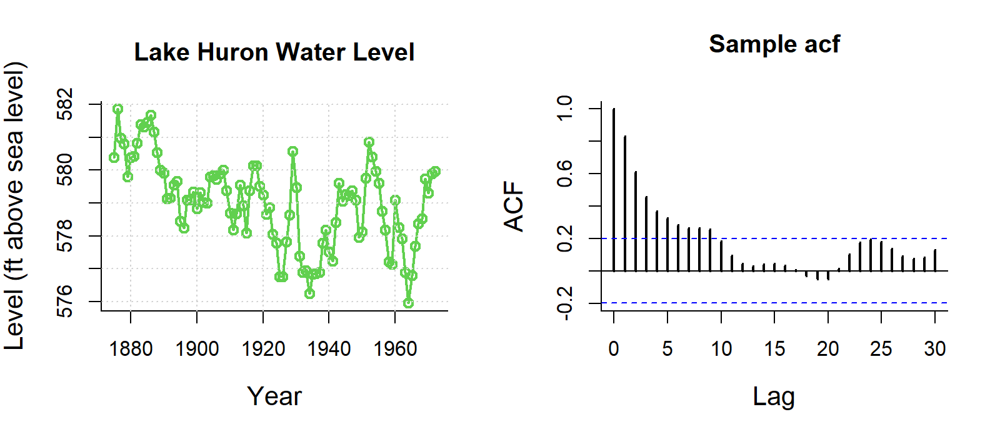
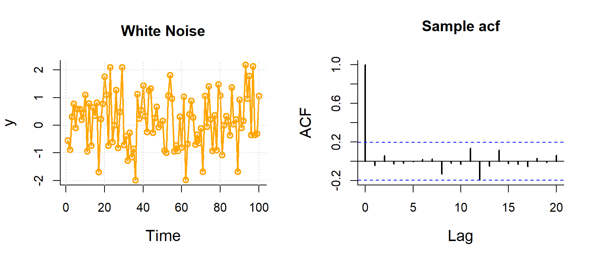
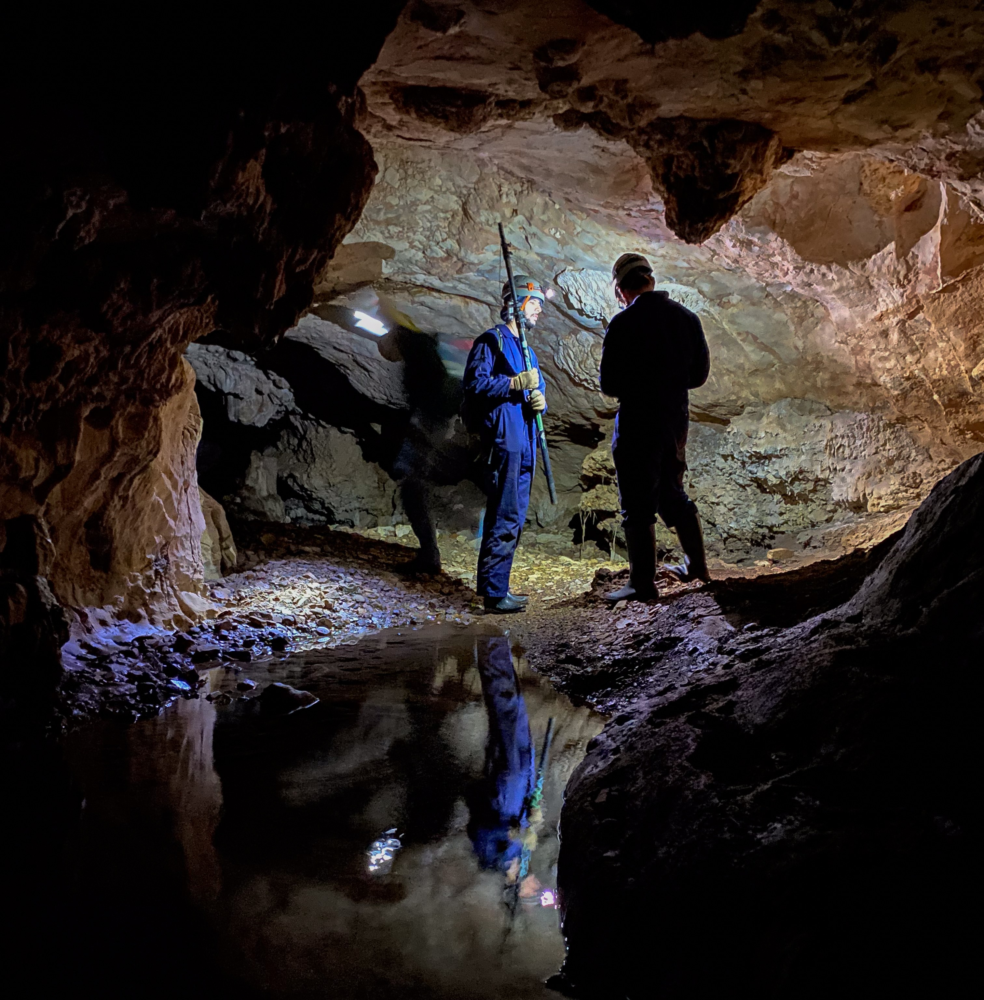
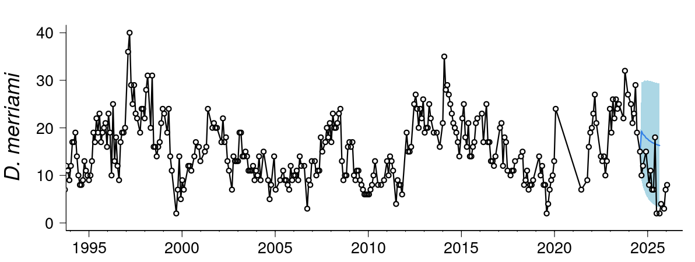

# OPTIONAL: Time Series

**Week 6 (study week)**: Cleaning and plotting time series data

This is an optional tutorial for anyone working with data collected over time:
repeated surveys, data loggers, weather records or growth measurements.

::: {.callout-note}
This tutorial is **optional and not assessed**, and it will not be in the exam. Work
through it in your own time if time series are relevant to your project.
:::

You will learn how to:

1. Convert text into dates and times with `lubridate`, and extract useful parts
   (year, month, day of year).
2. Plot long-term survey data and spot sudden changes.
3. Explore seasonality, trends and autocorrelation.
4. Highlight a study period on logger data.
5. Fit a simple growth curve.

Most examples use datasets from the [`lterdatasampler`](https://lter.github.io/lterdatasampler/)
package.

```{r}
#| label: setup

# Week 6 workshop (optional) - Time series
# Written by Nicholas Wu, 1234578, 01/04/2027

# install.packages("lterdatasampler")  # run once in the console if needed

library(tidyverse)        # includes lubridate for dates and times
library(lterdatasampler)  # example ecological datasets
library(patchwork)        # combine plots

# setwd("C:/Users/YOUR-NAME/Documents/ECS200")
```

# Dates and times with `lubridate` {.unnumbered}

When you import a CSV file, dates are often read as text (`chr`). R needs to know
they are dates before it can sort, plot or subtract them. The `lubridate` functions
are named after the **order** of the parts in your dates: `ymd()` for
year-month-day, `dmy()` for day-month-year, `mdy()` for month-day-year, with `_hm`
or `_hms` added when there is a time.

```{r}
#| label: lubridate

lubridate::dmy("05-01-1987")              # day-month-year
lubridate::mdy("01/05/1987")              # month-day-year
lubridate::ymd_hms("1987-01-05 14:30:00") # date and time
```

{width=70%}

Once a column is a date, you can extract useful parts from it:

```{r}
#| label: extract-dates

stream_dates <- lterdatasampler::luq_streamchem %>%
  dplyr::select(sample_date, temp) %>%
  dplyr::mutate(year      = lubridate::year(sample_date),                 # year
                month     = lubridate::month(sample_date),                # month as a number
                month_lab = lubridate::month(sample_date, label = TRUE),  # month as a label (Jan, Feb...)
                doy       = lubridate::yday(sample_date))                 # day of the year (1-366)

head(stream_dates)
```

Ecological time series are often sampled unevenly. The gap between consecutive
samples, calculated with `dplyr::lag()`, shows missing sampling periods or changes
in effort.

```{r}
#| label: gaps

stream_dates %>%
  dplyr::arrange(sample_date) %>%
  dplyr::mutate(days_since_last = as.numeric(sample_date - dplyr::lag(sample_date))) %>%
  dplyr::count(days_since_last, sort = TRUE) %>%  # how often each gap occurs
  head()
```

# Examples {.unnumbered}

::: {.panel-tabset .nav-pills}

## Long-term survey {.unnumbered}

The `luq_streamchem` data contain stream chemistry from the Quebrada Sonadora, a
high-elevation stream in the Luquillo Experimental Forest, Puerto Rico. The forest
supplies water to about 20% of Puerto Rico's population and is a refuge for
Caribbean biodiversity.

{width=90%}

Plot one chemical, potassium (`k`, mg/L), over time:

```{r}
#| label: potassium
#| fig-width: 7
#| fig-height: 3.5

ggplot2::ggplot(lterdatasampler::luq_streamchem, ggplot2::aes(x = sample_date, y = k)) +
  ggplot2::geom_line(colour = "#e12744") +
  ggplot2::labs(x = NULL, y = "Potassium (mg/L)") +
  ggplot2::theme_bw()
```

Something happened at the end of 1989! Are the other chemicals affected too? Convert
the data to long format so `facet_wrap()` can draw one panel per variable.
`scales = "free_y"` gives each panel its own *y*-axis, because the units differ.

```{r}
#| label: all-chem
#| fig-width: 9
#| fig-height: 7

stream_long <- lterdatasampler::luq_streamchem %>%
  tidyr::pivot_longer(cols      = -c(sample_id, sample_date), # every column except these two
                      names_to  = "variable",
                      values_to = "value")

ggplot2::ggplot(stream_long, ggplot2::aes(x = sample_date, y = value)) +
  ggplot2::geom_line(colour = "#e12744") +
  ggplot2::facet_wrap(~ variable, scales = "free_y") +
  ggplot2::labs(x = NULL, y = NULL) +
  ggplot2::theme_bw()
```

Several variables jump at the end of 1989. **Hurricane Hugo** hit Puerto Rico in
September 1989, and in the following year stream exports of potassium, nitrate and
ammonium increased by 119%, 182% and 102%. A dashed line marks the date of landfall:

```{r}
#| label: hugo
#| fig-width: 7
#| fig-height: 3.5

ggplot2::ggplot(lterdatasampler::luq_streamchem, ggplot2::aes(x = sample_date, y = k)) +
  ggplot2::geom_line(colour = "#e12744") +
  ggplot2::geom_vline(xintercept = as.Date("1989-09-18"), linetype = "dashed") +
  ggplot2::labs(x = NULL, y = "Potassium (mg/L)") +
  ggplot2::theme_bw()
```

Packages such as [`changepoint`](https://cran.r-project.org/web/packages/changepoint/index.html)
can detect change points like this statistically.

## Seasonal data {.unnumbered}

The `arc_weather` data contain daily weather records from Toolik Field Station,
Alaska (1988–2018).

{width=90%}

First calculate the monthly mean air temperature:

```{r}
#| label: monthly
#| fig-width: 8
#| fig-height: 3.5

arc_monthly <- lterdatasampler::arc_weather %>%
  dplyr::mutate(year  = lubridate::year(date),
                month = lubridate::month(date)) %>%
  dplyr::group_by(year, month) %>%
  dplyr::summarise(mean_temp = mean(mean_airtemp, na.rm = TRUE), .groups = "drop") %>%
  dplyr::mutate(year_month = lubridate::make_date(year, month, 1)) # first day of each month, for plotting

ggplot2::ggplot(arc_monthly, ggplot2::aes(x = year_month, y = mean_temp)) +
  ggplot2::geom_line() +
  ggplot2::labs(x = NULL, y = "Mean monthly air temperature (°C)") +
  ggplot2::theme_bw()
```

A **seasonal plot** puts month on the *x*-axis and draws one line per year, which
makes the seasonal cycle and any odd years easy to see:

```{r}
#| label: season-plot
#| fig-width: 7
#| fig-height: 4

ggplot2::ggplot(arc_monthly, ggplot2::aes(x = month, y = mean_temp, group = year, colour = year)) +
  ggplot2::geom_line(alpha = 0.7) +
  ggplot2::scale_x_continuous(breaks = 1:12, labels = month.abb) + # month.abb = Jan, Feb, ...
  ggplot2::scale_colour_viridis_c() +
  ggplot2::labs(x = NULL, y = "Mean monthly air temperature (°C)", colour = "Year") +
  ggplot2::theme_bw()
```

**Decomposition** splits a time series into a long-term **trend**, a repeating
**seasonal** cycle and the **remainder** (what is left over). Base R's `stl()` does
this with a `ts` (time series) object:

```{r}
#| label: decompose
#| fig-width: 7
#| fig-height: 6

# A ts object needs evenly spaced values, the start date and the number of
# observations per cycle (12 months per year)
arc_ts <- ts(arc_monthly$mean_temp, start = c(1988, 6), frequency = 12)

arc_stl <- stl(arc_ts, s.window = "periodic")
plot(arc_stl)
```

- **data**: the raw monthly means.
- **seasonal**: the repeating yearly cycle, which is very strong here.
- **trend**: the long-term change after removing the seasonal cycle. This is the part
  that matters for questions about climate change.
- **remainder**: variation that is not explained by the trend or the season.

**Autocorrelation** measures how similar a time series is to itself a certain number
of steps (*lags*) earlier. `acf()` plots the autocorrelation at each lag:

```{r}
#| label: acf
#| fig-width: 6
#| fig-height: 3.5

acf(arc_ts, lag.max = 36, main = "Monthly air temperature")
```

The strong wave pattern repeats every 12 months, as expected for a seasonal series:
months six months apart are negatively correlated (summer vs winter). Common ACF
patterns:

::: {layout-nrow="3"}





:::

Strong autocorrelation **violates the independence assumption** of the models in
Weeks 5–11. Estimates are still unbiased, but standard errors are too small, so
*p*-values are too optimistic. Time series models (e.g. ARIMA) or models with an
autocorrelation structure handle this.

## Logger data {.unnumbered}

Data loggers record temperature or humidity every few minutes for months. You may
only use part of the record, but it is useful to show the whole period and highlight
when you sampled.

`winter_clim_dat.csv` contains air temperature and relative humidity recorded every
90 minutes outside (EXT) and deep inside (DEEP) two caves (MAM and YES) used by
roosting bats. Here, dates and times are written as day/month/year hour:minute, so
we use `lubridate::dmy_hm()`.

{width=60%}

[<i class="bi bi-download"></i> winter_clim_dat.csv](data/winter_clim_dat.csv){.btn .btn-outline-danger .btn-sm .download-btn download="winter_clim_dat.csv"}

```{r}
#| label: cave
#| fig-width: 8
#| fig-height: 6

clim_data <- readr::read_csv("data/winter_clim_dat.csv") %>%
  dplyr::mutate(date_time = lubridate::dmy_hm(date_time),               # text to date-time
                location  = factor(location, levels = c("EXT", "DEEP"))) # outside first

# Survey period (as date-times, to match the x-axis)
survey_start <- lubridate::ymd_hm("2023-07-10 00:00")
survey_end   <- lubridate::ymd_hm("2023-08-12 00:00")

temp_plot <- ggplot2::ggplot(clim_data, ggplot2::aes(x = date_time, y = air_temp, colour = location)) +
  ggplot2::geom_line() +
  ggplot2::geom_vline(xintercept = c(survey_start, survey_end), linetype = "dashed") +
  ggplot2::scale_colour_manual(values = c("EXT" = "#F5C4B8", "DEEP" = "#e12744")) +
  ggplot2::labs(x = NULL, y = "Air temperature (°C)", colour = "Location") +
  ggplot2::facet_wrap(~ site) +
  ggplot2::theme_bw()

rh_plot <- ggplot2::ggplot(clim_data, ggplot2::aes(x = date_time, y = RH, colour = location)) +
  ggplot2::geom_line() +
  ggplot2::geom_vline(xintercept = c(survey_start, survey_end), linetype = "dashed") +
  ggplot2::scale_colour_manual(values = c("EXT" = "#B8CEF5", "DEEP" = "darkblue")) +
  ggplot2::labs(x = NULL, y = "Relative humidity (%)", colour = "Location") +
  ggplot2::facet_wrap(~ site) +
  ggplot2::theme_bw()

temp_plot / rh_plot  # patchwork: stack the two plots
```

## Growth data {.unnumbered}

The `knz_bison` data contain the age and weight of bison at Konza Prairie, Kansas,
weighed at an annual round-up since 1994, the longest continuous record of wild
ungulate weight gain in the world.

{width=60%}

```{r}
#| label: bison
#| fig-width: 7
#| fig-height: 4

bison_data <- lterdatasampler::knz_bison %>%
  dplyr::mutate(animal_age = rec_year - animal_yob) # age at weighing (years)

ggplot2::ggplot(bison_data, ggplot2::aes(x = animal_age, y = animal_weight, colour = animal_sex)) +
  ggplot2::geom_jitter(size = 0.5, alpha = 0.3, width = 0.2, height = 0) +
  ggplot2::labs(x = "Age (years)", y = "Weight (pounds)", colour = "Sex") +
  ggplot2::theme_bw()
```

Growth is not a straight line: it is fast at first and levels off at an adult size.
A common model for this is the **Gompertz** curve [as used by @Martin2020 for these
bison]:

$$
\text{mass} = b_1 \, e^{-e^{-b_2(\text{age} - b_3)}}
$$

where $b_1$ is the asymptotic (adult) mass, $b_2$ the growth rate at the inflection
point and $b_3$ the age at the inflection point. `nls()` (non-linear least squares)
estimates the three parameters from starting guesses.

```{r}
#| label: gompertz
#| fig-width: 7
#| fig-height: 4

# Female bison only
bison_f <- bison_data %>%
  dplyr::filter(animal_sex == "F")

# Fit the Gompertz model. The start values are rough guesses from the plot.
bison_gompertz <- nls(animal_weight ~ b1 * exp(-exp(-b2 * (animal_age - b3))),
                      data  = bison_f,
                      start = list(b1 = 1000, b2 = 1, b3 = 0.6))

summary(bison_gompertz)

# Predicted weights for ages 0 to 22, for plotting the curve
bison_pred <- data.frame(animal_age = seq(0, 22, by = 0.1))
bison_pred$animal_weight <- predict(bison_gompertz, newdata = bison_pred)

ggplot2::ggplot(bison_f, ggplot2::aes(x = animal_age, y = animal_weight)) +
  ggplot2::geom_jitter(size = 0.5, alpha = 0.2, width = 0.2, height = 0) +
  ggplot2::geom_line(data = bison_pred, colour = "#e12744", linewidth = 1) +
  ggplot2::labs(x = "Age (years)", y = "Weight (pounds)") +
  ggplot2::theme_bw()
```

:::

# Bad time series data {.unnumbered}

Loggers can be damaged, exposed to direct sun, flooded or affected by software bugs.
In this example something went wrong after 1 November:

{width=80%}

These data need to be removed before analysis. Depending on the problem, you can:

- filter out values beyond a biologically or physically possible threshold (e.g.
  humidity above 100%);
- filter out outliers with the IQR rule (Week 1);
- filter out the time period when you know the equipment was faulty (e.g. after a
  storm), using `dplyr::filter(date_time < lubridate::ymd("2023-11-01"))`.
  
  
## A worked example: cleaning a raw logger file {.unnumbered}

Other common problems with microclimate loggers are **outliers**, **duplicate
times/values** and **missing data points**. `logger_bad.csv` is a (simulated) week of
hourly air temperature from a logger placed in a tree hollow. It contains all of
these problems, just like a real file straight off a logger.

[<i class="bi bi-download"></i> logger_bad.csv](data/logger_bad.csv){.btn .btn-outline-danger .btn-sm .download-btn download="logger_bad.csv"}

```{r}
#| label: bad-import
#| fig-width: 8
#| fig-height: 3

logger_raw <- readr::read_csv("data/logger_bad.csv") %>%
  dplyr::mutate(date_time = lubridate::dmy_hm(date_time)) # text to date-time

summary(logger_raw)

# Always plot the raw data first
ggplot2::ggplot(logger_raw, ggplot2::aes(x = date_time, y = air_temp)) +
  ggplot2::geom_line() +
  ggplot2::geom_point(size = 0.8) +
  ggplot2::labs(x = NULL, y = "Air temperature (°C)") +
  ggplot2::theme_bw()
```

The plot already shows a spike to over 45 °C and a gap where the line jumps across
missing hours. The other problems are hidden, so we check for each one.

::: {.panel-tabset .nav-pills}

### 1. Duplicates {.unnumbered}

Duplicates in logger files usually happen when the logger is downloaded twice and
the files are joined (the same rows twice), or when the logger records two readings
at the same time.

**Exact duplicate rows** are found and removed exactly as in
[Week 1](week01_quality_check.qmd) (section 1.3), with `duplicated()` and
`dplyr::distinct()`:

```{r}
#| label: bad-dup-rows

sum(duplicated(logger_raw))   # number of rows that are exact copies

logger_clean <- logger_raw %>%
  dplyr::distinct()           # keep one copy of each row
```

**Duplicate times with different values** are specific to time series. The rows are
not identical, so `dplyr::distinct()` does not catch them, but a logger can only
have **one** reading per time. Count the readings at each time:

```{r}
#| label: bad-dup-times

# Times that have more than one reading
logger_clean %>%
  dplyr::count(date_time) %>%
  dplyr::filter(n > 1)

# Look at the readings at that time
logger_clean %>%
  dplyr::filter(date_time == lubridate::ymd_hm("2023-07-12 06:00"))
```

Decide which reading to keep. If you cannot tell which one is right, take the
**mean** of the readings at that time:

```{r}
#| label: bad-dup-fix

logger_clean <- logger_clean %>%
  dplyr::group_by(date_time) %>%
  dplyr::summarise(air_temp = mean(air_temp), .groups = "drop") # one row per time

# Check: should now return no rows
logger_clean %>% dplyr::count(date_time) %>% dplyr::filter(n > 1)
```

### 2. Outliers {.unnumbered}

The IQR rule from [Week 1](week01_quality_check.qmd) looks at all values together.
In a time series, a value can be within the normal range for the whole week but still
be impossible **for that time** (e.g. 20 °C at 3 am on a night when it was 8 °C an
hour earlier). Two time-series checks work better:

1. a **physical limit**: values outside what is possible at the site;
2. a **rate of change**: air temperature cannot jump by more than a few degrees in
   one hour, so compare each reading to the one before it with `dplyr::lag()`.

```{r}
#| label: bad-outlier

logger_clean <- logger_clean %>%
  dplyr::mutate(change = air_temp - dplyr::lag(air_temp)) # change since the last reading (°C)

# Readings above 40 °C, or that jumped more than 5 °C in an hour
logger_clean %>%
  dplyr::filter(air_temp > 40 | abs(change) > 5)
```

The spike at 14:00 on 13 July rose by over 30 °C in one hour, then dropped back
again (the row after it shows the matching drop). The sun probably hit the sensor.
The third row (12:00 on 14 July) is a **false alarm**: its "change" is large only
because the previous reading was 10 hours earlier (the missing data in tab 3), so it
is a real value. Always look at flagged rows before removing them.

Replace the bad value with `NA` rather than deleting the row, so the time series
stays complete:

```{r}
#| label: bad-outlier-fix

logger_clean <- logger_clean %>%
  dplyr::mutate(air_temp = dplyr::if_else(air_temp > 40, NA_real_, air_temp)) %>%
  dplyr::select(-change)                                    # remove the helper column
```

::: {.callout-note}
Choose the limits from what you know about the site and the sensor, and report them
in your methods (e.g. *"readings that changed by more than 5 °C within an hour were
removed"*). Do not remove values just because they are extreme: a real heatwave is
data, not an error.
:::

### 3. Missing data {.unnumbered}

Time series can be missing data in two ways:

- **Blank readings** (`NA`) in a row that exists. Count them with
  `colSums(is.na())` as in [Week 1](week01_quality_check.qmd) (section 1.2).
- **Missing rows**: the logger recorded nothing at all, e.g. when the battery
  failed. These are invisible to `is.na()` because the rows do not exist! Find them by
  looking at the **gap between readings**, as at the top of this page.

```{r}
#| label: bad-gaps

colSums(is.na(logger_clean))   # blank readings (includes the spike we removed)

# Gaps longer than the 1-hour logging interval
logger_clean %>%
  dplyr::mutate(gap_hours = as.numeric(difftime(date_time, dplyr::lag(date_time), units = "hours"))) %>%
  dplyr::filter(gap_hours > 1)
```

There is a 10-hour gap: 9 hourly readings are missing. `tidyr::complete()` adds a
row, filled with `NA`, for every expected time, so the gaps become visible:

```{r}
#| label: bad-complete

logger_clean <- logger_clean %>%
  tidyr::complete(date_time = seq(min(date_time), max(date_time), by = "1 hour"))

nrow(logger_clean)             # 7 days x 24 hours = 168
colSums(is.na(logger_clean))   # missing rows now show up as NA
```

What to do with the `NA`s depends on how long the gap is:

- **Short gaps** (one or two readings) can be filled by **linear interpolation**: a
  straight line between the readings on either side. Base R's `approx()` does this.
- **Long gaps** should usually be left as `NA`. Interpolating across 9 hours would
  draw a straight line through a whole night and invent data that were never
  measured.

```{r}
#| label: bad-interp

# Label each run of consecutive NAs with its length
logger_clean <- logger_clean %>%
  dplyr::mutate(run_id  = cumsum(!is.na(air_temp)))      %>% # same id for an NA run
  dplyr::group_by(run_id) %>%
  dplyr::mutate(gap_length = sum(is.na(air_temp)))       %>% # length of that NA run
  dplyr::ungroup() %>%
  dplyr::mutate(
    # straight-line estimate between the neighbouring readings
    interp   = approx(x = date_time, y = air_temp, xout = date_time)$y,
    # only use it for gaps of 2 readings or fewer
    air_temp_filled = dplyr::if_else(is.na(air_temp) & gap_length <= 2, interp, air_temp),
    filled   = is.na(air_temp) & !is.na(air_temp_filled)  # flag filled values
  ) %>%
  dplyr::select(date_time, air_temp, air_temp_filled, filled)

sum(logger_clean$filled)       # how many values were filled
```

:::

## Compare raw and cleaned data {.unnumbered}

Finally, compare the raw and cleaned data. Filled values are shown in red, and the
long gap is left empty:

```{r}
#| label: bad-final
#| fig-width: 8
#| fig-height: 5

raw_plot <- ggplot2::ggplot(logger_raw, ggplot2::aes(x = date_time, y = air_temp)) +
  ggplot2::geom_line(colour = "grey50") +
  ggplot2::labs(x = NULL, y = "Air temp (°C)", title = "Raw") +
  ggplot2::theme_bw()

clean_plot <- ggplot2::ggplot(logger_clean, ggplot2::aes(x = date_time, y = air_temp_filled)) +
  ggplot2::geom_line() +                                          # breaks where values are NA
  ggplot2::geom_point(data = dplyr::filter(logger_clean, filled),
                      colour = "#e12744", size = 2) +             # interpolated values
  ggplot2::labs(x = NULL, y = "Air temp (°C)", title = "Cleaned") +
  ggplot2::theme_bw()

raw_plot / clean_plot
```

::: {.callout-tip}
## Checklist for raw logger data

1. Convert the date-time column with `lubridate` and plot the raw data.
2. Remove exact duplicate rows (`dplyr::distinct()`, Week 1).
3. Find times with more than one reading (`dplyr::count(date_time)`) and keep one.
4. Flag impossible values and sudden jumps (`dplyr::lag()`) and set them to `NA`.
5. Add missing times with `tidyr::complete()`.
6. Interpolate only short gaps; leave long gaps as `NA`.
7. Report every cleaning step in your methods, and keep the raw file unchanged.
:::

# Analysing time series {.unnumbered}

Time series analysis is beyond this unit, but here are some possibilities:

- **Repeated measures**: if the same individuals or sites are measured over time,
  include them as a random effect (Week 12).
- **Trends and population dynamics**: GLMs (Week 8), or generalised additive models
  (GAMs) for non-linear trends over time [@Pedersen2019].
- **Forecasting**: models such as autoregressive (AR), ARIMA and exponential
  smoothing handle autocorrelation and seasonality and can predict future values.
  See this [live forecast](https://portal.naturecast.org/) of desert rodent populations.

{width=90%}

# Additional resources {.unnumbered}

- Coding Club: [Analysing time series data](https://ourcodingclub.github.io/tutorials/time/).
- R for Data Science: [dates and times](https://r4ds.hadley.nz/datetimes.html).
- Hyndman & Athanasopoulos, [Forecasting: Principles and Practice](https://otexts.com/fpp3/),
  a free online book on time series decomposition and forecasting.
- @Pedersen2019: hierarchical GAMs for wiggly trends that differ among sites or species.
