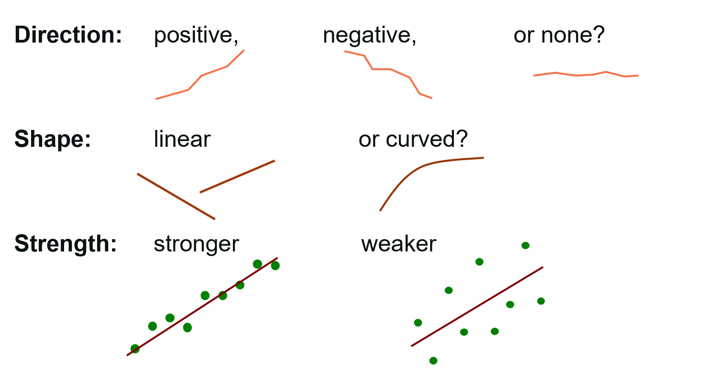
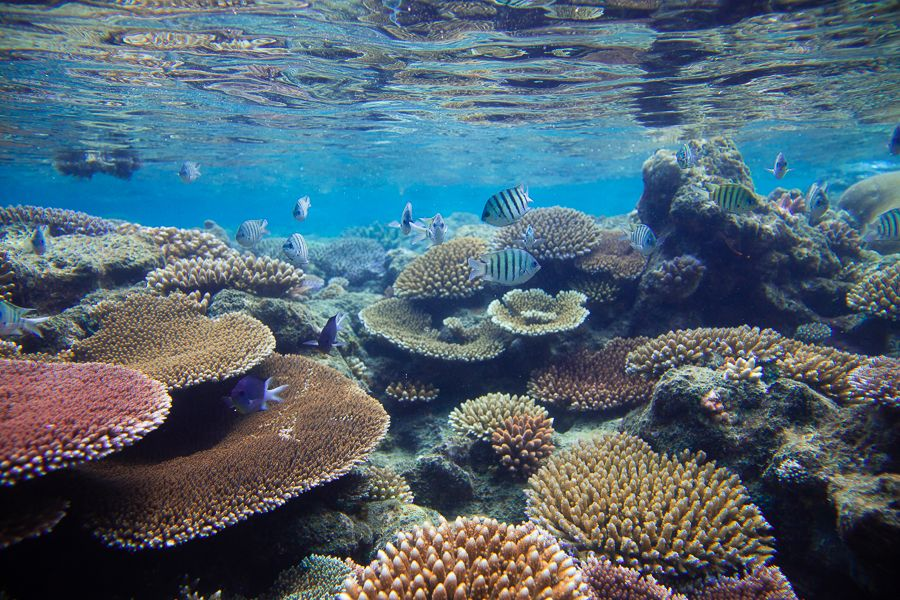

# Linear and Multiple Regression

**Week 7**: Relationships between a response and one or more numeric predictors

Last week you compared **groups**. This week the predictor is a **number** (latitude,
temperature, chlorophyll) and we ask how the response changes as that number
changes. You will fit a simple linear regression (one predictor) and then a
multiple regression (several predictors). Workshop materials are available in the
GitHub repository [ECS200](https://github.com/nicholaswunz/ECS200-Workshop).


::: {.callout-tip}
## Learning outcomes

By the end of this workshop you should be able to:

1. Explain what the intercept, slope and R^2^ of a regression mean.
2. Use diagnostic plots to check linearity, equal variance, normality and influential points.
3. Recognise collinearity between predictors and decide what to do about it.
4. Fit, visualise and write up simple and multiple regression models in R.
:::

## Before we start {.unnumbered}

[<i class="bi bi-download"></i> pie_crab.csv](data/pie_crab.csv){.btn .btn-outline-danger .btn-sm .download-btn download="pie_crab.csv"}
[<i class="bi bi-download"></i> coralreefdata.csv](data/coralreefdata.csv){.btn .btn-outline-danger .btn-sm .download-btn download="coralreefdata.csv"}

We use one new package, `ggeffects`, to plot what a model predicts.

```{r}
#| label: setup

# Week 7 workshop - Linear and multiple regression
# Written by Nicholas Wu, 1234578, 15/04/2027

# install.packages("ggeffects")  # run once in the console if needed

library(tidyverse)   # data import, wrangling and plotting
library(performance) # checking model assumptions
library(see)         # draws the plots for performance
library(ggeffects)   # predictions from models for plotting

# setwd("C:/Users/YOUR-NAME/Documents/ECS200")
```

# Part A: Simple linear regression {.unnumbered}

**Question**: Are fiddler crabs bigger at higher latitudes (Bergmann's rule)?

Bergmann's rule predicts that individuals of a species are larger in colder
places, which usually means at higher latitudes. In summer 2016, researchers
measured the carapace width of adult male Atlantic marsh fiddler crabs (*Minuca
pugnax*) at 13 salt marshes spanning more than 12 degrees of latitude, from Florida
to Massachusetts [@Johnson2019]. The data come from the
[`lterdatasampler`](https://lter.github.io/lterdatasampler/) collection.

{width=90%}

```{r}
#| label: load-crab

crab_data <- readr::read_csv("data/pie_crab.csv")

dplyr::glimpse(crab_data)
```

The columns we need are `size` (carapace width, mm) and `latitude` (degrees north).

## 1. Background {.unnumbered}

A simple linear regression fits the straight line that best describes how a
numeric response (*y*) changes with a numeric predictor (*x*):

$$
y_i = \beta_0 + \beta_1 x_i + \varepsilon_i
$$

- $\beta_0$ is the **intercept**: the predicted *y* when *x* = 0.
- $\beta_1$ is the **slope**: how much *y* changes, on average, for every one-unit
  increase in *x*. This is usually the number your research question is about.
- $\varepsilon_i$ is the **residual**: the vertical distance between each point and
  the line. Residuals are assumed to be normally distributed with constant spread.

R finds the line that makes the sum of the squared residuals as small as possible
(*least squares*). The null hypothesis is that the slope is zero (no relationship).

A straight line is only a good summary if the relationship really is straight. In
the app below, choose a pattern and compare the diagnostic plots with the ideal: a
**flat, patternless cloud** in the residuals plot and points **along the line** in the
Q-Q plot.

::: {.app-box .column-body-outset}
::: {.app-title}
App: is a straight line a good fit?
:::
::: {.app-grid}
::: {.app-controls}
```{ojs}
//| echo: false
//| output: false
import {rng, rnorm, runif, mean, sd, lm1, lm2, cor, qqpoints, smooth, fmt, fmtp, red, grey, dark} from "./apps/ecs200.js"
```

```{ojs}
//| echo: false
viewof lin_type = Inputs.radio(
  new Map([["Linear, going up", "up"], ["Linear, going down", "down"], ["Curved", "curve"], ["Fan-shaped", "fan"], ["One extreme outlier", "outlier"]]),
  {value: "up", label: "Pattern in the data"})
viewof lin_resid = Inputs.toggle({label: "Show residuals", value: false})
viewof lin_seed = Inputs.button("Resample")
```
:::
::: {.app-output}
```{ojs}
//| echo: false
lin_data = {
  const r = rng(707 + lin_seed);
  const n = 80;
  const x = runif(r, n, 0, 4);
  const e = rnorm(r, n, 0, 1);
  let y;
  if (lin_type === "up") y = x.map((v, i) => 1 + 1.5 * v + e[i]);
  if (lin_type === "down") y = x.map((v, i) => 8 - 1.5 * v + e[i]);
  if (lin_type === "curve") y = x.map((v, i) => 1 + 0.6 * v ** 3 + 2 * e[i]);
  if (lin_type === "fan") y = x.map((v, i) => 2 + 1.2 * v + e[i] * (0.2 + 1.1 * v));
  if (lin_type === "outlier") { y = x.map((v, i) => 2 + 0.3 * v + 0.8 * e[i]); x[0] = 3.9; y[0] = 14; }
  const fit = lm1(x, y);
  const pts = x.map((v, i) => ({x: v, y: y[i], fitted: fit.fitted[i], resid: fit.resid[i], std: fit.stdres[i]}));
  return {pts, fit};
}

lin_scatter = Plot.plot({
  width: 560, height: 250, marginLeft: 45,
  x: {label: "x (predictor)"}, y: {label: "y (response)", grid: true},
  marks: [
    lin_resid ? Plot.link(lin_data.pts, {x1: "x", x2: "x", y1: "y", y2: "fitted", stroke: red, strokeOpacity: 0.5}) : null,
    Plot.dot(lin_data.pts, {x: "x", y: "y", fill: grey, r: 3}),
    Plot.line(lin_data.pts.slice().sort((a, b) => a.x - b.x), {x: "x", y: "fitted", stroke: red, strokeWidth: 2.5})
  ]
})

lin_resplot = Plot.plot({
  width: 275, height: 210, marginLeft: 45,
  x: {label: "Fitted values"}, y: {label: "Residuals", grid: true},
  marks: [
    Plot.ruleY([0], {stroke: dark, strokeDasharray: "4,3"}),
    Plot.dot(lin_data.pts, {x: "fitted", y: "resid", fill: grey, r: 2.5}),
    Plot.line(smooth(lin_data.pts.map((d) => d.fitted), lin_data.pts.map((d) => d.resid)), {x: "x", y: "y", stroke: red, strokeWidth: 2})
  ]
})

lin_qq = Plot.plot({
  width: 275, height: 210, marginLeft: 45,
  x: {label: "Theoretical quantiles"}, y: {label: "Standardised residuals", grid: true},
  marks: [
    Plot.line([[-2.6, -2.6], [2.6, 2.6]], {stroke: red, strokeWidth: 2}),
    Plot.dot(qqpoints(lin_data.pts.map((d) => d.std)), {x: "theoretical", y: "sample", fill: grey, r: 2.5})
  ]
})

html`<div>${lin_scatter}<div class="app-row"><div><div class="app-plot-label">Residuals vs fitted</div>${lin_resplot}</div><div><div class="app-plot-label">Normal Q-Q plot of residuals</div>${lin_qq}</div></div>
<div class="app-verdict">R<sup>2</sup> = <b>${fmt(lin_data.fit.r2)}</b>, slope = <b>${fmt(lin_data.fit.b1)}</b>, <i>p</i> ${fmtp(lin_data.fit.p)}.
${{up: "A good fit: residuals are a flat cloud and the Q-Q points sit on the line.",
   down: "A good fit: the direction of the slope does not matter, only the pattern of the residuals.",
   curve: "A poor fit: the residuals form a U-shape. The relationship is curved, so a straight line is the wrong model.",
   fan: "A poor fit: the residuals spread out as fitted values increase (unequal variance). A log transformation or a GLM may help.",
   outlier: "One point drags the line and creates a long tail in the Q-Q plot. Check whether it is a data entry error."}[lin_type]}</div></div>`
```
:::
:::
:::

## 2. Visualise {.unnumbered}

Always plot the data before fitting a model. Describe the **direction** (positive or
negative), **form** (linear or curved), **strength** (tight or scattered) and any
**unusual points**.

{width=90%}

```{r}
#| label: crab-scatter
#| fig-width: 6
#| fig-height: 4

ggplot2::ggplot(crab_data, ggplot2::aes(x = latitude, y = size)) +
  ggplot2::geom_point(alpha = 0.4) +
  ggplot2::labs(x = "Latitude (°N)", y = "Carapace width (mm)") +
  ggplot2::theme_classic()
```

The relationship is **positive** (crabs are wider further north), roughly **linear**,
of **moderate strength**, and there are no obvious errors. Notice that the points
form 13 vertical stripes: every crab from the same marsh shares the same latitude.
Keep that in mind for the independence assumption below.

## 3. Check assumptions {.unnumbered}

Fit the model first, then check the residuals with `performance::check_model()`.

```{r}
#| label: crab-model-fit

# size explained by latitude
crab_lm <- lm(size ~ latitude, data = crab_data)
```

```{r}
#| label: crab-check
#| fig-width: 9
#| fig-height: 9

performance::check_model(crab_lm)
```

Each panel has a subtitle that describes what you want to see:

| Panel | Checks | What you want to see | Here |
|:------|:-------|:---------------------|:-----|
| Posterior predictive check | Overall fit | Model-predicted lines (blue) resemble the data (green) | ✅ |
| Linearity | Straight-line relationship | Flat, horizontal reference line | ✅ |
| Homogeneity of variance | Equal spread of residuals | Flat, horizontal reference line | ✅ Roughly flat |
| Influential observations | Single points controlling the fit | All points inside the contour lines | ✅ |
| Normality of residuals | Normal residuals | Dots fall along the line | ✅ Slight wobble in the tails, acceptable with *n* = 392 |

The plots cannot check **independence**. That comes from the study design: 392 crabs
were measured, but they come from only 13 marshes, and crabs from the same marsh
share the same environment. This means we have less independent information than
392 data points suggest, and the *p*-value will be too small. We will handle this
properly with a mixed-effects model in [Week 12](week12_mixed_models.qmd). For now we
note it as a caveat.

Influential points deserve a closer look. Use the app to see how a single point
can change the regression line, depending on where it sits.

::: {.app-box .column-body-outset}
::: {.app-title}
App: leverage and influential points
:::
::: {.app-grid}
::: {.app-controls}
```{ojs}
//| echo: false
viewof inf_x = Inputs.range([-10, 50], {value: 42, step: 1, label: "Red point: x position"})
viewof inf_y = Inputs.range([-20, 60], {value: 5, step: 1, label: "Red point: y position"})
viewof inf_n = Inputs.range([5, 60], {value: 20, step: 1, label: "Number of black points"})
viewof inf_seed = Inputs.button("Resample")
```
:::
::: {.app-output}
```{ojs}
//| echo: false
inf_data = {
  const r = rng(808 + inf_seed);
  const n = inf_n;
  const xb = Array.from({length: n}, (_, i) => (i * 20) / (n - 1));
  const yb = xb.map((v) => v + rnorm(r, 1, 0, 3)[0]);
  const x = [...xb, inf_x], y = [...yb, inf_y];
  const all = lm1(x, y), black = lm1(xb, yb);
  const pts = x.map((v, i) => ({x: v, y: y[i], red: i === n, hat: all.hat[i], std: all.stdres[i], cook: all.cook[i]}));
  return {pts, all, black, n};
}

inf_scatter = Plot.plot({
  width: 330, height: 260, marginLeft: 40,
  x: {domain: [-12, 52], label: "x"}, y: {domain: [-25, 65], label: "y", grid: true},
  marks: [
    Plot.line([[-12, inf_data.black.b0 - 12 * inf_data.black.b1], [52, inf_data.black.b0 + 52 * inf_data.black.b1]], {stroke: dark, strokeWidth: 2, strokeDasharray: "5,4"}),
    Plot.line([[-12, inf_data.all.b0 - 12 * inf_data.all.b1], [52, inf_data.all.b0 + 52 * inf_data.all.b1]], {stroke: red, strokeWidth: 2.5}),
    Plot.dot(inf_data.pts.filter((d) => !d.red), {x: "x", y: "y", fill: dark, r: 3}),
    Plot.dot(inf_data.pts.filter((d) => d.red), {x: "x", y: "y", fill: red, r: 7, symbol: "triangle"})
  ]
})

inf_lev = Plot.plot({
  width: 250, height: 260, marginLeft: 40,
  x: {label: "Leverage", domain: [0, 1]}, y: {label: "Std. residuals", grid: true},
  marks: [
    Plot.ruleX([2 * 2 / (inf_data.n + 1)], {stroke: red, strokeDasharray: "4,3"}),
    Plot.ruleY([0], {stroke: grey}),
    Plot.dot(inf_data.pts.filter((d) => !d.red), {x: "hat", y: "std", fill: dark, r: 3}),
    Plot.dot(inf_data.pts.filter((d) => d.red), {x: "hat", y: "std", fill: red, r: 7, symbol: "triangle"})
  ]
})

inf_red = inf_data.pts.find((d) => d.red)

html`<div><div class="app-row"><div><div class="app-plot-label">Data and fitted lines</div>${inf_scatter}</div><div><div class="app-plot-label">Residuals vs leverage</div>${inf_lev}</div></div>
<div class="app-verdict">Slope with the red point: <b>${fmt(inf_data.all.b1)}</b> (solid red line); without it: <b>${fmt(inf_data.black.b1)}</b> (dashed line).
Red point leverage = ${fmt(inf_red.hat)}, Cook's distance = <b>${fmt(inf_red.cook)}</b>.
${inf_red.cook > 1 ? "This point is <b>highly influential</b>: it changes the slope on its own."
  : inf_red.hat > 4 / (inf_data.n + 1) ? "High leverage (unusual x) but the point follows the trend, so it has little influence."
  : "This point has little influence on the fitted line."}
Move the red point far to the right <i>and</i> away from the trend to make it influential.</div></div>`
```
:::
:::
:::

**Leverage** measures how unusual a point's *x* value is. 

**Cook's distance** combines
leverage with the size of the residual. A point is only a problem when it is both
unusual in *x* and far from the line. Never delete a point just because it is
influential. Check whether it is a data entry error (Week 1) and, if it is real,
report the results with and without it.

::: {.callout-warning collapse="true"}
## When is a linear regression NOT appropriate? (click to expand)

| What you see | Problem | What to do instead |
|:-------------|:--------|:-------------------|
| Curved pattern in the scatterplot or a U-shape in the residuals | Relationship is not linear | Transform *x* and/or *y* (e.g. log, see the Assessment), or add a curved term `y ~ x + I(x^2)`. For wiggly relationships, use a generalised additive model [@Pedersen2019] |
| Residual spread increases with fitted values (fan shape) | Unequal variance | Log-transform *y*, or use a GLM (Weeks 8 and 11) |
| Observations grouped by site, individual or time | Not independent | Mixed-effects model (Week 12) |
| Response is a count, a proportion or yes/no | Residuals cannot be normal | GLM (Weeks 8 and 11) |
| Predictor measured with large error | Slope is biased towards zero | Discuss as a caveat. Better measurements are the real fix |
:::

## 4. Model {.unnumbered}

```{r}
#| label: crab-model

# Coefficients, standard errors, t values, p-values and R-squared
summary(crab_lm)

# 95% confidence intervals for the intercept and slope
confint(crab_lm)
```

The output gives everything you need:

- `Residuals`: a summary of the residuals. The median should be close to 0, and the
  minimum and maximum (and 1Q and 3Q) roughly the same distance from it.
- `Coefficients`: one row for the intercept and one for the slope.
  - `Estimate`: `(Intercept)` is the predicted width at latitude 0; `latitude` is the
    **slope**, the change in width (mm) per degree of latitude. A positive slope means
    width increases with latitude.
  - `Std. Error`: the uncertainty in each estimate.
  - `t value`: the estimate divided by its standard error.
  - `Pr(>|t|)`: the *p*-value for the null hypothesis that the coefficient is 0 (for
    the slope: no relationship).
- `Residual standard error`: the typical distance of a crab from the fitted line
  (mm), with its degrees of freedom (number of crabs − 2).
- `Multiple R-squared`: the proportion of variation in width explained by latitude.
  `Adjusted R-squared` is slightly lower because it penalises extra predictors; it
  matters more in multiple regression.
- `F-statistic ... on 1 and ... DF, p-value`: compares this model with a model that
  has no predictor. With one predictor its *p*-value equals the slope's *p*-value.
- `confint()`: the 95% confidence intervals (`2.5 %` to `97.5 %`) for the intercept
  and slope. If the slope's CI does not include 0, the relationship is significant
  at α = 0.05.

Add the fitted line and its 95% confidence band to the scatterplot.
`geom_smooth(method = "lm")` fits the same model as `lm(size ~ latitude)`.

```{r}
#| label: crab-fit-plot
#| fig-width: 6
#| fig-height: 4

ggplot2::ggplot(crab_data, ggplot2::aes(x = latitude, y = size)) +
  ggplot2::geom_point(alpha = 0.3) +
  ggplot2::geom_smooth(method = "lm", colour = "#e12744", fill = "#e12744") + # line + 95% CI
  ggplot2::labs(x = "Latitude (°N)", y = "Carapace width (mm)") +
  ggplot2::theme_classic()
```

## 5. Interpret {.unnumbered}

```{r}
#| label: crab-numbers
#| echo: false
cs <- summary(crab_lm)
cc <- coef(crab_lm)
ci <- confint(crab_lm)
```

The fitted model is:

$$
\widehat{\text{width}} = `r round(cc[1], 2)` + `r round(cc[2], 3)` \times \text{latitude}
$$

- **Slope** (`r round(cc[2], 3)`): carapace width increases by about
  `r round(cc[2], 2)` mm for every degree further north (95% CI
  `r round(ci[2, 1], 2)`–`r round(ci[2, 2], 2)` mm). Across the 12 degrees sampled,
  that is about `r round(12 * cc[2], 1)` mm.
- **Intercept** (`r round(cc[1], 2)`): the predicted width at latitude 0 (the
  equator). This is outside the range of the data and a negative width is
  impossible, so the intercept has no biological meaning here. That is common, and
  fine.
- **R^2^** (`r round(cs$r.squared, 2)`): latitude explains
  `r round(100 * cs$r.squared)`% of the variation in carapace width. The rest is
  variation among individual crabs.
- **F-test** at the bottom: compares this model with a model that has no
  predictor. With one predictor its *p*-value equals the slope's *p*-value.

**Methods sentence**: *The relationship between carapace width and latitude was
analysed with a simple linear regression using the `lm()` function in R. 
Model assumptions were checked with diagnostic plots using the `performance` 
package. Significance was set with α = 0.05.*

**Results sentence**:

> Consistent with Bergmann's rule, fiddler crabs were larger at higher latitudes.
> Carapace width increased by `r round(cc[2], 2)` mm per degree of latitude (95% CI
> `r round(ci[2, 1], 2)`–`r round(ci[2, 2], 2)`; *F*~1,`r cs$df[2]`~ = `r round(cs$fstatistic[1], 1)`,
> *p* < 0.001, R^2^ = `r round(cs$r.squared, 2)`; Fig. 1). Because crabs were sampled
> from only 13 marshes, this *p*-value is likely too small (see Week 12).

# Part B: Multiple regression {.unnumbered}

**Question**: Which environmental factors are associated with coral reef diversity?

This simulated dataset describes reef health (the Shannon diversity index of the
coral community, Week 4) at 72 reef sites, together with five potential predictors:

- `sst`: sea surface temperature at the time of the visit (°C)
- `pH`: surface water pH
- `chlorophyll`: chlorophyll-*a* concentration (mg/m^3^), a proxy for nutrient
  run-off and poor water clarity
- `distance_from_land`: distance from the coast (km)
- `fishing_allowed`: whether commercial fishing is allowed (Yes/No)

{width=90%}

```{r}
#| label: load-reef

reef_data <- readr::read_csv("data/coralreefdata.csv") %>%
  dplyr::mutate(fishing_allowed = factor(fishing_allowed)) # categorical predictor

dplyr::glimpse(reef_data)
```

## 1. Background {.unnumbered}

Multiple regression adds more predictors to the same equation:

$$
y_i = \beta_0 + \beta_1 x_{1i} + \beta_2 x_{2i} + \dots + \varepsilon_i
$$

Each slope is now a **partial effect**: the change in *y* for a one-unit change
in that predictor **while all other predictors are held constant**. This lets you
separate the effects of predictors that would otherwise be tangled together, for
example temperature and fishing.

Predictors can be numbers or categories. For a categorical predictor such as
`fishing_allowed`, the coefficient is the difference in mean *y* between that
category and the reference category (here "No").

**Collinearity** is the big trap. When two predictors are strongly correlated with
each other (e.g. chlorophyll is high close to land and low far from land), the model
cannot tell which one is responsible. The estimates become unstable: standard errors
grow, slopes can flip sign, and neither predictor may look significant even though
together they explain a lot [@Dormann2013]. The **variance inflation factor
(VIF)** measures this. VIF < 5 is fine, 5–10 is worrying and > 10 is serious.

::: {.app-box .column-body-outset}
::: {.app-title}
App: what collinearity does to your estimates
:::
::: {.app-grid}
::: {.app-controls}
```{ojs}
//| echo: false
viewof col_r = Inputs.range([0, 0.98], {value: 0.3, step: 0.02, label: "Correlation between predictors x1 and x2"})
viewof col_n = Inputs.range([20, 200], {value: 50, step: 10, label: "Sample size per study"})
viewof col_seed = Inputs.button("Run 300 new studies")
```
:::
::: {.app-output}
```{ojs}
//| echo: false
col_sims = {
  const r = rng(909 + col_seed);
  const out = [];
  for (let s = 0; s < 300; s++) {
    const x1 = rnorm(r, col_n), e = rnorm(r, col_n), noise = rnorm(r, col_n);
    const x2 = x1.map((v, i) => col_r * v + Math.sqrt(1 - col_r ** 2) * e[i]);
    const y = x1.map((v, i) => 1 + 0.5 * v + 0.5 * x2[i] + noise[i]);
    out.push(lm2(x1, x2, y).b1);
  }
  return out;
}

Plot.plot({
  width: 560, height: 270, marginLeft: 45,
  x: {label: "Estimated slope of x1 in each simulated study", domain: [-1.5, 2.5]},
  y: {label: "Number of studies", grid: true},
  marks: [
    Plot.rectY(col_sims, Plot.binX({y: "count"}, {x: (d) => Math.max(-1.5, Math.min(2.49, d)), thresholds: Array.from({length: 41}, (_, i) => -1.5 + i * 0.1), fill: grey, inset: 0.5})),
    Plot.ruleX([0.5], {stroke: red, strokeWidth: 3}),
    Plot.ruleX([0], {stroke: dark, strokeDasharray: "4,3"}),
    Plot.ruleY([0])
  ]
})

html`<div class="app-verdict">The true slope is 0.5 (red line). Spread of the estimates (SD) = <b>${fmt(sd(col_sims))}</b>.
VIF = 1 / (1 − r²) = <b>${fmt(1 / (1 - col_r ** 2), 1)}</b>.
${col_r > 0.9 ? "With strongly correlated predictors the estimates are all over the place, and some studies even get the sign wrong (left of the dashed line)."
  : "With weakly correlated predictors most studies estimate the slope close to its true value."}
Increase the correlation and watch the histogram spread out.</div>`
```
:::
:::
:::

## 2. Visualise {.unnumbered}

With several predictors, look at every pair of variables at once. `pairs()` draws a
scatterplot for each pair, and `cor()` gives the correlation coefficients.

```{r}
#| label: reef-pairs
#| fig-width: 7
#| fig-height: 7

# Scatterplot of every pair of numeric variables
reef_data %>%
  dplyr::select(shannon, sst, pH, chlorophyll, distance_from_land) %>%
  pairs()

# Correlation matrix (rounded to 2 decimal places)
reef_data %>%
  dplyr::select(shannon, sst, pH, chlorophyll, distance_from_land) %>%
  cor() %>%
  round(2)
```

```{r}
#| label: reef-box
#| fig-width: 4
#| fig-height: 3.5

# The categorical predictor
ggplot2::ggplot(reef_data, ggplot2::aes(x = fishing_allowed, y = shannon)) +
  ggplot2::geom_boxplot(outlier.shape = NA, fill = "grey90") +
  ggplot2::geom_jitter(width = 0.1, alpha = 0.5) +
  ggplot2::labs(x = "Commercial fishing allowed", y = "Shannon diversity (H')") +
  ggplot2::theme_classic()
```

What do we see?

- Diversity decreases strongly with chlorophyll and increases with distance from land.
- **Chlorophyll and distance from land are almost perfectly correlated (r = −0.97).**
  This is a collinearity warning.
- The relationships look linear and diversity seems lower where fishing is allowed.

## 3. Check assumptions {.unnumbered}

Fit the full model with all five predictors and check it, including collinearity.

```{r}
#| label: reef-full
#| fig-width: 9
#| fig-height: 9

reef_lm_full <- lm(shannon ~ sst + pH + chlorophyll + distance_from_land + fishing_allowed,
                   data = reef_data)

performance::check_model(reef_lm_full)

# Variance inflation factors
performance::check_collinearity(reef_lm_full)
```

Chlorophyll and distance from land have very high VIFs. In this full model,
chlorophyll does not even look significant (try `summary(reef_lm_full)`), even
though it is the variable most strongly correlated with diversity. That is
collinearity at work.

**How to fix it**: keep **one** of the correlated predictors. Choose using biology,
not *p*-values. Chlorophyll is the more direct measure of water quality, which is
what affects corals, while distance from land is only a proxy for it. So we keep
chlorophyll and remove distance.

```{r}
#| label: reef-final-check
#| fig-width: 9
#| fig-height: 9

reef_lm <- lm(shannon ~ sst + pH + chlorophyll + fishing_allowed, data = reef_data)

performance::check_collinearity(reef_lm) # all VIFs now close to 1
performance::check_model(reef_lm)
```

| Assumption | Check | Here |
|:-----------|:------|:-----|
| Linearity | Linearity panel and the pairs plot | ✅ |
| Equal variance | Homogeneity panel | ✅ |
| Normal residuals | Q-Q panel | ✅ Close enough |
| No influential points | Influential observations panel | ✅ |
| No collinearity | VIF < 5 | ✅ After removing distance from land |
| Independence | Study design | ⚠️ We assume reef sites were far enough apart to be independent |

::: {.callout-warning collapse="true"}
## Common mistakes with multiple regression (click to expand)

- **Too many predictors for the data.** A rough rule is at least 10–20 observations
  per predictor. With 72 sites, 4–5 predictors is the maximum.
- **Choosing predictors by trial and error** (adding and removing them until
  something is significant, or automated "stepwise" selection). This produces
  over-confident *p*-values. Decide which predictors to include **before** you
  analyse, based on your hypotheses, and keep non-significant predictors in the
  model [@Harrison2018; @Popovic2024].
- **Comparing the size of slopes measured in different units.** A slope of −3.7 for
  chlorophyll and −0.26 for SST cannot be compared directly, because a 1-unit change
  means very different things for each.
- **Interpreting a slope outside the range of the data** (extrapolation).
:::

## 4. Model {.unnumbered}

```{r}
#| label: reef-model

summary(reef_lm)
confint(reef_lm)
```

The output has the same parts as for the simple regression, with a few differences:

- `Coefficients`: one row per predictor. Each `Estimate` is a **partial effect**: the
  change in diversity for a one-unit increase in that predictor, holding the others
  constant.
  - `(Intercept)`: predicted diversity when every numeric predictor is 0 and fishing
    is "No" (the reference level). Not meaningful here (no reef has a pH of 0).
  - `sst`, `pH`, `chlorophyll`: the change in diversity per °C, per pH unit and per
    mg/m^3^.
  - `fishing_allowedYes`: the difference in mean diversity between fished ("Yes")
    and unfished ("No") reefs, at the same SST, pH and chlorophyll.
  - `Std. Error`, `t value` and `Pr(>|t|)`: as before, one test for each predictor.
- `Residual standard error ... on ... degrees of freedom`: the df is now the number of
  sites minus the number of coefficients (72 − 5 = 67).
- `Multiple R-squared` and `Adjusted R-squared`: the proportion of variation explained
  by all predictors together. Report the adjusted R^2^ when comparing models with
  different numbers of predictors, because R^2^ always increases when you add one.
- `F-statistic`: tests whether the predictors **together** explain more than a model
  with no predictors. It can be significant even when no single predictor is.
- `confint()`: the 95% CIs for each coefficient. A CI that includes 0 means no clear
  effect of that predictor.

The best way to understand a multiple regression is to plot its **predictions**.
`ggeffects::predict_response()` predicts diversity across the range of one
predictor while holding the other predictors at their average (or reference level).

```{r}
#| label: reef-predict
#| fig-width: 9
#| fig-height: 3.5

# Predicted diversity across the observed range of each predictor
pred_chl  <- ggeffects::predict_response(reef_lm, terms = "chlorophyll")
pred_sst  <- ggeffects::predict_response(reef_lm, terms = "sst")
pred_fish <- ggeffects::predict_response(reef_lm, terms = "fishing_allowed")

pred_chl   # print the predictions: note the "Adjusted for" lines at the bottom

# plot() draws each prediction with its 95% CI; show_data = TRUE adds the raw data
plot(pred_chl, show_data = TRUE) + ggplot2::labs(title = NULL, x = "Chlorophyll-a (mg/m³)", y = "Shannon diversity")
plot(pred_sst, show_data = TRUE) + ggplot2::labs(title = NULL, x = "Sea surface temperature (°C)", y = "Shannon diversity")
plot(pred_fish, show_data = TRUE) + ggplot2::labs(title = NULL, x = "Fishing allowed", y = "Shannon diversity")
```

## 5. Interpret {.unnumbered}

```{r}
#| label: reef-numbers
#| echo: false
rs  <- summary(reef_lm)
rc  <- coef(reef_lm)
rci <- confint(reef_lm)
rp  <- coef(rs)[, 4]
p_txt <- function(p) ifelse(p < 0.001, "< 0.001", sprintf("%.3f", p)) # format p-values
```

Each slope is the change in Shannon diversity for a one-unit increase in that
predictor, **holding all the other predictors constant**:

| Predictor | Estimate | 95% CI | *p* | Meaning |
|:----------|:--------:|:------:|:---:|:--------|
| Chlorophyll | `r round(rc["chlorophyll"], 2)` | `r round(rci["chlorophyll", 1], 2)` to `r round(rci["chlorophyll", 2], 2)` | < 0.001 | Diversity drops by `r abs(round(rc["chlorophyll"] * 0.1, 2))` for every 0.1 mg/m^3^ increase in chlorophyll |
| SST | `r round(rc["sst"], 2)` | `r round(rci["sst", 1], 2)` to `r round(rci["sst", 2], 2)` | < 0.001 | Diversity drops by `r abs(round(rc["sst"], 2))` per 1 °C warmer |
| Fishing allowed (Yes vs No) | `r round(rc["fishing_allowedYes"], 2)` | `r round(rci["fishing_allowedYes", 1], 2)` to `r round(rci["fishing_allowedYes", 2], 2)` | `r p_txt(rp["fishing_allowedYes"])` | Fished reefs are `r abs(round(rc["fishing_allowedYes"], 2))` lower in diversity |
| pH | `r round(rc["pH"], 2)` | `r round(rci["pH", 1], 2)` to `r round(rci["pH", 2], 2)` | `r p_txt(rp["pH"])` | No clear effect: the CI is very wide and includes 0 |

A non-significant result for pH does **not** prove pH has no effect. pH varied very
little among these sites (8.08–8.11), so the data contain little information about it.

**Results sentence**:

> Coral diversity was lower at reefs with higher chlorophyll-*a* concentrations
> (β = `r round(rc["chlorophyll"], 2)`, 95% CI `r round(rci["chlorophyll", 1], 2)` to
> `r round(rci["chlorophyll", 2], 2)`, *p* < 0.001), higher sea surface temperatures
> (β = `r round(rc["sst"], 2)` per °C, 95% CI `r round(rci["sst", 1], 2)` to `r round(rci["sst", 2], 2)`,
> *p* < 0.001) and where commercial fishing was allowed (`r abs(round(rc["fishing_allowedYes"], 2))`
> lower, 95% CI `r abs(round(rci["fishing_allowedYes", 2], 2))`–`r abs(round(rci["fishing_allowedYes", 1], 2))`,
> *p* < 0.001), but showed no clear relationship with pH (*p* = `r round(rp["pH"], 2)`). Together these
> predictors explained `r round(100 * rs$r.squared)`% of the variation in diversity
> (*F*~`r rs$fstatistic[2]`,`r rs$fstatistic[3]`~ = `r round(rs$fstatistic[1], 1)`, *p* < 0.001; Fig. 2).
> Distance from land was excluded because it was strongly correlated with chlorophyll (*r* = −0.97).

# Assessment {.unnumbered}

Task to complete before the end of the workshop.

[<i class="bi bi-download"></i> week07_assessment.R](assessments/week07_assessment.R){.btn .btn-danger .btn-sm .download-btn download="week07_assessment.R"}
[<i class="bi bi-download"></i> island.csv](data/island.csv){.btn .btn-outline-danger .btn-sm .download-btn download="island.csv"}
[<i class="bi bi-download"></i> foraging_shrub.csv](data/foraging_shrub.csv){.btn .btn-outline-danger .btn-sm .download-btn download="foraging_shrub.csv"}

**Question 1. Island size and herbivore species richness (simple regression).**
Larger islands usually support more species (the *species–area relationship*).
`island.csv` contains island area and herbivore species richness for 32 islands, in
a similar way to @Ross2019. Island area (`island_area_log`) is on the natural log
scale, and species richness is given on both the raw (`species_richness`) and log
(`species_richness_log`) scales.

a. Plot raw species richness against log island area, then log species richness
   against log island area. Which looks more linear?
b. Fit a linear model using the log-log version and check its assumptions.
c. Report the slope and its 95% CI, the R^2^ and the *p*-value, and write a
   results sentence.
d. Plot the data with the fitted line and its 95% CI.

**Question 2. What determines fairy-wren foraging height? (multiple regression).**
`foraging_shrub.csv` records the foraging height (m) of superb fairy-wrens, the
mean size of the surrounding shrubs (`mean_shrub_size`, a PCA score where larger
values mean bigger shrubs), the bird's sex (`sex_mf`) and the foraging substrate
(`substrate`: air, bark, foliage or ground).

a. Visualise the relationship between foraging height and each predictor.
b. Fit a multiple regression with shrub size, sex and substrate as predictors
   (no interactions). Check the assumptions, including collinearity.
c. Interpret the coefficient for `mean_shrub_size` and for `sex_mfMale` in words.
d. Use `ggeffects::predict_response()` to plot predicted foraging height against
   shrub size.
e. *Extra (not marked)*: add an interaction between sex and substrate. Does it
   improve the model? What does it mean biologically?



# Additional resources {.unnumbered}

- Coding Club: [From distributions to linear models](https://ourcodingclub.github.io/tutorials/modelling/)
  and [Intro to model design](https://ourcodingclub.github.io/tutorials/model-design/).
- [Everything is a linear model](https://danielroelfs.com/posts/everything-is-a-linear-model/).
- @Zuur2010 *A protocol for data exploration to avoid common statistical problems*:
  a short, practical checklist (outliers, collinearity, independence) to work
  through before any regression.
- @Zuur2016 *A protocol for conducting and presenting results of regression-type analyses*:
  how to report a regression clearly.
- @Dormann2013: a review of collinearity and the methods to deal with it.
- [Biostatistics with R (A. Terui)](https://aterui.github.io/biostats/): clear,
  ecology-focused notes on regression and GLMs.
- Quinn & Keough [-@Quinn2002], chapters 5 (correlation and regression) and 6
  (multiple regression).
