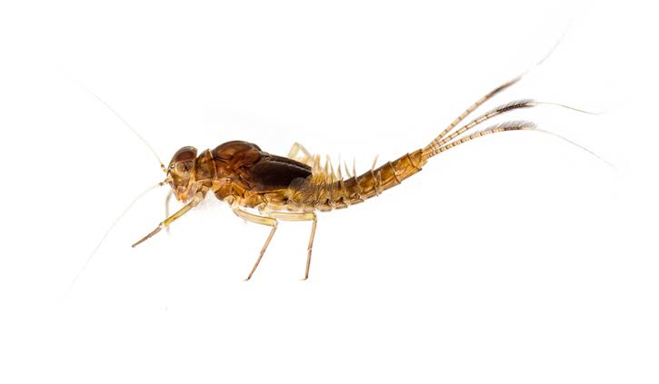

# Generalised Linear Models: Count Data

**Week 8**: Modelling counts with Poisson and negative binomial GLMs

Much of ecology is counting: the number of birds on a transect, seedlings in a
quadrat, frogs calling at a pond. Counts break the rules of the linear models from
Weeks 5 and 7, because they are whole numbers, **cannot be negative**, and usually
become more variable as the average increases. This week you will learn the
**generalised linear model (GLM)**, which handles all of this. Workshop materials
are available in the GitHub repository
[ECS200](https://github.com/nicholaswunz/ECS200-Workshop).


::: {.callout-tip}
## Learning outcomes

By the end of this workshop you should be able to:

1. Explain why counts need a different model from `lm()`, and what a *link function* does.
2. Fit a Poisson GLM and check it for overdispersion.
3. Switch to a negative binomial GLM when the counts are overdispersed.
4. Back-transform coefficients into rate ratios and write up the results.
:::

## Before we start {.unnumbered}

[<i class="bi bi-download"></i> stream_mayflies.csv](data/stream_mayflies.csv){.btn .btn-outline-danger .btn-sm .download-btn download="stream_mayflies.csv"}

```{r}
#| label: setup

# Week 8 workshop - GLMs for count data
# Written by Nicholas Wu, 1234578, 22/04/2027

library(tidyverse)   # data import, wrangling and plotting
library(performance) # checking model assumptions
library(see)         # draws the plots for performance
library(ggeffects)   # predictions from models for plotting

# The negative binomial model comes from the MASS package, which is installed
# with R. We call it with MASS::glm.nb() rather than loading the whole package,
# because MASS has its own select() that clashes with dplyr::select().

# setwd("C:/Users/YOUR-NAME/Documents/ECS200")
```

### Study context {.unnumbered}

{width=70%}

Mayfly nymphs (order Ephemeroptera) are sensitive to sediment and pollution, so
they are widely used as indicators of stream health. Shading from riparian
(streamside) vegetation keeps water cool and supplies leaf litter, while
clearing for agriculture adds sediment and nutrients.

A survey of 60 streams (30 in forested catchments and 30 in agricultural
catchments) took one standard kick-net sample per stream and **counted the mayfly
nymphs**. Riparian **canopy cover** (%) was measured at each sampling point.

**Question**: Is mayfly abundance related to canopy cover and catchment land use?

```{r}
#| label: load-data

mayfly_data <- readr::read_csv("data/stream_mayflies.csv") %>%
  dplyr::mutate(land_use = factor(land_use, levels = c("forest", "agriculture")))

dplyr::glimpse(mayfly_data)
```

## 1. Background {.unnumbered}

### Why not use `lm()` for counts? {.unnumbered}

| Property of counts | Problem for a linear model |
|:-------------------|:---------------------------|
| Whole numbers ≥ 0 | A straight line can predict negative counts |
| Often skewed with many small values and a few large ones | Residuals are not normal |
| Variance increases with the mean | Breaks the equal-variance assumption |

Transforming counts (e.g. `log(y + 1)`) is an old fix that often works poorly,
especially when there are many zeros. A GLM models the counts directly.

### The two ingredients of a GLM {.unnumbered}

1. **A distribution for the response.** For counts, the starting point is the
   **Poisson** distribution, which describes the number of random events in a fixed
   amount of space or time.
2. **A link function** that connects the predictors to the mean. For counts this is
   the **log link**:

$$
\log(\mu_i) = \beta_0 + \beta_1 x_i \quad\Longleftrightarrow\quad \mu_i = e^{\beta_0 + \beta_1 x_i}
$$

The model is a straight line on the **log scale**, which becomes an exponential
curve on the count scale, and the predicted mean ($\mu$) can never be negative.
Because of the log, coefficients are **multiplicative**: $e^{\beta_1}$ is the
factor by which the expected count changes for every one-unit increase in *x*.
This is called the **rate ratio**.

### Overdispersion {.unnumbered}

The Poisson distribution makes a strong assumption: **the variance equals the
mean**. Ecological counts are usually more variable than that, because animals
cluster, habitats are patchy and there are factors we did not measure. This is
**overdispersion**. If you ignore it, standard errors are too small and *p*-values
too optimistic. The usual fix is the **negative binomial** distribution, which has
an extra parameter (*k*, or `theta` in R) that allows the variance to be larger
than the mean.

Use the app to compare Poisson counts with overdispersed (negative binomial) counts
that have the same mean.

::: {.app-box .column-body-outset}
::: {.app-title}
App: Poisson versus overdispersed counts
:::
::: {.app-grid}
::: {.app-controls}
```{ojs}
//| echo: false
//| output: false
import {rng, rpois1, rnbinom1, mean, variance, fmt, red, grey, dark} from "./apps/ecs200.js"
```

```{ojs}
//| echo: false
viewof ct_mu = Inputs.range([0.5, 20], {value: 4, step: 0.5, label: "Mean count per sample"})
viewof ct_k = Inputs.range([0.3, 50], {value: 50, step: 0.1, label: "Clumping parameter k (small = more overdispersed)"})
viewof ct_seed = Inputs.button("Resample 300 samples")
```
:::
::: {.app-output}
```{ojs}
//| echo: false
ct_data = {
  const r = rng(301 + ct_seed);
  const counts = Array.from({length: 300}, () => (ct_k >= 50 ? rpois1(r, ct_mu) : rnbinom1(r, ct_mu, ct_k)));
  const maxc = Math.max(...counts, Math.ceil(ct_mu * 2.5));
  // expected Poisson frequencies with the same mean
  const pois = [];
  let p = Math.exp(-ct_mu);
  for (let c = 0; c <= maxc; c++) { pois.push({count: c, expected: 300 * p}); p = p * ct_mu / (c + 1); }
  return {counts, pois};
}

Plot.plot({
  width: 560, height: 280, marginLeft: 45,
  x: {label: "Count in a sample", round: true}, y: {label: "Number of samples", grid: true},
  marks: [
    Plot.rectY(ct_data.counts, Plot.binX({y: "count"}, {x: (d) => d, interval: 1, fill: grey, inset: 0.5})),
    Plot.line(ct_data.pois, {x: (d) => d.count + 0.5, y: "expected", stroke: red, strokeWidth: 2}),
    Plot.dot(ct_data.pois, {x: (d) => d.count + 0.5, y: "expected", fill: red, r: 3.5}),
    Plot.ruleY([0])
  ]
})

html`<div class="app-verdict">Mean = <b>${fmt(mean(ct_data.counts))}</b>, variance = <b>${fmt(variance(ct_data.counts))}</b>,
variance / mean = <b>${fmt(variance(ct_data.counts) / mean(ct_data.counts))}</b> (a Poisson distribution gives about 1).
Zeros: <b>${ct_data.counts.filter((d) => d === 0).length}</b> observed vs <b>${fmt(ct_data.pois[0].expected, 0)}</b> expected under Poisson.
${ct_k >= 50 ? "These counts are Poisson: the grey bars follow the red line (the Poisson expectation)."
  : "These counts are overdispersed: there are more zeros and more very large counts than a Poisson distribution (red line) expects."}</div>`
```
:::
:::
:::

::: {.callout-note}
## Is a zero really a zero?

Before modelling counts, think about what your zeros mean. A zero can be a **true
zero** (the species really was absent, or was present but by chance was not in the
sample) or a **false zero** (the species was there but you missed it, e.g. a
sampling design or observer error). False zeros should be avoided through good
design rather than fixed by the model [@Blasco2019]. See
[Research Design](research_design.qmd#zeros-and-nas-in-r) for examples.
:::

## 2. Visualise {.unnumbered}

```{r}
#| label: vis-hist
#| fig-width: 6
#| fig-height: 3

# Distribution of the counts: skewed, with some zeros and a few large counts
ggplot2::ggplot(mayfly_data, ggplot2::aes(x = mayflies)) +
  ggplot2::geom_histogram(binwidth = 2, fill = "grey60", colour = "white") +
  ggplot2::labs(x = "Mayfly nymphs per kick sample", y = "Number of streams") +
  ggplot2::theme_classic()
```

```{r}
#| label: vis-scatter
#| fig-width: 6
#| fig-height: 3

# Counts against canopy cover, coloured by land use
ggplot2::ggplot(mayfly_data, ggplot2::aes(x = canopy_cover, y = mayflies, colour = land_use)) +
  ggplot2::geom_point(size = 2, alpha = 0.8) +
  ggplot2::scale_colour_manual(values = c("forest" = "darkgreen", "agriculture" = "#e12744")) +
  ggplot2::labs(x = "Canopy cover (%)", y = "Mayfly nymphs per sample", colour = "Land use") +
  ggplot2::theme_classic()

# Compare the mean and the variance in each land-use group
mayfly_data %>%
  dplyr::group_by(land_use) %>%
  dplyr::summarise(mean     = mean(mayflies),
                   variance = var(mayflies),
                   n        = dplyr::n())
```

Mayfly counts increase with canopy cover and look lower in agricultural streams.
The spread of the counts gets larger as the counts get larger (a fan shape), and
the variance is much bigger than the mean, an early warning of overdispersion.

## 3. Check assumptions {.unnumbered}

GLMs do not assume normal residuals or equal variances. The key assumptions are:

| Assumption | How to check |
|:-----------|:-------------|
| The chosen distribution fits the data (no overdispersion for Poisson) | `performance::check_overdispersion()` for a Poisson model; the posterior predictive check in `performance::check_model()` |
| No more zeros than the distribution expects | Compare observed and predicted zeros (see below) |
| The relationship is linear on the log (link) scale | Plot the data; `performance::check_model()` |
| Independent observations | Study design (one sample per stream ✅. Otherwise, need to account for repeated sampling). |

**Step 1: start with a Poisson GLM.** Use `glm()` with `family = poisson`. The log
link is the default for Poisson.

```{r}
#| label: poisson

mayfly_pois <- glm(mayflies ~ canopy_cover + land_use,
                   family = poisson,
                   data = mayfly_data)

# Is the variance bigger than the Poisson model expects?
performance::check_overdispersion(mayfly_pois)
```

The dispersion ratio should be close to 1. A ratio well above 1 with a small
*p*-value means the data are **overdispersed**, so the Poisson model is not
appropriate.

**Step 2: switch to a negative binomial GLM.** `MASS::glm.nb()` works like `glm()`,
uses the log link and estimates the extra dispersion parameter (`theta`) for you.

```{r}
#| label: negbin
#| fig-width: 9
#| fig-height: 7

mayfly_nb <- MASS::glm.nb(mayflies ~ canopy_cover + land_use,
                          data = mayfly_data)

performance::check_model(mayfly_nb)
```

Then compare the number of zeros in the data with the number the model expects.
`dnbinom(0, ...)` gives each stream's predicted probability of a zero count, and
adding these up gives the expected number of zeros.

```{r}
#| label: zeros

# Observed number of streams with no mayflies
sum(mayfly_data$mayflies == 0)

# Number of zeros expected by the negative binomial model
sum(dnbinom(0, mu = fitted(mayfly_nb), size = mayfly_nb$theta))
```

In the posterior predictive check, the data simulated from the model 
(<span style="color:#1b6ca8;">blue</span>) now look
like the real data (<span style="color:#3aaf85;">green</span>), the other panels look reasonable, and the model
predicts about as many zeros as were observed. The negative binomial model is
appropriate.

::: {.callout-note collapse="true"}
## Reading `check_model()` for a GLM (click to expand)

For GLMs, the residuals are not expected to be normal, so `check_model()` shows
slightly different panels. It uses *simulated* residuals for the "uniformity" or
"normality" panels and adds a **posterior predictive check**: the model is used to
simulate many new datasets (blue lines), which should look like your real data
(green line). If the simulated data have far fewer zeros or a much narrower spread
than the real data, the distribution is wrong.
:::

::: {.callout-warning collapse="true"}
## When are these models NOT appropriate? (click to expand)

| What you see | What to do |
|:-------------|:-----------|
| Dispersion ratio > 1 in a Poisson GLM | Negative binomial GLM, `MASS::glm.nb()` (this workshop) |
| Many more zeros than even the negative binomial predicts | Zero-inflated or hurdle models (e.g. `glmmTMB` package). Think first about whether the zeros are true or false [@Blasco2019] |
| Samples differ in effort (different trap nights, transect lengths or areas) | Add an **offset**: `glm(count ~ x + offset(log(effort)), family = poisson)`. The model then describes counts *per unit of effort* |
| Counts out of a known total (e.g. 7 of 20 seeds germinated) | Binomial GLM (Week 11) |
| Several samples from the same site, plot or individual | Generalised linear mixed model (`lme4::glmer()`, Week 12) |
| Very large counts with no zeros and a symmetrical spread | An `lm()` may be fine. Check the residuals |
:::

## 4. Model {.unnumbered}

```{r}
#| label: nb-summary

summary(mayfly_nb)
```

The output gives everything you need:

- `Coefficients`: one row per term.
  - `Estimate`: the effect on the **log scale**. `(Intercept)` is the log of the
    expected count for a forest stream with 0% canopy cover (the reference level).
    `canopy_cover` is the change in log(count) for each 1% more cover.
    `land_useagriculture` is the difference in log(count) between agricultural and
    forest streams at the same canopy cover. A positive estimate means more mayflies,
    a negative one fewer.
  - `Std. Error`: the uncertainty in each estimate.
  - `z value`: the estimate divided by its standard error (GLMs use *z* instead of *t*).
  - `Pr(>|z|)`: the *p*-value, the probability of an effect this large if the true
    effect were zero.
- `Dispersion parameter for Negative Binomial(...) family`: the estimated *theta*
  (*k*). Small values mean strongly clumped counts; very large values mean the counts
  are close to Poisson.
- `Null deviance` and `Residual deviance`: how badly a model with no predictors and
  our model fit the data. The bigger the drop, the more the predictors explain.
- `AIC`: a measure of fit that penalises extra parameters, used to compare models
  fitted to the same data (lower is better).
- `Theta` and `Std. Err.`: theta again, with its standard error.

The coefficients are on the **log scale**. Back-transform them with `exp()` to get
**rate ratios**, which are much easier to interpret.

```{r}
#| label: nb-irr

# Rate ratios and their 95% confidence intervals
exp(coef(mayfly_nb))
exp(confint(mayfly_nb))
```

Plot the model's predictions on the count scale.

```{r}
#| label: nb-predict
#| fig-width: 6.5
#| fig-height: 4

# Predicted counts across canopy cover for each land use (with 95% CIs)
mayfly_pred <- ggeffects::predict_response(mayfly_nb, terms = c("canopy_cover", "land_use"))

plot(mayfly_pred, show_data = TRUE) +
  ggplot2::scale_colour_manual(values = c("darkgreen", "#e12744")) +
  ggplot2::scale_fill_manual(values = c("darkgreen", "#e12744")) +
  ggplot2::labs(title = NULL, x = "Canopy cover (%)", y = "Mayfly nymphs per sample",
                colour = "Land use", fill = "Land use")
```

The prediction lines curve upwards because the model is linear on the log scale.

## 5. Interpret {.unnumbered}

```{r}
#| label: nb-numbers
#| echo: false
irr    <- exp(coef(mayfly_nb))
irr_ci <- exp(confint(mayfly_nb))
nb_p   <- coef(summary(mayfly_nb))[, 4]
pct    <- function(x) round(100 * (x - 1))
```

| Term | Rate ratio | 95% CI | Meaning |
|:-----|:----------:|:------:|:--------|
| `canopy_cover` | `r round(irr["canopy_cover"], 3)` | `r round(irr_ci["canopy_cover", 1], 3)`–`r round(irr_ci["canopy_cover", 2], 3)` | Each 1% increase in canopy cover multiplies the expected count by `r round(irr["canopy_cover"], 3)`, i.e. `r pct(irr["canopy_cover"])`% more mayflies. Over 10% more cover that is ×`r round(irr["canopy_cover"]^10, 2)` |
| `land_useagriculture` | `r round(irr["land_useagriculture"], 2)` | `r round(irr_ci["land_useagriculture", 1], 2)`–`r round(irr_ci["land_useagriculture", 2], 2)` | At the same canopy cover, agricultural streams have `r round(irr["land_useagriculture"], 2)` times as many mayflies as forest streams, i.e. `r abs(pct(irr["land_useagriculture"]))`% fewer |

A rate ratio of 1 means no effect. If the 95% CI of a rate ratio does not include
1, the effect is significant at α = 0.05.

**Methods sentence**: *Mayfly counts were analysed with a negative binomial
generalised linear model (log link) with canopy cover and land use as predictors,
fitted with `MASS::glm.nb()` in R. A Poisson model was rejected because the counts
were overdispersed (dispersion ratio = `r round(performance::check_overdispersion(mayfly_pois)$dispersion_ratio, 1)`). 
Significance was set with α = 0.05.*

**Results sentence**:

> Mayfly abundance increased with riparian canopy cover, by `r pct(irr["canopy_cover"])`% for
> every 1% increase in cover (rate ratio = `r round(irr["canopy_cover"], 3)`, 95% CI
> `r round(irr_ci["canopy_cover", 1], 3)`–`r round(irr_ci["canopy_cover", 2], 3)`, *p* < 0.001).
> At the same canopy cover, streams in agricultural catchments had `r abs(pct(irr["land_useagriculture"]))`% fewer
> mayflies than forested streams (rate ratio = `r round(irr["land_useagriculture"], 2)`, 95% CI
> `r round(irr_ci["land_useagriculture", 1], 2)`–`r round(irr_ci["land_useagriculture", 2], 2)`,
> *p* = `r round(nb_p["land_useagriculture"], 3)`; Fig. 1).

# Assessment {.unnumbered}

Task to complete before the end of the workshop.

[<i class="bi bi-download"></i> week08_assessment.R](assessments/week08_assessment.R){.btn .btn-danger .btn-sm .download-btn download="week08_assessment.R"}
[<i class="bi bi-download"></i> pollinator_visits.csv](data/pollinator_visits.csv){.btn .btn-outline-danger .btn-sm .download-btn download="pollinator_visits.csv"}

{width=100%}

**Pollinator visits in urban gardens and bushland.** Urban gardens can provide food
for pollinators, but are they as good as native bushland? Observers watched 80
flowering plants of the same native shrub species for **15 minutes** each, 40 in
urban gardens and 40 in bushland remnants, and **counted the number of pollinator
visits**. They also counted the number of open flowers on each plant (`flowers`).

1. Import the data, check its structure, convert `habitat` to a factor with
   `urban_garden` as the reference level, and check for missing values.
2. Plot the distribution of `visits`, and plot `visits` against `flowers` coloured
   by `habitat`. Describe what you see.
3. Fit a Poisson GLM with `flowers` and `habitat` as predictors. Check it for
   overdispersion. Is the Poisson model appropriate? Explain.
4. Fit a more appropriate model and check its assumptions with `check_model()`.
   Compare the observed number of zeros with the number the model expects.
5. Calculate the rate ratios and their 95% CIs. In words, how much does the number
   of visits change (a) for every extra open flower, and (b) in bushland compared
   with urban gardens?
6. Plot the predicted number of visits against the number of flowers for each
   habitat with `ggeffects::predict_response()`.
7. Write a results sentence.
8. Twelve plants received no visits. Give one reason why a zero might be a *true*
   zero and one reason it might be a *false* zero in this study, and suggest a
   change to the design that would reduce false zeros.



# Additional resources {.unnumbered}

- @Blasco2019 *What does a zero mean? Understanding false, random and structural
  zeros in ecology*: a short, readable paper on designing surveys to avoid false zeros.
- Coding Club: [Intro to model design](https://ourcodingclub.github.io/tutorials/model-design/)
  covers Poisson models and choosing distributions.
- [Biostatistics with R (A. Terui)](https://aterui.github.io/biostats/): the chapters
  on probability distributions and GLMs have nice visual explanations.
- @Zuur2016: a protocol for running and presenting regression-type analyses,
  including GLMs.
- [Poisson regression in R (UCLA)](https://stats.oarc.ucla.edu/r/dae/poisson-regression/):
  a worked example, including how to interpret the output.
