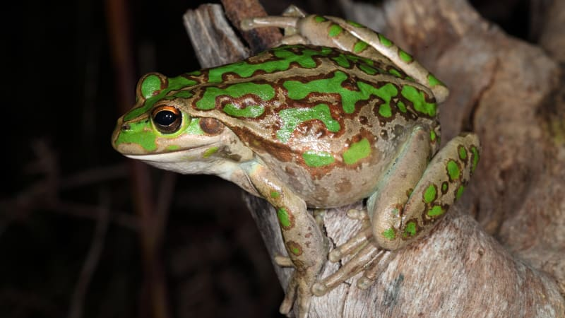
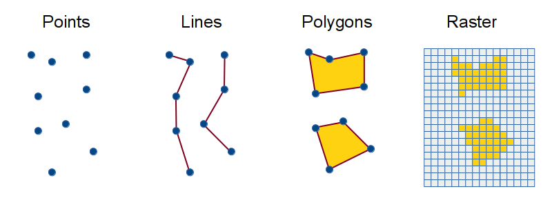

# OPTIONAL: Spatial Data

**Week 9**: Downloading and mapping species occurrence data

This is an optional tutorial for anyone working with species occurrence or other
spatial data.

::: {.callout-note}
This tutorial is **optional and not assessed**, and it will not be in the exam. Work
through it in your own time if maps are relevant to your project. It was inspired by
Amanda Buyan and Dax Kellie's tutorials for the [Atlas of Living Australia](https://labs.ala.org.au/posts/)
(ALA).
:::

Maps are one of the most useful tools an ecologist has. A quick map of species
observations shows where a species has been recorded, the extent of your data, and
possible errors (e.g. a frog recorded in the ocean). In this tutorial you will
download records of the motorbike frog (*Litoria moorei*) in Western Australia since
2000 from FrogID, and map them.

{width=90%}

```{r}
#| label: setup

# Week 9 workshop (optional) - Spatial data
# Written by Nicholas Wu, 1234578, 22/04/2027

# Install these packages once, in the console, if needed:
# install.packages(c("galah", "sf", "ozmaps", "leaflet"))

library(tidyverse)  # data wrangling and plotting
library(galah)      # download data from the Atlas of Living Australia
library(sf)         # work with spatial (map) data
library(patchwork)  # combine plots
library(ozmaps)      # download Australia map
```

# Download the data {.unnumbered}

## Search for a taxon {.unnumbered}

`galah::search_taxa()` checks that the ALA recognises your species name and shows its
full taxonomy. It is worth doing this even when you know the scientific name.

```{r}
#| label: search-taxa

galah::search_taxa("Litoria moorei")
```

## Search for fields {.unnumbered}

Next, find the names of the fields (columns) you want to filter on: here year,
state and data source. `galah::search_all()` searches the available fields:

```{r}
#| label: search-fields

galah::search_all(fields, "year")
galah::search_all(fields, "states")
galah::search_all(fields, "resource")
```

`galah::show_values()` lists the possible values of a field. The field `cl22`
contains Australian states and territories:

```{r}
#| label: show-values

options(timeout = 120) # allow more time for the download

galah::search_all(fields, "cl22") %>%
  galah::show_values()
```

## Download observations {.unnumbered}

Always count the records **before** downloading them, so you do not accidentally
download millions of rows:

```{r}
#| label: count

galah::galah_call() %>%                                   # start a query
  galah::galah_identify("Litoria moorei") %>%             # motorbike frog
  galah::galah_filter(year >= 2000,                       # since 2000
                      cl22 == "Western Australia",        # in Western Australia
                      dataResourceName == "FrogID") %>%   # recorded by FrogID
  galah::atlas_counts()                                   # count the records
```

To download the records themselves, you first need to
[register your email with the ALA](https://auth.ala.org.au/userdetails/registration/createAccount)
and give it to `galah`:

```{r}
#| label: config-show
#| eval: false

galah::galah_config(email = "your-email-here")
```

```{r}
#| label: config-hidden
#| include: false

galah::galah_config(email = "nikywu1990@hotmail.com")
```

`galah::atlas_occurrences()` downloads the location and date of every record:

```{r}
#| label: download

frogs <- galah::galah_call() %>%
  galah::galah_identify("Litoria moorei") %>%
  galah::galah_filter(year >= 2000,
                      cl22 == "Western Australia",
                      dataResourceName == "FrogID") %>%
  galah::atlas_occurrences()

frogs
```

# Make a map {.unnumbered}

The `ozmaps` package contains outlines of Australian states. Keep Western Australia
and plot it with `ggplot2::geom_sf()`, which draws spatial (`sf`) objects.

```{r}
#| label: wa-map
#| fig-width: 4
#| fig-height: 4

au_map <- ozmaps::ozmap_data("abs_ste")                        # Australian states
wa_map <- au_map %>%
  dplyr::filter(NAME == "Western Australia")                   # keep WA only

ggplot2::ggplot() +
  ggplot2::geom_sf(data = wa_map, colour = "grey60", fill = "#F5F5F5") +
  ggplot2::theme_bw()
```

## Coordinate reference systems {.unnumbered}

The Earth is round but maps are flat, so every map uses a **coordinate reference
system (CRS)** to flatten it. Our WA outline uses GDA94:

```{r}
#| label: crs

sf::st_crs(wa_map)$input
```

The same outline looks different in different CRSs. `sf::st_transform()` changes
the CRS:

```{r}
#| label: crs-compare
#| fig-width: 9
#| fig-height: 3.5

crs_gda94 <- ggplot2::ggplot(wa_map) +
  ggplot2::geom_sf(colour = "grey60", fill = "#F5F5F5") +
  ggplot2::labs(title = "GDA94") +
  ggplot2::theme_bw()

crs_wa <- wa_map %>%
  sf::st_transform(crs = 7850) %>%   # a projection designed for WA (GDA2020 / MGA zone 50)
  ggplot2::ggplot() +
  ggplot2::geom_sf(colour = "grey60", fill = "#F5F5F5") +
  ggplot2::labs(title = "EPSG:7850") +
  ggplot2::theme_bw()

crs_canada <- wa_map %>%
  sf::st_transform(crs = 2955) %>%   # a projection designed for Canada!
  ggplot2::ggplot() +
  ggplot2::geom_sf(colour = "grey60", fill = "#F5F5F5") +
  ggplot2::labs(title = "EPSG:2955") +
  ggplot2::theme_bw()

crs_gda94 + crs_wa + crs_canada
```

Always check that all your spatial layers use the **same** CRS before combining them.

## Add the observations {.unnumbered}

Plot the outline, then add the records as points (longitude on the *x*-axis,
latitude on the *y*-axis):

```{r}
#| label: points-map
#| fig-width: 5
#| fig-height: 5

ggplot2::ggplot() +
  ggplot2::geom_sf(data = wa_map, colour = "grey60", fill = "#F5F5F5") +
  ggplot2::geom_point(data = frogs,
                      ggplot2::aes(x = decimalLongitude, y = decimalLatitude),
                      colour = "#e12744", alpha = 0.5, size = 1) +
  ggplot2::labs(x = NULL, y = NULL) +
  ggplot2::theme_bw()
```

## Where are most records? {.unnumbered}

With thousands of overlapping points it is hard to see where records are
concentrated. `ggplot2::geom_bin_2d()` counts the records in grid cells instead:

```{r}
#| label: density-map
#| fig-width: 5.5
#| fig-height: 5

ggplot2::ggplot() +
  ggplot2::geom_sf(data = wa_map, colour = "grey60", fill = "#F5F5F5") +
  ggplot2::geom_bin_2d(data = frogs,
                       ggplot2::aes(x = decimalLongitude, y = decimalLatitude),
                       binwidth = 0.25) +                    # grid cells of 0.25 degrees
  ggplot2::scale_fill_viridis_c(trans = "log10", direction = -1) +
  ggplot2::labs(x = NULL, y = NULL, fill = "Number of\nrecords") +
  ggplot2::theme_bw()
```

Most records come from around Perth, where most people live and record frogs.

## Interactive map {.unnumbered}

The `leaflet` package makes interactive maps you can zoom and pan. Hover over a
point to see the date of the record.

```{r}
#| label: leaflet

# Convert the table to a spatial object with longitude/latitude coordinates (CRS 4326)
frogs_sf <- frogs %>%
  tidyr::drop_na(decimalLongitude, decimalLatitude) %>%
  sf::st_as_sf(coords = c("decimalLongitude", "decimalLatitude"), crs = 4326)

leaflet::leaflet() %>%
  leaflet::addTiles() %>%                  # background map
  leaflet::addCircles(data = frogs_sf,
                      label = ~as.character(eventDate),
                      color = "#e12744")
```

# Seasonality {.unnumbered}

`galah::galah_group_by()` counts records per month without downloading them all:

```{r}
#| label: by-month
#| fig-width: 6
#| fig-height: 3.5

frogs_month <- galah::galah_call() %>%
  galah::galah_identify("Litoria moorei") %>%
  galah::galah_filter(year >= 2000,
                      cl22 == "Western Australia",
                      dataResourceName == "FrogID") %>%
  galah::galah_group_by(month) %>%
  galah::atlas_counts() %>%
  dplyr::mutate(month = lubridate::month(as.numeric(month), label = TRUE)) # 1 -> Jan

ggplot2::ggplot(frogs_month, ggplot2::aes(x = month, y = count)) +
  ggplot2::geom_col(fill = "#e12744") +
  ggplot2::labs(x = NULL, y = "Number of records") +
  ggplot2::theme_bw()
```

::: {.callout-important}
## Citizen science records are not standardised surveys

ALA records come from citizen scientists and researchers. Recording effort is **not
standardised**: it depends on when and where people go out, which is especially
true for rare species. A month with few records may mean fewer frogs calling, or
fewer people listening. This kind of plot only shows real seasonal activity if
survey effort is the same across the year. Remember from
[Research Design](research_design.qmd#zeros-and-nas-in-r): "not recorded" is not
the same as "absent".
:::

# Types of spatial data {.unnumbered}

Spatial data come in two main forms:

- **Vector data** are made of *points* (e.g. survey sites, occurrence records),
  *lines* (e.g. rivers, roads) and *polygons* (e.g. reserves, lakes, state
  boundaries). This tutorial used points and polygons.
- **Raster data** are grids of cells, each with a value, used for continuous
  variables such as rainfall, temperature, elevation or vegetation cover.

{width=90%}

# Common mistakes {.unnumbered}

Check the quality of spatial data before plotting and analysing them. This tutorial
does not cover spatial data cleaning, but here are common problems to look out for:

{width=100%}

# Analysing spatial data {.unnumbered}

Spatial analysis is beyond this unit, but here are some possibilities:

- **Spatially explicit regression**: sites close together tend to be similar
  (spatial autocorrelation), which breaks the independence assumption. Spatial
  models account for this. See Coding Club's [spatial modelling tutorial](https://ourcodingclub.github.io/tutorials/spatial-modelling-inla/).
- **Species distribution models** relate occurrence records to environmental
  predictors (climate, soil, habitat) to predict where a species could occur. They
  are used in conservation planning and to predict the effects of climate change
  and the spread of invasive species.
- **Movement ecology**: see the optional [Week 10](week10_movement.qmd).

# Additional resources {.unnumbered}

- [Cleaning biodiversity data in R](https://cleaning-data-r.ala.org.au): a practical
  guide to the problems in geo-referenced biodiversity data.
- [`galah` documentation](https://galah.ala.org.au/R/) for downloading ALA data.
- Coding Club: [Working with rasters and remote-sensing data](https://ourcodingclub.github.io/tutorials/spatial/).
- ALA Labs: [species distribution modelling with `tidysdm`](https://labs.ala.org.au/posts/2024-04-30_sdm-tidymodels/).
- [Geocomputation with R](https://r.geocompx.org/): a free book on spatial data in R.
