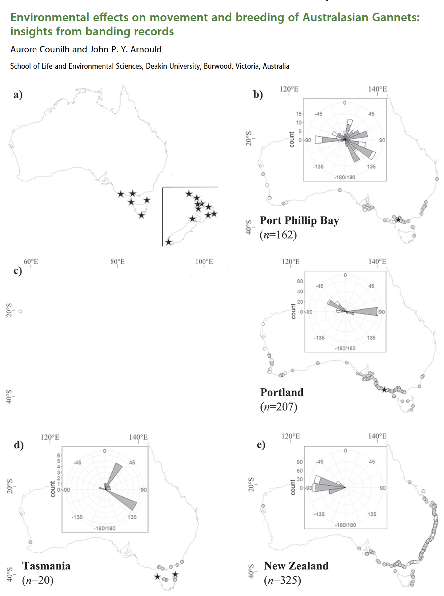
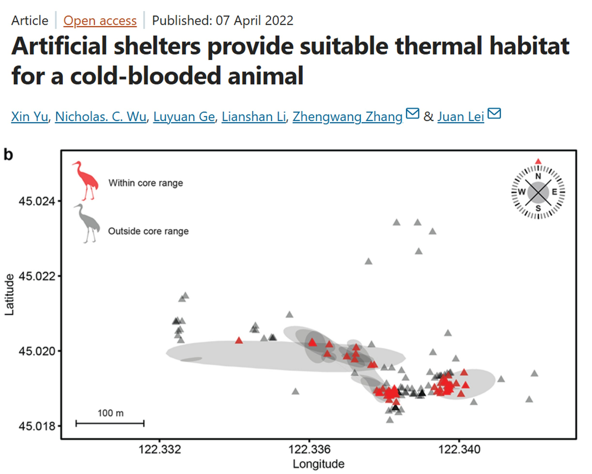
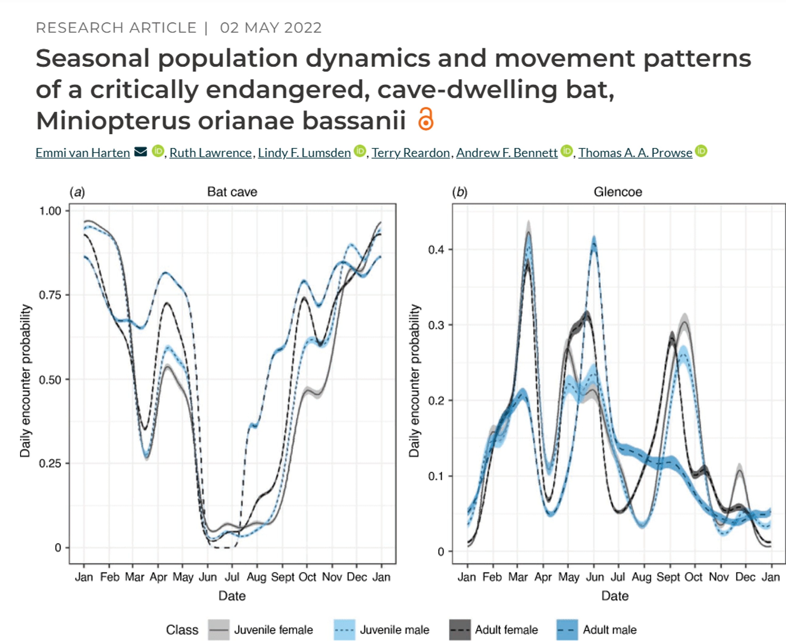
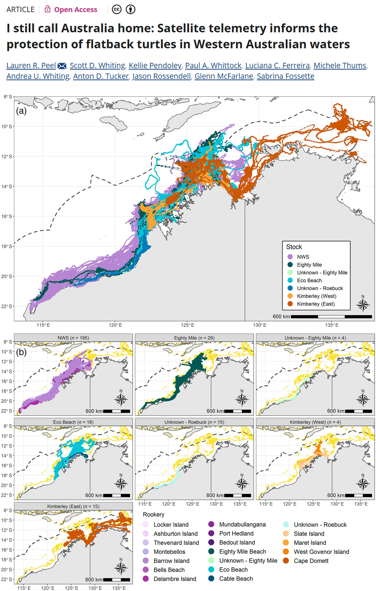
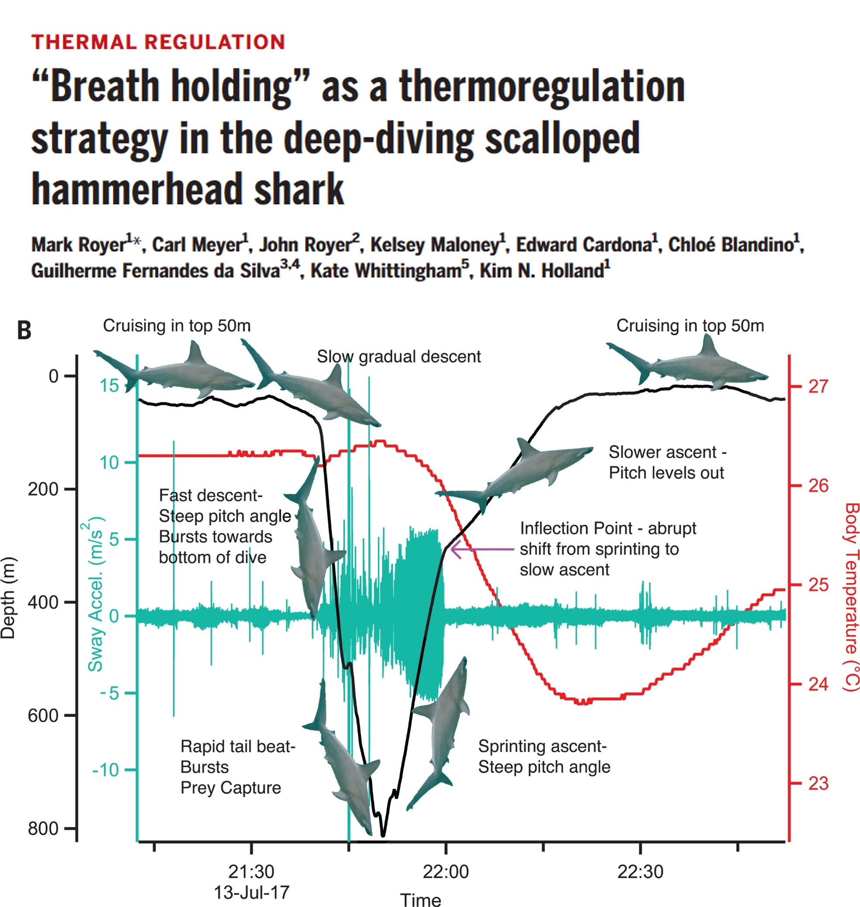

# OPTIONAL: Movement Data

**Week 10 (study week)**: Cleaning and plotting animal tracking data

This is an optional tutorial for anyone working with animal tracking (telemetry)
data.

::: {.callout-note}
This tutorial is **optional and not assessed**, and it will not be in the exam. Work
through it in your own time if tracking data are relevant to your project.
:::

Tracking data combine **location** and **time**, so this tutorial builds on the
optional [time series](week06_time_series.qmd) and [spatial data](week09_spatial.qmd)
tutorials.

# Tracking technologies {.unnumbered}

How do we track animals in the wild? There are many methods, and **how you process,
analyse and interpret movement data depends heavily on the method used**.

![Methods for marking and tagging insects. Image from [@ruuvzivckova2026].](images/insect_telemetry.png){width=80%}

::: {.panel-tabset .nav-pills}

### Marking {.unnumbered}

The simplest and cheapest method uses capture–mark–recapture or direct observation
of marked animals. It is time-consuming, and following or recapturing animals can
**disturb their behaviour**. It is still widely used, for example to monitor bird
movements through citizen science reports of leg bands. **Example study [@counilh2023]**

{width=100%}

### Radio telemetry {.unnumbered}

**VHF radio telemetry**: a small transmitter (usually < 5% of the animal's body
mass) emits a very high frequency (VHF) radio signal that the researcher tracks with
a receiver and antenna. Tags are cheap, light and have long battery lives, which
suits terrestrial and semi-aquatic animals (e.g. freshwater turtles). However,
tracking is labour intensive and gives only a few locations per day. Automated
networks such as [MOTUS](https://motus.org/) use fixed receivers to detect tags
continuously. **Example study [@yu2022]**

{width=100%}

**Radio-frequency identification (RFID)**: tiny, battery-free passive integrated
transponder (PIT) tags are detected when an animal passes close to an antenna, for
example at cave entrances to record when bats move between caves. **Example study [@van2022]**.

{width=100%}

### Satellite telemetry {.unnumbered}

**GPS telemetry**: tags (collars, backpacks, harnesses) record locations from
satellites, often many per hour. GPS tags are among the most expensive options.
**GSM (cellular) tags** upload data over the mobile network, so you do not need to
recover the tag, but they need phone coverage **Example study [@peel2024]**.


{width=100%}

**Argos satellite telemetry**: tags (platform transmitter terminals, PTTs) send
signals to satellites, which estimate the location from the Doppler shift. Argos
locations are less accurate than GPS (up to kilometres), but tags can last months to
years, which suits large, wide-ranging species such as sharks, turtles and seals. **Example study [@hoenner2012]**

{width=100%}

### Acoustic telemetry {.unnumbered}

Radio signals do not travel through salt water, so most underwater tracking uses
**acoustic tags**, which send coded sound pulses to fixed or mobile receivers. Tags
can last for years, but you only detect animals near a receiver, so the design of
the receiver array is crucial. It works best in confined habitats such as rivers,
estuaries and reefs. **Example study [@baker2023]**

{width=100%}

### Onboard loggers {.unnumbered}

**Accelerometers** measure acceleration in three axes (the same technology as in
smartwatches). They can show activity levels, classify behaviours (foraging,
resting, hunting) and estimate energy expenditure. Behaviours must first be
calibrated against known behaviours, and accelerometers do not record location, so
they are often combined with GPS or VHF tags **Example study [@wild2025]**.


{width=100%}

**Biologgers** record other variables such as light, temperature, depth, heart rate
or internal body temperature **Example study [@royer2023]**.

{width=100%}

:::

# Process GPS data {.unnumbered}

Basic tracking data contain the **ID** of each animal, its location (**longitude**
and **latitude**) and the **date and time** of each location (a *fix*). Here we use
GPS data from three red-footed boobies (*Sula sula*) nesting on Diego Garcia in the
Indian Ocean. We loosely follow the [ExMove workflow](https://exmove.github.io/) for
cleaning and processing tracking data [@langley2024].

{width=100%}

Download the three GPS files and the metadata file, and save them in a folder called
`gps_study` inside your `data` folder.

[<i class="bi bi-download"></i> GV37501_201606_DG_RFB.csv](data/gps_study/GV37501_201606_DG_RFB.csv){.btn .btn-outline-danger .btn-sm .download-btn download="GV37501_201606_DG_RFB.csv"}
[<i class="bi bi-download"></i> GV37503_201606_DG_RFB.csv](data/gps_study/GV37503_201606_DG_RFB.csv){.btn .btn-outline-danger .btn-sm .download-btn download="GV37503_201606_DG_RFB.csv"}
[<i class="bi bi-download"></i> GV37734_201807_NI_RFB.csv](data/gps_study/GV37734_201807_NI_RFB.csv){.btn .btn-outline-danger .btn-sm .download-btn download="GV37734_201807_NI_RFB.csv"}
[<i class="bi bi-download"></i> RFB_metadata.csv](data/gps_study/RFB_metadata.csv){.btn .btn-outline-danger .btn-sm .download-btn download="RFB_metadata.csv"}

```{r}
#| label: setup

# Week 10 workshop (optional) - Movement data
# Written by Nicholas Wu, 1234578, 29/04/2027

# install.packages("geosphere")  # run once in the console if needed

library(tidyverse)  # data wrangling, plotting, dates (lubridate) and text (stringr)
library(geosphere)  # distances between longitude/latitude points
library(patchwork)  # combine plots

# setwd("C:/Users/YOUR-NAME/Documents/ECS200")
```

## Load all the GPS files {.unnumbered}

Each bird has its own file. `list.files()` finds them, and `purrr::map()` imports
each one with `readr::read_csv()`, then `purrr::list_rbind()` stacks them into one
data frame. `id = "file_name"` adds a column with the name of the file each row came
from. We read `Date` and `Time` as text because the files use different date formats.

```{r}
#| label: load-gps

# Find every file in the gps_study folder that starts with "GV" and ends in .csv
gps_files <- list.files(path = "data/gps_study", pattern = "^GV.*\\.csv$", full.names = TRUE)
gps_files

# Import every file and stack them
gps_raw <- purrr::map(gps_files, readr::read_csv,
                      id = "file_name",
                      col_types = readr::cols(Date = "c", Time = "c")) %>%
  purrr::list_rbind()

dplyr::glimpse(gps_raw)
```

Now tidy the columns. The bird ID is the first 7 characters of the file name (e.g.
"GV37501" from "GV37501_201606_DG_RFB.csv"), which `stringr::str_sub()` extracts.
This only works because every ID has the same length and position.

```{r}
#| label: clean-gps

gps_data <- gps_raw %>%
  dplyr::mutate(
    file_name = basename(file_name),                          # drop the folder from the name
    ID        = stringr::str_sub(file_name, start = 1, end = 7),
    Date      = lubridate::parse_date_time(Date, orders = c("dmy", "ymd")), # files use different formats
    date_time = lubridate::ymd_hms(paste(as.Date(Date), Time), tz = "GMT"),  # GPS time is in GMT
    lon       = Longitude,
    lat       = Latitude) %>%
  dplyr::select(ID, date_time, lon, lat) %>%                  # keep only the columns we need
  dplyr::arrange(ID, date_time)                               # order by bird, then time

dplyr::glimpse(gps_data)
```

## Merge with metadata {.unnumbered}

The metadata file holds one row per tag deployment: the bird ID, when the tag was
attached and removed, and the nest location. These times were recorded in local time
(Indian/Chagos), so we convert them to GMT to match the GPS data.

```{r}
#| label: metadata

meta_data <- readr::read_csv("data/gps_study/RFB_metadata.csv") %>%
  dplyr::mutate(
    ID          = BirdID,
    deploy_time = lubridate::dmy_hms(paste(DeploymentDate, DeploymentTime), tz = "Indian/Chagos"),
    deploy_time = lubridate::with_tz(deploy_time, tzone = "GMT"),   # local time to GMT
    nest_lon    = NestLong,
    nest_lat    = NestLat) %>%
  dplyr::select(ID, Population, BreedingStage, deploy_time, nest_lon, nest_lat)

meta_data

# Add the metadata to every GPS fix of the matching bird
gps_merged <- gps_data %>%
  dplyr::left_join(meta_data, by = "ID")
```

Look at the raw tracks:

```{r}
#| label: raw-tracks
#| fig-width: 6
#| fig-height: 5

ggplot2::ggplot(gps_merged, ggplot2::aes(x = lon, y = lat, colour = ID)) +
  ggplot2::geom_path() +   # joins the fixes in time order
  ggplot2::geom_point(size = 0.5) +
  ggplot2::labs(x = "Longitude", y = "Latitude") +
  ggplot2::theme_bw()
```

Some fixes for GV37734 look wrong: they are far away from the rest of the track.
Before dealing with them, check for duplicates and missing data (Week 1).

## Duplicates and missing fixes {.unnumbered}

```{r}
#| label: dup-na

sum(duplicated(gps_merged))   # duplicated rows
colSums(is.na(gps_merged))    # missing values in each column
```

There are no duplicated rows and no missing values in these data (if there were,
`dplyr::distinct()` would remove the duplicates). A few random missing fixes are not a problem, but **many consecutive
missing fixes are not random**. For example, dense forest canopy blocks GPS signals,
which biases the data against forest habitats.

```{r}
#| label: distinct

gps_merged <- gps_merged %>%
  dplyr::distinct()
```

## Movement metrics {.unnumbered}

To find impossible fixes, calculate for each fix (within each bird):

- the **distance** from the previous fix,
- the **time** since the previous fix,
- the **speed** (distance / time),
- the **net displacement**: the distance from the first fix (the nest).

`geosphere::distHaversine()` calculates the distance in metres between two sets of
longitude/latitude points, allowing for the curvature of the Earth.
`dplyr::lag()` gives the previous value, and `dplyr::first()` the first value.

```{r}
#| label: metrics

gps_metrics <- gps_merged %>%
  dplyr::group_by(ID) %>%                                       # calculate within each bird
  dplyr::mutate(
    dist_m     = geosphere::distHaversine(cbind(lon, lat), cbind(dplyr::lag(lon), dplyr::lag(lat))),
    time_s     = as.numeric(difftime(date_time, dplyr::lag(date_time), units = "secs")),
    speed_ms   = dist_m / time_s,                               # metres per second
    netdisp_km = geosphere::distHaversine(cbind(lon, lat), cbind(dplyr::first(lon), dplyr::first(lat))) / 1000) %>%
  dplyr::ungroup()

summary(gps_metrics$speed_ms)
```

Plot the distributions of these metrics to spot errors:

```{r}
#| label: metric-plots
#| fig-width: 8
#| fig-height: 6

time_plot <- ggplot2::ggplot(gps_metrics, ggplot2::aes(x = time_s / 60)) +
  ggplot2::geom_histogram(bins = 50) +
  ggplot2::scale_x_log10() +                       # log scale: most gaps are short
  ggplot2::labs(x = "Time between fixes (minutes, log scale)", y = "Count") +
  ggplot2::facet_wrap(~ ID) +
  ggplot2::theme_bw()

speed_plot <- ggplot2::ggplot(gps_metrics, ggplot2::aes(x = speed_ms)) +
  ggplot2::geom_histogram(bins = 50) +
  ggplot2::labs(x = "Speed (m/s)", y = "Count") +
  ggplot2::facet_wrap(~ ID) +
  ggplot2::theme_bw()

disp_plot <- ggplot2::ggplot(gps_metrics, ggplot2::aes(x = netdisp_km)) +
  ggplot2::geom_histogram(bins = 50) +
  ggplot2::labs(x = "Net displacement from first fix (km)", y = "Count") +
  ggplot2::facet_wrap(~ ID) +
  ggplot2::theme_bw()

time_plot / speed_plot / disp_plot
```

## Filter out errors {.unnumbered}

Choose thresholds from the biology of your species (and the literature), then
filter:

- **Deployment period**: remove the first 30 minutes after the tag was attached,
  when the bird may behave unnaturally after handling.
- **Speed**: red-footed boobies rarely fly faster than about 20 m/s, so faster
  "movements" are GPS errors.
- **Net displacement**: these birds were rearing chicks and returning to the nest,
  so fixes more than 300 km away are errors.

If your GPS data have a dilution of precision (DOP) column, you can also remove fixes
with poor precision (e.g. DOP > 8).

```{r}
#| label: filter

gps_clean <- gps_metrics %>%
  dplyr::filter(date_time > deploy_time + lubridate::minutes(30), # after the first 30 min
                is.na(speed_ms) | speed_ms < 20,                 # keep the first fix (no speed) and realistic speeds
                netdisp_km <= 300)                               # within 300 km of the start

# How many fixes were removed for each bird?
dplyr::left_join(dplyr::count(gps_metrics, ID, name = "before"),
                 dplyr::count(gps_clean, ID, name = "after"),
                 by = "ID")
```

```{r}
#| label: compare-tracks
#| fig-width: 9
#| fig-height: 4.5

raw_plot <- ggplot2::ggplot(gps_metrics, ggplot2::aes(x = lon, y = lat, colour = ID)) +
  ggplot2::geom_path() +
  ggplot2::labs(title = "Raw data", x = "Longitude", y = "Latitude") +
  ggplot2::theme_bw()

clean_plot <- ggplot2::ggplot(gps_clean, ggplot2::aes(x = lon, y = lat, colour = ID)) +
  ggplot2::geom_path() +
  ggplot2::labs(title = "Filtered data", x = "Longitude", y = "Latitude") +
  ggplot2::theme_bw()

raw_plot + clean_plot + patchwork::plot_layout(guides = "collect") # one shared legend
```

::: {.callout-note}
## Coordinate reference systems

Longitude and latitude are in degrees (CRS code EPSG:4326). `geosphere` handles
these directly. If you combine tracks with other maps or rasters (e.g. habitat or
sea surface temperature), make sure every layer uses the **same coordinate reference
system**, and use a projected CRS in metres for area calculations such as home
ranges. See the optional [spatial data](week09_spatial.qmd) tutorial and the
[EPSG database](https://epsg.io/).
:::

## Plot the clean data {.unnumbered}

::: {.panel-tabset .nav-pills}

### Speed over time {.unnumbered}

```{r}
#| label: speed-time
#| fig-width: 8
#| fig-height: 3.5

gps_clean %>%
  dplyr::group_by(ID) %>%
  dplyr::mutate(days_elapsed = as.numeric(difftime(date_time, min(date_time), units = "days"))) %>%
  ggplot2::ggplot(ggplot2::aes(x = days_elapsed, y = speed_ms)) +
  ggplot2::geom_line() +
  ggplot2::labs(x = "Time since the first fix (days)", y = "Speed (m/s)") +
  ggplot2::facet_wrap(~ ID) +
  ggplot2::theme_bw()
```

### Speed over space {.unnumbered}

```{r}
#| label: speed-space
#| fig-width: 7
#| fig-height: 5.5

ggplot2::ggplot(gps_clean, ggplot2::aes(x = lon, y = lat, colour = speed_ms)) +
  ggplot2::geom_path(ggplot2::aes(group = ID), linewidth = 0.6) +
  ggplot2::geom_point(size = 0.6) +
  ggplot2::geom_point(data = meta_data, ggplot2::aes(x = nest_lon, y = nest_lat),
                      colour = "black", shape = 17, size = 3, inherit.aes = FALSE) + # nest
  ggplot2::scale_colour_viridis_c(option = "inferno") +
  ggplot2::labs(x = "Longitude", y = "Latitude", colour = "Speed (m/s)") +
  ggplot2::theme_bw()
```

:::

# Other tracking data {.unnumbered}

Other technologies need different cleaning steps:

- **Argos tags**: each location has a *location class* (accuracy category) instead
  of a DOP. Error estimates differ among classes, and tracks are often processed with
  state-space models.
- **Acoustic telemetry**: sound signals are easily corrupted, so false detections
  occur. Detections of tag IDs that are not in your study are easy to remove, but
  false detections of real tag IDs are harder to spot. Most studies use speed filters
  or summarise detections over longer time periods.

# Analysing movement data {.unnumbered}

Movement analysis is beyond this unit, because it needs models that handle
autocorrelated, multidimensional (*x*, *y*, time) and irregularly sampled data. Some
possibilities:

- **Home range / space use**: minimum convex polygons ([MCP](https://jamesepaterson.github.io/jamespatersonblog/03_trackingworkshop_homeranges)),
  kernel density estimates ([KDE](https://jamesepaterson.github.io/jamespatersonblog/04_trackingworkshop_kernels))
  and autocorrelated KDE ([AKDE](https://ecoisilva.github.io/AKDE_minireview/code/AKDE_R-tutorial.html)).

| Method | Complexity | Data needed | Gives intensity of use? | Best for |
|:-------|:-----------|:------------|:------------------------|:---------|
| MCP | Very simple | Low (≥ 30 points) | No | Coarse, presence-only questions |
| KDE | Moderate | Moderate (≥ 50 points) | Yes | Core areas |
| AKDE | High | High (≥ 100 points) | Yes | Rigorous inference from intensive GPS data |

::: {.callout-important}
## Home range or space use?

A **home range** is "*that area traversed by an individual in its normal activities
of food gathering, mating and caring for young*" (Burt, 1943). Tracking data alone
cannot show whether an area is used for all these activities, and an animal tracked
for one season may use a completely different area in another. The safest term is
**space use**, interpreted in the context of the study design (e.g. one week vs
several months of tracking).
:::

- **Behavioural states**: high-resolution movement and accelerometer data can
  separate resting, foraging and travelling using methods such as hidden Markov models.

![Classifying echidna behaviour from accelerometer traces [@clemente2016].](images/echidna_study.jpg){width=100%}

- **Social networks**: when and where tracked animals meet can be used to build
  social networks.
- **Disease spread**: movement data help predict how diseases spread through
  populations, as seen for [COVID-19](https://data.who.int/dashboards/covid19/cases).

# Additional resources {.unnumbered}

- [ExMove](https://exmove.github.io/): a complete, step-by-step toolkit for cleaning
  and processing tracking data (the basis of this tutorial).
- [A guide to sampling design for GPS-based studies of animal societies](https://doi.org/10.1111/2041-210X.13999).
- [Navigating through the R packages for movement](https://doi.org/10.1111/1365-2656.13116):
  a review of R packages for movement ecology.
