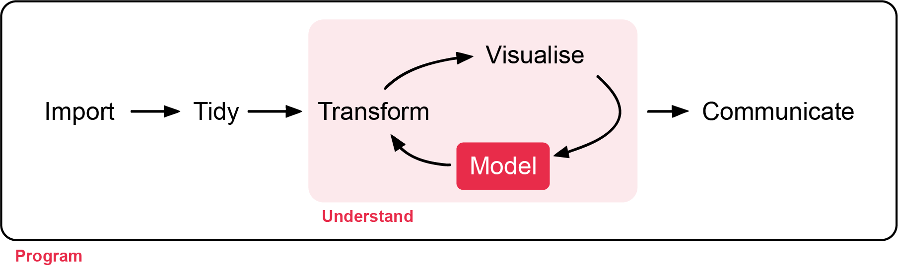

# Generalised Linear Models: Binary Data

**Week 11**: Logistic regression for presence/absence, alive/dead and other yes/no responses

Many ecological questions have a yes/no answer. Is the species present at this
site? Did the seedling survive? Did the coral bleach? Did the bird nest
successfully? This week you will model these **binary** responses with **logistic
regression**, a GLM with a binomial distribution and a logit link. It works the same
way as the count GLMs from Week 8. Workshop materials are available in the GitHub
repository [ECS200](https://github.com/nicholaswunz/ECS200-Workshop).



::: {.callout-tip}
## Learning outcomes

By the end of this workshop you should be able to:

1. Explain why a binary response needs logistic regression, and what probability,
   odds and the logit link are.
2. Fit and check a logistic regression in R.
3. Turn coefficients into odds ratios and predicted probabilities.
4. Write up the results of a logistic regression.
:::

## Before we start {.unnumbered}

[<i class="bi bi-download"></i> frog_ponds.csv](data/frog_ponds.csv){.btn .btn-outline-danger .btn-sm .download-btn download="frog_ponds.csv"}

```{r}
#| label: setup

# Week 11 workshop - GLMs for binary data
# Written by Nicholas Wu, 1234578, 06/05/2027

library(tidyverse)   # data import, wrangling and plotting
library(performance) # checking model assumptions
library(see)         # draws the plots for performance
library(ggeffects)   # predictions from models for plotting

# setwd("C:/Users/YOUR-NAME/Documents/ECS200")
```

### Study context {.unnumbered}

Farm dams can be important breeding habitat for frogs, but only if they are
suitable. Fringing vegetation provides shelter and calling sites, while
introduced fish such as mosquitofish (*Gambusia holbrooki*) eat eggs and tadpoles.

In spring, 90 farm dams were surveyed once at night for a calling tree frog. For
each dam, the survey recorded whether the frog was **detected (1) or not (0)**, the
percentage of the shoreline with **fringing vegetation**, and whether **fish** were
present.

**Question**: Is frog occurrence related to fringing vegetation and the presence of fish?

{width=100%}

```{r}
#| label: load-data

frog_data <- readr::read_csv("data/frog_ponds.csv") %>%
  dplyr::mutate(fish = factor(fish, levels = c("absent", "present")))

dplyr::glimpse(frog_data)

# How many dams had frogs?
frog_data %>%
  dplyr::count(frog_present)
```

## 1. Background {.unnumbered}

### Probability and odds {.unnumbered}

For a binary response we model the **probability** (*p*) that the outcome is 1
(e.g. that the frog is present). Probabilities are stuck between 0 and 1, so a
straight line does not work: it will eventually predict probabilities below 0 or
above 1. Instead, logistic regression models the **log-odds**:

$$
\text{odds} = \frac{p}{1-p} \qquad\qquad \log\left(\frac{p_i}{1-p_i}\right) = \beta_0 + \beta_1 x_i
$$

- **Odds** compare the chance of "yes" with the chance of "no". *p* = 0.5 gives
  odds of 1 (1:1), *p* = 0.8 gives odds of 4 (4:1).
- The **logit link**, log(odds), turns a probability between 0 and 1 into a number
  between −∞ and +∞, so a straight line is fine on that scale.
- On the probability scale the line becomes an **S-shaped curve** that never goes
  below 0 or above 1.
- $e^{\beta_1}$ is the **odds ratio**: how much the odds are multiplied for every
  one-unit increase in *x*. An odds ratio > 1 means *p* increases with *x*, < 1
  means it decreases, and 1 means no effect.

The response follows a **binomial distribution** (for 0/1 data, also called the
Bernoulli distribution), so in R we use `glm(..., family = binomial)`.

Use the app to see how the intercept and slope control the S-curve, and why a
straight line (`lm()`) fails for binary data.

::: {.app-box .column-body-outset}
::: {.app-title}
App: the logistic curve
:::
::: {.app-grid}
::: {.app-controls}
```{ojs}
//| echo: false
//| output: false
import {rng, runif, logistic, lm1, fmt, red, grey, dark, blue} from "./apps/ecs200.js"
```

```{ojs}
//| echo: false
viewof lg_b0 = Inputs.range([-6, 6], {value: -2.5, step: 0.1, label: "Intercept β₀ (log-odds when x = 0)"})
viewof lg_b1 = Inputs.range([-0.15, 0.15], {value: 0.06, step: 0.005, label: "Slope β₁ (change in log-odds per unit of x)"})
viewof lg_lm = Inputs.toggle({label: "Also show a straight line (lm)", value: false})
viewof lg_seed = Inputs.button("Resample")
```
:::
::: {.app-output}
```{ojs}
//| echo: false
lg_data = {
  const r = rng(1111 + lg_seed);
  const x = runif(r, 80, 0, 100);
  const pts = x.map((v) => {
    const p = logistic(lg_b0 + lg_b1 * v);
    const y = r() < p ? 1 : 0;
    return {x: v, y, yj: y + (r() - 0.5) * 0.06};
  });
  const curve = Array.from({length: 101}, (_, i) => ({x: i, p: logistic(lg_b0 + lg_b1 * i)}));
  const fit = lm1(pts.map((d) => d.x), pts.map((d) => d.y));
  return {pts, curve, fit};
}

Plot.plot({
  width: 560, height: 320, marginLeft: 50,
  x: {label: "Predictor x (e.g. vegetation cover, %)", domain: [0, 100]},
  y: {label: "Probability of presence", domain: [-0.25, 1.25], ticks: [0, 0.25, 0.5, 0.75, 1], tickFormat: ".2f", grid: true},
  marks: [
    Plot.ruleY([0, 1], {stroke: dark}),
    Plot.dot(lg_data.pts, {x: "x", y: "yj", fill: grey, fillOpacity: 0.6, r: 3}),
    Plot.line(lg_data.curve, {x: "x", y: "p", stroke: red, strokeWidth: 3}),
    lg_lm ? Plot.line([[0, lg_data.fit.b0], [100, lg_data.fit.b0 + 100 * lg_data.fit.b1]], {stroke: blue, strokeWidth: 2.5, strokeDasharray: "6,4"}) : null
  ]
})

html`<div class="app-verdict">Odds ratio for a 1-unit increase in x = e<sup>β₁</sup> = <b>${fmt(Math.exp(lg_b1), 3)}</b>
(for a 10-unit increase: <b>${fmt(Math.exp(10 * lg_b1), 2)}</b>). Probability at x = 0: <b>${fmt(logistic(lg_b0))}</b>; at x = 100: <b>${fmt(logistic(lg_b0 + 100 * lg_b1))}</b>.
${lg_lm ? "The dashed blue straight line predicts impossible probabilities below 0 or above 1 at the ends." : "Grey dots are the observed 0s and 1s (spread slightly so you can see them); the red curve is the true probability."}</div>`
```
:::
:::
:::

## 2. Visualise {.unnumbered}

Binary data are hard to see on a scatterplot because every point sits at 0 or 1.
Two useful plots are the raw 0/1 points with a fitted logistic curve on top, and
the proportion of 1s in each group.

```{r}
#| label: vis-veg
#| fig-width: 6
#| fig-height: 3

# Raw 0/1 data (jittered vertically a little) with a logistic curve for each fish group
ggplot2::ggplot(frog_data, ggplot2::aes(x = veg_cover, y = frog_present, colour = fish)) +
  ggplot2::geom_jitter(height = 0.03, width = 0, alpha = 0.6) +
  ggplot2::geom_smooth(method = "glm", method.args = list(family = binomial), se = FALSE) +
  ggplot2::scale_colour_manual(values = c("absent" = "grey40", "present" = "#e12744")) +
  ggplot2::labs(x = "Fringing vegetation (% of shoreline)", y = "Frog detected (1) or not (0)",
                colour = "Fish") +
  ggplot2::theme_classic()
```

```{r}
#| label: vis-fish

# Proportion of dams with frogs, with and without fish
frog_data %>%
  dplyr::group_by(fish) %>%
  dplyr::summarise(n_dams      = dplyr::n(),
                   n_frogs     = sum(frog_present),
                   prop_frogs  = mean(frog_present)) # mean of 0/1 values = proportion of 1s
```

Frogs were more often detected at dams with more fringing vegetation, and less
often at dams with fish.

## 3. Check assumptions {.unnumbered}

Residuals from binary data are always strange-looking (every residual comes from
a 0 or a 1), so the usual residual plots are not useful. Instead:

| Assumption | How to check |
|:-----------|:-------------|
| Independent observations | Study design: one survey per dam ✅ . Multiple surveys per dam requires [random effects models](week12_mixed_models.qmd)|
| The relationship is linear on the logit scale | **Binned residuals**: group observations by their fitted value and average the residuals in each bin. Most bins should fall inside the error bounds |
| Enough data | A rough rule is at least 10 observations of the rarer outcome (0 or 1) for every predictor. Here both outcomes have more than 40 dams, and there are only 2 predictors ✅ |
| Predictors are not strongly correlated | `performance::check_collinearity()` |

Overdispersion cannot happen with 0/1 data, so there is nothing to check for it.

```{r}
#| label: fit-check
#| fig-width: 9
#| fig-height: 5

frog_glm <- glm(frog_present ~ veg_cover + fish,
                family = binomial,
                data = frog_data)

# Binned residuals: points should mostly fall inside the grey bounds
plot(performance::binned_residuals(frog_glm))
```

```{r}
#| label: fit-check-all
#| fig-width: 9
#| fig-height: 9

# All diagnostics together
performance::check_model(frog_glm)
```

The binned residuals fall inside the bounds and the collinearity is low, so the
model is appropriate.

::: {.callout-warning collapse="true"}
## When is logistic regression NOT appropriate, or not enough? (click to expand)

| Situation | What to do |
|:----------|:-----------|
| **Imperfect detection**: a single survey can miss a species that is really there (a false absence) | Survey each site several times and use an **occupancy model**, which estimates detection and occupancy separately [@Specht2017]. Logistic regression then models "detected", not "present" |
| Successes out of a known number of trials (e.g. 7 of 20 eggs hatched) | Binomial GLM with `cbind(successes, failures) ~ x` as the response |
| A continuous proportion (e.g. % cover) | Beta regression (e.g. `glmmTMB` package with `family = beta_family()`) |
| Repeated surveys at the same sites, or sites grouped in regions | Mixed model, `lme4::glmer(..., family = binomial)` (Week 12) |
| Warning "fitted probabilities numerically 0 or 1 occurred" | **Complete separation**: a predictor perfectly predicts the outcome (e.g. all dams with fish have no frogs). Estimates are unreliable, so collect more data or simplify the model |
| A time until the event happens (e.g. days until death) | Survival analysis (Week 13) |
:::

## 4. Model {.unnumbered}

```{r}
#| label: summary

summary(frog_glm)
```

The output gives everything you need:

- `Coefficients`: one row per term.
  - `Estimate`: the effect on the **log-odds scale**. `(Intercept)` is the log-odds
    of detecting frogs at a dam with 0% vegetation and no fish (the reference level).
    `veg_cover` is the change in log-odds for each 1% more vegetated shoreline.
    `fishpresent` is the difference in log-odds between dams with and without fish.
    A positive estimate means frogs are **more** likely to be detected, a negative
    one **less** likely.
  - `Std. Error`: the uncertainty in each estimate.
  - `z value`: the estimate divided by its standard error.
  - `Pr(>|z|)`: the *p*-value, the probability of an effect this large if the true
    effect were zero.
- `Dispersion parameter for binomial family taken to be 1`: fixed at 1 for 0/1 data,
  which is why there is no overdispersion to check.
- `Null deviance` and `Residual deviance`: how badly a model with no predictors and
  our model fit the data. The bigger the drop, the more the predictors explain.
- `AIC`: compares models fitted to the same data (lower is better).
- `Number of Fisher Scoring iterations`: how many steps R took to fit the model.
  You can ignore it unless it is very large (over about 25), which can be a sign of
  complete separation.

As in Week 8, the coefficients are on the link scale (here log-odds).
Back-transform them with `exp()` to get **odds ratios**.

```{r}
#| label: odds-ratios

exp(coef(frog_glm))     # odds ratios
exp(confint(frog_glm))  # 95% confidence intervals for the odds ratios
```

Odds ratios are still a bit abstract, so it helps to show predicted
**probabilities**.

```{r}
#| label: predict
#| fig-width: 6.5
#| fig-height: 4

frog_pred <- ggeffects::predict_response(frog_glm, terms = c("veg_cover [all]", "fish"))

plot(frog_pred, show_data = TRUE, jitter = 0.03) +
  ggplot2::scale_colour_manual(values = c("grey40", "#e12744")) +
  ggplot2::scale_fill_manual(values = c("grey40", "#e12744")) +
  ggplot2::labs(title = NULL, x = "Fringing vegetation (% of shoreline)",
                y = "Probability of detecting frogs", colour = "Fish", fill = "Fish")

# Predicted probability at 10% and 90% vegetation cover, with and without fish
ggeffects::predict_response(frog_glm, terms = c("veg_cover [10, 90]", "fish"))
```

## 5. Interpret {.unnumbered}

```{r}
#| label: numbers
#| echo: false
or     <- exp(coef(frog_glm))
or_ci  <- exp(confint(frog_glm))
lg_p   <- coef(summary(frog_glm))[, 4]
p_tab  <- as.data.frame(ggeffects::predict_response(frog_glm, terms = c("veg_cover [10, 90]", "fish")))
p_at   <- function(v, f) round(p_tab$predicted[p_tab$x == v & p_tab$group == f], 2)
```

| Term | Odds ratio | 95% CI | Meaning |
|:-----|:----------:|:------:|:--------|
| `veg_cover` | `r round(or["veg_cover"], 3)` | `r round(or_ci["veg_cover", 1], 3)`–`r round(or_ci["veg_cover", 2], 3)` | Each extra 1% of vegetated shoreline multiplies the odds of detecting frogs by `r round(or["veg_cover"], 3)`. For a 10% increase: ×`r round(or["veg_cover"]^10, 2)` |
| `fishpresent` | `r round(or["fishpresent"], 2)` | `r round(or_ci["fishpresent", 1], 2)`–`r round(or_ci["fishpresent", 2], 2)` | With fish present, the odds of detecting frogs are `r round(or["fishpresent"], 2)` times the odds without fish, i.e. the odds are reduced by `r round(100 * (1 - or["fishpresent"]))`% |

::: {.callout-important}
## Odds are not probabilities

An odds ratio of 0.2 does **not** mean the probability is 80% lower. The change in
probability depends on where you are on the S-curve. That is why it is good
practice to also report predicted probabilities, as in the results sentence below.
:::

**Methods sentence**: *Frog detection (detected/not detected) was modelled with a
binomial generalised linear model (logistic regression) using the `glm()` function 
in R, with fringing vegetation cover and fish presence as the main predictors. 
Model fit was assessed with binned residuals using the `performance::binned_residuals()` 
function. Significance was set with α = 0.05.*

**Results sentence**:

> The probability of detecting frogs increased with fringing vegetation (odds ratio =
> `r round(or["veg_cover"], 3)` per 1% cover, 95% CI `r round(or_ci["veg_cover", 1], 3)`–`r round(or_ci["veg_cover", 2], 3)`,
> *p* < 0.001) and was lower at dams with fish (odds ratio = `r round(or["fishpresent"], 2)`,
> 95% CI `r round(or_ci["fishpresent", 1], 2)`–`r round(or_ci["fishpresent", 2], 2)`, *p* < 0.001; Fig. 1).
> At dams without fish, the predicted probability of detecting frogs rose from
> `r p_at(10, "absent")` at 10% vegetation cover to `r p_at(90, "absent")` at 90% cover, whereas at dams
> with fish it rose from `r p_at(10, "present")` to `r p_at(90, "present")`. Because each dam was surveyed
> once, these are probabilities of *detection*, which may underestimate true occupancy.

# Assessment {.unnumbered}

Task to complete before the end of the workshop.

[<i class="bi bi-download"></i> week11_assessment.R](assessments/week11_assessment.R){.btn .btn-danger .btn-sm .download-btn download="week11_assessment.R"}
[<i class="bi bi-download"></i> coral_bleaching.csv](data/coral_bleaching.csv){.btn .btn-outline-danger .btn-sm .download-btn download="coral_bleaching.csv"}

**Coral bleaching after a marine heatwave.** Heat stress on coral reefs is measured
as **degree heating weeks (DHW)**: how much, and for how long, the water was warmer
than the usual summer maximum. NOAA warns that significant bleaching is likely
above 4 DHW and severe bleaching above 8 DHW. After a marine heatwave, divers
recorded whether 150 tagged coral colonies were **bleached (1) or not (0)**, together
with the heat stress at each colony's location (`dhw`) and the colony's depth
(`depth_m`).

1. Import the data and check its structure. How many colonies bleached?
2. Plot the bleaching data against DHW and against depth. Describe the patterns.
3. Fit a logistic regression with `dhw` and `depth_m` as predictors.
4. Check the model (binned residuals and collinearity). Is the model appropriate?
5. Calculate the odds ratios and 95% CIs. In words, how do the odds of bleaching
   change with each extra DHW and with each extra metre of depth?
6. Use `ggeffects::predict_response()` to find the predicted probability of
   bleaching for a colony at 5 m depth at 4 DHW and at 8 DHW, and plot the
   predicted probability against DHW.
7. Write a results sentence.
8. The study recorded each colony once, a few weeks after the heatwave. Suggest
   one reason why a colony recorded as "not bleached" might be misclassified, and
   how the design could be improved.



# Additional resources {.unnumbered}

- [Biostatistics with R (A. Terui)](https://aterui.github.io/biostats/): chapters
  on the binomial distribution and GLMs.
- [UCLA: Logit regression in R](https://stats.oarc.ucla.edu/r/dae/logit-regression/):
  a worked example with clear interpretation of odds ratios.
- @Specht2017: why a single survey can miss rare species, and how repeat
  surveys and occupancy models fix it.
- Quinn & Keough [-@Quinn2002], chapter 13 (generalised linear models and logistic
  regression).
- [NOAA Coral Reef Watch](https://coralreefwatch.noaa.gov/product/5km/tutorial/crw10a_dhw_product.php):
  what degree heating weeks mean.
