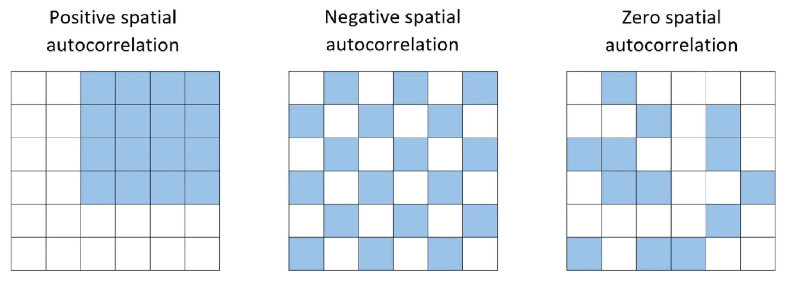
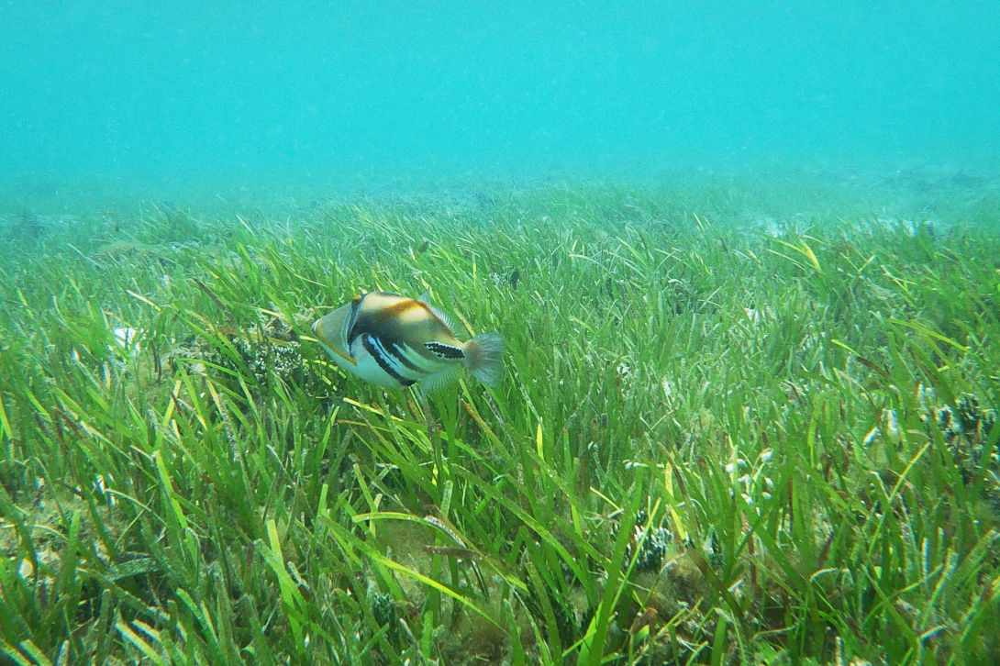

# Mixed-Effects Models

**Week 12**: Accounting for sites, repeated measurements and other sampling structure with random effects

So far, every model has assumed that each observation is **independent**. In real
ecological studies that is rarely true (including your study): we measure the same 
animal more than once,take several quadrats from each site, or put several seedlings 
in each pot. 

This week you will learn **mixed-effects models**, which add **random effects** to 
a linear model to account for this structure. Workshop materials are available in 
the GitHub repository [ECS200](https://github.com/nicholaswunz/ECS200-Workshop).


::: {.callout-tip}
## Learning outcomes

By the end of this workshop you should be able to:

1. Recognise non-independent (grouped or repeated) data and explain why it matters.
2. Explain the difference between fixed and random effects.
3. Fit and check a random-intercept model with `lmerTest::lmer()`.
4. Interpret the fixed effects and the variance components, and write up the results.
:::

## Before we start {.unnumbered}

[<i class="bi bi-download"></i> lizard_repeated.csv](data/lizard_repeated.csv){.btn .btn-outline-danger .btn-sm .download-btn download="lizard_repeated.csv"}
[<i class="bi bi-download"></i> pie_crab.csv](data/pie_crab.csv){.btn .btn-outline-danger .btn-sm .download-btn download="pie_crab.csv"}

We need two new packages. `lme4` fits mixed models, and `lmerTest` is a small
add-on that gives `lme4` models *p*-values.

```{r}
#| label: setup

# Week 12 workshop - Mixed-effects models
# Written by Nicholas Wu, 1234578, 13/05/2027

# install.packages("lme4")      # run once in the console if needed
# install.packages("lmerTest")

library(tidyverse)   # data import, wrangling and plotting
library(lme4)        # mixed-effects models
library(lmerTest)    # p-values for mixed-effects models
library(performance) # checking model assumptions
library(see)         # draws the plots for performance
library(ggeffects)   # predictions from models for plotting

# setwd("C:/Users/YOUR-NAME/Documents/ECS200")
```

### Study context {.unnumbered}

In Week 5 every lizard was raced only once. That needs a lot of lizards. A more
efficient design is to race the **same lizard at several temperatures**. Here, 16
dragons were each raced at 18, 22, 26 and 30 °C (in random order, with a rest day
between trials), giving 64 sprint speeds.

**Question**: How does sprint speed change with temperature?

```{r}
#| label: load-data

lizard_rm <- readr::read_csv("data/lizard_repeated.csv")

dplyr::glimpse(lizard_rm)

# Each lizard appears 4 times, once per temperature
lizard_rm %>%
  dplyr::count(lizard_id)
```

## 1. Background {.unnumbered}

### Why independence matters {.unnumbered}

Some lizards are simply faster than others, at every temperature, perhaps because
they are bigger or in better condition. The four measurements from the same lizard
are therefore more similar to each other than to measurements from other lizards.
They are **not independent**.

If we ignore this and fit `lm(sprint_speed ~ temperature)`, R treats the data as 64
independent lizards. Treating repeated or grouped measurements as independent
replicates is called **pseudoreplication** [@Hurlbert1984]. It is one of the most
common mistakes in ecology, and it usually makes *p*-values too small.

Grouping structure appears everywhere:

| Design | Grouping (random effect) |
|:-------|:-------------------------|
| The same individual measured repeatedly | Individual ID |
| Several quadrats or traps within each site | Site |
| Several plants in each pot, tank or plot | Pot / tank / plot |
| Surveys repeated over several years | Year |
| Offspring from the same parents | Family |

Another example is spatial autocorrelation, where sampling closer to each other 
may yield similar results because of similar soil composition (a problem you will 
see with [The Island](the_islands.qmd)). **Randomisation matters!**

{width=100%}

### Fixed and random effects {.unnumbered}

A mixed-effects model contains both:

- **Fixed effects** are the predictors your question is about (here, temperature).
  You estimate and report their coefficients, exactly as in Weeks 5–11.
- **Random effects** describe the grouping structure (here, lizard ID). You are not
  interested in the difference between lizard L03 and lizard L11. You want to
  account for the fact that lizards differ.

The simplest random effect is a **random intercept**: each lizard gets its own
baseline speed, and those baselines are assumed to come from a normal distribution
with a standard deviation that the model estimates:

$$
\text{speed}_{ij} = \beta_0 + \beta_1\,\text{temperature}_{ij} + u_j + \varepsilon_{ij}, \qquad u_j \sim N(0, \sigma^2_{\text{lizard}}), \quad \varepsilon_{ij} \sim N(0, \sigma^2)
$$

The model splits the unexplained variation into two parts:
**between lizards** ($\sigma^2_{\text{lizard}}$) and **within lizards** ($\sigma^2$, the residual).

In R the random intercept is written `(1 | lizard_id)`, which reads "a separate
intercept for each lizard":

```r
lmerTest::lmer(sprint_speed ~ temperature + (1 | lizard_id), data = lizard_rm)
```

Use the app to compare a model that ignores lizard identity with one that has a
random intercept for each lizard.

::: {.app-box .column-body-outset}
::: {.app-title}
App: random intercepts
:::
::: {.app-grid}
::: {.app-controls}
```{ojs}
//| echo: false
//| output: false
import {rng, rnorm, mean, sum, fmt, red, grey, dark} from "./apps/ecs200.js"
```

```{ojs}
//| echo: false
viewof re_between = Inputs.range([0, 0.5], {value: 0.25, step: 0.01, label: "Differences between lizards (SD of baselines)"})
viewof re_within = Inputs.range([0.02, 0.4], {value: 0.1, step: 0.01, label: "Variation within a lizard (residual SD)"})
viewof re_n = Inputs.range([3, 20], {value: 8, step: 1, label: "Number of lizards"})
viewof re_view = Inputs.radio(new Map([["Ignore lizard identity: one line, lm()", "lm"], ["Random intercept for each lizard: lmer()", "lmer"]]), {value: "lm", label: "Model"})
viewof re_seed = Inputs.button("Resample")
```
:::
::: {.app-output}
```{ojs}
//| echo: false
re_fit = {
  const r = rng(1212 + re_seed);
  const temps = [18, 22, 26, 30];
  const u = rnorm(r, re_n, 0, re_between);
  const pts = [];
  for (let j = 0; j < re_n; j++) temps.forEach((t) => pts.push({id: j, x: t, y: 0.4 + 0.045 * t + u[j] + rnorm(r, 1, 0, re_within)[0]}));
  // pooled least squares (balanced design, so the slope equals the within-lizard slope)
  const xs = pts.map((d) => d.x), ys = pts.map((d) => d.y), N = pts.length;
  const mx = mean(xs), my = mean(ys);
  const sxx = sum(xs.map((v) => (v - mx) ** 2));
  const b1 = sum(pts.map((d) => (d.x - mx) * (d.y - my))) / sxx;
  const b0 = my - b1 * mx;
  const resid = pts.map((d) => d.y - b0 - b1 * d.x);
  const seNaive = Math.sqrt(sum(resid.map((e) => e * e)) / (N - 2) / sxx);
  // lizard means of the residuals = estimated baselines before shrinkage
  const raw = Array.from({length: re_n}, (_, j) => mean(resid.filter((_, i) => pts[i].id === j)));
  const within = resid.map((e, i) => e - raw[pts[i].id]);
  const s2 = sum(within.map((e) => e * e)) / (N - re_n - 1);
  const su2 = Math.max(0, sum(raw.map((v) => v * v)) / (re_n - 1) - s2 / temps.length);
  const shrink = su2 / (su2 + s2 / temps.length);
  const seMixed = Math.sqrt(s2 / sxx);
  const lines = raw.flatMap((v, j) => [18, 30].map((t) => ({id: j, x: t, y: b0 + b1 * t + shrink * v})));
  return {pts, b0, b1, seNaive, seMixed, lines, icc: su2 / (su2 + s2)};
}

Plot.plot({
  width: 560, height: 300, marginLeft: 50,
  x: {label: "Test temperature (°C)", domain: [17, 31]},
  y: {label: "Sprint speed (m/s)", grid: true},
  color: {scheme: "tableau10"},
  marks: [
    re_view === "lmer" ? Plot.line(re_fit.lines, {x: "x", y: "y", z: "id", stroke: "id", strokeOpacity: 0.7, strokeWidth: 1.5}) : null,
    Plot.dot(re_fit.pts, {x: (d) => d.x + (d.id - re_n / 2) * 0.08, y: "y", fill: re_view === "lmer" ? "id" : grey, r: 3.5}),
    Plot.line([[17, re_fit.b0 + re_fit.b1 * 17], [31, re_fit.b0 + re_fit.b1 * 31]], {stroke: red, strokeWidth: 3.5})
  ]
})

html`<div class="app-verdict">Slope = <b>${fmt(re_fit.b1, 3)}</b> m/s per °C in both models.
Standard error of the slope: <b>${fmt(re_fit.seNaive, 4)}</b> if lizard identity is ignored vs <b>${fmt(re_fit.seMixed, 4)}</b> with a random intercept.
Proportion of the unexplained variation due to differences between lizards (ICC) = <b>${fmt(re_fit.icc)}</b>.
${re_view === "lmer" ? "Each coloured line is one lizard: same slope, its own baseline. The thick red line is the average lizard (the fixed effect)."
  : "Lizard differences end up in the residuals, which makes the noise look larger than it is."}</div>`
```
:::
:::
:::

Because every lizard was raced at every temperature, the random intercept removes
the lizard-to-lizard differences from the noise, so the temperature effect is
estimated **more precisely** (a smaller standard error). This is the same idea as a
paired *t*-test. When the predictor only varies **between** groups (e.g. one
latitude per marsh), it works the other way: ignoring the grouping makes you **too
confident**. You will see that with the crab data at the end of this workshop.

### How many groups do I need? {.unnumbered}

The model estimates the *variation among groups* from the groups you sampled, so it
needs enough of them. A common guideline is **at least 5 levels**, and preferably
more, for a random effect [@Harrison2018]. With only 2–3 sites, include site as a
fixed effect instead.

## 2. Visualise {.unnumbered}

Plot each lizard as its own line ("spaghetti plot"). This shows the grouping
structure immediately.

```{r}
#| label: vis
#| fig-width: 6.5
#| fig-height: 4.5

ggplot2::ggplot(lizard_rm, ggplot2::aes(x = temperature, y = sprint_speed, group = lizard_id)) +
  ggplot2::geom_line(alpha = 0.5) +   # one line per lizard
  ggplot2::geom_point(alpha = 0.7) +
  ggplot2::labs(x = "Test temperature (°C)", y = "Sprint speed (m/s)") +
  ggplot2::theme_classic()
```

Every lizard gets faster as temperature increases, the lines are roughly parallel
(similar slopes), and some lizards are consistently faster than others (different
heights). That is exactly the pattern a **random intercept** describes.

## 3. Check assumptions {.unnumbered}

A linear mixed model has the same assumptions as a linear model (linearity, equal
variance and normal residuals) plus one more: the **random effects are normally
distributed**. The independence assumption now only applies *after* accounting for
the grouping.

```{r}
#| label: fit-check
#| fig-width: 9
#| fig-height: 9

# Random intercept model
lizard_lmm <- lmerTest::lmer(sprint_speed ~ temperature + (1 | lizard_id),
                             data = lizard_rm)

performance::check_model(lizard_lmm)
```

| Assumption | Panel | Here |
|:-----------|:------|:-----|
| Linearity | Linearity | ✅ Flat reference line |
| Equal variance | Homogeneity of variance | ✅ |
| Normal residuals | Normality of residuals | ✅ |
| Normal random effects | Normality of random effects (lizard_id) | ✅ Dots close to the line |
| Independence, given the grouping | Study design | ✅ Lizards are different animals, tested in random order |

::: {.callout-warning collapse="true"}
## When do you need something different? (click to expand)

| Situation | What to do |
|:----------|:-----------|
| Groups differ in their **slope** as well as their intercept (the spaghetti lines are not parallel) | Add a **random slope**: `(1 + temperature \| lizard_id)`. This needs plenty of data per group |
| Groups within groups, e.g. quadrats within sites within regions | **Nested** random effects: `(1 \| region/site)` |
| Two separate groupings, e.g. site and year | **Crossed** random effects: `(1 \| site) + (1 \| year)` |
| Counts or binary responses with grouping | **Generalised** linear mixed model: `lme4::glmer(count ~ x + (1 \| site), family = poisson)` |
| Fewer than about 5 groups | Fit the grouping as a fixed effect, e.g. `lm(y ~ x + site)` |
| Message `boundary (singular) fit` | The random effect variance is estimated as zero, often because there are too few groups or little variation among them. Check the data. The model may not need that random effect |
| Measurements close in time are more similar than distant ones | Temporal autocorrelation (see the optional Week 6 on time series) |
:::

## 4. Model {.unnumbered}

```{r}
#| label: summary

summary(lizard_lmm)
```

The output gives everything you need:

- `Linear mixed model fit by REML`: REML (restricted maximum likelihood) is the
  default fitting method. `t-tests use Satterthwaite's method` means `lmerTest`
  calculated the degrees of freedom and *p*-values.
- `Scaled residuals`: a quick summary of the residuals. The median should be near 0
  and the minimum and maximum roughly symmetrical.
- `Random effects`: how the unexplained variation is split.
  - `lizard_id (Intercept)`: the `Variance` and `Std.Dev.` of the baseline speeds
    **between** lizards. A large value means lizards differ a lot.
  - `Residual`: the variation **within** a lizard, left over after temperature and
    lizard identity.
- `Number of obs: 64, groups: lizard_id, 16`: check these match your design (16
  lizards × 4 temperatures).
- `Fixed effects`: interpreted exactly like `lm()`.
  - `Estimate`: `(Intercept)` is the predicted speed of the average lizard at 0 °C
    (outside the data, so not meaningful on its own). `temperature` is the change in
    sprint speed per °C for the average lizard.
  - `Std. Error`: the uncertainty in each estimate, now accounting for the repeated
    measures.
  - `df`: degrees of freedom from Satterthwaite's method (usually a decimal).
  - `t value` and `Pr(>|t|)`: the test statistic and *p*-value.
- `Correlation of Fixed Effects`: how strongly the estimates are related to each
  other. You can usually ignore it.

```{r}
#| label: extras

# 95% confidence intervals for the fixed effects (Wald method, fast and fine here)
confint(lizard_lmm, parm = "beta_", method = "Wald")

# Intraclass correlation (ICC): proportion of the unexplained variance due to lizards
performance::icc(lizard_lmm)

# R-squared: marginal = fixed effects only; conditional = fixed + random effects
performance::r2(lizard_lmm)
```

Compare this with the model that ignores lizard identity:

```{r}
#| label: compare-lm

lizard_lm <- lm(sprint_speed ~ temperature, data = lizard_rm)

# Same slope, different standard error
summary(lizard_lm)$coefficients["temperature", ]
summary(lizard_lmm)$coefficients["temperature", ]
```

Plot the predictions for the average lizard, with the raw data.

```{r}
#| label: predict
#| fig-width: 6
#| fig-height: 4

lizard_pred <- ggeffects::predict_response(lizard_lmm, terms = "temperature")

plot(lizard_pred, show_data = TRUE) +
  ggplot2::labs(title = NULL, x = "Test temperature (°C)", y = "Sprint speed (m/s)")
```

## 5. Interpret {.unnumbered}

```{r}
#| label: numbers
#| echo: false
fe     <- summary(lizard_lmm)$coefficients
vc     <- as.data.frame(VarCorr(lizard_lmm))
ci_fe  <- confint(lizard_lmm, parm = "beta_", method = "Wald")
icc_v  <- performance::icc(lizard_lmm)$ICC_adjusted
r2_v   <- performance::r2(lizard_lmm)
```

- **Temperature**: sprint speed increased by `r round(fe["temperature", "Estimate"], 3)` m/s
  per °C (95% CI `r round(ci_fe["temperature", 1], 3)`–`r round(ci_fe["temperature", 2], 3)`), i.e. about
  `r round(12 * fe["temperature", "Estimate"], 2)` m/s across the 12 °C range tested.
- **Random effects**: lizards differed in their baseline speed with an SD of
  `r round(vc$sdcor[1], 2)` m/s, while the residual SD within a lizard was
  `r round(vc$sdcor[2], 2)` m/s. The ICC of `r round(icc_v, 2)` means
  `r round(100 * icc_v)`% of the unexplained variation was due to consistent
  differences between individual lizards.
- **R^2^**: temperature alone explains `r round(r2_v$R2_marginal, 2)` of the variation
  (marginal R^2^), and temperature plus lizard identity explain `r round(r2_v$R2_conditional, 2)`
  (conditional R^2^).

**Methods sentence**: *Because each lizard was tested at all four temperatures, the
effect of temperature on sprint speed was analysed with a linear mixed-effects model
with temperature as a fixed effect and lizard identity as a random intercept,
fitted with `lme4` and `lmerTest` in R (p-values from Satterthwaite's degrees of
freedom). Significance was set with α = 0.05.*

**Results sentence**:

> Sprint speed increased with temperature by `r round(fe["temperature", "Estimate"], 3)` m/s per °C
> (95% CI `r round(ci_fe["temperature", 1], 3)`–`r round(ci_fe["temperature", 2], 3)`;
> *t*~`r round(fe["temperature", "df"])`~ = `r round(fe["temperature", "t value"], 1)`, *p* < 0.001; Fig. 1).
> Individual lizards differed consistently in speed (SD among lizards = `r round(vc$sdcor[1], 2)` m/s;
> ICC = `r round(icc_v, 2)`).

# Revisiting Week 7: crabs in marshes {.unnumbered}

{width=90%}

In Week 7 we regressed fiddler crab size on latitude using 392 crabs, but they came
from only **13 marshes**, and every crab in a marsh has the same latitude. The
predictor varies only *between* marshes, so the real replication for the latitude
effect is closer to 13 than to 392. A random intercept for marsh (`site`) fixes
this.

```{r}
#| label: crab
#| fig-width: 6
#| fig-height: 4

crab_data <- readr::read_csv("data/pie_crab.csv")

# Week 7 model: treats 392 crabs as independent
crab_lm  <- lm(size ~ latitude, data = crab_data)

# Mixed model: crabs are grouped within marshes
crab_lmm <- lmerTest::lmer(size ~ latitude + (1 | site), data = crab_data)

# Compare the latitude estimate and its standard error
summary(crab_lm)$coefficients["latitude", ]
summary(crab_lmm)$coefficients["latitude", ]
```

```{r}
#| label: crab-numbers
#| echo: false
cl  <- summary(crab_lm)$coefficients
cm  <- summary(crab_lmm)$coefficients
```

The slope barely changes, but its standard error increases from
`r round(cl["latitude", "Std. Error"], 3)` to `r round(cm["latitude", "Std. Error"], 3)`
and the degrees of freedom drop from `r crab_lm$df.residual` to about
`r round(cm["latitude", "df"])`, which is close to the number of marshes. The
evidence for Bergmann's rule is still strong (*p* < 0.001), but the **mixed model gives
an honest measure of the uncertainty**. With a weaker effect, the simple `lm()` could
easily have produced a "significant" result that the data did not support.

# Assessment {.unnumbered}

Task to complete before the end of the workshop.

[<i class="bi bi-download"></i> week12_assessment.R](assessments/week12_assessment.R){.btn .btn-danger .btn-sm .download-btn download="week12_assessment.R"}
[<i class="bi bi-download"></i> seagrass_meadows.csv](data/seagrass_meadows.csv){.btn .btn-outline-danger .btn-sm .download-btn download="seagrass_meadows.csv"}

{width=100%}

**Seagrass shoot length and water depth.** Seagrasses need light, and light
decreases with depth. To test whether seagrass shoots are shorter in deeper water,
divers sampled **8 seagrass meadows**. In each meadow they placed **12 quadrats** at
different depths and measured the mean shoot length (cm) in each quadrat.

1. Import the data and check its structure. Which variable is the grouping
   (random) effect, and why should it be random rather than ignored?
2. Plot shoot length against depth, with a different colour (or line) for each
   meadow. Describe the pattern within meadows and among meadows.
3. Fit a linear model that ignores meadow (`lm()`), and a mixed model with a random
   intercept for meadow (`lmerTest::lmer()`).
4. Check the assumptions of the mixed model with `performance::check_model()`.
5. Report the depth effect (estimate, 95% CI, *p*-value) from the mixed model.
   How do the estimate and its standard error differ from the `lm()`?
6. Report the among-meadow SD, the residual SD and the ICC. What do they tell you?
7. Plot the predicted shoot length against depth with `ggeffects::predict_response()`.
8. Write a results sentence.
9. For next year's survey, the team can afford about 100 quadrats. Would you
   recommend 5 meadows × 20 quadrats or 20 meadows × 5 quadrats if the aim is to
   make conclusions about seagrass meadows in general? Explain in one or two
   sentences.



# Additional resources {.unnumbered}

- Coding Club: [Introduction to linear mixed models](https://ourcodingclub.github.io/tutorials/mixed-models/),
  a friendly, ecology-based tutorial (dragons included).
- @Harrison2018 *A brief introduction to mixed effects modelling and multi-model
  inference in ecology*: the go-to practical guide (focus on sections 1–4).
- @Hurlbert1984 *Pseudoreplication and the design of ecological field experiments*:
  the classic paper that defined pseudoreplication.
- @Pedersen2019 *Hierarchical generalized additive models in ecology*: what to do
  when relationships are wiggly as well as grouped (advanced).
- [Mixed models with R (M. Clark)](https://m-clark.github.io/mixed-models-with-R/):
  a clear next step if you want to learn random slopes and GLMMs.
