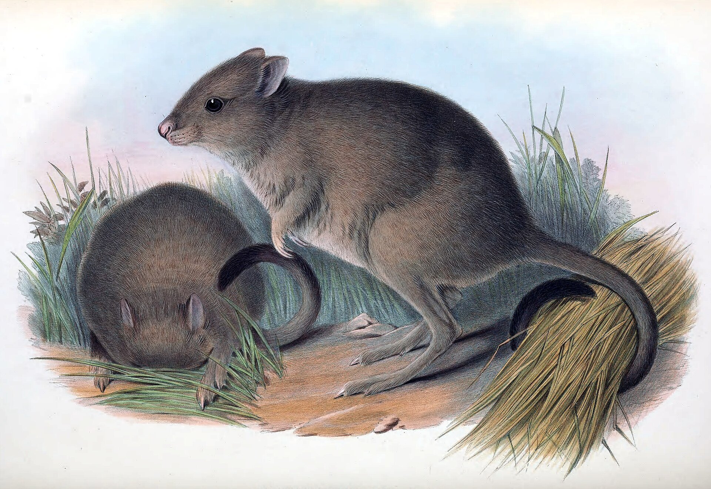
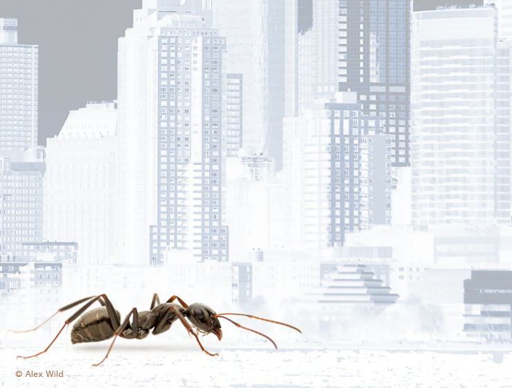

# Survival Analysis

**Week 13**: Time-to-event data, censoring, Kaplan–Meier curves and Cox models

How long does a translocated animal survive? How many days until a seed
germinates, a plant flowers, or an insect is knocked down by heat? These are
**time-to-event** questions. They need their own methods, because in almost every
study some individuals have not had the event by the time the study ends. 

This week you will learn **survival analysis**, which handles this properly. 
Workshop materials are available in the GitHub repository
[ECS200](https://github.com/nicholaswunz/ECS200-Workshop).


::: {.callout-tip}
## Learning outcomes

By the end of this workshop you should be able to:

1. Explain what censoring is and why it rules out a *t*-test or logistic regression.
2. Estimate and plot survival curves with the Kaplan–Meier method.
3. Compare survival between groups with a log-rank test and a Cox proportional hazards model.
4. Interpret hazard ratios, check the proportional hazards assumption and write up the results.
:::

## Before we start {.unnumbered}

[<i class="bi bi-download"></i> woylie_survival.csv](data/woylie_survival.csv){.btn .btn-outline-danger .btn-sm .download-btn download="woylie_survival.csv"}

We use `survival`, which comes installed with R, for the models, and `ggsurvfit` to
draw survival curves with ggplot2.

```{r}
#| label: setup

# Week 13 workshop - Survival analysis
# Written by Nicholas Wu, 1234578, 20/05/2027

# install.packages("ggsurvfit")  # run once in the console if needed

library(tidyverse)  # data import, wrangling and plotting
library(survival)   # survival models (installed with R)
library(ggsurvfit)  # survival curves with ggplot2

# setwd("C:/Users/YOUR-NAME/Documents/ECS200")
```

### Study context {.unnumbered}

{width=100%}

The woylie (brush-tailed bettong, *Bettongia penicillata*) is a critically endangered
marsupial from south-west Western Australia. Predation by introduced foxes and cats
is a major threat, so woylies are often translocated into **predator-proof fenced
reserves**. Translocations outside fences can establish wider populations, but only
if enough animals survive.

Sixty woylies were radio-collared and released, 30 inside a fenced reserve and 30 in
an unfenced reserve with predator baiting. Each animal was tracked for up to **365
days**. For each woylie, the data record:

- `days`: days from release until death, or until tracking stopped;
- `status`: **1** = the woylie died during the study; **0** = the woylie was still
  alive when tracking stopped (the study ended, or its collar failed);
- `release_site` (fenced or unfenced) and body mass at release (`mass_g`).

**Question**: Does survival differ between fenced and unfenced release sites?

```{r}
#| label: load-data

woylie_data <- readr::read_csv("data/woylie_survival.csv") %>%
  dplyr::mutate(release_site = factor(release_site, levels = c("fenced", "unfenced")))

dplyr::glimpse(woylie_data)

# How many deaths (status = 1) and censored animals (status = 0) per site?
woylie_data %>%
  dplyr::count(release_site, status)
```

## 1. Background {.unnumbered}

### Censoring {.unnumbered}

Most woylies released inside the fence were still alive after 365 days. We know
they survived **at least** 365 days, but not how long they would actually live.
Their survival time is **censored**. A collar that fails on day 200 also gives a
censored time: the animal was alive on day 200, and after that we do not know.

Censored observations contain real information, so they must not be thrown away
or treated as deaths:

| Approach | Problem |
|:---------|:--------|
| *t*-test on `days` | Censored animals lived *longer* than recorded, so the mean is underestimated, most of all in the group that survives best |
| Drop the censored animals | Removes the survivors, which makes survival look worse than it is |
| Logistic regression on dead/alive | Ignores *when* animals died. Dying on day 5 and on day 360 count the same, and animals followed for different lengths of time are not comparable |

### Survival curves, the log-rank test and the Cox model {.unnumbered}

- The **survival function** $S(t)$ is the probability of surviving beyond time *t*.
  It starts at 1 and steps down every time an animal dies.
- The **Kaplan–Meier** method estimates $S(t)$ from data with censoring. At each
  death, the proportion surviving is multiplied by (1 − deaths / number still at
  risk). Censored animals count as "at risk" until the day they are censored, and
  then they leave the calculation. They are not counted as deaths.
- The **log-rank test** compares survival curves between groups (H~0~: the curves
  are the same).
- The **Cox proportional hazards model** is the regression model for survival
  data. It models the **hazard** (the instantaneous risk of death at any moment)
  and can include several predictors, numeric or categorical:

$$
h(t) = h_0(t)\, e^{\beta_1 x_1 + \beta_2 x_2 + \dots}
$$

$e^{\beta}$ is the **hazard ratio (HR)**. HR = 2 means twice the risk of dying at
any moment, HR = 0.5 means half the risk, and HR = 1 means no effect. The model
assumes the hazard ratio stays the same throughout the study: the **proportional
hazards** assumption.

Use the app to see how survival curves, censoring and sample size interact.

::: {.app-box .column-body-outset}
::: {.app-title}
App: Kaplan–Meier survival curves and censoring
:::
::: {.app-grid}
::: {.app-controls}
```{ojs}
//| echo: false
//| output: false
import {rng, rexp, kaplanMeier, logrank, fmt, fmtp, red, grey, dark} from "./apps/ecs200.js"
```

```{ojs}
//| echo: false
viewof sv_medA = Inputs.range([20, 600], {value: 400, step: 10, label: "Median survival, fenced (days)"})
viewof sv_medB = Inputs.range([20, 600], {value: 110, step: 10, label: "Median survival, unfenced (days)"})
viewof sv_end = Inputs.range([30, 365], {value: 365, step: 5, label: "Study length (days)"})
viewof sv_n = Inputs.range([5, 60], {value: 30, step: 1, label: "Animals per group"})
viewof sv_seed = Inputs.button("Resample")
```
:::
::: {.app-output}
```{ojs}
//| echo: false
sv_data = {
  const r = rng(1313 + sv_seed);
  const make = (median) => {
    const t = rexp(r, sv_n, Math.log(2) / median);
    return {times: t.map((v) => Math.min(Math.ceil(v), sv_end)), status: t.map((v) => (v <= sv_end ? 1 : 0))};
  };
  const A = make(sv_medA), B = make(sv_medB);
  const kmA = kaplanMeier(A.times, A.status), kmB = kaplanMeier(B.times, B.status);
  const steps = [
    ...kmA.steps.map((d) => ({...d, group: "fenced"})), {time: sv_end, surv: kmA.steps.at(-1).surv, group: "fenced"},
    ...kmB.steps.map((d) => ({...d, group: "unfenced"})), {time: sv_end, surv: kmB.steps.at(-1).surv, group: "unfenced"}
  ];
  const cens = [...kmA.censored.map((d) => ({...d, group: "fenced"})), ...kmB.censored.map((d) => ({...d, group: "unfenced"}))];
  const lr = logrank(A.times, A.status, B.times, B.status);
  const ncens = A.status.filter((s) => s === 0).length + B.status.filter((s) => s === 0).length;
  return {steps, cens, lr, ncens};
}

Plot.plot({
  width: 560, height: 320, marginLeft: 50,
  x: {label: "Days since release", domain: [0, 365]},
  y: {label: "Proportion surviving", domain: [0, 1], grid: true},
  color: {domain: ["fenced", "unfenced"], range: [grey, red], legend: true},
  marks: [
    Plot.line(sv_data.steps, {x: "time", y: "surv", stroke: "group", curve: "step-after", strokeWidth: 2.5}),
    Plot.dot(sv_data.cens, {x: "time", y: "surv", stroke: "group", symbol: "plus", r: 5}),
    Plot.ruleX([sv_end], {stroke: dark, strokeDasharray: "4,3"})
  ]
})

html`<div class="app-verdict">Log-rank test: χ² = <b>${fmt(sv_data.lr.chisq)}</b>, <i>p</i> <b>${fmtp(sv_data.lr.p)}</b>.
<b>${sv_data.ncens}</b> of ${2 * sv_n} animals were censored (+ symbols), i.e. still alive when the study ended (dashed line).
Shorten the study and watch how many observations become censored and how much harder it is to detect a difference.</div>`
```
:::
:::
:::

## 2. Visualise {.unnumbered}

The response in a survival analysis is a pair of columns, time and status,
combined with `survival::Surv()`. The `+` signs printed below mark censored times.

```{r}
#| label: surv-object

# Time and status combined into one "survival" response
head(survival::Surv(woylie_data$days, woylie_data$status), 10)
```

Plot the **Kaplan–Meier curves** for each release site. `ggsurvfit::survfit2()`
estimates the curves, and `ggsurvfit::ggsurvfit()` plots them as a ggplot.

```{r}
#| label: km-plot
#| fig-width: 7
#| fig-height: 5

# Kaplan-Meier estimate for each release site
woylie_km <- ggsurvfit::survfit2(survival::Surv(days, status) ~ release_site,
                                 data = woylie_data)

woylie_km %>%
  ggsurvfit::ggsurvfit(linewidth = 1) +
  ggsurvfit::add_confidence_interval() +  # 95% CI bands
  ggsurvfit::add_censor_mark() +          # + marks for censored animals
  ggsurvfit::add_risktable() +            # number still being tracked
  ggplot2::scale_colour_manual(values = c("grey30", "#e12744")) +
  ggplot2::scale_fill_manual(values = c("grey30", "#e12744")) +
  ggplot2::labs(x = "Days since release", y = "Proportion surviving")
```

```{r}
#| label: km-median

# Median survival time (with 95% CI) for each site
woylie_km
```

- `n`: number of woylies in each group. `events`: number that died.
- `median`: the time by which half the animals had died, with its 95% CI
  (`0.95LCL` to `0.95UCL`). `NA` means the curve never fell below 0.5 (or the CI never
  reached it).

Survival inside the fence stayed high all year, while most woylies released
outside the fence died within the first few months. The median survival for the
fenced site is `NA` because fewer than half of those woylies died, so the curve
never dropped below 0.5.

## 3. Check assumptions {.unnumbered}

| Assumption | How to check |
|:-----------|:-------------|
| **Independent (non-informative) censoring**: whether an animal is censored has nothing to do with its risk of dying | Study design. A collar failing at random is fine. Losing track of animals *because* they were dying (e.g. collar destroyed by a predator but recorded as "lost") is not |
| **Independent individuals** | Study design |
| **Proportional hazards** (Cox model only): the hazard ratio is constant over time | `survival::cox.zph()`: a non-significant test, and a roughly flat line in its plot |
| **Enough events**: roughly 10 events (deaths) per predictor in a Cox model | Count the events ✅ (`r sum(woylie_data$status)` deaths, 2 predictors) |

Fit the Cox model first, then test the proportional hazards assumption.

```{r}
#| label: cox-fit
#| fig-width: 8
#| fig-height: 3.5

woylie_cox <- survival::coxph(survival::Surv(days, status) ~ release_site + mass_g,
                              data = woylie_data)

# Test of the proportional hazards assumption for each predictor and overall
woylie_zph <- survival::cox.zph(woylie_cox)
woylie_zph

# One plot per predictor: the line should be roughly flat
par(mfrow = c(1, 2))  # two plots side by side
plot(woylie_zph)
par(mfrow = c(1, 1))  # back to one plot per page
```

All *p*-values are above 0.05 and the lines are roughly flat, so the proportional
hazards assumption is reasonable.

::: {.callout-warning collapse="true"}
## When is a Cox model NOT appropriate? (click to expand)

| Situation | What to do |
|:----------|:-----------|
| Survival curves **cross**, or `cox.zph()` is significant | Hazards are not proportional. Report Kaplan–Meier curves and the log-rank test, stratify the model (`strata()`), or split the study period into intervals |
| Censoring is related to the risk of death (informative censoring) | Fix the design: check collars more often and follow up mortality signals |
| Individuals grouped in sites, cohorts or families | Add a random effect (a *frailty* term, e.g. the `coxme` package), the survival version of Week 12 |
| Events only checked every few weeks, so the exact day is unknown | Interval-censored methods, or analyse survival per interval with a binomial GLM (Week 11) |
| An event that can happen repeatedly (e.g. repeated nest failures) | Recurrent event models |
| Predictors that change during the study (e.g. body condition at each capture) | Time-varying covariates in `coxph()` |
:::

## 4. Model {.unnumbered}

**Log-rank test**: do the two survival curves differ?

```{r}
#| label: logrank

survival::survdiff(survival::Surv(days, status) ~ release_site, data = woylie_data)
```

The output gives everything you need:

- `N`: number of woylies in each group.
- `Observed`: the number of deaths that actually happened in each group.
- `Expected`: the number of deaths expected in each group if both groups had the
  same survival curve (the null hypothesis). Many more observed than expected deaths
  in the unfenced group means survival was worse there.
- `(O-E)^2/E` and `(O-E)^2/V`: how far observed is from expected in each group; they
  add up to the test statistic.
- `Chisq= ... on 1 degrees of freedom`: the log-rank test statistic. The df is the
  number of groups minus 1.
- `p= ...`: the probability of curves this different if survival were really the
  same at both sites.

**Cox model**: how big is the effect of release site, and does body mass matter?

```{r}
#| label: cox-summary

summary(woylie_cox)
```

The output gives everything you need:

- `n = ..., number of events = ...`: the number of animals and deaths used.
- The first table has one row per predictor:
  - `coef`: the effect on the **log-hazard** scale. Positive means a higher risk of
    death, negative a lower risk. `release_siteunfenced` compares unfenced with fenced
    (the reference level); `mass_g` is per gram of body mass.
  - `exp(coef)`: the **hazard ratio**. Above 1 = higher risk, below 1 = lower risk,
    1 = no effect.
  - `se(coef)`: the standard error of `coef`.
  - `z` and `Pr(>|z|)`: the test statistic and *p*-value for each predictor.
- The second table repeats `exp(coef)` with its 95% confidence interval (`lower .95`
  to `upper .95`). If the CI does not include 1, the effect is significant at
  α = 0.05. `exp(-coef)` is the same hazard ratio the other way round (e.g. fenced
  compared with unfenced).
- `Concordance`: how well the model ranks which animals died first (0.5 = no better
  than chance, 1 = perfect).
- `Likelihood ratio test`, `Wald test` and `Score (logrank) test`: three versions of
  an overall test of whether the predictors together explain survival. They usually
  agree; report the predictor-level results above.

## 5. Interpret {.unnumbered}

```{r}
#| label: numbers
#| echo: false
cox_s  <- summary(woylie_cox)
hr     <- cox_s$conf.int
lr     <- survival::survdiff(survival::Surv(days, status) ~ release_site, data = woylie_data)
lr_p   <- 1 - pchisq(lr$chisq, df = 1)
km_tab <- summary(woylie_km)$table
surv365 <- summary(woylie_km, times = 365, extend = TRUE) # extend = TRUE gives a value even if no animals were left
```

| Term | Hazard ratio | 95% CI | Meaning |
|:-----|:------------:|:------:|:--------|
| `release_siteunfenced` | `r round(hr["release_siteunfenced", "exp(coef)"], 1)` | `r round(hr["release_siteunfenced", "lower .95"], 1)`–`r round(hr["release_siteunfenced", "upper .95"], 1)` | At any point in the study, a woylie released outside the fence was `r round(hr["release_siteunfenced", "exp(coef)"], 1)` times as likely to die as one inside the fence (of the same body mass) |
| `mass_g` | `r round(hr["mass_g", "exp(coef)"], 4)` | `r round(hr["mass_g", "lower .95"], 4)`–`r round(hr["mass_g", "upper .95"], 4)` | The HR is per gram, so it looks tiny. Per 100 g heavier, HR = `r round(hr["mass_g", "exp(coef)"]^100, 2)` (95% CI `r round(hr["mass_g", "lower .95"]^100, 2)`–`r round(hr["mass_g", "upper .95"]^100, 2)`). The CI includes 1, so there is no clear effect of body mass |

A hazard ratio is about the **rate** of dying, not the total number that die.
Survival curves and the proportion surviving to a given time are easier for most
readers to understand, so report them as well.

**Methods sentence**: *Survival of radio-collared woylies was estimated with the
Kaplan–Meier method and compared between release sites with a log-rank test using 
the `ggsurvfit::survfit2()` function in R. The effects of release site and body mass 
on the risk of death were estimated with a Cox proportional hazards model, using 
the `survival::coxph()` function from the `survival` package in R. Animals alive at
the end of the 365-day study or whose collars failed were treated as censored. The
proportional hazards assumption was checked with Schoenfeld residuals
(`cox.zph()`). Significance was set with α = 0.05.*

**Results sentence**:

> Survival over the first year was much higher inside the fenced reserve
> (`r round(100 * surv365$surv[1])`% surviving at 365 days) than at the unfenced site
> (`r round(100 * surv365$surv[2])`%; median survival = `r round(km_tab["release_site=unfenced", "median"])` days;
> log-rank χ²~1~ = `r round(lr$chisq, 1)`, *p* < 0.001; Fig. 1). After accounting for body
> mass, woylies released outside the fence had `r round(hr["release_siteunfenced", "exp(coef)"], 1)` times
> the hazard of death (95% CI `r round(hr["release_siteunfenced", "lower .95"], 1)`–`r round(hr["release_siteunfenced", "upper .95"], 1)`,
> *p* < 0.001). There was no clear effect of body mass on the risk of death (HR per 100 g =
> `r round(hr["mass_g", "exp(coef)"]^100, 2)`, 95% CI `r round(hr["mass_g", "lower .95"]^100, 2)`–`r round(hr["mass_g", "upper .95"]^100, 2)`,
> *p* = `r round(cox_s$coefficients["mass_g", "Pr(>|z|)"], 2)`).

::: {.callout-note}
## Link to your project

Survival analysis is not only about death. In [The Islands](the_islands.qmd)
project, **time to first flowering** and **time to first fruit** are time-to-event
data. Plots that had not flowered when you harvested them are censored.
:::

# Assessment {.unnumbered}

Task to complete before the end of the workshop.

[<i class="bi bi-download"></i> week13_assessment.R](assessments/week13_assessment.R){.btn .btn-danger .btn-sm .download-btn download="week13_assessment.R"}
[<i class="bi bi-download"></i> ant_knockdown.csv](data/ant_knockdown.csv){.btn .btn-outline-danger .btn-sm .download-btn download="ant_knockdown.csv"}

{width=100%}

**Are city ants more heat tolerant?** Cities are hotter than the surrounding
countryside (the urban heat island). To test whether urban ants tolerate heat
better, workers of one ant species were collected from **rural** and **urban**
colonies and placed individually in vials in a heat block at a constant 42 °C. The
**knockdown time** (minutes until the ant lost coordination and could no longer stand)
was recorded. The trial stopped after **60 minutes**, so ants still standing at 60
minutes were censored. Head width (mm) was measured as an index of body size.

**Note**: For the purpose of this excerise, we assume the ants are *independent* 
of their colonies. In reality, we would need to include colony source as a random 
effect due to genetic similarities among related ant individuals.

Columns: `ant_id`, `origin` (rural/urban), `head_width` (mm), `knockdown_min`
(minutes), `status` (1 = knocked down, 0 = still standing at 60 minutes).

1. Import the data, check its structure and count how many ants from each origin
   were knocked down and how many were censored.
2. Explain in one or two sentences why a *t*-test comparing `knockdown_min`
   between origins would give a misleading answer.
3. Plot Kaplan–Meier curves of the proportion of ants still standing over time for
   each origin, and report the median knockdown time for each origin.
4. Use a log-rank test to compare the two origins.
5. Fit a Cox model with `origin` and `head_width` as predictors and check the
   proportional hazards assumption.
6. Report and interpret the hazard ratios for origin and head width (careful: here
   the "event" is being knocked down, so what does a hazard ratio below 1 mean?).
7. Write a results sentence.



# Additional resources {.unnumbered}

- [Survival analysis in R (E. Zabor)](https://www.emilyzabor.com/survival-analysis-in-r.html):
  an excellent, step-by-step tutorial using `survival` and `ggsurvfit`.
- [`ggsurvfit` documentation](https://www.danieldsjoberg.com/ggsurvfit/): more ways
  to customise survival plots.
- [STHDA: Cox proportional hazards model](http://www.sthda.com/english/wiki/cox-proportional-hazards-model):
  short explanations of hazard ratios and the PH assumption.
- Woylie conservation: [Australian Wildlife Conservancy](https://www.australianwildlife.org/wildlife/woylie/).
