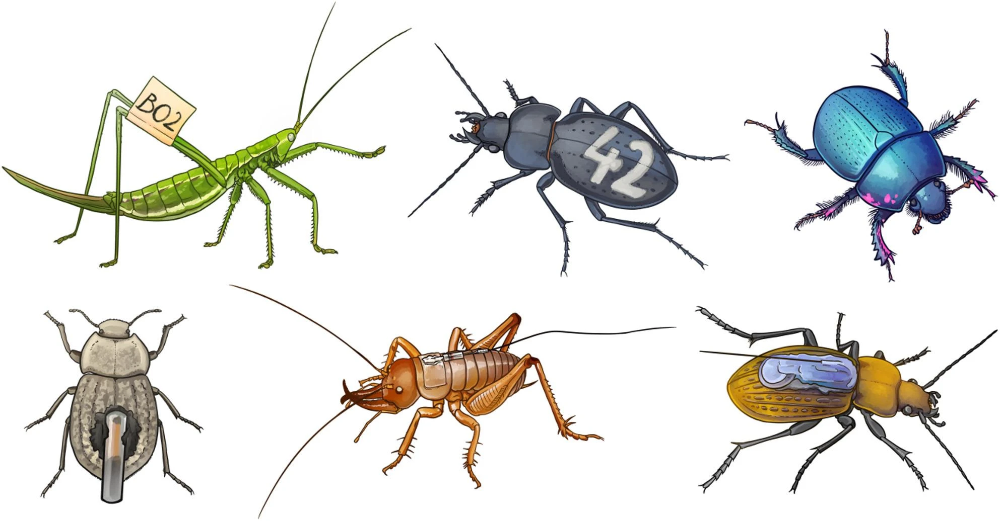
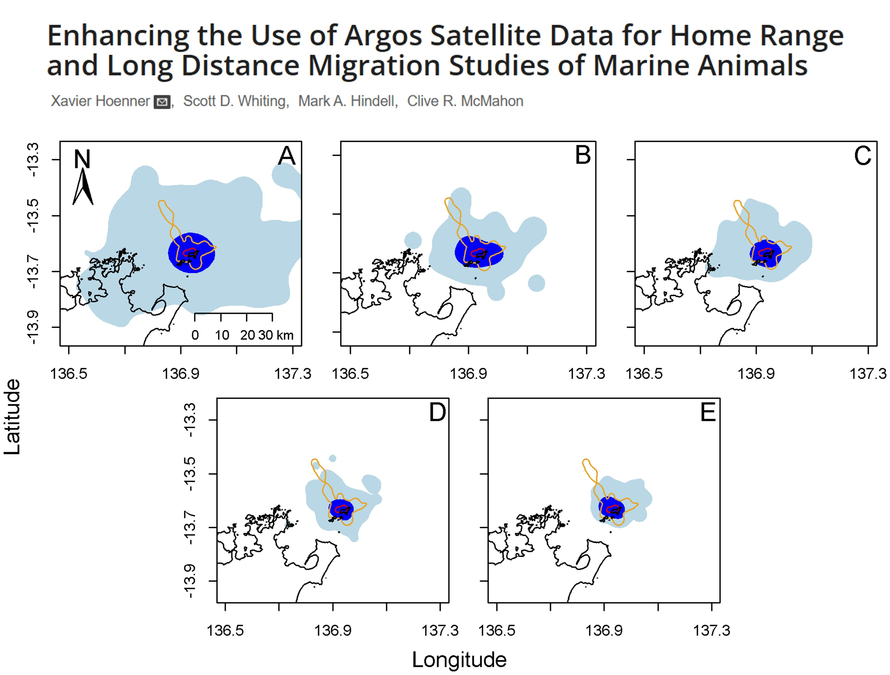
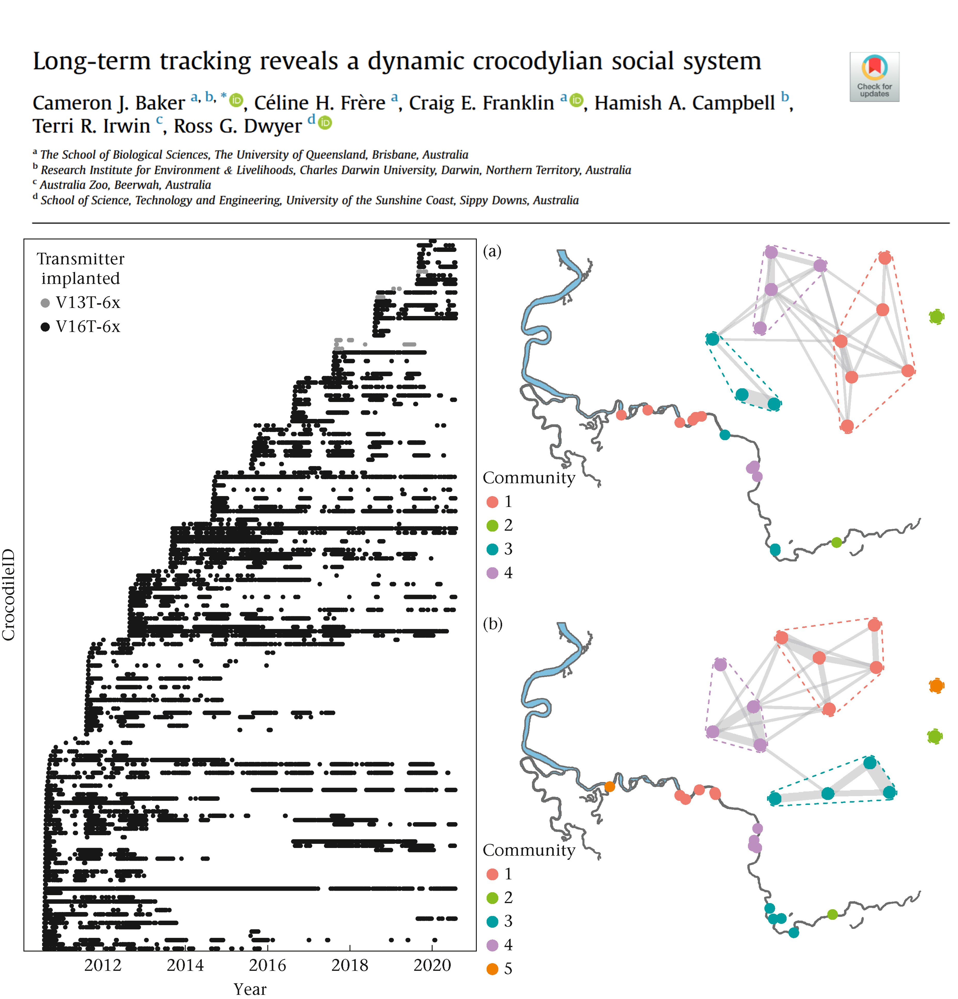
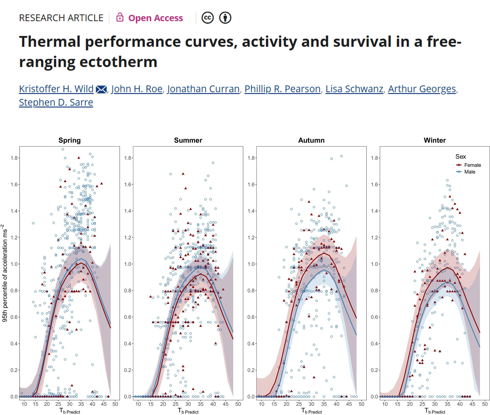
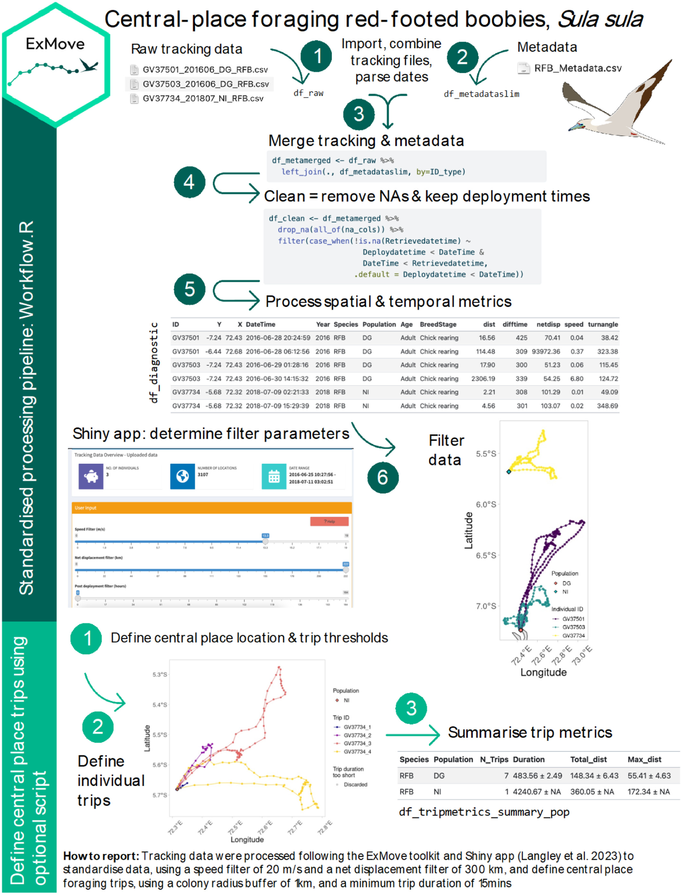
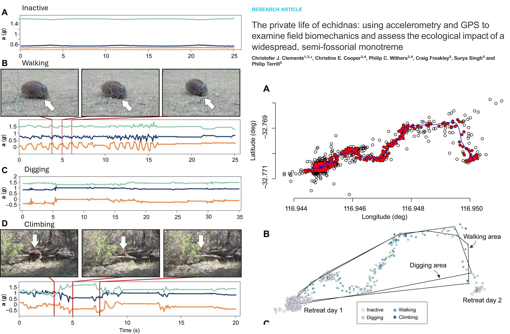

# OPTIONAL - Movement Data

**Week 10** - Cleaning and plotting movement data

This is an optional tutorial if you plan to work with animals with telemetry 
tracking their movement.

:::{.callout-note}

**THIS TUTORIAL WILL NOT BE IN THE EXAM**. It is an optional extra learning tool.

:::

Since movement data from tracked animals include location and time data, you will 
apply skills from both the [time series tutorial](week7_time_series.qmd) and 
[spatial data tutorial](week9_spatial.qmd) in this tutorial.


# Sensor Technologies {.unnumbered}

How do we track animals? Here are some example ways researchers use to track 
animals in the wild.

:::{.callout-important}

**How you process, analyse and infer movement data will heavily depend on the type of tracking technique used**.

:::





::: {.panel-tabset .nav-pills}

### Marking {.unnumbered}

This is the simplest and least expensive method which relies on traditional 
capture-mark-recapture techniques or direct observations to infer behaviour and 
movement. The downside is that it is time consuming to follow the animal, 
which could also **disturb the animal's behaviour** by the presence of the observer, 
and recapturing animals multiple times also causes distress on the animals which 
could impact their behaviour. Nevertheless, it is a popular method for identifying 
individuals in certain studies, such as monitoring bird migration in citizen 
science projects, via binoculars and photographs of bird bands. 

**Example study**: [Environmental effects on movement and breeding of Australasian Gannets: insights from banding records](https://doi.org/10.1080/01584197.2023.2214581)


### Radio Telemetry {.unnumbered}

**VHF radio telemetry**: A small transmitter (typically <5-10% of an animals weight) 
is attached to an animal that emits **very high frequency** (VHF) radio waves 
(30-300 MHz) at regular intervals. The animal is then tracked by the researcher 
with a receiver + antenna. It is less costly to purchase and relatively lightweight 
compared to other telemetry systems like GPS. They also typically have longer battery 
life than satellite-based trackers and are most suitable for terrestrial animals 
(and semi-aquatic animals like freshwater turtles). However, this method is still 
labour intensive (requires active tracking) and has low temporal resolution 
(few fixes per day).

Newer automated radio telemetry systems like the [Motus](https://motus.org/) 
network enables continuous, long-term tracking of wildlife using stationary 
receivers to detect VHF transmitter tags, offering high temporal resolution for 
small animals. There is a high upfront cost of purchasing multiple receivers, but 
or long-term monitoring of a site or ecosystem, a Motus network offsets the upfront 
cost for long-term monitoring.

**Example study**: [Artificial shelters provide suitable thermal habitat for a cold-blooded animal](https://doi.org/10.1038/s41598-022-09950-y)


**Radio-Frequency Identification** (RFID): Uses a tiny, battery-free, passive 
integrated transponder tags (PIT tag) implanted under the skin or attached as tags, 
and a RFID receiver to detect when a tagged animal moves through the antenna. If 
several RFID receivers are deployed between sites, for example monitoring bat movement 
between caves, then you can infer how often and when bats move between monitored 
caves.

**Example study**: [Seasonal population dynamics and movement patterns of a critically endangered, cave-dwelling bat](https://doi.org/10.1071/WR21088)


### Satellite Telemetry {.unnumbered}

**GPS telemetry**: Global position system (GPS) uses satellite technology and tags 
(collars, backpacks) to monitor animal movement, migration, and habitat usage in 
real-time or via data retrieval (via VHF tracking). GPS is one of the more 
expensive techniques, with individual tags costing thousands of dollars.

Newer Global System for Mobile Communications (GSM) / Cellular Telemetry allow for 
GPS tags to upload data via mobile network, allowing for near real-time data access 
without the need to find the GPS logger. However, GSM requires cell coverage to 
work and has lower battery capacity. Studies in urban environments or areas with 
good cellular connectivity benefit from using GSM telemetry


**Example study**: [Satellite telemetry informs the protection of flatback turtles in Western Australian waters](https://doi.org/10.1002/ecs2.4847)


**Argos Satellite telemetry**: A global, near real-time, low-power tracking system 
that uses Doppler shift on the signals when they are received by the satellites.
Tags are known as platform transmitter terminals (PTTs). The downside over GPS is 
that Argos is less accuracy that GPS (within kilometers), and has low temporal 
resolution, for similar price tags. However, it can be deployed for longer periods 
(months-years) and is most suitable for large migratory species like sharks, 
turtles, seals.

**Example study**: [Enhancing the Use of Argos Satellite Data for Home Range and Long Distance Migration Studies of Marine Animals](https://doi.org/10.1371/journal.pone.0040713)




### Acoustic Telemetry {.unnumbered}

Widely used for tracking aquatic animal movement and behaviour, by utilising sound 
pulses (transmitters) to transmit unique IDs to fixed or mobile receivers. They 
often have a long battery life (often years), but the quality and detection 
depends on the number of receiver arrays available. The best use case are for 
movement of aquatic organisms in structured aquatic habitats such as rivers.
**Radio signals do not propagate in salt water**, so most marine underwater tracking 
is done via acoustic telemetry.

**Example study**: [Long-term tracking reveals a dynamic crocodylian social system](https://doi.org/10.1016/j.anbehav.2023.02.015)




### Onboard Loggers {.unnumbered}

**Accelerometers**: A logger that measures linear and angular acceleration in three 
axes (**same tech in your smart watches and phones**). Data from accelerometers 
can be used for monitoring activity levels, classify behaviors (foraging, resting, 
hunting), and estimate energy expenditure, such as overall dynamic body acceleration 
(ODBA). The challenge of accelerometers is that they require calibration of known 
behaviours (e.g. in the lab or controlled setting) to infer behaviour in the wild, 
and also accelerometers do not have location data, so the integration of GPS of 
VHF telemtry is required to link behavour with space use.

**Example study**: [Thermal performance curves, activity and survival in a free-ranging ectotherm](https://doi.org/10.1111/1365-2656.70091)




**Biologgers**: Additional tags that store data onboard that can measure light, 
temperature, depth with the animal movement depending on the sensors added. Some 
implantable loggers can measure internal physiological parameters such as heart 
rate, ventilation, blood pressure and flow, and internal body temperature.

**Example study**: [“Breath holding” as a thermoregulation strategy in the deep-diving scalloped hammerhead shark](https://www.science.org/doi/full/10.1126/science.add4445)


:::


# Process GPS Data {.unnumbered}


The most basic movement data will include a column for the `ID` of the individual 
tracked, an `x` coordinate representing longitude, and a `y` coordinate representing 
latitude, and a `date_time` stamp representing the day and time of the location.

In this tutorial, we will work GPS-data from three GPS-tagged red-footed boobies, 
*Sula sula*.

We will loosely follow the cleaning and processing workflow of raw data from [ExMove tutorial](https://exmove.github.io/), but there are others out there. 
For example, [Gupte et al.](https://besjournals.onlinelibrary.wiley.com/doi/full/10.1111/1365-2656.13610) (2021)




## Clean raw data {.unnumbered}

The three GPS data and metadata files are available in the github repository [ECS200](https://github.com/nicholaswunz/ECS200-Workshop) in the data folder 
called gps_study. You will need to download it to your local desktop.

### Load multiple GPS files into R {.unnumbered}

```{r setup, message = FALSE, warning = FALSE}
# install.packages("stringr")

# Load libraries
library(tidyverse)
library(stringr)
library(lubridate) # for converting dates and time
library(sf) # work with spatial data

```


Adjust these numbers for extracting the ID number from file name using `stringr` 
R package (e.g. to extract GV37501 from “GV37501_201606_DG_RFB.csv”, we want 
characters 1-7). 


:::{.callout-note}

This approach only works if all ID’s are the same length and in the same 
position — see the `str_sub()` [documentation](https://stringr.tidyverse.org/reference/str_sub.html) 
for other options.

:::


```{r load data, include=FALSE}
# List all individual files 
files <- list.files(path = "C:/Users/75002992/OneDrive - Murdoch University/Desktop/gps_study", 
                    pattern = "GV.*\\.csv$", # only extract files with the letters GV for the GPS data
                    full.names = TRUE)

# load and merge all listed files
raw_data <- files %>%
  map_dfr(~ read_csv(.x, 
                     col_types = cols(
                       Date = col_character(),
                       Time = col_character()
                       )
                     ) %>% 
            mutate(file_name = basename(.x),
                   # for files with different date formats
                   Date = lubridate::parse_date_time(Date, orders = c("ymd", "dmy", "mdy"))
                   ),
          ) 


IDstart <- 1 # start position of the ID in the filename
IDend <- 7 # end position of the ID in the filename

# Clean raw data
raw_data <- raw_data %>%
  dplyr::mutate(
    # convert character to date and time, and define time zone for tracking data (GMT)
    date_time = lubridate::ymd_hms(paste(Date, Time), tz = "GMT"),
    ID = stringr::str_sub(file_name, start =  IDstart, end = IDend),
    date = lubridate::date(date_time), # extract date only
    x = Longitude, # for spatial analysis
    y = Latitude, # for spatial analysis
  ) %>%
  dplyr::select(-c(Date, Time, Longitude, Latitude, Altitude, Speed, Course, Type, Distance, Essential))


# You can also have additional columns depending on the type of logger used, for example:
# lc = Argos fix quality
# Lat2/Lon2 = additional location fixes from Argos tag
# laterr/lonerr = location error information provided by some GLS processing package

glimpse(raw_data)
```


```{r, eval=FALSE}
# List all individual files 
files <- list.files(path = "YOUR/FILE/LOCATION", 
                    pattern = "GV.*\\.csv$", # only extract files with the letters GV for the GPS data
                    full.names = TRUE)

# load and merge all listed files
raw_data <- files %>%
  map_dfr(~ read_csv(.x, 
                     col_types = cols(
                       Date = col_character(),
                       Time = col_character()
                       )
                     ) %>% 
            mutate(file_name = basename(.x),
                   # for files with different date formats
                   Date = lubridate::parse_date_time(Date, orders = c("ymd", "dmy", "mdy"))
                   ),
          ) 


IDstart <- 1 # start position of the ID in the filename
IDend <- 7 # end position of the ID in the filename

# Clean raw data
raw_data <- raw_data %>%
  dplyr::mutate(
    # convert character to date and time, and define time zone for tracking data (GMT)
    date_time = lubridate::ymd_hms(paste(Date, Time), tz = "GMT"),
    ID = stringr::str_sub(file_name, start =  IDstart, end = IDend),
    date = lubridate::date(date_time), # extract date only
    x = Longitude, # for spatial analysis
    y = Latitude, # for spatial analysis
  ) %>%
  dplyr::select(-c(Date, Time, Longitude, Latitude, Altitude, Speed, Course, Type, Distance, Essential))


# You can also have additional columns depending on the type of logger used, for example:
# lc = Argos fix quality
# Lat2/Lon2 = additional location fixes from Argos tag
# laterr/lonerr = location error information provided by some GLS processing package

glimpse(raw_data)

```

### Merge with metadata {.unnumbered}

Metadata are an essential piece of information for any tracking study, as they 
contain important information about each data file, such as tag ID, animal ID, 
or deployment information, that we can add back into to our raw data when needed. 

Format all dates and times, combine them and specify timezone.

```{r, include=FALSE}

# Load csv file
df_metadata <- read_csv("C:/Users/75002992/OneDrive - Murdoch University/Desktop/gps_study/RFB_metadata.csv")

# check what the data contains
glimpse(df_metadata)

# Looks like a few things require a correction their class. Lets do it.

df_metadata_slim <- df_metadata %>%
  dplyr::mutate(DeploymentDate = lubridate::dmy(DeploymentDate),
                RetrievalDate  = lubridate::dmy(RetrievalDate),
                Deploydatetime = lubridate::parse_date_time(
                  paste(DeploymentDate, DeploymentTime),# make deploy datetime
                  order = c("dmY HMS", "Ymd HMS"), 
                  tz    = "Indian/Chagos"),
                Retrievedatetime = lubridate::parse_date_time(
                  paste(RetrievalDate, RetrievalTime), # make retrieve datetime
                  order = c("dmY HMS", "Ymd HMS"),
                  tz    = "Indian/Chagos"),
                TagID          = as.character(TagID),
                ID             = BirdID,
                CPY            = NestLat,
                CPX            = NestLong,
                ) %>%
  dplyr::select(-c("DeploymentDate", "DeploymentTime", "RetrievalDate", "RetrievalTime", "BirdID")) %>%
  dplyr::mutate(across(contains('datetime'), # for chosen datetime column
                       ~with_tz(., tzone = "GMT")) #format to different tz
         )

glimpse(df_metadata_slim)

# Here we’ll create a dataframe of temporal extents of our data to use in absence of deploy/retrieve times (this is also useful for basic data checks and for writing up methods).

df_temporalextents <- raw_data %>%
  group_by(ID) %>%
  summarise(min_datetime = min(date_time),
            max_datetime = max(date_time))

# Then we use these temporal extents of our data to fill in any NA’s in the deploy/retrieve times.

df_metadata_slim <- df_metadata_slim %>%
  dplyr::left_join(df_temporalextents, by = "ID") %>%
  dplyr::mutate(Deploydatetime = case_when(!is.na(Deploydatetime) ~ Deploydatetime,
                                      is.na(Deploydatetime) ~ min_datetime),
         Retrievedatetime = case_when(!is.na(Retrievedatetime) ~ Retrievedatetime,
                                      is.na(Retrievedatetime) ~ max_datetime)) %>%
  dplyr::select(-c(min_datetime, max_datetime))

df_meta_merged <- raw_data %>%
  dplyr::left_join(df_metadata_slim, by = "ID") 


```

```{r, eval=FALSE}

# Load csv file
df_metadata <- read_csv("YOUR/FILE/LOCATION/RFB_metadata.csv")

# check what the data contains
glimpse(df_metadata)

# Looks like a few things require a correction their class. Lets do it.

df_metadata_slim <- df_metadata %>%
  dplyr::mutate(DeploymentDate = lubridate::dmy(DeploymentDate),
                RetrievalDate  = lubridate::dmy(RetrievalDate),
                Deploydatetime = lubridate::parse_date_time(
                  paste(DeploymentDate, DeploymentTime),# make deploy datetime
                  order = c("dmY HMS", "Ymd HMS"), 
                  tz    = "Indian/Chagos"),
                Retrievedatetime = lubridate::parse_date_time(
                  paste(RetrievalDate, RetrievalTime), # make retrieve datetime
                  order = c("dmY HMS", "Ymd HMS"),
                  tz    = "Indian/Chagos"),
                TagID          = as.character(TagID),
                ID             = BirdID,
                CPY            = NestLat,
                CPX            = NestLong,
                ) %>%
  dplyr::select(-c("DeploymentDate", "DeploymentTime", "RetrievalDate", "RetrievalTime", "BirdID")) %>%
  dplyr::mutate(across(contains('datetime'), # for chosen datetime column
                       ~with_tz(., tzone = "GMT")) #format to different tz
         )

glimpse(df_metadata_slim)

# Here we’ll create a dataframe of temporal extents of our data to use in absence of deploy/retrieve times (this is also useful for basic data checks and for writing up methods).

df_temporalextents <- raw_data %>%
  group_by(ID) %>%
  summarise(min_datetime = min(date_time),
            max_datetime = max(date_time))

# Then we use these temporal extents of our data to fill in any NA’s in the deploy/retrieve times.

df_metadata_slim <- df_metadata_slim %>%
  dplyr::left_join(df_temporalextents, by = "ID") %>%
  dplyr::mutate(Deploydatetime = case_when(!is.na(Deploydatetime) ~ Deploydatetime,
                                      is.na(Deploydatetime) ~ min_datetime),
         Retrievedatetime = case_when(!is.na(Retrievedatetime) ~ Retrievedatetime,
                                      is.na(Retrievedatetime) ~ max_datetime)) %>%
  dplyr::select(-c(min_datetime, max_datetime))

df_meta_merged <- raw_data %>%
  dplyr::left_join(df_metadata_slim, by = "ID") 


```

Have a look at the raw data using `ggplot`.

```{r}

df_meta_merged %>%
  ggplot(aes(x = x, y = y, colour = ID)) +
  # geom_path lets you explore how two variables are related over time
  geom_path() + 
  geom_point() +
  theme_bw()

```

Looks like there are outlier data points for GV37734 (blue). Before we deal with 
this, let's check if there are duplicates and missing data first.

### Duplicates {.unnumbered}

Check for duplicated rows from week 1's R prac.

```{r}

sum(duplicated(df_meta_merged))  # Returns the number of duplicate rows

# View the duplicate rows themselves
raw_data[duplicated(df_meta_merged), ]

```

In this dataset of three individuals, there are no duplicated rows which is good! 
Always good for sanity check.

### Missing fixes {.unnumbered}

A small percentage of random missing fixes are typically not a problem, but 
**many consecutive missing points are not random**, e.g. dense canopy creates 
habitat-biased missing fixes.

Visualise missing rows with `vis_miss()` function from week 1's R prac.

```{r}

# Visualise missing data pattern
visdat::vis_miss(df_meta_merged)

```
Great! No missing values in this dataset.
Probably because the boobies tracked are in open water with no structures that 
could interfere with GPS signals.

### Outliers {.unnumbered}

As you saw with the raw plot traces, we can visually see that GV37734 has erroneous 
GPS fixes. Most GPS units will also include a dilution of precision columns (DOP) 
which measure the potential loss of precision due to satellite geometry. Lower 
values are better (1-2 excellent vs >8 poor to very poor)

If your GPS data has a DOP column, you can remove data with DOP precision values 
above a defined user-threshold. Check for sampling interval as histogram and 
position error.

Our example dataset does not have a DOP column, but if you would like to know 
how to check, then run this code with whatever your `data` object name is called.

```{r, eval=FALSE}

# Check the distribution of errors
data %>%
  ggplot(aes(x = DOP)) +
  geom_histogram()

# example filter for DOP values above 10, keeping data with DOP values below 10.
data %>%
  filter(dop < 10)

```


In our dataset, we don't have DOP column so we need to check for erroneous GPS 
fixes in a different way.


:::{.callout-note}

**Check projection**

We will work frequently with raster data (spatial covariates) and possibly with 
vector data (i.e., home ranges). One of the challenges is to ensure that both – 
tracking data and covariates – have a **matching coordinate reference system** (CRS).

The CRS defines the reference system that is being used to explicitly reference 
a feature in space. Projected CRS flatten the three dimensional data to the a 
two-dimensional plane (and introduce some distortion).

There are two classes of CRS: **geographic** (e.g., WGS84) and **projected** 
(e.g., UTM) CRS.

Which CRS is best to use? It depends on the range of the study species. I usually 
prefer projected CRS, because their units are meters and not degrees.

First we need to specify the co-ordinate projection systems for the tracking data 
and meta data. The default here is lon/lat for both tracking data & metadata, for 
which the EPSG code is 4326. For more information have a look at the 
[ESPG.io database](https://epsg.io/).

```{r}

tracking_crs <- 4326 # Only change if data are in a different coordinate system
meta_crs <- 4326 # Only change if data are in a different coordinate system

```

Next we transform coordinates of data, and perform spatial calculations. 
This requires spatial analysis, and so it is good practice to run all spatial 
analyses in a coordinate reference system that uses metres as a unit.

The default CRS for this workflow is the [Spherical Mercator projection](https://epsg.io/3857) — (`crs = 3857`), which is used by Google Maps/OpenStreetMap and works worldwide. 
However, this CRS can over-estimate distance calculations in some cases, so it’s 
important to consider the location and scale of your data (e.g., equatorial/polar/local scale/global scale) 
and choose a projection system to match. Other options include (but are not 
limited to) UTM, and Lambert Azimuthal Equal-Area (LAEA) projections.

```{r}

transform_crs <- 3857

```

:::

Here we’ll calculate some useful movement metrics from the tracking data, including 
distance between fixes, time between fixes, and net displacement from the first fix.

This will involve transforming the data to a projected coordinate system using the 
`st_transform()` and `st_as_sf()` functions from the`sf` R package.

We can calculate distance with the `st_distance()` function, with units depending 
on the coordinate system. 

```{r}

df_diagnostic <- df_meta_merged %>%
  dplyr::ungroup() %>% #need to ungroup to extract geometry of the whole dataset
  dplyr::mutate(
    geometry_GPS = sf::st_transform( # transform X/Y coordinates
    sf::st_as_sf(., coords = c("x","y"), crs = tracking_crs), #from original format 4326
    crs = transform_crs)$geometry # to the new transform_crs format 3857
    ) %>%
  dplyr::group_by(ID) %>% #back to grouping by ID for calculations per individual
  dplyr::mutate(
    # distance travelled from previous fix, 
    dist = sf::st_distance(geometry_GPS, lag(geometry_GPS), by_element = T), # calculations are done by row
    # time passed since previous fix
    diff_time = difftime(date_time, lag(date_time), units = "secs"), # in seconds
    # dist. between 1st and current location
    netdisp = sf::st_distance(geometry_GPS, geometry_GPS[1], by_element = F)[,1], # dense matrix w/ pairwise distances
    speed = as.numeric(dist)/as.numeric(diff_time), # calculate speed (distance/time)
    dX = as.numeric(x)-lag(as.numeric(x)), #diff. in lon  relative to prev. location
    dY = as.numeric(y)-lag(as.numeric(y)), #diff. in lat relative to prev. location
    turnangle = atan2(dX, dY)*180/pi + (dX < 0)*360) %>% # angle from prev. to current location
  dplyr::ungroup() %>% 
  dplyr::select(-c(geometry_GPS, dX, dY)) # ungroup and remove excess geometries


```

Add latitude and longitude column — this can be useful for plotting and is a common 
coordinate system used in the shiny app.

```{r}

df_diagnostic <- sf::st_coordinates(
  sf::st_transform(
    sf::st_as_sf(df_diagnostic, coords = c("x", "y"), 
                 crs = tracking_crs), 
    crs = 4326)) %>% 
                  as.data.frame() %>% 
                  rename("Lon" = "X", "Lat" = "Y") %>% 
                  cbind(df_diagnostic, .)

# Check the distribution of errors
diff_plot <- df_diagnostic %>%
  ggplot(aes(x = diff_time / 60)) + # from seconds to minutes
  geom_histogram(bins = 100) +
  labs(x = "Difference between points (minute)", y = "Frequency") + 
  theme_bw() +
  facet_wrap(~ ID)

speed_plot <- df_diagnostic %>%
  ggplot(aes(x = speed)) +
  geom_histogram(bins = 100) +
  labs(x = "Speed (m/s)", y = "Frequency") +
  theme_bw() +
  facet_wrap(~ ID)


netdisp_plot <- df_diagnostic %>%
  ggplot(aes(x = as.vector(netdisp) / 1000)) + # convert m to km
  labs(x = "SNet displacement (km)", y = "Frequency") +
  geom_histogram(bins = 100) +
  theme_bw() +
  facet_wrap(~ ID)

cowplot::plot_grid(diff_plot, 
                   netdisp_plot, 
                   speed_plot,
                   ncol = 1, align = "v")

```
### Define threshold {.unnumbered}

For this section, you can either use the code chunks produced by the [Shiny app](https://lukeozsanlav.shinyapps.io/exmove_explorer/), or manually define the 
threshold values yourself. 

- If you’re using the Shiny app, you can copy the code chunks from the bottom of 
each page to replace the user input section below. 

- If you’re manually defining the threshold values, you can edit each of the 
variables below as you would for any of the user input sections (the tutorial has 
suggested some for the RFB dataset).

First we define a period to filter after tag deployment, when all points before 
the cutoff will be removed (e.g. to remove potentially unnatural behaviour following 
the tagging event). 

```{r}

# We define this period using the as.period function, by providing an integer value and time unit (e.g. hours/days/years). This code below specifies a period of 30 minutes:
filter_cutoff <- as.period(30, unit = "minutes") 

```

Next we define a **net displacement** (distance from first point) threshold and 
specify units. Any points further away from the first tracking point will be removed 
(see commented code for how to retain all points):

```{r}

# Create net displacement filter using distance and units
filter_netdisp <- units::as_units(300, "km") # e.g., "m", "km"

#If you want to retain points no matter the net displacement value, use these values instead:
#filter_netdisp_dist <- max(df_diagnostic$netdisp)
#filter_netdist_units <- "m"

```

Filter the data based on your defined thresholds.

```{r}

df_filtered <- df_diagnostic %>%
  filter(Deploydatetime + filter_cutoff < date_time, # keep times after cutoff
         speed < 20, # keep speeds slower than speed filter (here is 20 m/s)
         netdisp <= filter_netdisp) # keep distances less than net displacement filter (here is 300 km)


```

Have a look at the filtered data using `ggplot` and compare with the original raw 
data.

```{r}

raw_plot <- df_meta_merged %>%
  ggplot(aes(x = x, y = y, colour = ID)) +
  geom_path() + 
  geom_point() +
  labs(title = "Raw data") +
  theme_bw() +
  theme(legend.position = "bottom")

filtered_plot <- df_filtered %>%
  ggplot(aes(x = x, y = y, colour = ID)) +
  geom_path() + 
  geom_point() +
  labs(title = "Filtered data") +
  theme_bw() +
  theme(legend.position = "bottom")

cowplot::plot_grid(raw_plot, 
                   filtered_plot, 
                   nrow = 1, align = "v")

```


## Plotting {.unnumbered}

Create version of data for plotting by transforming required columns to numeric 
and creating time elapsed columns.


```{r}

df_plotting <- df_filtered %>%
  group_by(ID) %>%
  mutate(diffsecs    = as.numeric(diff_time),
         secs_elapsed = cumsum(replace_na(diffsecs, 0)),
         time_elapsed = as.duration(secs_elapsed),
         days_elapsed = as.numeric(time_elapsed, "days")) %>%
  mutate(across(c(dist, speed, Lat, Lon), as.numeric))

```

::: {.panel-tabset .nav-pills}

### Speed over time {.unnumbered}

Create a time series plot of speed, faceted for each individual.

```{r}

df_plotting %>% 
  ggplot(aes(x = days_elapsed, y = speed, group = ID)
         ) +
  geom_line() +   # add line of speed over time
  xlab("time elapsed (days)") + 
  ylab("speed (m/s)") +
  facet_wrap(~ID) +
  theme_bw() 

```

### Speed over space and time {.unnumbered}

Create a spatial plot of speed each individual.

```{r}

df_plotting %>% 
  ggplot() +
  # add GPS points and paths between them
  geom_point(aes(x = Lon, y = Lat, col = speed), 
             alpha = 0.8, size = 0.6 
             ) +
  geom_path(aes(x = Lon, y = Lat, col = speed, group = ID), 
            alpha = 0.8, linewidth = 0.6 
            ) +
  # colour birds using scale_colour_gradient2
  scale_colour_gradient2(name = "Speed", 
                         low = "blue", mid = "white", high = "red", 
                         midpoint = (max(df_plotting$speed,na.rm = TRUE) / 2) # use `midpoint` for nice colour transition
                         ) +
  theme_bw() 

```

:::

# Other Data Types {.unnumbered}

When cleaning other types of telemetry data, take into consideration of the 
following issues:

### Argos staellite tags {.unnumbered}

- Data are labelled with a location class rather than DOP.

- Error distributions are studied for each location class (bivariate t-distributions).

- Often modelled with an SSM


### Acoustic telemtery {.unnumbered}

Acoustic signals are more easily corrupted than electromagnetic caves, resulting 
in the wrong tag ID being recorded.

- **Type A false detection** are of tag IDs not in the study (easy to discard)

- **Type B false detection** are of tag IDs in the study (hard to distinguish 
from real data)

Most rely of speed filter (use SDR) pr coarse temporal scale summary stats.


# Analysis {.unnumbered}

You are now ready to analyse movement data. However, movement analysis is beyond 
this second-year unit, because they require more sophisticated models to work with 
messy data. This includes multidimensional data (x,y,time), highly correlated data, 
complex and heterogeneous data, circular and skewed distributions, and often have 
missing or irregularly sampled data. But they still over important information.

Here are some possibilities you can you do with spatial data:

- **Home range analysis**: Understanding animal space use patterns has profound 
implications across multiple domains of ecology, conservation, and wildlife management.
Some example cases include conservation and management, disease transmission, 
human-wildlife conflict, and tourism, hunting and recreation activities. 
Some methods for estimating home range include simple Minimum Convex Polygon ([MCP](https://jamesepaterson.github.io/jamespatersonblog/03_trackingworkshop_homeranges)), Kernel Density Estimation ([KDE](https://jamesepaterson.github.io/jamespatersonblog/04_trackingworkshop_kernels)), Local Convex Hull ([LoCoH](https://tengkengvang.com/2017/08/18/local-convex-hull-or-locoh-in-r/)), and Autocorrelated Kernel Density Estimation ([AKDE](https://ecoisilva.github.io/AKDE_minireview/code/AKDE_R-tutorial.html)).

| Method | Complexity  | Data Requirements     | Intensity Info      | Boundaries | Best For                                           |
|:------:|:-----------:|:---------------------:|:-------------------:|:----------:|:--------------------------------------------------:|
| MCP    | Very Simple | Low (≥30 points)      | None                | Hard edge  | Coarse-scale, presence/absence questions           |
| KDE    | Moderate    | Moderate (≥50 points) | Yes (UD)            | Smooth     | Core area identification, intensity-based analyses |
| LoCoH  | Moderate    | Moderate (≥50 points) | Yes (local density) | Complex    | Complex landscapes, hard boundaries                |
| AKDE   | High        | High (≥100+ points)   | Yes (UD)            | Smooth     | Rigorous statistical inference, intensive GPS data | 

* UD = utilization distribution

:::{.callout-important}

## Important
The term **home range** can be broadly defined as "*that area traversed by an individual in its normal activities of food gathering, mating and caring for young.*” (Burt, 1943), but the movement 
data collected can't explicitly tell whether this is an animals home range without 
additional information on the behaviour of the animal such as food gathering, 
mating and caring for young.

The most conservative definition of using these methods (MCP, KDE etc) is **space use**. 
This is because if you track an animal in one study for one season, let's say 
summer, but another researcher tracked the same animal in winter and their area 
found is hundreds of kilometers apart, then does that mean they have two home 
ranges? For migratory species like the example above, is there a clear home range? 

The term home range, therefore must be stated carefully and the **inference of the movement data must be in the context of research question and study design** (e.g. studies done in one week 
vs multiple months).

:::

- **Behavioural states**: Fine-temporal resolution movement data (often seconds) 
can reveal behavioural states such as when animal is resting or active. Together 
with accelerometers, such movement data can infer detailed behaviours such as 
jumping, digging, mating, fighting. Some statistical analyse to classify behaviors 
include hidden markov models, and self-organizing map networks.



- **Social networks**: You can transform spatio-temporal data into edge lists 
(who is connected) and "gambit-of-the-group" data (who is in which group at what time) 
to build network models.

- **Disease surveillance**: A clear example is the [COVID-19 pandemic](https://data.who.int/dashboards/covid19/cases), tracking the spread of 
cases and predicting locations of spread by integrating with human population 
density and movement.


# Additional Resource {.unnumbered}

- [A guide to sampling design for GPS-based studies of animal societies](https://doi.org/10.1111/2041-210X.13999): A useful guide if you plan to study animal societies (networks, personalities) 
using GPS telemetry.

- [R packages for movement](https://doi.org/10.1111/1365-2656.13116): A review 
about which R packages are most used in the movement ecology space and their pros and cons.
