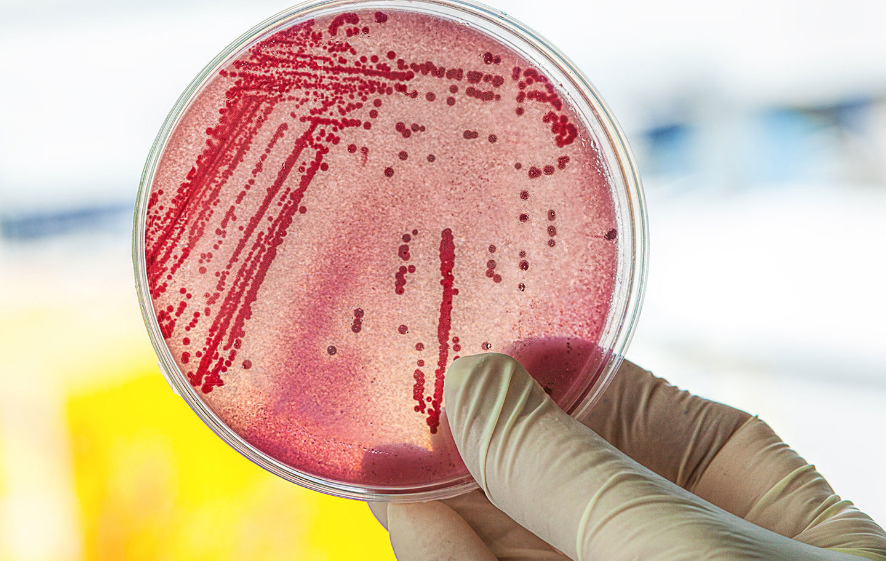
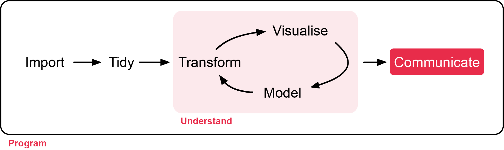

# Random Effects

**Week 12** - Simple random effects models

In this workshop, you will fit add simple random effects to model to account for simple experimental design elements.
Workshop materials are available in the github repository [ECS200](https://github.com/nicholaswunz/ECS200-Workshop).


::: {.panel-tabset .nav-pills}

## Random effects models {.unnumbered}

In this lab we fit models which have both fixed effects and random effects. As a reminder these are fixed effects and random effects.

**Fixed effects** are the main variables of interest, the ones you want to estimate and interpret directly.

- They represent the variables in your research question (say an association between distances from land in the context of coral reef health)
- After modelling a researcher will focus on reporting co-efficients and p-value in context to provide insight into the research question(s).


**Random effects** are the structure of the data you need to take into account. 
This structure may exist because of the study design, grouping or clustering. 
These are sources of variation you’re not primarily interested in, but need to control for in the analysis. 
In any instance where independence was a concern this can be accounted for with a more sophisticated model than those we have introduced so far, by including random effects. 
In ecology, these often capture the experimental design components of the model.

In general, random effects can account for:

- **Spatial similarities** ([spatial autocorrelation](https://atlas.co/blog/spatial-autocorrelation/): If sites are close to each other or you have multiple observations from a single locations
- **Repeated measures**: You have more than one measurement for each unit (say over time, or replications) you can account for this with random effects
- **Clusters**: If your units are in groups or clusters (say a tank or container) then random effects can account for this. 


Anytime two or more observations are more likely to be similar to each other for any reason (genetics, location, experimental design setup, etc) a random effects model should be considered. 
Note that these models can be quite complex, say the groups might have several layers (herd within farm within region) and those models are not explored here.

### Background {.unnumbered}

The data simulated was inspired by [Murdoch researchers](https://www.murdoch.edu.au/research/hbi/centres/centre-for-water-energy-and-waste) Bumandalai, O., Bayliss, K.L. & Moheimani, N.R. [Plasma-activated water can maintain quality of fresh Spirulina (*Limnospira platensis*, formerly *Arthrospira platensis*)]( https://doi.org/10.1007/s10811-026-03811-1), *J. Appl. Phycol.* (2026) we will run a **repeated measures one-way ANOVA** (one-way ANOVA with a random effect).

Our main questions is what is the impact on *E. coli* counts (which are a component of microbial contamination in Spirulina grown as a supplement for human consumption) of the plasma-activated water (PAW) as compared to the control. 
The study measured the *E. coli* counts at the start of the study, and every 7 days there after until day 28. 
**The main interest is in the difference between conditions (PAW and control)** and we include time as a secondary component of the fixed effects.




### Data processing {.unnumbered}

Here is the metadata for the `e_coli.csv` data.

- **flask**: replicate units for each treatment (n = 8 per treatment).
- **day**: number of days since the start of the experiment when measurements were taken.
- **treatment**: Categorical variable with either the control treatment or plasma-activated water (PAW) treatment.
- **ecoli**: the number of *E. coli* counted in CFU ml^-1^.
- **log_ecoli**: log transformed *E. coli* count. (see [Why Log scale](week5_inference.qmd) section in week 5's workshop for more detail).


```{r, warning=FALSE, message=FALSE}

library(tidyverse)

## read in the data
e_coli <- read.csv("https://raw.githubusercontent.com/nicholaswunz/ECS200-Workshop/refs/heads/main/data/e_coli.csv", stringsAsFactors = T)

## take a look
summary(e_coli)

```

### Visualisation {.unnumbered}


Let's plot *E. coli* growth over experimental time period (day 0 to 28) either with the overall mean +/- standard error across the two treatments plus individual replicate flasks (top figure), or overall mean +/- standard error across the two treatments only.

```{r}

ggplot(e_coli, aes(x = day, y = log_ecoli, group = flask, colour = treatment)) +
  geom_line(alpha = 0.5) +
  geom_point() +
  stat_summary(aes(group = treatment), fun = mean, geom = "line", linewidth = 1.2) +
  theme_bw() + 
  labs(title = "E. coli growth over time",
       x = "Time (days)",
       y = "Count of E. coli (logged)")

# Plot the mean +/- standard error only
ggplot(e_coli, aes(x = day, y = log_ecoli, colour = treatment)) +
  stat_summary(fun.data = mean_se, geom = "errorbar", width = 0.2) +
  stat_summary(fun = mean, geom = "point", size = 2) +
  theme_bw() + 
  labs(title = "E. coli growth over time (mean and standard error)",
       x = "Time (days)",
       y = "Count of E. coli (logged)")
```


### Modelling, Model Selection and Assumptions {.unnumbered}

In this section we will fit a one-way ANOVA with a random effect using the `Error()` function within `aov()` function and check the assumptions and model diagnostics. 

The figures below are as follows:

- QQ plot of the residuals to assess normality.

- The fitted values versus the residuals. 
In this we are looking for an indication that there is **change in the standardised residuals** over the range of the fitted values to support an assessment of the assumption of equal variances. 
There should be an equal number of residual above zero and below zero, and not too many standardised residuals more extreme than -2 and 2. 


```{r}

## fit the  model
anova_model <- aov(log_ecoli ~ treatment * day  + Error(flask), data = e_coli)

## focus on the within flask variability 
model_within <- anova_model$Within 

diag_e_coli <- data.frame(fitted = fitted(model_within),
                         resd= residuals(model_within))


ggplot(diag_e_coli, aes(sample = resd)) +
  stat_qq() +
  stat_qq_line() +
  theme_bw() +
  labs(title = "E coli, QQ plot of the residuals",
        x = "Theoretical Quantiles",
       y = "Standardised residuals")


ggplot(diag_e_coli, aes(x = fitted, y = scale(resd))) +
  geom_point() +
  geom_hline(yintercept = 0) +
  theme_bw() +
  labs(
    title = "Residuals vs Fitted",
    x = "Fitted values",
    y = "Residuals"
  )

```


| Assumption | Check         | Met       |                              
|:----------:|:-----------------------------------------:|:------------------:|
| Normality of residuals  | The residuals follow the QQ fairly line closely. |This assumption is  met. |
| Residuals vs fitted values   | We expect not too many residuals beyond -2 and 2 and no structure over the fitted values. |This assumption is met. |
| Independence      | We have accounted for the experimental design by including a flask term in the modelling | This assumption has been addresses    |


All the assumptions are met. We can now look at the model itself.

```{r}

summary(anova_model)
```

Plotting the predictions is tricky (it is much easier to do with more advanced approaches to linear mixed models and random effects) but we can clearly we what is happening from the data.

### Interpretation  {.unnumbered}




On the log scale the growth in *E. coli* bacteria is linear for both the control and PAW, however the growth of bacteria in PAW is about double that of the control group. The p-values for treatment, day and the interaction of treatment and day are all <0.001. 


# Assessment {.unnumbered}

There is no additional assessment today. 
