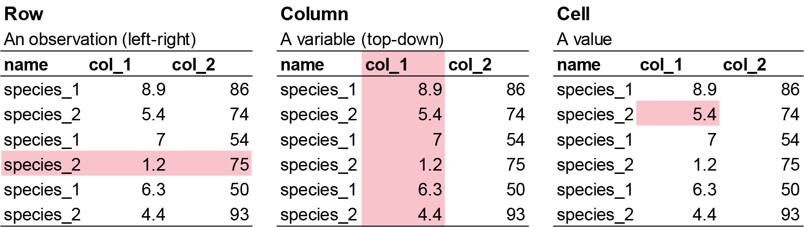
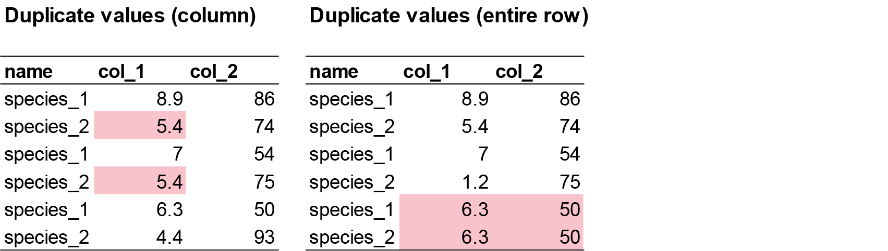

# Quality Check

**Week 1** - Quality checks and data exploration

In this section, you will learn how to check the quality of the raw data you 
imported, and steps to correct errors in the raw data. Workshop materials are 
available in the github repository [ECS200](https://github.com/nicholaswunz/ECS200-Workshop).

>All statistical techniques have in common the problem of ‘*rubbish in, rubbish out*’


## Background Reading {.unnumbered}

How do we know the data is ready for analysis? Before we do any analysis, we need 
to check the raw data for the following:

- **Check data structure and types**: Use `str()` and `summary()` to ensure each 
column is the correct type (numeric, factor, character, etc.) and matches your 
expectations. e.g., Convert relevant character columns to factors for categorical 
analysis.
- **Inspect for missing values**: Use `colSums(is.na()` or visual tools (e.g., 
`naniar::gg_miss_var()` or `visdat_viz_dat()`) to identify missing data and 
decide how to handle it.
- **Check for duplicates**: Ensure there are no unintended duplicate rows or IDs.
- **Validate categorical variables**: Confirm that categories are consistent 
and correctly formatted (e.g., all lower case, no extra spaces).
- **Scan for outliers or impossible values**: Look for values outside expected 
ranges (e.g., negative stem lengths, impossible dates).
- **Review column names**: Ensure column names are meaningful, have no spaces or 
special characters, and are consistent.
- **Preview the data**: Use plotting functions to visually inspect the data for 
obvious issues.
- **Check for extra rows or columns**: Sometimes, files have summary rows, notes, 
or empty columns that should be removed.

These steps help ensure your data is reliable, interpretable, and suitable for 
statistical analysis. Importantly, it makes you a trustworthy researcher!

## Tidyverse {.unnumbered}

From here on, we will follow the `tidyverse` syntax for consistency. Tidyverse 
is a collection of R packages designed for data import, cleaning, manipulation, 
visualisation, and analysis

It is widely used in ecology because ecological datasets are often large, messy, 
spatial or temporal related, and often have nested replicates. Tidyverse provides 
a consistent and readable workflow.

Some important concepts include:

::: {.panel-tabset .nav-pills}

### Pipes {.unnumbered}

The pipe operator (either `%>%` or `|>`) passes the output of one step into the 
next step.

```{r, eval=FALSE}

data %>% # first step is your data source
  mutate() %>% # next step is what you want to do to the data
  arrange() # the following step after you have done step 1 and so on.

# Without pipes
mean(log(c(1, 10, 100)))

# with pipes
c(1, 10, 100) %>%
  log() %>%
  mean()

```


Pipes make ecological workflows easier to read because analyses often involve 
multiple steps. An example workflow includes 

- Import data
- Filter sites
- Remove missing values
- Calculate summaries
- Plot results


### Data Structure {.unnumbered}

As a general rule, tidyverse works best if the data looks like this:



- Each row = one observation
- Each column = one variable 
- Each cell = one value


The way you record information in the field or in the lab is probably very 
different to the way you want your data entered into R. 

In the field, you want tables that you can ideally draw up ahead of time and 
fill in as you go, and you will be adding notes and all sorts of information in 
addition to the data you want to analyse. For instance, if you monitor the height 
of seedlings during a factorial experiment using warming and fertilisation treatments, 
you might record your data like this:


Let’s say you want to run a test to determine whether warming and/or fertilisation 
affected seedling growth. **You may know how your experiment is set up, but R doesn’t!** 
At the moment, with 8 measures per row (combination of all treatments and species 
for one replicate, or block), you cannot run an analysis. On the contrary, tidy 
datasets are arranged so that each row represents an observation and each column 
represents a variable. In our case, this would look something like this:


This makes a much longer dataframe row-wise, which is why this form is often 
called *long format*. Now if you wanted to compare between groups, treatments, 
species, etc., R would be able to split the dataframe correctly, as each grouping 
factor has its own column.

Example dataset in R suitable for tidyverse:

```{r}

# Here is the a an example species and mass using the data.frame function.
example_data <- data.frame(
  site = c("A", "A", "B", "B"),
  species = c("Skink", "Agamid", "Skink", "Frog"),
  temperature = c(28, 31, 26, 22),
  abundance = c(5, 2, 8, 4)
)


```
Output:

```{r}

example_data

```

:::

# Before We Start {.unnumbered}

Create a new R file. You don't need to save the previous one.
Click **File > New File > R Script** to start. Write the workshop name, your name,
your student number, and date. 
Always do this when starting a new script.

```{r}

# Week 1 workshop - Data quality check
# Written by Nicholas Wu, 1234578, 06/11/2026

```

### Exercise (5 min) {.unnumbered}

🧪 **Get your workflow set up**
  
Next, load your appropriate packages (the same `tidyverse`, and a one for 
visualising missing data called [`visdat`](https://cran.r-project.org/web/packages/naniar/vignettes/getting-started-w-naniar.html) at this stage), 
set your working directory via `setwd()`, and load the `plant_calcium.csv` via 
`read_csv()`. 

Lets call the imported data object `plant_calcium_data` this time.

Details on installing and loading R prackages, setting your working directory, and 
loading your csv file can be found in the pre-lab [Introduction to R](R_intro.qmd)
tutorial.

```{r, include=FALSE}
#install.packages("visdat")

library(tidyverse)
library(visdat)

# Load a CSV file
plant_calcium_data <- read_csv("https://raw.githubusercontent.com/nicholaswunz/ECS200-Workshop/refs/heads/main/data/plant_calcium.csv")

```

<details>
<summary><strong>Show answer</strong></summary>

```{r, eval=FALSE}
# Install packages
#install.packages("visdat")

# Load relevent libraries
library(tidyverse)
library(visdat)

# Set your working directory
setwd("YOUR-LOCAL-DIRECTORY/")

# Load a CSV file
plant_calcium_data <- read_csv("plant_calcium.csv")

```

</details>

# Step 1: Data Quality Check {.unnumbered}

## 1.1. Initial check {.unnumbered}

This helps you spot if variables are coded incorrectly (e.g., numbers as characters 
or vice versa), which could be due to the researcher error before inporting the 
data. Some example mistakes include:
  
- **Incorrect data types**: Numeric columns may be read as character (text) if 
there are unexpected symbols, missing values coded inconsistently, or formatting 
issues (**e.g.** a column meant to be numbers may contain text or empty strings, 
causing R to treat it as character instead of numeric). 
- **Inconsistent coding**: Categorical variables may be inconsistently labeled 
(**e.g.**, "Male", "male", "M"), leading to multiple categories that should be 
merged.
- **Header issues**: Sometimes, the header row is missing or duplicated, or 
extra non-data rows are included at the top or bottom of the file.
- **Encoding problems**: Special characters (e.g., accents, non-English letters) 
may not display correctly if the file encoding is not specified or mismatched.
- **Trailing spaces**: Spaces at the start or end of strings can create unexpected 
categories or prevent proper matching.


For small datasets (like in this workshop) it is easier to make fixes directly 
from Excel and import the new .csv file.
As before, we will check the data here first with the `str()` function.

```{r, eval=FALSE}

# Check the structure of your data
str(plant_calcium_data)
glimpse(plant_calcium_data)

# Get a summary of all variables
summary(plant_calcium_data)

```

If you would like to change the mistake in R directly, here is the code to do so 
using the `recode()` function. For example, let's say you have three sites called 
A, B, C, but you noticed one site was mistakenly labelled as E. Here is how to 
change "E" to "B".

```{r, eval=FALSE}

# Create fake dataframe with A,B,C sites but one is mislabelled E.
fake_data <- data.frame(
  site = c("A","A","A","B","E","B","C","C","C"),
  species_1 = c(3, 7, 5, 2, 9, 4, 6, 1, 8)
)

fake_data %>%
  dplyr::mutate(site = recode(site, "E" = "B")) # recode order by providing the variable you want to change "E", and the new variable name "B".

```

Let's say you have a character that is suppose to be a numeric value. e.g. "nine" 
instead of "9", you will do the same thing as above but convert 'chr' to 'num' 
using `as.numeric()` function.

```{r, eval=FALSE}

# Create fake dataframe with species numbers but one was not correctly labelled.
fake_data <- data.frame(
  site = c("A","A","A","B","E","B","C","C","C"),
  species_1 = c(3, 7, 5, 2, "nine", 4, 6, 1, 8)
)


# Create a new object called fake_clean_data that replaces 'nine' with '9' and change species_1 to numeric
fake_clean_data <- fake_data %>%
  mutate(species_1 = recode(species_1, "nine" = "9"),
         species_1 = as.numeric(species_1))

# check if species_1 is numeric in the new fake_clean_data
glimpse(fake_clean_data)

```

### Exercise (5 min) {.unnumbered}

🧪 **Find the incorrect class in this dataset**
  
I have created an example dataset called `fake_data` with three things wrong with 
it. Find the three issues in this dataset.

```{r ex 2}
fake_data <- data.frame(
  site = c("A", "B", "C", "A", "B", "A", "B", "C", "a", "B", "A", "B", "A", "B", "C", "C", "B", "A", "A", "C", "B", "C", "C", "A", "A", "A", "A", "B", "C", "C", "C"),
  species_1 = c(7, 25, 30, 50, 38, 13, 5, 31, 34, 22, 41, 25, 22, 37, 39, 13, 45, 10, 40, 7, 28, 36, 19, 2, 12, 5, 16, 38, 27, 44, 44),
  species_2 = c(9.3, 8.6, 0.8 , 7.5, 9 , 9.1, 4.3, 8.6, 0.1, 7.8, 1.2, 6.2, 0.4, 0.4, 7.4, 1.9, 8.3, 7.8, 2.9, 9.3, 9.1, 2.3, 6.3, 8.5, 6.5, 6.6, "1,7", 1.8, 8.4, 4.7, 4.7),
  species_3 = c(190, 160, 70, 430, 310, 99, 530, 420, 371, 357, 198, 171, 463, 124, 254, 484, 435, 409, 122, 305, 410, 162, 473, 200, 401, 273, 421, 419, 293, 487, 487),
  species_4 = c(2, 0, 4, 8, 6.7, 3, 7.2, 4.3, 2, NA, 10, 10, 6, 4, 8, 1.7, 1, 0, NA, 4, 6, 8.2, 10, 6, 2, 5, 10, 7, NA, NA, NA)
)

```


What are the identified issues?

<details>
<summary><strong>Show answer</strong></summary>

1. site should be **factor**, not character
2. species_2 should be **numeric**, not character
3. species_4 has **5 NA's**

</details>

## 1.2. Identify missing values {.unnumbered}

Missing data may appear as blanks, "NA", ".", or other placeholders. If not 
handled properly, this can cause errors or misinterpretation during analysis.


```{r, eval=FALSE}

# Check for missing values in each column
colSums(is.na(plant_calcium_data))

# Visualise missing data pattern
visdat::vis_dat(plant_calcium_data)

```

`vis_dat()` visualises the whole dataframe at once, and provides information about 
the class of the data input into R, as well as whether the data is missing or not.

The function `vis_miss()` provides a summary of whether the data is missing or not. 
It also provides the amount of missings in each columns.

```{r, eval=FALSE}

# Visualise missing data pattern
visdat::vis_miss(plant_calcium_data)

```

**Option**: Removing columns with missing values.

```{r}

# Removes all rows with NA in the dataset
plant_data_clean <- plant_calcium_data %>% 
  drop_na()

# not recommended if NA is scattered across columns (e.g. leaf1area) because some important variables might be dropped out.

# If you only want to drop rows where NA is present in the elevation column only.
plant_data_clean <- plant_calcium_data %>% 
  drop_na(elevation)

# Run the vis_miss again on the clean data to check if the NA rows are removed. 
visdat::vis_miss(plant_data_clean)

```

### Exercise (5 min) {.unnumbered}

🧪 **Identify and handle missing values in the `fake_data` dataset**
  
- Which column contains missing variables?
- How many missing values are there?
- Remove rows with missing values and create a new object called `fake_data_clean`.
- Visualise the new `fake_data_clean` with `visdat::vis_dat(fake_data_clean)`.


<details>
<summary><strong>Show answer</strong></summary>

```{r ans3, eval=FALSE}

# Check for missing values in each column
colSums(is.na(fake_data)) # species_4, # 5 missing values

# Visualise missing data pattern
visdat::vis_dat(fake_data) 

# Drop rows where NA is present in the species_4 column only.
fake_data_clean <- fake_data %>% 
  drop_na(species_4)

# Run the vis_miss again on the clean data to check if the NA rows are removed. 
visdat::vis_miss(fake_data_clean)

```

</details>

## 1.3. Checking duplicates {.unnumbered}



There are two common duplicate types that can happen in your dataset.

1. **Row duplicates**: where the values and names of two rows are identical 99% 
of the time, this is user error (e.g. copy pasted). These must be identified and 
removed.

```{r, eval=FALSE}

sum(duplicated(plant_calcium_data))  # Returns the number of duplicate rows

# View the duplicate rows themselves
plant_data[duplicated(plant_calcium_data), ]

```
In the `plant_calcium_data`, there are no row duplicates.

2. **Value duplicates**: 90% of value duplicates in a column might be biologically 
realistic responses and is likely due to rounding of values during recording 
(e.g. values 2.5 and 2.5 might look duplicated due to user rounding. Actual values 
are 2.47 and 2.49). This is usually okay and can be kept in the dataset. 

User error occurs if there is a pattern in duplicates (e.g. **2**,**2**,6,1,**2**,
**2**,9,4,**2**,**2**,5,9). This can occur due to copy and pasting in the following 
row by accident.

You the researcher must decide whether these duplicate responses are real or due 
to user error.

```{r, eval=FALSE}

sum(duplicated(plant_calcium_data$leaf_dry_mass))  # Returns the number of duplicate rows

plant_data[duplicated(plant_calcium_data$leaf_dry_mass) | duplicated(plant_calcium_data$leaf_dry_mass, fromLast = TRUE), ] # Returns all occurrences of duplicated numbers 

```
In the `leaf_dry_mass` column, there are 51 value duplicates.

### Exercise (3 min) {.unnumbered}

🧪 **Identify the duplicate row in the `fake_data` dataset**
  
- Where is the duplicate row?
- Remove the duplicate row. Either manually in Excel (easy), or an R function 
(challenge).
- Are there other duplicate values and do you know if they are ecologically 
relevant duplicates (similar response) or user error?

<details>
<summary><strong>Show answer</strong></summary>

```{r ans4, eval=FALSE}

sum(duplicated(fake_data)) # 1 duplicate found

# View the duplicate rows themselves
fake_data[duplicated(fake_data), ] #1 duplicate row in row 31

sum(duplicated(fake_data$species_1))  # species_1 = 7
sum(duplicated(fake_data$species_2))  # species_2 = 6
sum(duplicated(fake_data$species_3))  # species_3 = 1
sum(duplicated(fake_data$species_4))  # species_4 = 15

```

</details>

# Step 2: Visualising Data {.unnumbered}

## 2.1 Check for outliers {.unnumbered}

Outliers aren't inherently "bad," but they can cause problems depending on the 
context and goals of your analysis. 
They can:

1. **Skew statistical results**: A single extreme value can pull the mean far 
from the center, increase variability making data seem more spread than it really 
us, and can distrort the slope and intercept of linear models, leading to 
misleading predictions.
2. **Create obscure patterns**: Hide clusters or trends that would otherwise be 
visible.
3. **Indicate user error**: Data entry mistakes (e.g., typing 1000 instead of 100), 
measurement errors (e.g., faulty sensors), incorrect data merging (e.g., mixing 
units like metres and feet).

There are different ways we can check for outliers. See a more comprehensive [page](https://statsandr.com/blog/outliers-detection-in-r/) for more options. 
Here, we will create two common plots to check for outliers, and run some simple 
methods for detecting and removing outliers.


::: {.panel-tabset .nav-pills}

### Boxplot {.unnumbered}

We can use the `ggplot()` function from the [`ggplot`](https://www.sthda.com/english/wiki/ggplot2-essentials) package to create a boxplot via `geom_boxplot()` showing the distribution of the `lead2area` 
data.

```{r}

# Boxplot of leaf2area to detect potential outliers
ggplot(plant_data_clean, aes(y = leaf2area)) +
  geom_boxplot(fill = "lightgrey") +
  theme_bw()

```

### Histogram {.unnumbered}

Another way we can visualise outliers is with histograms via `geom_histogram()` 
or density plots via [`geom_density()`](https://www.sthda.com/english/wiki/ggplot2-density-plot-quick-start-guide-r-software-and-data-visualization)

```{r}

# Boxplot of height to detect potential outliers
ggplot(plant_data_clean, aes(x = leaf2area)) +
  geom_histogram() +
  theme_bw()

```

Here you can see one clear outlier with a value above 100. All other values are 
below 25. You can either manually remove the outlier on Excel, or with the 
following code below.

**Option**: Remove outliers using the interquartile range (IQR) rule.

```{r, eval=FALSE}

# View potential outliers using IQR rule
Q1 <- quantile(plant_data_clean$leaf2area, 0.25, na.rm = TRUE)
Q3 <- quantile(plant_data_clean$leaf2area, 0.75, na.rm = TRUE)
IQR <- Q3 - Q1

# Filter rows with height outside 1.5 * IQR range
outliers <- filter(plant_data_clean, leaf2area < (Q1 - 1.5 * IQR) | leaf2area > (Q3 + 1.5 * IQR))
outliers

```

Make sure the numbers are biologically realistic based on intuition and comparing 
with the literature.
If the values are unrealistic, it is a safe assumption to remove them.

:::

## 2.2 Is data normally distributed? {.unnumbered}

This step is required to check if the data is suitable for certain types of analysis.
Sometimes, [transformation](week2_tidy_data.qmd) is required for certain data to 
meet the assumptions of certain statistical methods and improve the interpretability 
and performance of models. Many statistical techniques—like linear regression, ANOVA, 
and t-tests—assume that the data is normally distributed, has constant variance, 
and is linearly related (from your [MAS183 - Statistical Data Analysis](https://handbook.murdoch.edu.au/units/18/MAS183) and [MAS224 - Biostatistical Methods](https://handbook.murdoch.edu.au/units/02/mas224) units).
If the data is skewed, has outliers, or shows non-constant variance (heteroscedasticity), 
these assumptions are violated, which can lead to 
**biased estimates, incorrect conclusions, or poor model fit**.

By applying transformations such as logarithmic, square root, or Box-Cox, we can:
  
- **Reduce skewness** and make the distribution more symmetrical.
- **Stabilise variance** across levels of an independent variable.
- **Improve linearity** between variables.
- **Minimise the influence of outliers**.


Let's check the distribution of `leaf2area` after removing that one outlier.

```{r}

# remove values above 100
plant_data_clean <- plant_data_clean %>%
  filter(leaf2area < 100)

ggplot(plant_data_clean, aes(x = leaf2area)) +
  geom_histogram() +
  theme_bw()

```

Looks normally distributed to me! We will learn data transformation in next weeks 
workshop.


# Assessment {.unnumbered}

## Interpretation {.unnumbered}


## Coding {.unnumbered}

We will use a modified `plant_calcium.csv` dataset called `plant_calcium_task.csv` 
for the next workshop. Here, you need to conduct a quality check and data 
exploration of this new dataset and fix any potential issues.

Download `plant_calcium_task.csv` from the [GitHub](https://github.com/nicholaswunz/ECS200-Workshop) 
page to your local folder (wherever you set your directory). 

The `plant_calcium_task.csv` is in the 'data' folder.

Set up your working directory and load the `plant_calcium_task.csv` to R and give 
it am object name. If you like, you can call it `plant_task_data_raw`.

```{r, eval=FALSE}

# Week 1 workshop - Data quality check
# Name, Student ID, date

# Load packages
library(tidyverse)
library(visdat)

# Set your working directory
setwd("YOUR-DIRECTORY")

# Load your data
plant_task_data_raw <- read_csv("plant_calcium_task.csv")

```

To make it a bit easier for you, I have given you hints where the errors are so 
you dont have to look through every single column or every problem. But in your 
own dataset, you will need to thoroughly check your own data in the future. 

Hints:
  
1. Identify **missing values** in one of the numeric columns. Remember to check 
if you really need to remove these missing value rows or not.
2. There is an **inconsistent coding** in one of the categorical variables. 
Correct the incorrect coding. You can do this on Excel, or in R but do comment 
which one you used.
3. There are **two numeric columns** with outliers. One is biologically realistic, 
the other one is a data entry mistake. Decide which one is the data entry mistake 
and remove/correct that outlier.
4. Create a **clean version** of the data after removing the errors as `
plant_task_data_clean` and **visualise** one of the numeric columns as a density 
plot.


```{r home ans 2, include=FALSE, eval=FALSE}

plant_task_data_raw <- read_csv("data/plant_calcium_task.csv")

plant_task_data_clean <-  plant_task_data_raw %>%
dplyr::mutate(watershed = recode(watershed, "W2" = "W1"),
                watershed = as.factor(watershed),
                transect  = as.factor(transect)) %>%
  dplyr::filter(stem_dry_mass < 1)


# 1. values missing in 'sample' column.
# 2. 'watershed' column - W2 should be W1
# 3. 'stem_dry_mass' one biologically unrealistic row 327, and 'leaf_dry_mass' one biologically realistic in row 322

```

When you have completed the assessment, save your `plant_task_data_clean` data 
as a csv file. The `plant_task_data_clean` should have the NA's and outliers 
removed, and watershed transect changed to factor.

Here's how to do it in R with `write.csv()`. The location of the saved file 
should be your working directory.

```{r save, eval=FALSE}

write.csv(plant_task_data_clean, file = "plant_task_data_clean.csv")

```

## Optional - For the adventurous folks {.unnumbered}

Here we will start thinking about writing code efficiently.
For example, you would have noticed by now that whatever raw data we load in R, 
any categorical columns are automatically listed as characters. So you can write 
a code that both loads the data and change the characters to factors in the same 
line of code (e.g. using the `dplyr::mutate()` function). Load the `plant_calcium_task.csv` 
and change categorical variables from character and factor.

Repeat the same assessment as above, but instead of correcting the errors by
editing them on Excel, do all the corrections within the R environment. Visualise 
the **clean version** of the the data with a density plot but separate the density 
by the treatment groups (reference and W1 variables). 


# Additional Resource {.unnumbered}

- Loading [other file types](https://r4ds.hadley.nz/data-import.html#other-file-types) 
(if not .csv).
- How to [rename factor levels](https://www.r-bloggers.com/2024/03/title-how-to-rename-factor-levels-in-r-with-examples/) in R.
- CrashCourse Statistics video on [Plots, Outliers, and Justin Timberlake](https://youtu.be/HMkllhBI91Y?si=B2oEhfrOjoaVPWyD), with examples of 
went to remove outliers.
                             
                             