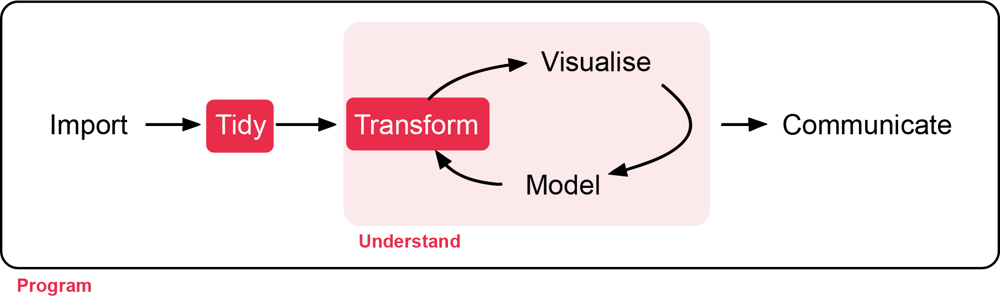
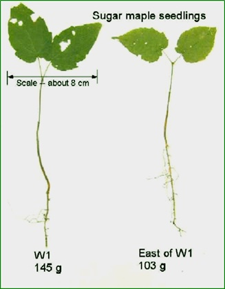
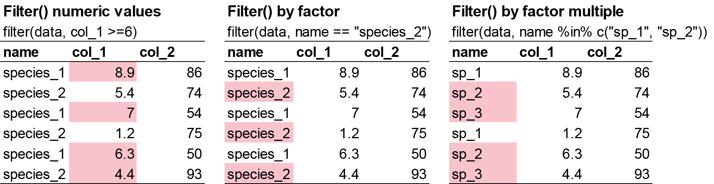
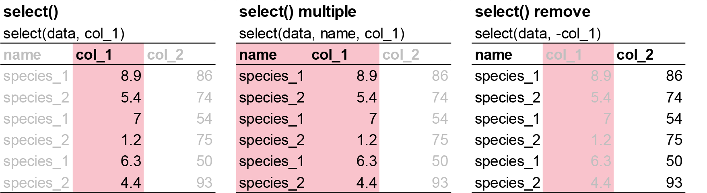
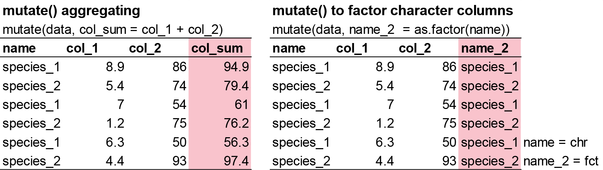
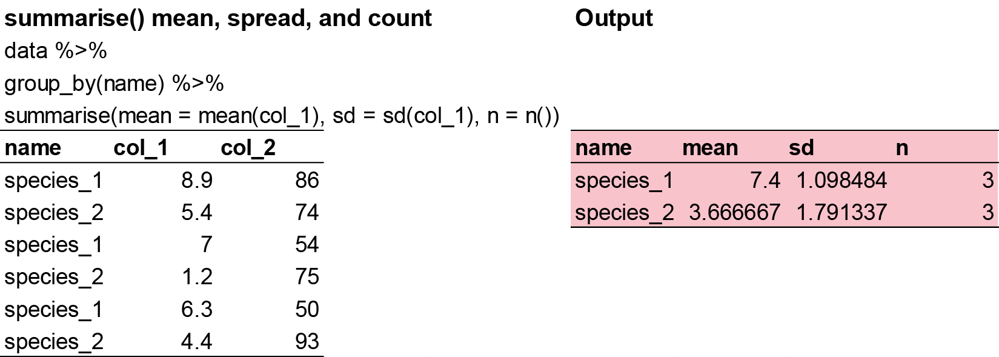
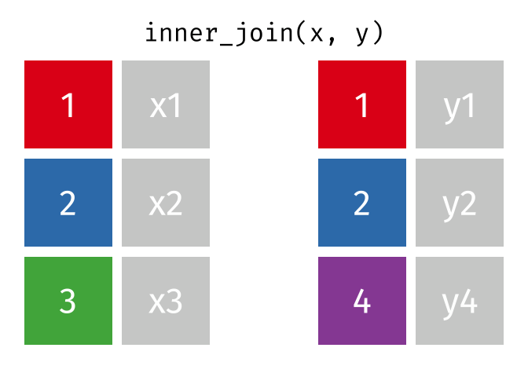

# Tidy Data

**Week 2** - Tidying data and clean code

In this workshop, you will learn how transform raw data to something usable for 
analysis, and get familiar with clean code. 
Workshop materials are available in the github repository [ECS200](https://github.com/nicholaswunz/ECS200-Workshop).




## Background reading {.unnumbered}

Sometimes, it is rare that you get the data in exactly the right form you need 
from the raw data you import into R. Often you’ll need to create some new variables 
or summaries, or maybe you just want to rename the variables or reorder the 
observations in order to make the data a little easier to work with. In this 
workshop you are going to learn the five key `dplyr` functions (part of tidyverse) 
that allow you to solve the vast majority of your data manipulation challenges:

- Pick observations by their **values** [`filter()`](https://dplyr.tidyverse.org/reference/filter.html). 
e.g. keeping rows with values higher than 100.
- **Reorder** the rows [`arrange()`](https://dplyr.tidyverse.org/reference/arrange.html). 
e.g. rearrange a numeric column by the largest values.
- Pick variables by their **names** [`select()`](https://dplyr.tidyverse.org/reference/select.html). 
e.g. keeping selected columns only.
- **Create** new variables with functions of existing variables [`mutate()`](https://dplyr.tidyverse.org/reference/mutate.html). e.g. the sum of 
values from two numeric columns. 
- Collapse many values down to a single **summary** [`summarise()`](https://dplyr.tidyverse.org/reference/summarise.html). e.g. 
getting the overall mean of the dataset.

These can all be used in conjunction with [`group_by()`](https://dplyr.tidyverse.org/reference/group_by.html) 
which changes the scope of each function from operating on the entire dataset to 
operating on it **group-by-group**. These **six functions** provide the verbs 
for a language of data manipulation.

All verbs work similarly:

- The first argument is a data frame.
- The subsequent arguments describe what to do with the data frame, using the 
variable names (without quotes).
- The result is a new data frame.

Together these properties make it easy to chain together multiple simple steps 
to achieve a complex result. Let’s dive in and see how these verbs work.


### Study context {.unnumbered}

In order to know whether our imported data requires transformation before 
analysis, we need to know what we are analysing. Let's stick with a familiar 
dataset, the `plant_calcium.csv` from this [study](https://lter.github.io/lterdatasampler/articles/hbr_maples_vignette.html).


The `plant_calcium.csv` dataset contains observations on sugar maple seedlings 
in **untreated** and **calcium-treated** watersheds at Hubbard Brook Experimental 
Forest in New Hampshire, USA.

Growth of sugar maples (*Acer saccharum*), known for their maple syrup and iconic 
leaf shape, can be stunted due to soil acidification from prolonged [acid rain](https://news.cornell.edu/stories/2006/05/acid-rain-causing-decline-sugar-maples-say-researchers), 
which leaches calcium - a nutrient important for plant growth - from soils and
stresses maple seedlings.

To investigate the impact of soil calcium supplementation on sugar maple 
seedling growth, researchers at the Hubbard Brook Long Term Ecological Research 
(LTER) site recorded “general sugar maple germinant health by height, leaf area, 
biomass, and chlorophyll content” [@Juice2006] for seedlings in untreated and previously calcium-treated watersheds [@Peters2004]. By comparing seedling growth in calcium-treated (**W1**) versus 
untreated (**Reference**) watersheds, calcium impacts on sugar maple seedling 
growth can be explored.



# Part 1 - Data Manipulation  {.unnumbered}

Before we start, load your previous assessment workflow with the `plant_task_data_clean.csv` 
dataset (errors removed). Here, we will call the imported as `plant_task_clean_data`.

```{r first 2, eval=FALSE}

# Week 2 workshop - Tidying data
# Written by Nicholas Wu, 06/11/2024, Murdoch University

# Load packages
library(tidyverse)
library(visdat)

# Set your working directory
setwd("YOUR-DIRECTORY")

# Load your data
plant_task_clean_data <- read_csv("data/plant_task_clean_data.csv")

```

```{r load data, include=FALSE}
#install.packages("visdat")

library(tidyverse)
library(visdat)

# Load a CSV file
plant_task_clean_data <- read_csv("https://raw.githubusercontent.com/nicholaswunz/ECS200-Workshop/refs/heads/main/data/plant_calcium_task.csv") %>%
  dplyr::mutate(watershed = recode(watershed, "W2" = "W1"),
                watershed = as.factor(watershed),
                transect  = as.factor(transect)) %>%
  dplyr::filter(stem_dry_mass < 1)

```

::: {.panel-tabset .nav-pills}

## Filter rows with `filter()` {.unnumbered}



`filter()` allows you to subset observations based on their values. The first 
argument is the name of the data frame. The second and subsequent arguments are 
the expressions that filter the data frame. For example, we can select all values 
for the year 2004 for the calcium-treated sites (W1):


```{r filter, eval=FALSE}

# filter function by two columns. A numeric and a categorical.
plant_task_clean_data %>%
  filter(year == 2004, watershed == "W1")

```

:::{.callout-note}

When filtering the **exact character or factor value** you want, always use two 
equal signs (`==`), not one (`=`).

:::

You can also filter rows by more one variable in a column using `x %in% y` logic.  
This will select every row where `x` is one of the values in `y`. For example, 
we can select all values in transect R1 and W1-1 only:

```{r filter2, eval=FALSE}

# filter function for the transect column by "R1" and "W1-1"
plant_task_clean_data %>%
  filter(transect %in% c("R1", "W1-1"))

```

Lastly, you can filter by number thresholds. e.g. filtering out extreme values 
(i.e. for data quality checks), or filter within a range of values. For example, 
we can select all `stem_dry_mass values` below 0.9 or between 0.01-0.02:

```{r filter3, eval=FALSE}

# filter function by stem_dry_mass values below 0.9
plant_task_clean_data %>%
  filter(stem_dry_mass <= 0.9)

# filter function by stem_dry_mass values between 0.01 and 0.02
plant_task_clean_data %>%
  filter(stem_dry_mass > 0.01 & stem_dry_mass < 0.02)

```

Other possible functions and operators within the `filter()` function can be found [here](https://dplyr.tidyverse.org/reference/filter.html).


## Arrange rows with `arrange()` {.unnumbered}


`arrange()` works similarly to `filter()` except that instead of selecting rows, 
it **changes their order**. It takes a data frame and a set of column names 
(or more complicated expressions) to order by. If you provide more than one 
column name, each additional column will be used to break ties in the values of 
preceding columns:


```{r arrange, eval=FALSE}

# Order the dataset by the ascending stem_length value (lowest in top row to highest in bottom row)
plant_task_clean_data %>%
  arrange(stem_length)

# Order the dataset by the descending stem_length value (highest in top row to lowest in bottom row)
plant_task_clean_data %>%
  arrange(desc(stem_length))

```

**Note**: Missing values are always sorted at the end.


## Select columns with `select()` {.unnumbered}



It’s not uncommon to get datasets with hundreds or even thousands of variables.
In this case, the first challenge is often narrowing in on the variables you’re 
actually interested in. `select()` allows you to rapidly zoom in on a useful 
subset using operations based on the names of the variables.


```{r select, eval=FALSE}

# Select only three variables to keep.
plant_task_clean_data %>%
  select(year, watershed, stem_dry_mass)

```


## Add new variables with `mutate()` {.unnumbered}



Besides selecting sets of existing columns, it’s often useful to add new columns 
that are functions of existing columns. That’s the job of `mutate()`.

`mutate()` always adds new columns at the end of your dataset so we’ll start by 
creating a narrower dataset so we can see the new variables. 

```{r mutate, eval=FALSE}

# Calculate the total dry mass from leaf_dry_mass and stem_dry_mass and correct the unit from kilogram to gram
plant_task_clean_data <- plant_task_clean_data %>%
  mutate(total_dry_mass   = leaf_dry_mass + stem_dry_mass,
         total_dry_mass_g = total_dry_mass * 1000)

```


## Grouped summaries with `summarise()` {.unnumbered}



The last key verb is `summarise()`. It collapses a data frame to a single row. 
However, `summarise()` is not terribly useful unless we pair it with `group_by()`. 
This changes the unit of analysis from the complete dataset to individual groups.
Then, when you use the dplyr verbs on a grouped data frame they’ll be automatically 
applied “by group”. For example, if we applied exactly the same code to a data 
frame (`plant_task_clean_data`) grouped by watershed, we get the average values
per treatment:

```{r summarise, eval=FALSE}

# Get the mean total_dry_mass_g by treatment groups using pipes
plant_task_clean_data %>%
  group_by(watershed) %>%
  summarise(mean = mean(total_dry_mass_g))

```


:::{.callout-note}

What happens if we try to summarise a dataset with NA's inside?

```{r NA data, eval=FALSE}

# Here is an example dataset
NA_data <- data.frame(site = c("A", "B", "A", "B", "A", "B"),
                      species = c(3, 4, 6, 2, 4, NA))

# Get the mean species by site
NA_data %>%
  group_by(site) %>%
  summarise(mean = mean(species))

# Try this now with na.rm = TRUE
NA_data %>%
  group_by(site) %>%
  summarise(mean = mean(species, na.rm = TRUE))

```


That’s because aggregation functions obey the usual rule of missing values: 
if there’s any missing value in the input, the output will be a missing value.
Fortunately, all aggregation functions have an na.rm argument which removes the 
missing values prior to computation. If your dataset has NAs, the `na.rm = TRUE` 
argument will be helpful.

:::


:::

## Exercise (15 min) {.unnumbered}

🧪 **Use the previous functions to complete the following task for the `fake_data` below**

```{r ex 1}

fake_data <- data.frame(
  site = c("A", "B", "C", "A", "B", "A", "B", "C", "A", "B", "A", "B", "A", "B", "C", "C", "B", "A", "b", "C", "B", "C", "C", "A", "A", "A", "A", "B", "C", "C", "C"),
  species_1 = as.integer(c(7, 25, 30, 50, 38, 13, 5, 31, 34, 22, 41, 25, 22, 37, 39, 13, 45, 10, 40, 7, 28, 36, 19, 2, 12, 5, 16, 38, 27, 44, 44)),
  species_2 = as.integer(c(9, 8, 1 , 7, 9 , 9, 4, 8, 1, 7, 1, 6, 4, 4, 7, 2, 8, 7, 2, 9, 9, 2, 6, 8, 6, 6, 17, 1, 8, 4, 4)),
  species_3 = as.integer(c(190, 160, 70, 430, 310, 99, 530, 420, 371, 357, 198, 171, 463, 124, 254, 484, 435, 409, 122, 305, 410, 162, 473, 200, 401, 273, 421, 419, 293, 487, 487)),
  species_4 = as.integer(c(2, 0, 4, 8, 6, 3, 7, 4, 2, NA, 35, 10, 6, 4, 8, 1, 1, 0, NA, 4, 6, 8, 10, 6, 2, 5, 10, 7, NA, NA, NA))
  )

```


- Conduct the usual **quality check** on this dataset (slightly different mistakes).
- Create a new variable column called `total_sp` that combines all the species.
- Select only the `site` and `total_sp` variable into a new dataframe.
- Calculate the mean, minimum, maximum, and count of `total_sp` by site.


Question:

1. What is the mean total abundance in site B?
2. What is the problem with using mean here? Is there a better way to calculate 
central tendancy for dount data? (**hint**: think of decimals in this context).
3. Which site has the highest average species abundance?
4. Which site has the most replicate samples?

<details>
<summary><strong>Show answer</strong></summary>

```{r ans 1, eval=FALSE}

str(fake_data)

# there is an inconsistent coding in one of the categorical variables, and an extreme value in one of the numeric variables to remove.

fake_data_clean <- fake_data %>%
  dplyr::mutate(site = recode(site, "b" = "B"),
                site = as.factor(site)) %>%
  dplyr::filter(species_4 < 30) %>%
  dplyr::mutate(total_sp = species_1 + species_2 + species_3 + species_4) %>%
  dplyr::select(site, total_sp)

fake_data_clean %>%
  dplyr::group_by(site) %>%
  dplyr::summarise(mean = mean(total_sp),
                   min  = min(total_sp),
                   max  = max(total_sp),
                   n    = n())

# 1. 361.25 
# 2. Mode more suitable for integers
# 3. Site B
# 4. site A

```

</details>


# Part 2 - Tidy Code {.unnumbered}

Good coding style is like correct punctuation: you can manage without it, 
butitsuremakesthingseasiertoread. I am mostly comfortable with the tidyeverse 
syntax, but the most important take away here is **keep everything consistent** 
if you prefer a different style.


The full breakdown of the tidy syntax can be found [here](https://style.tidyverse.org/).

::: {.panel-tabset .nav-pills}

## File names {.unnumbered}

File names should be **machine readable**: avoid spaces, symbols, and special 
characters. Lower case is preferred and never have names that differ only in 
their capitalisation. Delimit words with `-` or `_`. Use .R as the extension of 
R files.

```{r, eval=FALSE}

# Good
fit_models.R
utility_functions.R
exploratory-data-analysis.R

# Bad
fit models.R
foo.r
ExploratoryDataAnaylsis.r

```

File names should be **human readable**: use file names to describe what’s in the file.

```{r, eval=FALSE}

# Good
report-draft-notes.txt

# Bad
temp.r
```

Use the same structure for closely related files:

```{r, eval=FALSE}
# Good
fig-eda.png
fig-model-3.png

# Bad
figure eda.PNG
fig model three.png

```


## R organisation {.unnumbered}

Use commented lines of `-` to break up your file into easily readable chunks.
Here is a **template** you can use for your future projects. 

```{r organisation}
# Title.
# Short description of what is being done.
# Authors name and date of analysis.


## Set up ## ----------------------------------------------------------------

# any code related to setting up directory, installing and loading packages (e.g. from workshop 1)

## Loading and cleaning data ## ---------------------------------------------

# any code relating to loading the data, checking the quality, transforming the dataset, so that it is ready for analysis


## Analysis ## -------------------------------------------------------------

# All code involved with preliminary analysis, full analysis, and model output

## Visualisation ## --------------------------------------------------------

# Creating beautiful figures for your report!

```


## Syntax {.unnumbered}

### Object names {.unnumbered}

Variable and function names should use only lowercase letters, numbers, and 
underscore. Use underscores (so called *snake case*) to separate words within a 
name.

```{r syntax 1, eval=FALSE}

# Good
day_one
day_1

# Bad
DayOne
dayone

```

Generally, variable names should be nouns and function names should be verbs. 
Strive for names that are concise and meaningful (this is not easy!).

```{r syntax 2, eval=FALSE}

# Good
day_one

# Bad
first_day_of_the_month
djm1

```

Where possible, avoid re-using names of common functions and variables. This 
will cause confusion for the readers of your code.

```{r syntax 3, eval=FALSE}

# Bad
T <- FALSE
c <- 10
mean <- function(x) sum(x)

```

### Infix operators {.unnumbered}

Most infix operators (`==`, `+`, `-`, `<-`, etc.) should always be surrounded by 
spaces:

```{r infix 1, eval=FALSE}

# Good
height <- (feet * 12) + inches
mean(x, na.rm = TRUE)

# Bad
height<-feet*12+inches
mean(x, na.rm=TRUE)

```

There are a few exceptions, which should never be surrounded by spaces:

The operators with [high precedence](https://rdrr.io/r/base/Syntax.html): `::`, 
`:::`, `$`, `@`, `[`, `[[`, `^`, unary `-`, unary `+`, and `:`.

```{r infix 2, eval=FALSE}

# Good
sqrt(x^2 + y^2)
df$z
x <- 1:10

# Bad
sqrt(x ^ 2 + y ^ 2)
df $ z
x <- 1 : 10

```

### Assignment {.unnumbered}

Use `<-`, not `=`, for assignment.

```{r assignment, eval=FALSE}

# Good
x <- 5

# Bad
x = 5

```

## Pipes {.unnumbered}

Use `%>%` or `|>` to emphasise a sequence of actions, rather than the object that 
the actions are being performed on.

The tidyverse has been designed to work particularly well with the pipe, but you 
can use it with any code, particularly in conjunction with the _ placeholder.

```{r pipes, eval=FALSE}

strings %>%
  str_replace("a", "b") %>%
  str_replace("x", "y")

strings |>
  gsub("a", "b", x = _) |>
  gsub("x", "y", x = _)

```

Avoid using the pipe when:

- You need to **manipulate more than one object at a time**. Reserve pipes for a 
sequence of steps applied to one primary object.
- There are meaningful intermediate objects that could be given informative names.

### Long lines {.unnumbered}

If the arguments to a function don’t all fit on one line, put each argument on 
its own line and indent:

```{r long, eval=FALSE}

# Good
iris %>%
  summarise(
    Sepal.Length = mean(Sepal.Length),
    Sepal.Width = mean(Sepal.Width),
    .by = Species
  )

iris |>
  summarise(
    Sepal.Length = mean(Sepal.Length),
    Sepal.Width = mean(Sepal.Width),
    .by = Species
  )

# Bad
iris %>%
  summarise(Sepal.Length = mean(Sepal.Length), Sepal.Width = mean(Sepal.Width), .by = Species)

```


For data analysis, we recommend using the pipe whenever a function needs to span 
multiple lines, even if it’s only a single step.

```{r long 2, eval=FALSE}

# Bad
summarise(
  iris,
  Sepal.Length = mean(Sepal.Length),
  Sepal.Width = mean(Sepal.Width),
  .by = Species
)

```


## Conflict packages {.unnumbered}

Take careful note of the conflicts message that’s printed when you load the tidyverse. 
It tells you that dplyr overwrites some functions in base R.
If you want to use the base version of these functions after loading dplyr, you’ll 
need to use their full names: `stats::filter()` and `dplyr::filter()`.

:::

## Exercise (15 min) {.unnumbered}

🧪 **Clean the code below**

Your colleague got a new job and you have been promoted to his position where 
you are taking over his unfinished projects. 
The ecological data has been collected and some quick analysis was performed.
But, you noticed that he didnt perform a quality check on the raw data and the # 
explanations are not clear.
The current state is not suitable for the client so you are assigned to clean.

Clean the code where relevent, and check if all the code is working on your end.

**Note**: change the working directory to your folder and load the plant_calcium.csv 
to work on.


```{r ex 2, eval=FALSE}

# Exercise 2
# Cleaning code and tidying dataset
# John Smith, 25-03/2025

## Set up ## ----------------------------------------------------------------
library(tiderVerse)

# Set my directory
setwd("YOUR DIRECTORY")

## Loading and cleaning data ## ---------------------------------------------

# Load raw data
plant data <- read_csv("data/plant_calcium.csv")
str(plant data)

## Analysis ## -------------------------------------------------------------

# Fit model: height explained by elevation
model <- lm(stem_dry_mass ~ stem_length, data = plant_data)

# Check model summary
summary(model)

## Visualisation ## --------------------------------------------------------

# Creating scatterplot figure
plant_data %>%
  ggplot() +
  geom_point(aes(x = stem_length, y = Stem_dry_mass)) +
  labs(
    x = "Stem Length (mm)",
    y = "Stem Dry Mass (g)",
    title = "Stem Dry Mass vs. Stem Length in Sugar Maple Seedlings",
    subtitle = "Hubbard Brook LTER"
  ) +
  theme_minimal()

```

<details>
<summary><strong>Show answer</strong></summary>

```{r ans 2, eval=FALSE}

# Exercise 2
# Cleaning code and tidying dataset
# John Smith, 25-03-2025

## Set up ## ----------------------------------------------------------------
library(tidyverse)

# Set my directory
setwd("YOUR DIRECTORY")

## Loading and cleaning data ## ---------------------------------------------

# Load raw data
plant_data <- read_csv("data/plant_calcium.csv")
str(plant_data)


# Correct class type
plant_data <- plant_data %>%
  mutate(watershed = as.factor(watershed),
         elevation = as.factor(elevation))

# note, 'transect' does not need to be a factor as there are no distinct categories for transect. It is just text to keep track of replications. 

# Check for missing values in each column
colSums(is.na(plant_data))

# Visualise missing data pattern
visdat::vis_dat(plant_data)

# Remove NA rows based on missing elevation data
plant_data <- plant_data %>% 
  drop_na(elevation)

# Check for duplicate rows
sum(duplicated(plant_data))  # None

# Check for outliers

ggplot(plant_data, aes(x = leaf2area)) +
  geom_histogram() +
  theme_bw()

# create a clean dataset after filtering the outlier
plant_data_clean <- plant_data %>%
  dplyr::filter(leaf2area < 90)

## Analysis ## -------------------------------------------------------------

# Fit model: height explained by elevation
dry_length_mod <- lm(stem_dry_mass ~ stem_length, data = plant_data_clean)

# Check model summary
summary(dry_length_mod)

## Visualisation ## --------------------------------------------------------

# Creating scatterplot figure
plant_data_clean %>%
  ggplot() +
  geom_point(aes(x = stem_length, y = stem_dry_mass)) +
  labs(
    x = "Stem Length (mm)",
    y = "Stem Dry Mass (g)",
    title = "Stem Dry Mass vs. Stem Length in Sugar Maple Seedlings",
    subtitle = "Hubbard Brook LTER"
  ) +
  theme_minimal()

```

</details>


# Assessment {.unnumbered}

## Interpretation {.unnumbered}


## Coding {.unnumbered}

Task to complete before the end of the workshop.

Here is the template to get things started. Load your saved `plant_task_clean_data.csv` 
file from [week 1](week1_getting_started.qmd)'s R practical.

```{r, eval=FALSE}

# Week 2 workshop - Tidying data
# Name, Student ID, date

# Load packages
library(tidyverse)

# Set your working directory
setwd("YOUR-DIRECTORY")

# Load your data
plant_task_clean_data <- read_csv("plant_task_clean_data.csv")

```

Fortunately, the authors of the study cleaned the data so we do not need to do 
much data transformation before analysis. For the purpose of future workshops, 
please select only the following columns: `year`, `watershed`, `elevation`, 
`stem_length`, `leaf_dry_mass`, and `stem_dry_mass`.

Next, calculate the total dry mass from `leaf_dry_mass` and `stem_dry_mass` and 
correct the unit from kilogram to gram.

Create a separate object to that summarises the mean, standard deviation, and 
count `plant_task_data_clean` of the total dry mass variable by `watershed` and 
`year`.

Save this workflow for future workshops.
Remember to create a header with the next workshop titled “*Week 4 workshop - Descriptive statistics*”, 
a description called “Run some basis statistical summarise and plotting the data”, 
your name, and the next workshops date.


```{r home 1, include=FALSE, eval=FALSE}

plant_data_clean <- plant_task_clean_data %>%
  dplyr::select(year, watershed, elevation, stem_length, leaf_dry_mass, stem_dry_mass) %>%
  dplyr::mutate(total_mass_g = (leaf_dry_mass + stem_dry_mass) * 1000)


plant_data_clean %>%
  dplyr::group_by(watershed, year) %>%
  dplyr::summarise(mean = mean(total_mass_g),
                   sd   = sd(total_mass_g),
                   n    = n())

```


## For the adventurous folks {.unnumbered}

You've learned how to use the core `dplyr` verbs — now let’s practice building 
more powerful and efficient workflows by combining multiple functions in clean, 
compact code.

**1. Take your cleaned dataset `plant_task_data_clean` and write one pipeline that**:

- Filters only `W1` watershed and year `2004`.
- Creates a new variable `total_mass_g` from `stem_dry_mass` + `leaf_dry_mass`, 
multiplied by 1000
- Selects only the new variable and `stem_length`
- Filters any rows with `stem_length` greater than 200 mm.
- Arranges the result by `total_mass_g` in descending order.

Use `%>%` or `|>` and avoid creating intermediate objects.

```{r hard 1, include=FALSE, eval=FALSE}

plant_task_clean_data %>%
  dplyr::filter(year == 2004 , watershed == "W1") %>%
  dplyr::mutate(total_mass_g = (leaf_dry_mass + stem_dry_mass) * 1000) %>%
  dplyr::select(total_mass_g, stem_length) %>%
  dplyr::arrange(desc(total_mass_g))

```

**2. Using `group_by()` and `summarise()` in a single chain**:

- Group the data by `watershed` and `year`.
- Calculate the mean, coefficient of variation, and count of `total_mass_g`.
- Arrange by year in ascending order.

```{r home 2, include=FALSE, eval=FALSE}

plant_data_clean %>%
  dplyr::group_by(watershed, year) %>%
  dplyr::summarise(mean = mean(total_mass_g),
                   cv   = sd(total_mass_g) / mean * 100, 
                   n    = n())

```


**3. Write a function that**:

- Takes a numeric column as input.
- Filters out outliers using the 1.5 × IQR rule.
- Returns the filtered data.

Try applying it to `leaf_dry_mass` and `stem_length`.

```{r home 3, include=FALSE, eval=FALSE}

remove_outliers <- function(x) {
  Q1 <- quantile(x, 0.25, na.rm = TRUE)
  Q3 <- quantile(x, 0.75, na.rm = TRUE)
  IQR <- Q3 - Q1
  x > (Q1 - 1.5 * IQR) & x < (Q3 + 1.5 * IQR)
}

# This returns a logical vector (TRUE = keep, FALSE = outlier).


# Keep rows where both variables are within IQR bounds (i.e. not outliers)
plant_no_outliers <- plant_task_clean_data %>%
  dplyr::filter(remove_outliers(leaf_dry_mass),
                remove_outliers(stem_length)
                )


nrow(plant_task_clean_data)  # Original 358
nrow(plant_no_outliers)      # After filtering 345

```


# Extra Stuff {.unnumbered}

## Operators for logical operations {.unnumbered}

Here are some of the most commonly used operators to manipulate data. When you 
use them to create a subsetting condition, R will evaluate the expression, and 
return only the observations for which the condition is met.

| Operator     | Explanation                                                                        | 
|:-------------|:-----------------------------------------------------------------------------------|
| `==`         | Equals exactly                                                                     | 
| `<` and `<=` | Is smaller than, is smaller than or equal to.                                      |
| `>` and `>=` | Is bigger than, is bigger than or equal to.                                        |
| `!=`         | Not equal to.                                                                      |
| `%in%`       | Belongs to one of the following (usually followed by a vector of possible values). | 
| `&`          | AND operator, allows you to chain two conditions which must both be met.           | 
| `|`          | OR operator, to chains two conditions when at least one should be met.             |  
| `!`          | NOT operator, to specify things that should be omitted.                            | 


## Additional Resource {.unnumbered}

- More comprehensive description of the [data transformation](https://r4ds.had.co.nz/transform.html) 
functions to explore.
- An animated version that visualises what some of the [tidyverse functions](https://www.garrickadenbuie.com/project/tidyexplain/) do.

::: {.panel-tabset .nav-pills}

## `inner_join()` {#inner_join .unnumbered}

`inner_join()` combines two dataframes by a common 'key'.
This function returns only rows with matching keys in both dataframes.
Rows without a match are excluded.

::: {.content-visible when-format="html"}

:::

```{r inner, eval=FALSE}

# create two dataframes
df1 <- data.frame(ID = c(1, 2, 3), Name = c('A', 'B', 'C'))
df2 <- data.frame(ID = c(2, 3, 4), Score = c(80, 90, 70))

# apply rbind() function
dplyr::inner_join(df1, df2, by = 'ID')

```


## `left_join()` {#left_join .unnumbered}

`left_join()` combines two dataframes by 'key'.
This function returns all rows from the left dataframe, and adds matching rows 
from the right (unmatched = NA)
Rows without a match are excluded.

::: {.content-visible when-format="html"}

:::

```{r left , eval=FALSE}

# create two dataframes
df1 <- data.frame(ID = c(1, 2, 3), Name = c('A', 'B', 'C'))
df2 <- data.frame(ID = c(2, 3, 4), Score = c(80, 90, 70))

# apply rbind() function
dplyr::left_join(df1, df2, by = 'ID')

```

## `right_join()` {#right_join .unnumbered}

`right_join()` combines two dataframes by 'key'.
This function returns all rows from the right dataframe, and adds matching rows 
from the left (unmatched = NA)
Rows without a match are excluded.

::: {.content-visible when-format="html"}

:::

```{r right , eval=FALSE}

# create two dataframes
df1 <- data.frame(ID = c(1, 2, 3), Name = c('A', 'B', 'C'))
df2 <- data.frame(ID = c(2, 3, 4), Score = c(80, 90, 70))

# apply rbind() function
dplyr::right_join(df1, df2, by = 'ID')

```

## `full_join()` {#full_join .unnumbered}

`full_join()` combines two dataframes by 'key'.
This function returns all rows from the both dataframes.
The unmatched rows get NA values for missing columns.

::: {.content-visible when-format="html"}

:::

```{r full , eval=FALSE}

# create two dataframes
df1 <- data.frame(ID = c(1, 2, 3), Name = c('A', 'B', 'C'))
df2 <- data.frame(ID = c(2, 3, 4), Score = c(80, 90, 70))

# apply rbind() function
dplyr::full_join(df1, df2, by = 'ID')

```

:::

- Basic [data manipulation](https://ourcodingclub.github.io/tutorials/data-manip-intro/).
- Efficient [data manipulation](https://ourcodingclub.github.io/tutorials/data-manip-efficient/) 
(streamline your code).
- Advanced [data manipulation](https://ourcodingclub.github.io/tutorials/data-manip-creative-dplyr/) 
(diverse `dplyr` functions).

