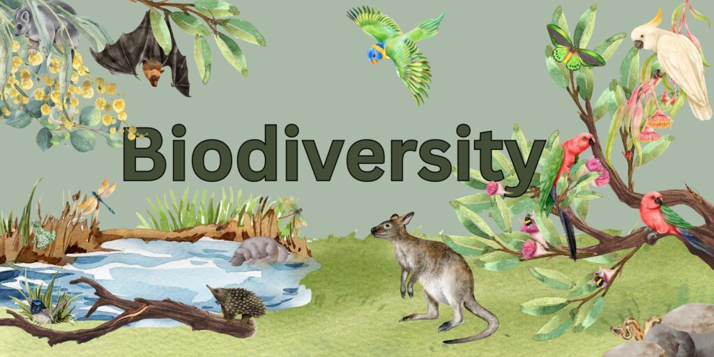
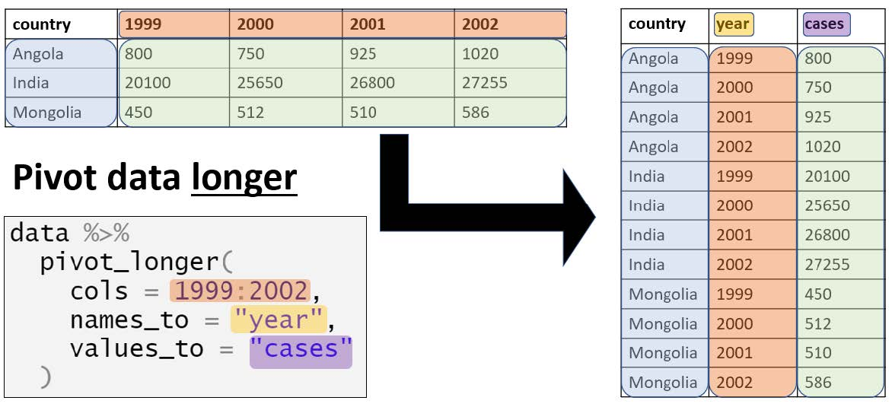
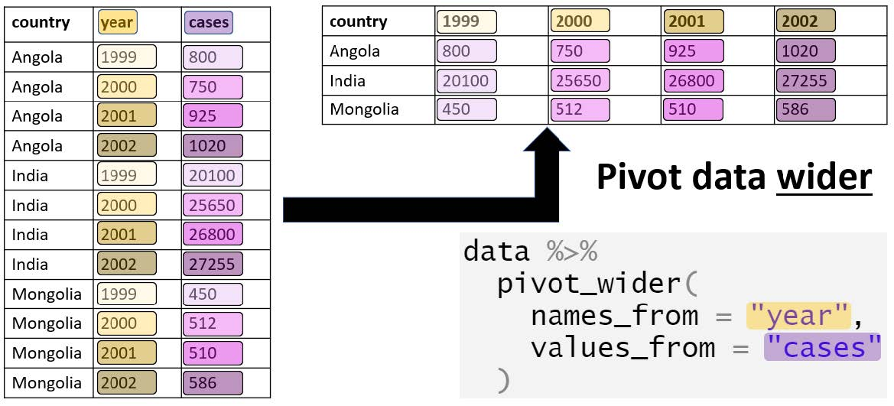
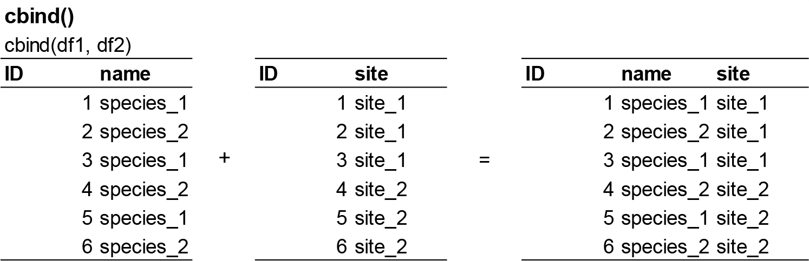
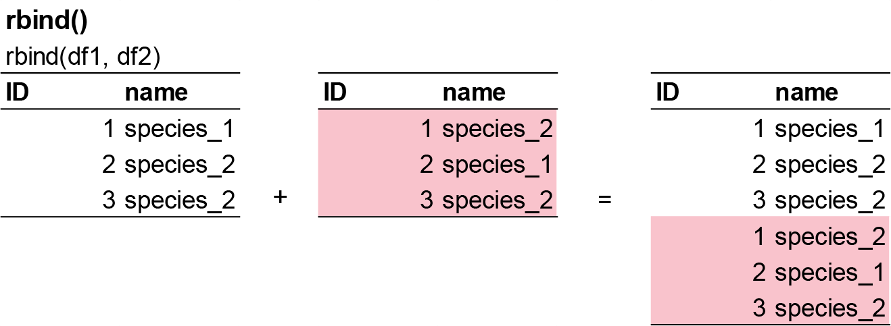

# Diversity Indices

**Week 3** - Measurements of biodiversity

In this workshop, you will learn different types of ways to quantify diversity 
and abundance in your dataset. This section is particularly important for groups 
who are doing field studies, but this quantitative skill is also useful if you 
have a job in field ecology. Workshop materials are available in the github 
repository [ECS200](https://github.com/nicholaswunz/ECS200-Workshop).




## Background reading {.unnumbered}

Biodiversity can be measured using different scales and metrics, most commonly by 
looking at species richness (the number of different species) and species evenness 
(the relative proportion of individuals in each species). Other measurements 
include alpha, beta, and gamma diversity, which describe diversity within a single 
site, between sites, and across a larger region, respectively. Here, we will focus 
on the most common ways of quantifying diversity and abundance. 

**Abundance metrics**

1. [Absolute abundance](#absolute) ($N_i$): The total number of individuals of a 
species recorded. A simple and intuitive calculation, but sensitive to sampling 
effort, i.e, cannot compare across surveys without standardisation. Only use when 
sampling effort is standardised (e.g., same transect length, trap nights).

2. [Relative abundance](#relative) ($p_i$): Comparable across communities and is 
foundational for many diversity indices. Only use when communities have differing 
total abundance, or you need proportional representation, or over time.

3. [Density](#density) ($d_i$; individuals per area or effort): Allows spatial 
comparison, but requires accurate area/effort estimates. Appropriate for 
quadrat/plot/transect sampling.

**Species richness metrics**

1. [Species richness](#richness) ($S$): The total number of unique species.
A sample and intuitive calculation, but highly sensitive to sample size and rare 
species. Only use when comparing equally-sampled plots or as a component in more 
complex metrics.


2. [Rarefied richness](#rare): Standardised species richness for a fixed number 
of individuals or samples. Allows fair comparison across unequal sampling effort, 
but assumes random sampling, i.e low resolution when sample sizes differ greatly. 
Only use in surveys with unequal effort.


**Diversity indices**

1. [Shannon diversity index](#shannon) ($H'$): Incorporates both species richness 
and evenness (the relative abundance of each species). **Widely used**, but difficult 
to interpret ecologically. Moderately sensitive to rare species, but good for 
comparing diversity across sites or time when both abundance and richness matter.

2. [Simpson's diversity index](#simpson) ($D$): Emphasises the dominance of species 
and is less sensitive to rare species. However, underweights rare species and may 
mask losses in low-abundance taxa. Use in management-focused studies (dominance 
effects), and stable community comparisons.

Other types of diversity metrics such as Rényi and Tsallis diversities, taxonomic 
diversity and taxonomic distinctness, alpha and beta diveristy can also be done 
with the [`vegan`](https://vegandevs.r-universe.dev/vegan/doc/diversity-vegan.pdf) 
R package.


### New functions {.unnumbered}

Here are some new functions from the tidyverse you will be using in this workshop.

- `pivot_longer()` converts data from *wide format* to *long format*.
- `starts_with()`*used inside `select()` to choose columns whose names begin with 
a specific string.
- `across()`* applies a function to multiple columns in a `summarise()` or 
`mutate()` call. e.g. `everything()` = select all columns and `sum` = function to 
apply.
- `.x`* is a pronoun used inside anonymous functions in tidyverse pipelines—especially 
in `across()` and `map()`. It represents the current column being processed.

'*' See 'Relative abundance' section for example use.

::: {.panel-tabset .nav-pills}

## pivot {#long .unnumbered}

`pivot_longer()` converts *wide* data into long format.
The function turns column names into values under a new variable.



Example syntax in R:

```{r long, eval=FALSE}

data <- data.frame(ID = c(1, 2), 
                   Jan = c(10, 20), 
                   Feb = c(15, 25))

tidyr::pivot_longer(data, cols = Jan:Feb, names_to = 'Month', values_to = 'Value')

```


`pivot_wider()` converts *long* data into wide format.
The function spreads values across multiple columns using a key column.
Useful when summarising tidy data.



Example syntax in R:

```{r wide, eval=FALSE}

data <- data.frame(
  ID = c(1, 1, 2, 2),
  Month = c('Jan', 'Feb', 'Jan', 'Feb'),
  Value = c(10, 15, 20, 25))

tidyr::pivot_wider(data, names_from = Month, values_from = Value)

```

::: {.content-visible when-format="html"}

:::


## cbind {#cbind .unnumbered}

`cbind()` combines dataframes **by columns**, binding them side-by-side. This 
function is used when data has the **same number of rows** and you want to add 
variables from a different dataset.



Example syntax in R:

```{r cbind, eval=FALSE}

# create two dataframes
df1 <- data.frame(ID = 1:3)
df2 <- data.frame(Name = c('A', 'B', 'C'))

# apply cbind() function
cbind(df1, df2)

```


## rbind {#rbind .unnumbered}

`rbind()` combines dataframes **by rows**, stacking them vertically. This function 
is used when data has the **same columns** and you want to add observations.



Example syntax in R:

```{r rbind, eval=FALSE}

# create two dataframes
df1 <- data.frame(ID = 1:2, Name = c('A', 'B'))
df2 <- data.frame(ID = 3, Name = 'C')

# apply rbind() function
rbind(df1, df2)

```


:::


## Calculations of abundance {.unnumbered}

We will start with this fake ecological survey data. Also, to calculate Shannon 
and Simpson's diversity, we will need the the `vegan` package.

```{r fake, warning=FALSE, message=FALSE}
#install.packages('vegan')

# Load library
library(tidyverse)
library(vegan)

# Create fake survey data
fake_data <- data.frame(
  site = c("A","A","A","A","A",
           "B","B","B","b","B",
           "C","C","C","C","C"),
  species_1 = c(57,73,20,75,83,
                41,6,61,45,2,
                0,93,0,0,86),
  species_2 = c(31,12,4,41,4,
                49,2,7,7,9,
                54,64,35,38,53),
  species_3 = c(0,38,3,0,39,
                0,29,24,15,23,
                10,0,1,5,2),
  species_4 = c(11,28,19,0,1,
                34,7,0,1,0,
                1,0,12,45,5),
  species_5 = c(0,0,0,0,0,
                4,5,0,0,0,
                3,1,0,1,2)
)

# Clean data identified with incosistencies in format
fake_data_clean <- fake_data %>%
  dplyr::mutate(site = recode(site, "b" = "B"),
                site = as.factor(site))

```

::: {.panel-tabset .nav-pills}

## Absolute abundance {#absolute .unnumbered}

**Equation**:

$$
N_i = \sum_{j=1}^{k} n_{ij}
$$
where $n_{ij}$ - individuals of species $i$ in sample $j$. Essentially its just 
the number of individuals of that species counted.

To calculate absolute abundance of one species in R, here is the following code.

```{r, eval=FALSE}

# for one species
sum(fake_data_clean$species_1) # Total abundance for all or individual species across all sites

```

You can see that the total number of species_1 in the survey is 642.

You may want to calculate abundance for each species, by site.

```{r, warning=FALSE, message=FALSE}

fake_data_long <- fake_data_clean %>% 
  tidyr::pivot_longer(!site, names_to = "species", values_to = "abundance") # convert wide format to long format (easier to summaries groups)

abundance_sum <- fake_data_long %>%
  dplyr::group_by(site, species) %>%
  dplyr::summarise(total = sum(abundance))

# Visulise abundance
abundance_sum %>%
  ggplot() +
  geom_bar(aes(x = species, y = total), stat = "identity") +
  labs(x = "Species", y = "Total abundance") +
  theme_bw() +
  coord_flip()

```

You can see that the total number of species_1 is 308 in site A, 155 in site B, 
and 179 in site C.

## Abundance {#relative .unnumbered}

**Equation**:

$$
p_i = \frac{N_i}{\sum_{i=1}^{S} N_i} = \frac{N_i}{N}
$$

where $p_i$ is the relative abundance of species $i$, $N_i$ is the abundance of 
species $i$, $\sum_{i=1}^{S} N_i = N$ is the total abundance across all species 
in the community, $S$ is the total number of species. 

For example, if 10 of the 50 individuals in a quadrat are species A: $p_i$ = 10/50 
= 0.20, meaning species A makes up 20% of the community.

To calculate relative abundance of each species in R, here is the following code.

```{r, warning=FALSE, message=FALSE}

# Option 1 - using wide format data
fake_data_clean %>%
  dplyr::select(starts_with("species_")) %>% # select all columns with "species_"
  dplyr::summarise(across(everything(), sum)) %>%      # For each column (using across), calculate the sum of all values (everything). i.e total abundance per species
  dplyr::mutate(total = sum(across(everything()))) %>% # total abundance of all species
  dplyr::mutate(across(starts_with("species_"), ~ .x / total)) # For each species column, take its values (.x) and divide by total.


# Option 2 - using long format data
relative_sum <- fake_data_long %>%
  dplyr::group_by(species) %>%
  dplyr::summarise(species_sum = sum(abundance),
         relative_abundance    = species_sum / sum(fake_data_long$abundance))

# Visualise relative abundance by species
relative_sum %>%
  ggplot() +
  geom_bar(aes(x = species, y = relative_abundance), stat = "identity") +
  labs(x = "Species", y = "Relative abundance") +
  theme_bw() +
  coord_flip()

```

To calculate relative abundance of each species within each site.

```{r relative 2, warning=FALSE, message=FALSE}

# Option 1 - using wide format data
fake_data_clean %>%
  dplyr::group_by(site) %>%
  dplyr::summarise(across(starts_with("species_"), sum)) %>%   # total abundance per species per site
  dplyr::mutate(total = rowSums(across(starts_with("species_")))) %>%  # site-level total abundance
  dplyr::mutate(across(starts_with("species_"), ~ .x / total)) # divide species abundance by site total

# Option 2 - using long format data
relative_site_sum <- fake_data_long %>%
  dplyr::group_by(site, species) %>%
  dplyr::summarise(total_abundance = sum(abundance)) %>%
  dplyr::mutate(site_total         = sum(total_abundance),
                rel_abundance      = total_abundance / site_total)

# Visualise results
relative_site_sum %>%
  ggplot() +
  geom_bar(aes(x = site, y = rel_abundance, fill = species), stat = "identity", position = position_dodge()) +
  labs(x = "Sites", y = "Relative abundance") +
  theme_bw()
```

We see that species_1 makes up about 57% of the sample for Site A, and species_4 
makes up about 11% of the sample. Once we calculate relative densities for each 
species at each site, this eliminates differences in total density at each site 
because all sites then total to 1.

## Density {#density .unnumbered}

**Equation**:

$$
d_i = \frac{N_i}{A}
$$

where $d_i$ is the density of species $i$ (e.g, individuals/ha), $N_i$ absolute 
abundance of species $i$, $A$ is the area sampled (e.g. m^2^, ha, km^2^). 

For example, if you counted 42 lizards in a 0.5 ha plot: $d_i$ = 42/0.5 = 84 
individuals/ha.

To calculate density for each site per sampling event (individuals/site/sampling 
event) in R, here is the following code.

```{r density, warning=FALSE, message=FALSE}

# Option 1 - wide format
fake_data_clean %>%
  dplyr::group_by(site) %>%
  dplyr::summarise(round(across(starts_with("species"), mean, na.rm = TRUE))) # calculates the mean count per site across the sampling period.


# Option 2 - long format
density_sum <- fake_data_long %>%
  dplyr::group_by(site, species) %>%
  dplyr::summarise(density = round(mean(abundance))) # calculates the mean count per site across the sampling period.

# Visualise results
density_sum %>%
  ggplot() +
  geom_bar(aes(x = site, y = density, fill = species), stat = "identity", position = position_dodge()) +
  labs(x = "Sites", y = "Density (n/sample effort)") +
  theme_bw()

```

We can see here that site A has 62 individuals per sampling effort for species_1, 
while site B has 31 indidvuals per sampling effort for species_1.

If you want density of all individuals by site, then use the following code.

```{r density 2, eval=FALSE}

fake_data_long %>%
  dplyr::group_by(site) %>%
  dplyr::summarise(density = round(mean(abundance))) # calculates the mean count per site across the sampling period.

```

Site A has an average of 22 individuals per sampling effort, while site B has an 
average of 20 individuals per sampling effort.

:::

### Exercise 1 (10 min) {.unnumbered}

🧪 **Complete the following task for the `excerise_survey_data` below**

- Calculate the absolute abundance, relative abundance, and density of all species 
by sites
- What is the absolute abundance of species_1 overall?
- What is the relative abundance of species_2 in site B relative to all sampled 
sites?
- What is the mean density of species_3 overall?

```{r ex 1}

excerise_survey_data <- data.frame(
  site = c("A","A","A","B","B","B","C","C","C"),
  plot = c(1,2,3,1,2,3,1,2,3),
  species_1 = c(12, 7, 15, 4, 9, 6, 20, 18, 25),
  species_2 = c(5, 2, 1, 10, 7, 4, 3, 1, 0),
  species_3 = c(0, 3, 2, 6, 4, 5, 0, 1, 2),
  species_4 = c(8, 6, 3, 1, 4, 2, 10, 7, 5)
)

```

<details>
<summary><strong>Show answer</strong></summary>

```{r ans 1, eval=FALSE}

excerise_survey_long <- excerise_survey_data %>%
  tidyr::pivot_longer(!c(site, plot), names_to = "species", values_to = "abundance")# convert wide format to long format (easier to summaries groups)
  
excerise_survey_sum <- excerise_survey_long %>%
  dplyr::group_by(site, species) %>% # grouped by site and species
  dplyr::summarise(species_sum = sum(abundance), # calculates total abundance by site and species (so combination of the plots)
            relative = (species_sum / sum(excerise_survey_long$abundance) * 100), # calculates relative abundance from all species in all sites combined.
            density = round(mean(abundance)) # calculates density (individuals/plot)
            ) 

# answer 1 
excerise_survey_sum %>%
  filter(species == "species_1") %>%
  pull(species_sum) %>%
  sum()

# answer 2
excerise_survey_sum %>%
  filter(species == "species_2", site == "B") %>%
  select(relative) 

# answer 3
excerise_survey_sum %>%
  filter(species == "species_3") %>%
  pull(density) %>%
  mean()


# 1. 116
# 2. 10%
# 3. 2.6

```

</details>


## Calculations of species richness {.unnumbered}

::: {.panel-tabset .nav-pills}

## Species richness {#richness .unnumbered}

**Equation**:

$$
S = number \, of \, species \, observed
$$

To calculate species richness in R, here is the following code. Note, you will 
need to remove zeros when using `length()` to count number of species because 
length will include zero.

```{r richness, eval=FALSE}

# Option 1 - using tidyverse
fake_data_long %>%
  dplyr::filter(abundance != 0) %>% # remove rows with zeros (e.g. no species 5 in site A)
  dplyr::group_by(site) %>%
  dplyr::summarise(total = length(unique(species))) 

```

In our fake dataset, we have four species in site A, and all five species in site 
B and C. 

:::{.callout-important}

## Important
If we includes zeros in this calculation, we would get species_5 
in the count which means all sites would have five species, which is incorrect.

:::


## Rarefied richness {#rare .unnumbered}

Species richness increases with sample size, and differences in richness actually 
may be caused by differences in sample size. To solve this problem, we may try 
to rarefy species richness to the same number of individuals.

To calculate absolute abundance of one species in R, here is the following code.

```{r rare,  warning=FALSE, message=FALSE}

# sum species counts per site
site_counts <- fake_data_clean %>%
  group_by(site) %>%
  summarise(across(where(is.numeric), sum))


# Rarefied richness needs a “sample size” = smallest total abundance across sites.
nmin <- rowSums(site_counts[ , -1]) %>% min()

rarefied_richness_output <- vegan::rarefy(site_counts[ , -1], sample = nmin)

# add rarefied results to sites
rarefied_richness <- bind_cols(site = site_counts$site,
                               rarefied_richness = rarefied_richness_output)

```

In this fake dataset, the results are the same as your standard species richness count. 
When you have more complicated and more variable datasets with lots of rare 
species, this calculation might be useful. Always justify which metric you plan 
to use in your report.

:::

### Exercise 2 (10 min) {.unnumbered}

🧪 **Complete the following task for the `excerise_survey_data` below**

- Calculate the species richness by sites.
- What is the richness of site C?

<details>
<summary><strong>Show answer</strong></summary>

```{r ans 2, eval=FALSE}

# Species richness
excerise_survey_long %>%
  filter(abundance != 0) %>% # remove rows with zeros (e.g. no species 5 in site A)
  group_by(site) %>%
  summarise(total = length(unique(species))) 

# 1. 4

```

</details>


## Calculations of diversity {.unnumbered}

::: {.panel-tabset .nav-pills}

## Shannon diversity index {#shannon .unnumbered}

**Equation**:

$$
H' = - \sum_{i=1}^{S} p_i \,\ln(p_i)
$$

where $H'$ is Shannon diversity index, $S$ is the total number of species in the 
community (species richness), $p_i$ is the relative abundance of species $i$ 
(see relative abundance). High $H'$ = many species, relatively even abundances, 
while low $H'$ = few species or dominance by one/few species.

To calculate $H'$ in R, here is the following code.

```{r shannon, warning=FALSE, message=FALSE}

shannon_output <- vegan::diversity(site_counts[, -1], index = "shannon") # remove site column [,-1] for the diversity function to work

# add H results to sites
shannon_sum <- bind_cols(site = site_counts$site,
                               shannon = shannon_output)

# Visualise results
shannon_sum %>%
  ggplot() +
  geom_bar(aes(x = site, y = shannon), stat = "identity") +
  labs(x = "Sites", y = "Shannon diveristy index (H')") +
  theme_bw()

```

If $H'$ = 0, only one species is present (no diversity). 
A value of 1.36 in site B means site B has slighty higher diversity than site A 
and site C. i.e. more species and/or a more even distribution of individuals among 
species. 


## Simpson's diversity index {#simpson .unnumbered}

**Equation**:

$$
D_1 = 1 - \sum_{i=1}^{S} p_i^2
$$


where $D_1'$ is Simpson's diversity index, $S$ is the total number of species in 
the community (species richness), $p_i$ is the relative abundance of species $i$ 
(see relative abundance). High $D_1$ = high diversity, while low $D_1$ = low 
diversity.

For inverse Simpson's diversity index, the **equation** is:

$$
D_2 = \frac{1}{\sum_{i=1}^{S} p_i^2}
$$
where $D_2$ is the inverse of Simpson's diversity index. If $D_2$ = 1, only one 
species is present, and if $D_2$ is higher then more species are present/or more 
even distribution.

To calculate $D_1$ in R, here is the following code.

```{r simpson, warning=FALSE, message=FALSE}

site_counts <- fake_data_clean %>%
  group_by(site) %>%
  summarise(across(where(is.numeric), sum))

# sum species counts per site
simpson_output <- vegan::diversity(site_counts[ , -1], index = "simpson") # remove site column [,-1] for the diversity function to work

# add D1 results to sites
simpson_sum <- bind_cols(site = site_counts$site,
                               simpson = simpson_output)

# Visualise results
simpson_sum %>%
  ggplot() +
  geom_bar(aes(x = site, y = simpson), stat = "identity") +
  labs(x = "Sites", y = "Simpson's diveristy index (D1)") +
  theme_bw()
```

Similar to Shannon diversity index, site B has higher $D_1$ of 0.71 compared to 
the other two sites.

:::

### Exercise 3 (10 min) {.unnumbered}

🧪 **Complete the following task for the `fake_data_clean` below**

- Calculate the Shannon diversity index, and Simpson's diversity index by sites 
(*Note**: Use the original wide format, not long format for this part)
- What is the diversity of site A using the Shannon diversity index ($H'$) method?
- What is the diversity of site B using the inverse Simpson's diversity index ($D_2$) method?

<details>
<summary><strong>Show answer</strong></summary>

```{r ans 3, eval=FALSE}

# sum species counts per site
excerise_survey_sum <- excerise_survey_data %>%
  group_by(site) %>%
  summarise(across(where(is.numeric), sum))

# Shannon diversity
bind_cols(site = excerise_survey_sum$site, 
          shannon = vegan::diversity(excerise_survey_sum[, -c(1, 2)], index = "shannon"),
          simpson = vegan::diversity(excerise_survey_sum[, -c(1, 2)], index = "invsimpson"))

# 1. 1.14
# 2. 3.5

```

</details>


# Assessment {.unnumbered}

Task to complete before the end of the workshop.

Here is an example from a real dataset looking at the effects of experimental 
**drought** on soil invertebrate communities, called `invert_exp_survey.csv` [@Farkas2025].
The `invert_exp_survey.csv` file can be found on [GitHub](https://github.com/nicholaswunz/ECS200-Workshop) 
in the 'data' folder.

The invertebrate diversity is grouped at order level, with the exception of 
Crustacea (subphylum), Diplopoda (class), Chilopoda (class), and Annelida (phylum).


Use the skills that you learnt in the previous practical and this weeks practical 
to complete the following assessment with the example dataset `invert_exp_survey.csv`:

**1. Load data and inspect structure**

- Create a working for your `invert_exp_survey.csv` data
- Import `invert_exp_survey.csv` into R
- Inspect the structure and column names
- Check for missing values
- Check for duplicate rows


```{r assess, eval=FALSE}

# Week 3 workshop - Quantifying diversity
# Name, Student ID, date

# Load packages
library(tidyverse)
library(visdat)

# Set your working directory
setwd("YOUR-DIRECTORY")

# Load your data
invert_raw <- read_csv("invert_exp_survey.csv")

# Convert to long format

```

**2. Calculate and visualise relative abundance by treatment (i.e, Within each treatment, what proportion of the total community does each invertebrate order make up?)**

- Sum the total abundance of each order by treatment. Hint: use Option 2 - using 
long format data (one row per sample × order)
- The figure should look close to this.

```{r abund output hide, include=FALSE}

# Load library
library(tidyverse)
library(vegan)

invert_raw <- read_csv("https://raw.githubusercontent.com/nicholaswunz/ECS200-Workshop/refs/heads/main/data/invert_exp_survey.csv")

# Check for missing values in each column
colSums(is.na(invert_raw)) # missing values

# Returns the number of duplicate rows
sum(duplicated(invert_raw)) # zero duplicates

# visualise spread
invert_long <- invert_raw %>%
  tidyr::pivot_longer(!c(sample_ID, month, block, shelter, treatment, trap), names_to = "order", values_to = "abundance") # convert wide format to long format

rel_abund <- invert_long %>%
  group_by(treatment, order) %>%
  summarise(total_abundance = sum(abundance)) %>%
  mutate(site_total = sum(total_abundance),
         rel_abundance = total_abundance / site_total)

```

```{r abund output}

# QUESTION 2: What proportion of the total community does each invertebrate order make up?


# Plot the summarised outcome
rel_abund %>%
  ggplot() +
  geom_bar(
    aes(x = order, y = rel_abundance, fill = treatment),
    stat = "identity",
    position = position_dodge()
  ) +
  labs(x = NULL, y = "Relative abundance") +
  theme_bw() +
  coord_flip()

```

**3. Calculate species richness per treatment**

- Count the number of unique invertebrate orders with abundance > 0

```{r richness output hide, include=FALSE}

invert_long %>%
  group_by(treatment) %>%
  filter(abundance != 0) %>% # remove rows with zeros 
  summarise(total = length(unique(order))) 

```

**4. Calculate Shannon diversity index by treatment**

- You can find the code to summarise species counts per site under the 
'rarified species' section (`site_counts`).
- Apply `vegan::diversity()`
- Apply `bind_cols()` to match the shannon numbers with your treatment names.
- Plot it, the figure should look close to this.

```{r diversity output hide, include=FALSE}

# sum species counts per site
site_sums <- invert_raw %>%
  group_by(treatment) %>%
  summarise(across(where(is.numeric), sum))

shannon_results <- vegan::diversity(site_sums[ , -c(1, 2)], index = "shannon") # remove site column [,-1] for the diversity function to work

shannon_inv <- bind_cols(treatment = site_sums$treatment,
                               shannon = shannon_results)

```

```{r diversity output}

shannon_inv %>%
  ggplot() +
  geom_bar(
    aes(x = treatment, y = shannon),
    stat = "identity"
  ) +
  labs(x = "Treatment", y = "Shannon diveristy index (H')") +
  theme_bw()

```

## For the adventurous folks {.unnumbered}

Try to get Shannon diversity index by treatment and block.
Convert wide data to sums per treatment x block.

See if you can replicate this figure.

```{r diversity output hide2, include=FALSE}

site_sums <- invert_raw %>%
  group_by(treatment, block) %>%
  summarise(across(where(is.numeric), sum))

shannon_results <- vegan::diversity(site_sums[ , -c(1, 2)], index = "shannon") # remove site column [,-1] for the diversity function to work


shannon_inv <- bind_cols(treatment = site_sums$treatment,
                               shannon = shannon_results)

```

```{r diversity output2}

shannon_inv %>%
  ggplot() +
  geom_point(aes(x = treatment, y = shannon), size = 2) +
  labs(x = "Treatment", y = "Shannon diveristy index (H')") +
  theme_bw()

```

This is more reflective of the normal variation across experimental blocks and 
where your report should be going towards instead ot the mean only.


# Extra Stuff {.unnumbered}

- More detailed background and [theory](https://www.davidzeleny.net/anadat-r/doku.php/en:diversity_analysis) on indices of [diversity and evenness](https://www.davidzeleny.net/anadat-r/doku.php/en:div-ind) with example R code and dataset to play with.
