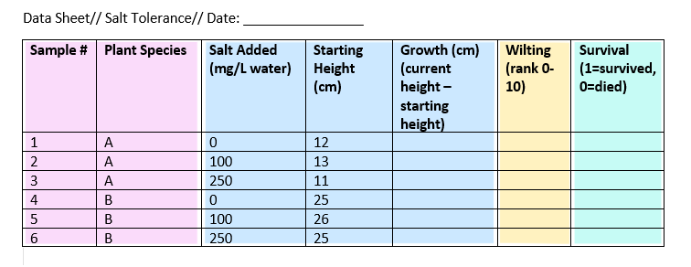
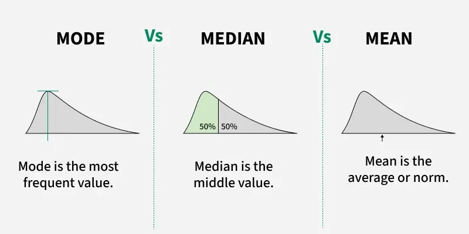
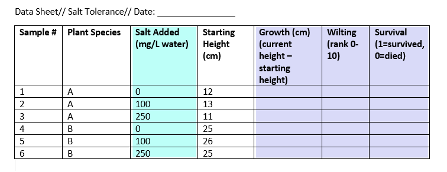
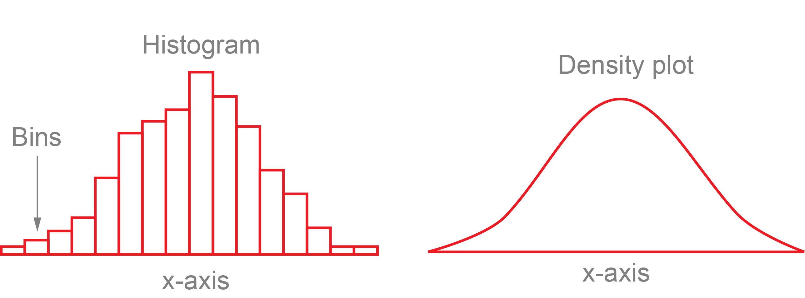
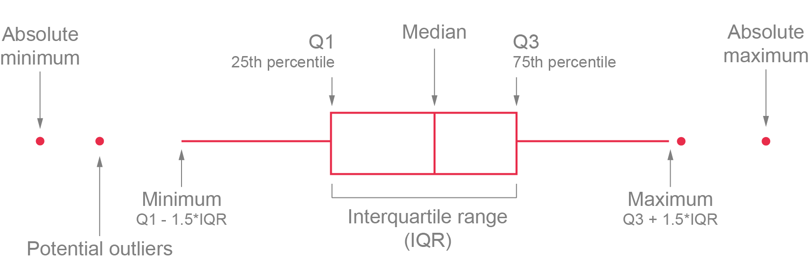
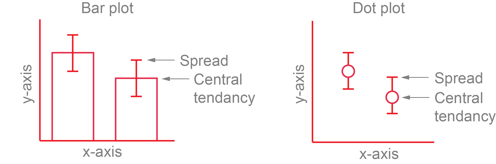
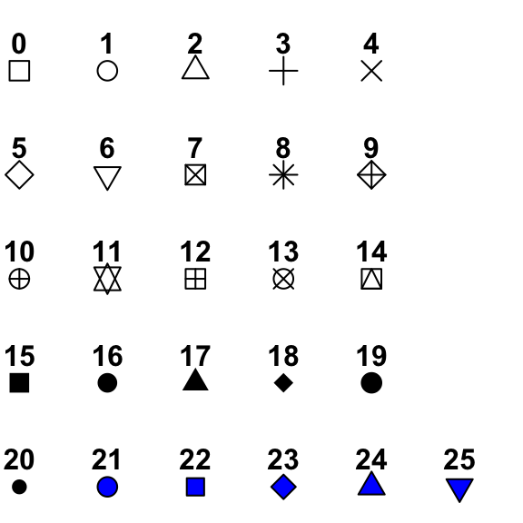
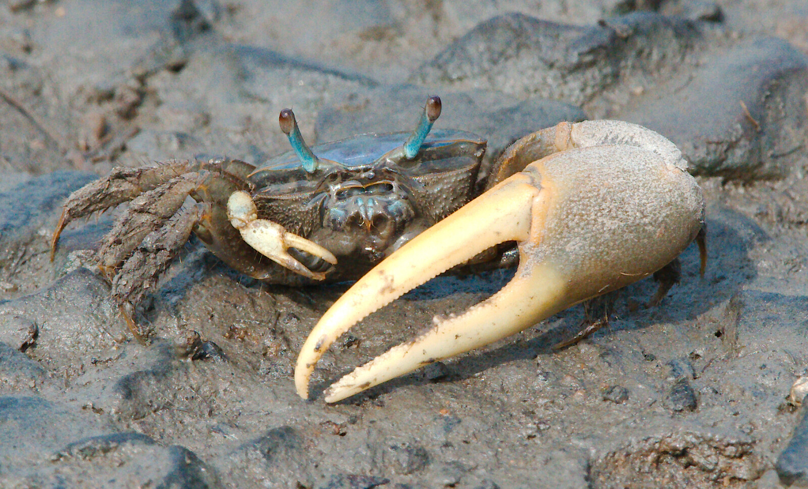
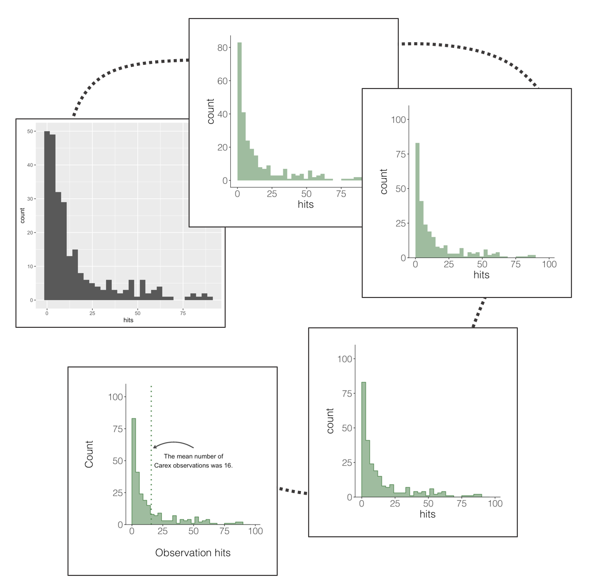

# Descriptive Stats

**Week 4** - Descriptive stats and plotting data

In this workshop, you will learn how to summarise different types of ecological 
data using appropriate statistical measures and visualisations. Understanding the 
right measures of central tendency and spread is critical before conducting any 
formal hypothesis testing. 

Workshop materials are available in the github repository [ECS200](https://github.com/nicholaswunz/ECS200-Workshop).


## Background reading {.unnumbered}


Before we can decide on the appropriate descriptive stats it helps to understand the **scale** of your variable.
The table below outlines appropriate measures for both qualitative and quantitative variables:

| Data Scale | Type         | Definition                                      | Examples                          | Central Tendency | Spread/Variation              |
|:----------:|:------------:|:-----------------------------------------------:|:---------------------------------:|:----------------:|:-----------------------------:|
| Nominal    | Qualitative  | Named categories with no intrinsic order        | sex (male/female), species name   | Mode             | Count, Proportion             |
| Ordinal    | Qualitative  | Named categories data with a natural order      | life stage (egg, juvenile, adult) | Median, Mode     | Range, IQR                    |
| Interval   | Quantitative | Equal intervals between values but no true zero | temperature, pH, dates            | Mean, Median     | SD, SE, CI                    |
| Ratio      | Quantitative | Equal intervals and a true zero                 | length, age, body mass            | Mean, Median     | SD, SE, CV, IQR, CI, variance | 


When laying out your datasheet for your study, it is important to know what data 
types each column will be when imported into R. 
Here is an example data sheet that is color-coded according to the type of variable: [nominal]{style="background-color: #fadbfa;"}, [continuous]{style="background-color: #cce8ff;"}, [ordinal]{style="background-color: #fff2c0;"}, and [binary]{style="background-color: #c6fbf5;"}.



Key Terms used in this workshop:

- **Mean**: Average value. Use with symmetric, normally distributed data.
- **Median**: Middle value. More robust to outliers and skewed data.
- **Mode**: Most frequent value (useful for categories).
- **Standard Deviation (SD)**: How spread out the data is.
- **Standard Error (SE)**: SD divided by the square root of n (how precise the mean is).
- **Coefficient of Variation (CV)**: SD / Mean. Compares spread across variables.
- **Interquartile Range (IQR)**: Range between 25th and 75th percentiles.
- **Confidence Interval (CI)**: A range that likely contains the true mean.
- **Variance**: How much values differ from the average value.


If you are still confused by the terminologies, the CrashCourse Statistics videos 
on the [Mean, Median, and Mode: Measures of Central Tendency](https://youtu.be/kn83BA7cRNM?si=qzoPZk44hZRlzo9P) (11:22 min long), and the [Measures of Spread](https://youtu.be/R4yfNi_8Kqw?si=9QO_QzRmLG5oyQjH) 
(11:46 min long) better explains the terms visually.

# Part 1 - Descriptive Statistics {.unnumbered}

::: {.panel-tabset .nav-pills}

## Central tendancy {.unnumbered}

Deciding on whether to use mean, median, or mode will depend on how your data is 
distributed. A skewed distribution can result in different outcomes of central 
tendancy if you are calculating using the mean, median, and mode. 



Here is a CrashCourse Statistics video on [The Shape of Data: Distributions](https://youtu.be/bPFNxD3Yg6U?si=MSoRYOukKdRFjGem) on other types 
of distributions encountered (11:22 min long).
In practice, mode is rarely used, but is often included in a discussion of mean 
and medians. From here, we will focus on mean and median, which can be calculated 
using the `mean()` and `median()` function, respectively. 

```{r fake, warning=FALSE, message=FALSE}
#install.packages("cowplot")

# Load library
library(tidyverse)
library(cowplot)

# Create fake data distribution
set.seed(1)
dist_data <- data.frame(normal = rnorm(100, mean = 10, sd = 2),
                        skewed = rexp(100, rate = 0.2))

dist_data %>%
  dplyr::summarise(normal_mean = mean(normal),
                   normal_median = median(normal),
                   skewed_mean = mean(skewed),
                   skewed_median = median(skewed))

```

If the data is normally distributed, the mean and median will be similar (e.g. 
normal = 10), but if the data is skewed, the mean and median will show different 
central tenancies (e.g. mean = 4.7, median = 3).

## Spread {.unnumbered}

We can calculate the standard deviation, standard error, confidence interval, 
coefficient of variation, and variance with the following code can be calculated 
using the `mean()` and `median()` function, respectively. 

```{r spread, warning=FALSE, message=FALSE}

dist_data %>%
  dplyr::summarise(
    n = length(skewed),
    mean = mean(skewed), # required for calculation of CI
    variance = var(skewed),
    sd = sd(skewed), # standard deviation
    se = sd(skewed) / sqrt(n), # standard error
    ci_lower = mean(skewed) - qt(0.975, df = n - 1) * se, # lower 5%
    ci_upper = mean(skewed) + qt(0.975, df = n - 1) * se, # lower 95%
    cv = sd(skewed) / mean(skewed) # coefficient of variation
  )

```

Remember that the skewed data is strongly right-skewed so SD and CI must be 
interpreted carefully.

- SD measures spread *around the mean* assuming deviations are roughly symmetric.
- 95% CI assumes the *sampling distribution of the mean* is approximately normal.

Skewed data violate this assumption.
SE & CI describe uncertainty in the mean, not **variability** of the data.

For data measured at an [ordinal]{style="background-color: #fff2c0;"} level, the 
range and interquartile range are the only appropriate measures of variability.

For more [continuous]{style="background-color: #cce8ff;"} level data like interval 
and ratio levels, the SD and variance are also applicable.

Here is a visualisation on SD (top) and 95% CI (bottom) for normal skewed data.

```{r spread vis, warning=FALSE, message=FALSE}

dist_dat_long <- dist_data %>%
  tidyr::pivot_longer(cols = everything(), names_to = "data_type", values_to = "value")

dist_dat_stats <- dist_dat_long %>%
  group_by(data_type) %>%
  summarise(mean = mean(value),
            sd = sd(value),
            n = length(value),
            se = sd(value) / sqrt(n),
            ci_lower = mean(value) - qt(0.975, df = n - 1) * se, #lower 5%
            ci_upper = mean(value) + qt(0.975, df = n - 1) * se, # lower 5%
            cv = sd(value) / mean(value) # coefficient of variation
            )

sd_plot <- ggplot(dist_dat_long, aes(x = value)) +
  geom_histogram(bins = 30, fill = "lightgrey", colour = NA) +
  geom_vline(data = dist_dat_stats, aes(xintercept = mean), colour = "black", linewidth = 1) +
  geom_vline(data = dist_dat_stats, aes(xintercept = mean + sd), linetype = "dashed", colour = "black") +
  geom_vline(data = dist_dat_stats, aes(xintercept = mean - sd), linetype = "dashed", colour = "black") +
  facet_wrap(~ data_type, scales = "free") +
  labs(
    subtitle = "Mean ± SD assumes symmetry",
    x = "Value",
    y = "Frequency"
  ) +
  theme_classic()

ci_plot <- ggplot(dist_dat_long, aes(x = value)) +
  geom_histogram(bins = 30, fill = "lightgrey", colour = NA) +
  geom_vline(data = dist_dat_stats, aes(xintercept = mean), colour = "black", linewidth = 1) +
  geom_vline(data = dist_dat_stats, aes(xintercept = ci_lower), linetype = "dashed", colour = "black") +
  geom_vline(data = dist_dat_stats, aes(xintercept = ci_upper), linetype = "dashed", colour = "black") +
  facet_wrap(~ data_type, scales = "free") +
  labs(
    subtitle = "Mean ± 95% CI assumes symmetry",
    x = "Value",
    y = "Frequency"
  ) +
  theme_classic()

cowplot::plot_grid(sd_plot, ci_plot, ncol = 1, align = "v")

```

Boxplots are better alternatives to represent spread for skewed data (see below 
on quantiles).

## Other descriptive stats {.unnumbered}

Other types of descriptive stats include quantiles, maximum, minimum, and range.
Quantiles divide a sorted dataset or probability distribution into equal-sized 
subgroups. The max, min, and range can be calculated within the `summarise()` 
function, while the quantiles can be calculated with the base R `quantile()` 
function.


```{r other, warning=FALSE, message=FALSE}
dist_data %>%
  dplyr::summarise(normal_max = max(normal),
                   normal_min = min(normal),
                   normal_range = normal_max - normal_min)

# Option 1
quantile(dist_data$normal)


# Option 2 with dplyr (and it's possible to calculate by grouping)
dist_data %>%
  #dplyr::group_by(column_1, column_2) %>%
  dplyr::summarise(min    = quantile(normal, probs = 0, na.rm = TRUE), 
                   Q1     = quantile(normal, probs = 0.25, na.rm = TRUE),
                   median = quantile(normal, probs = 0.5, na.rm = TRUE),
                   Q3     = quantile(normal, probs = 0.75, na.rm = TRUE),
                   max    = quantile(normal, probs = 1, na.rm = TRUE),
                   n      = n())

```

Visually for normal and skewed distributions, the quantiles would look like this.
We will need to convert the wide format of `dist_data` to long format.

```{r quantile, warning=FALSE, message=FALSE}

dist_data %>%
    tidyr::pivot_longer(everything(), names_to = "data_type", values_to = "value") %>% # convert wide format to long format
ggplot(aes(x = data_type, y = value)) +
  geom_boxplot() +
  theme_classic()

```

:::


### Exercise 1 (5 min) {.unnumbered}

🧪 **Complete the following task for the `excerise_survey_data` below**


```{r ex 1}

excerise_survey_data <- data.frame(
  site = c("A","A","A","B","B","B","C","C","C"),
  plot = c(1,2,3,1,2,3,1,2,3),
  species_1 = c(12, 7, 15, 4, 9, 6, 20, 18, 25),
  species_2 = c(5, 2, 1, 10, 7, 4, 3, 1, 0),
  species_3 = c(0, 3, 2, 6, 4, 5, 0, 1, 2),
  species_4 = c(8, 6, 3, 1, 4, 2, 10, 7, 5)
)

```

- Calculate mean, standard deviation, and sample size of species 3.
You can calculate sample size with `length()` function.
- What is the mean number of species 3? Does the number make sense for species count data?
- What is the standard deviation of species 3?
- What is the sample size of species 3?

<details>
<summary><strong>Show answer</strong></summary>

```{r ans 1, eval=FALSE}

excerise_survey_data %>%
  summarise(mean = mean(species_3),
            sd   = sd(species_3),
            n    = length(species_3))  

# 1. 2.55
# 2. 2.17
# 3. 9

```

</details>


## By groups {.unnumbered}

Create a fake dataset to illustrate summarises by different groups.

```{r}

fake_data <- data.frame(
  site = c("A", "B", "C", "A", "B", "A", "B", "C", "A", "B", "A", "B", "A", "B", "C", "C", "B", "A", "B", "C", "B", "C", "C", "A", "A", "A", "A", "B", "C", "C", "C"),
  plot = c("A1", "B1", "C1", "A2", "B2", "A3", "B3", "C2", "A4", "B4", "A5", "B5", "A6", "B6", "C3", "C4", "B7", "A7", "B8", "C5", "B9", "C6", "C7", "A8", "A9", "A10", "A11", "B10", "C8", "C9", "C10"),
  species_1 = as.integer(c(7, 25, 30, 50, 38, 13, 5, 31, 34, 22, 41, 25, 22, 37, 39, 13, 45, 10, 40, 7, 28, 36, 19, 2, 12, 5, 16, 38, 27, 44, 44)),
  species_2 = as.integer(c(9, 8, 1 , 7, 9 , 9, 4, 8, 1, 7, 1, 6, 4, 4, 7, 2, 8, 7, 2, 9, 9, 2, 6, 8, 6, 6, 17, 1, 8, 4, 4)),
  species_3 = as.integer(c(190, 160, 70, 430, 310, 99, 530, 420, 371, 357, 198, 171, 463, 124, 254, 484, 435, 409, 122, 305, 410, 162, 473, 200, 401, 273, 421, 419, 293, 487, 487)),
  species_4 = as.integer(c(2, 0, 4, 8, 6, 3, 7, 4, 2, NA, 35, 10, 6, 4, 8, 1, 1, 0, NA, 4, 6, 8, 10, 6, 2, 5, 10, 7, NA, NA, NA))
  )

```

::: {.panel-tabset .nav-pills}

### By group {.unnumbered}

Let's say we want to calculate the average abundance of all invertebrates across 
three sites. We will first convert the data to long format, and then `group_by(site)`
to calculate the mean, standard deviation and count by sites.

```{r}

fake_long <- fake_data %>%
  pivot_longer(
    cols      = starts_with("species"),
    names_to  = "species",
    values_to = "abundance"
  )

fake_sum <- fake_long %>%
  group_by(site) %>%
  summarise(
    mean = mean(abundance, na.rm = TRUE),
    sd = sd(abundance, na.rm = TRUE),
    n = n()
  ) %>%
  ungroup()

fake_sum %>%
  ggplot() +
  geom_pointrange(aes(x = site, y = mean, ymin = mean - sd, ymax = mean + sd)) +
  theme_bw()

```


### By subgroup within group {.unnumbered}

Let's say we want to calculate the average abundance **for each species** across 
three sites. We will first convert the data to long format, and then `group_by(site, species)`
to calculate the mean, standard deviation and count by species across sites.

```{r}

fake_sp_sum <- fake_long %>%
  group_by(site, species) %>%
  summarise(
    mean = mean(abundance, na.rm = TRUE),
    sd = sd(abundance, na.rm = TRUE),
    n = n()
  ) %>%
  ungroup()

fake_sp_sum %>%
  ggplot() +
  geom_pointrange(aes(x = site, y = mean, ymin = mean - sd, ymax = mean + sd, 
                      colour = species),
                  position = position_dodge(0.8)) + # Change the position by 0.8 to seperate species
  theme_bw()

```

:::

# Part 2 - Figures with ggplot {.unnumbered}

R really shines when it comes to data visualisation and with some tweaks, you 
can make eye-catching plots that make it easier for people to understand your 
science. The `ggplot2` package, part of the tidyverse collection of packages, as 
well as its many extension packages are a great tool for data visualisation.

The gg in ggplot2 stands for grammar of graphics. Writing the code for your graph 
is like constructing a sentence made up of different parts that logically follow 
from one another. In a more visual way, it means **adding layers** that take care 
of different elements of the plot. 

Your plotting workflow will therefore be something like creating an empty plot, 
adding a layer with your data points, then your measure of uncertainty, the axis 
labels, and so on.


### Independent vs dependent variables {.unnumbered}

In this example experiment data sheet, we have one [independent]{style="background-color: #bdfff8;"} 
and three [dependent]{style="background-color: #d9daf8;"} variables.

The other variables in the sheet can’t be classified as independent or dependent, 
but they do contain data that you will need in order to interpret your independent 
and dependent variables.



## Plot Types {.unnumbered}

There are so many ways to visualise your data beyond this workshop, so we will 
only focus a few common ones you will likely use in your report.


Let's say we are interested in visualising at differences in stem length in 
calcium-treated (**W1**) versus untreated (**Reference**) watersheds, there are 
a couple of ways we can visualise this.

```{r load data, message=FALSE}

# Load a CSV file
plant_task_clean_data <- read_csv("https://raw.githubusercontent.com/nicholaswunz/ECS200-Workshop/refs/heads/main/data/plant_calcium_task.csv") %>%
  dplyr::mutate(watershed = recode(watershed, "W2" = "W1"),
                watershed = as.factor(watershed),
                transect  = as.factor(transect)) %>%
  dplyr::filter(stem_dry_mass < 1)

```

::: {.panel-tabset .nav-pills}


## Histogram or density {.unnumbered}



A [histogram](https://r-graph-gallery.com/histogram) and [density plot](https://r-graph-gallery.com/density-plot) takes as input a numeric variable only. The variable is cut into several bins, 
and the number of observation per bin is represented by the height of the bar. 
It is possible to represent the distribution of several variable on the same axis 
using this technique.

To create a histogram by group, use the `geom_histogram()` function within ggplot.

```{r hist}

plant_task_clean_data %>%
  ggplot(aes(x = stem_length, fill = watershed)) +
  geom_histogram(alpha = 0.4, position = "identity") # changed transparency due to overlap in watershed groups

```

To create a density plot by group, use the `geom_density()` function within ggplot.

```{r density}

plant_task_clean_data %>%
  ggplot(aes(x = stem_length, fill = watershed)) +
  geom_density(alpha = 0.4, position = "identity") # changed transparency due to overlap in watershed groups

```

## Boxplot {.unnumbered}



A [boxplot](https://r-graph-gallery.com/89-box-and-scatter-plot-with-ggplot2.html) 
provides an effective summary of one or more numeric variables, showcasing key 
statistical features through its distinct elements:

- **Median** Line: The line that divides the box represents the median of the data. 
For example, if the median is 10, this indicates that half of the data points lie 
below 10 and half above.
- **Quartiles**: The ends of the box indicate the upper (Q3) and lower (Q1) 
quartiles. If Q3 is 15, this means that 75% of the observations fall below this 
value.
- **Interquartile Range** (IQR): The difference between Quartiles 1 and 3 is known 
as the interquartile range (IQR), which measures the spread of the middle 50% of 
the data.
- **Whiskers**: The lines extending from the box show the range of values within 
Q3 + 1.5 × IQR to Q1 - 1.5 × IQR, representing the highest and lowest values, 
excluding outliers.
- **Outliers**: Dots (or other markers) beyond the whiskers indicate potential 
outliers in the dataset.

To create a boxplot by group, use the `geom_boxplot()` function within ggplot.

```{r boxplot}

plant_task_clean_data %>%
  ggplot(aes(x = watershed, y = stem_length)) +
  geom_boxplot()

```

## Bar plot or dot plot {.unnumbered}



To plot the mean and standard deviation as a bar plot, use the `geom_bar()` 
function with `geom_errorbar()`.

```{r bar}

plant_sum <- plant_task_clean_data %>%
  group_by(watershed) %>%
  summarise(mean = mean(stem_length),
            sd = sd(stem_length))


plant_sum %>%
  ggplot(aes(x = watershed)) +
  geom_bar(aes(y = mean), stat = "identity") +
  geom_errorbar(aes(ymin = mean-sd, ymax = mean+sd), width = .02)

```

To plot the mean and standard deviation as a dot plot, use the `geom_pointrange()`. 
It is also useful to include the raw data in this case, which you will need to call 
in the `plant_task_clean_data` and `plant_sum` separately and plot the raw data
with the `geom_jitter()` function.

```{r dot}

# mean +/- sd only.
mean_plot <- plant_sum %>%
  ggplot() + 
  geom_pointrange(aes(x = watershed, y = mean, ymin = mean-sd, ymax = mean+sd))

# including raw data
raw_plot <- ggplot() + 
  geom_jitter(data = plant_task_clean_data, aes(x = watershed, y = stem_length), 
              alpha = 0.1, position = position_jitter(0.2)) + #raw data
  geom_pointrange(data = plant_sum, aes(x = watershed, y = mean, 
                                      ymin = mean-sd, ymax = mean+sd))

cowplot::plot_grid(mean_plot, raw_plot, ncol = 2, align = "v")

```


## Scatter plot {.unnumbered}


A [scatterplot](https://r-graph-gallery.com/scatterplot) displays the relationship 
between 2 numeric variables. For each data point, the value of its first variable 
is represented on the X axis, the second on the Y axis

To create a scatterplot, use the `geom_point()` function within ggplot.

```{r scatter}

plant_task_clean_data %>%
  ggplot(aes(x = stem_length, y = stem_dry_mass)) +
  geom_point()

```

To create a scatterplot by group, include a colour or shape level within ggplot.

```{r scatter2}

color_plot <- plant_task_clean_data %>%
  ggplot(aes(x = stem_length, y = stem_dry_mass, colour = watershed)) +
  geom_point()

shape_plot <- plant_task_clean_data %>%
  ggplot(aes(x = stem_length, y = stem_dry_mass, shape = watershed)) +
  geom_point()

cowplot::plot_grid(color_plot, shape_plot, ncol = 1, align = "v")

```


:::


## Tweaking Plots {.unnumbered}

To make your figures publication ready, here are some advice on changing the 
labels, adding colour, changing the shape and size, plotting multiple plots.

::: {.panel-tabset .nav-pills}

## Themes {.unnumbered}

ggplot has some default themes you can use for your figures instead of manually 
changing each feature. Here is what the themes look like when you apply them.


## Labels and titles {.unnumbered}

To add a labels independently for the title using `ggtitle()`, subtitle using 
`ggsubtitle()`, x-axis label using `xlab()`, y-axis label using `ylab()`, or all 
within the `labs()` function as shown here:

```{r labels}

plant_task_clean_data %>%
  ggplot(aes(x = watershed, y = stem_length)) +
  geom_boxplot() +
  # Modify here
  labs(title = "Your title",
       subtitle = "your subtile",
       x = "Treatment", 
       #x = NULL, # You can also remove labels by calling NULL
       y = "Stem length (mm)") +
  theme_classic()

```

More options can be found [here](https://www.sthda.com/english/wiki/ggplot2-title-main-axis-and-legend-titles) 
such as changing the size and colour of the text, or splitting long titles into 
multiple lines.

## Shapes and size {.unnumbered}

To manually change the point shapes, use the `scale_shape_manual()` function, 
and choose the shape with it's associated number. More options such as shape size 
can be found [here](https://www.sthda.com/english/wiki/ggplot2-point-shapes).



```{r shape}

plant_task_clean_data %>%
  ggplot(aes(x = stem_length, y = stem_dry_mass, shape = watershed)) +
  geom_point() +
  # Modify here
  scale_shape_manual(values = c(4, 15))+
  labs(x = "Stem length (mm)", 
       y = "Stem dry mass (g)",
       shape = "Watershed") +
  theme_classic()

```

To manually change the point size, use the `scale_size_manual()` function.

```{r size}

plant_task_clean_data %>%
  ggplot(aes(x = stem_length, y = stem_dry_mass, size = factor(year))) +
  geom_point() +
  # Modify here
  scale_size_manual(values = c(0.5, 2))+
  labs(x = "Stem length (mm)", 
       y = "Stem dry mass (g)",
       size = "Year") +
  theme_classic()

```

## Colours {.unnumbered}

There is a vast number of R libraries that that are tailored to create pretty 
palettes. You can explore them in your own time. Here is an R package called [`colorspace`](https://cran.r-project.org/web/packages/colorspace/vignettes/colorspace.html) 
which I like to use often.

You can change the outline or fill colour overall or by groups (e.g. watershed) 
with either method below. Note, you can either use existing [R base colour](https://www.nceas.ucsb.edu/sites/default/files/2020-04/colorPaletteCheatsheet.pdf) 
like `tomato1`, specific R package color names, or hex values (e.g. #000000 for 
black) for very specific colours.

```{r color}

single_colour <- plant_task_clean_data %>%
  ggplot(aes(x = watershed, y = stem_length)) +
  geom_boxplot(colour = "darkred") + # Modify here
  labs(subtitle = "Change a single outline colour",
       x = "Treatment", 
       y = "Stem length (mm)") +
  theme_classic()

single_fill <- plant_task_clean_data %>%
  ggplot(aes(x = watershed, y = stem_length)) +
  geom_boxplot(fill = "#F5C4B8") + # Modify here
  labs(subtitle = "Change a single fill colour",
       x = "Treatment", 
       y = "Stem length (mm)") +
  theme_classic()

group_colour <- plant_task_clean_data %>%
  ggplot(aes(x = watershed, y = stem_length, colour = watershed)) + # Modify here
  geom_boxplot() +
  # Modify here
  scale_color_manual(values = c("darkblue", "darkred")) +
  labs(subtitle = "Change outline colour by group",
       x = "Treatment", 
       y = "Stem length (mm)",
       colour = "Watershed") +
  theme_classic()

group_fill <- plant_task_clean_data %>%
  ggplot(aes(x = watershed, y = stem_length, fill = watershed)) + # Modify here
  geom_boxplot() +
  # Modify here
  scale_fill_manual(values = c("#B8CEF5", "#F5C4B8")) +
  labs(subtitle = "Change fill colour by group",
       x = "Treatment", 
       y = "Stem length (mm)",
       fill = "Watershed") +
  theme_classic()

cowplot::plot_grid(single_colour, single_fill, 
                   group_colour, group_fill, ncol = 2, align = "v")


```

You can also colour by gradient if the colour values are continuous. Here is an 
example with a scatter plot.

```{r color2}

cat_plot <- plant_task_clean_data %>%
  ggplot(aes(x = stem_length, y = stem_dry_mass, colour = watershed)) +
  geom_point() +
  # Modify here
  scale_colour_manual(values = c("#B8CEF5", "#F5C4B8")) +
  labs(subtitle = "Fill by categorical group",
       x = "Stem length (mm)", 
       y = "Stem dry mass (g)",
       colour = "Watershed") +
  theme_classic()


con_plot <- plant_task_clean_data %>%
  ggplot(aes(x = stem_length, y = stem_dry_mass, colour = leaf_dry_mass)) +
  geom_point() +
    labs(subtitle = "Fill by continuous value",
       x = "Stem length (mm)", 
       y = "Stem dry mass (g)",
       colour = "Leaf dry mass (g)") +
  theme_classic()

cowplot::plot_grid(cat_plot, con_plot, ncol = 1, align = "v")

```


## Splitting plots {.unnumbered}

The [facet](https://www.sthda.com/english/wiki/ggplot2-facet-split-a-plot-into-a-matrix-of-panels) 
approach partitions a plot into a matrix of panels. Each panel shows a different 
subset of the data. Let's seperate out plant_task_clean_data by `year` using the
`facet_grid()` function.

```{r split}

# Split in vertical direction
plant_task_clean_data %>%
  ggplot(aes(x = stem_length, y = stem_dry_mass, colour = watershed)) +
  geom_point() +
  scale_colour_manual(values = c("#B8CEF5", "#F5C4B8")) +
  labs(x = "Stem length (mm)", 
       y = "Stem dry mass (g)",
       colour = "Watershed") + 
  theme_classic() +
  # Modify here
  facet_grid(year ~ .)


# Split in horizontal direction
plant_task_clean_data %>%
  ggplot(aes(x = stem_length, y = stem_dry_mass, colour = watershed)) +
  geom_point() +
  scale_colour_manual(values = c("#B8CEF5", "#F5C4B8")) +
  labs(x = "Stem length (mm)", 
       y = "Stem dry mass (g)",
       colour = "Watershed") + 
  theme_classic() +
  # Modify here
  facet_grid(. ~ year)

```

Facets can be placed side by side using the function `facet_wrap()` as followed. 
Here, we switch to have the years coloured and the plot split by watershed. 
How you decide which variable to split and colour will depend on your story and 
hypothesis.

```{r wrap}

plant_task_clean_data %>%
  ggplot(aes(x = stem_length, y = stem_dry_mass, colour = factor(year))) +
  geom_point() +
  scale_colour_manual(values = c("#B8CEF5", "#F5C4B8")) +
  labs(x = "Stem length (mm)", 
       y = "Stem dry mass (g)",
       colour = "Watershed") + 
  theme_classic() +
  # Modify here
  facet_wrap(~ watershed)

```


If you have different types of plots you would like to join together, the R 
package **cowplot** does a good job of this. More details on cowplot can be found [here](https://wilkelab.org/cowplot/articles/aligning_plots.html), 
but here is a taste of how to use cowplot. The figure legends are position at 
the bottom to look nicer using `theme(legend.position="bottom")`.


```{r cowplot}

cowplot::plot_grid(group_fill + theme(legend.position = "bottom"), 
                   cat_plot + theme(legend.position = "bottom"), 
                   ncol = 2, align = "v")

```

:::


# Assessment {.unnumbered}

Task to complete before the end of the workshop.

Load you R file from week 2 that contained your `plant_task_data_clean`.
Under the header “*Week 4 workshop - Descriptive statistics*”, complete the 
following tasks:

**1. Check the distribution of the total dry mass. What kind of distribution is this data?**

- You do not need to make the plot pretty here.

```{r assess, eval=FALSE}

# Week 4 workshop - Descriptive stats
# Written by Nicholas Wu, 06/11/2024, Murdoch University

# Load packages
library(tidyverse)
library(visdat)

# Set your working directory
setwd("YOUR-DIRECTORY")

# Load your data
plant_task_data_clean <- read_csv("plant_task_data_clean.csv")

# If you are not confident with your original plant_task_data_clean file, here is one woth all the errors fixed
plant_task_data_raw <- read_csv("plant_calcium_task.csv") %>%
  dplyr::mutate(watershed = recode(watershed, "W2" = "W1"),
                watershed = as.factor(watershed),
                transect  = as.factor(transect),
                total_mass_g = (leaf_dry_mass + stem_dry_mass) * 1000) %>% # calculates total dry mass 
  dplyr::filter(stem_dry_mass < 1)

```

**2. Calculate the central tendency, spread, and sample size of `total_mass_g` by watershed, and year based on your interpretation of the spread**

- Decide on calculations of central tendency and spread you will apply based on 
the distribution observed.
- What are the numbers and sample size for year 2003 W1?
- Are they similar to year 2004 W1? If not, what's the difference?


**3. Plot the central tendency and spread with the raw data in a figure by watershed, and year**

- Decide on which figure to create based on the workshop.
- Make a publication ready figure (include colour).

```{r ans 1 hide, include=FALSE}

library(tidyverse)

# Load a CSV file
plant_task_clean_data <- read_csv("https://raw.githubusercontent.com/nicholaswunz/ECS200-Workshop/refs/heads/main/data/plant_calcium_task.csv") %>%
  dplyr::mutate(watershed = recode(watershed, "W2" = "W1"),
                watershed = as.factor(watershed),
                transect  = as.factor(transect)) %>%
  dplyr::filter(stem_dry_mass < 1)

plant_data_clean <- plant_task_clean_data %>%
  dplyr::select(year, watershed, elevation, stem_length, leaf_dry_mass, stem_dry_mass) %>%
  dplyr::mutate(total_mass_g = (leaf_dry_mass + stem_dry_mass) * 1000)

# answer 1
ggplot(plant_data_clean, aes(x = total_mass_g)) +
  geom_histogram() +
  theme_bw()


# answer 2 - option 1 median + sd
sum_1 <- plant_data_clean %>%
  dplyr::group_by(watershed, year) %>%
  dplyr::summarise(median = median(total_mass_g),
                   sd   = sd(total_mass_g),
                   n    = n())

# answer 2 - option 2 quantiles
plant_data_clean %>%
  dplyr::group_by(watershed, year) %>%
  dplyr::summarise(min    = quantile(total_mass_g, probs = 0, na.rm = TRUE), 
                   Q1     = quantile(total_mass_g, probs = 0.25, na.rm = TRUE),
                   median = quantile(total_mass_g, probs = 0.5, na.rm = TRUE),
                   Q3     = quantile(total_mass_g, probs = 0.75, na.rm = TRUE),
                   max    = quantile(total_mass_g, probs = 1, na.rm = TRUE),
                   n     = n())


# answer 3 - option 1
ggplot() +
  geom_jitter(data = plant_data_clean, aes(x = watershed, y = total_mass_g), 
              alpha = 0.1, position = position_jitter(0.2)) + #raw data
  geom_pointrange(data = sum_1, aes(x = watershed, y = median, 
                                      ymin = median-sd, ymax = median+sd,
                                    colour = watershed)) +
  scale_color_manual(values = c("black", "#e82c4a")) +
  labs(x = NULL, y = "Total dry mass (g)") +
  theme_classic() +
  facet_wrap(~ year)

# answer 3 - option 2
plant_data_clean %>%
  ggplot(aes(x = watershed, y = total_mass_g, colour = watershed)) +
  geom_boxplot() +
  scale_color_manual(values = c("black", "#e82c4a")) +
  labs(x = NULL, y = "Total dry mass (g)") +
  theme_classic() +
  facet_wrap(~ year)

```

Try to create a figure similar to option 1 or option 2 from your `plant_task_data_clean.csv` dataset.

```{r figure}
#| echo: false

# a option 1
ggplot() +
  geom_jitter(data = plant_data_clean, aes(x = watershed, y = total_mass_g), 
              alpha = 0.1, position = position_jitter(0.2)) + #raw data
  geom_pointrange(data = sum_1, aes(x = watershed, y = median, 
                                      ymin = median-sd, ymax = median+sd,
                                    colour = watershed)) +
  scale_color_manual(values = c("black", "#e82c4a")) +
  labs(title = "Option 1", x = NULL, y = "Total dry mass (g)") +
  theme_classic() +
  facet_wrap(~ year)

# option 2
plant_data_clean %>%
  ggplot(aes(x = watershed, y = total_mass_g, colour = watershed)) +
  geom_boxplot() +
  scale_color_manual(values = c("black", "#e82c4a")) +
  labs(title = "Option 2", x = NULL, y = "Total dry mass (g)") +
  theme_classic() +
  facet_wrap(~ year)
```


## For the adventurous folks {.unnumbered}

We will use a new dataset provided by `lterdatasampler`, called `pie_crab`.
The `pie_crab` contains body size data of Atlantic marsh fiddler crab (*Minuca pugnax*) across various salt marshes throughout the eastern coast of the United States to test the *Bergmann’s rule*, which predicts that organisms at higher latitudes are larger than ones at lower latitudes.



13 marshes were sampled on the Atlantic coast of the United States in summer 2016, 
spanning > 12 degrees of latitude, from northeast Florida to northeast Massachusetts.
Between 25 and 37 adult male fiddler crabs were collected, and their sizes recorded, 
from each marsh between 2016-07-24 and 2016-08-13.

Here is the metadata of the `pie_crab` data:
- date: Date of collection
- latitude: Latitude of the collection site in degrees
- site: The site ID
- size: Mean carapace width (mm)
- air_temp: The mean air temperature of the day.
- air_temp_sd: The standard deviation of the measured air temprature. Also an 
indicator of seasonality
- water_temp
- water_temp_sd
- name: Names of the sampled Marshes. 

```{r home 2, warning=FALSE, message=FALSE}
#install.packages("lterdatasampler")

# Load R package
library(lterdatasampler)

# Load 'pie_crab' from the R package
glimpse(pie_crab)

```

**1. Do a data quality check**

- Any missing data?
- Are there duplicates?
- Check the data structure and types and correct any mistakes
- Check the data distribution carapace size. Are there outliers?

**2. Calculate the central tendency, spread, and sample size of the carapace size `size` by site and latitude**

- Decide on calculations of central tendency and spread you will apply based on 
the distribution observed.
- Which site has the highest average carapace size?
- Which site has the lowest sample size?


**3. Plot the relationship between latitude and mean carapace width (plus raw carapace width) to test the Bergmann’s rule in Fidler crabs**

- Make a publication ready figure (include colour).
- What relationship can you see?


```{r ans 2 hide, include=FALSE}
#install.packages("colorspace")
#library(colorspace)

# Answer 1

colSums(is.na(pie_crab))
# Any missing data? 0

sum(duplicated(pie_crab))
pie_crab[duplicated(pie_crab), ]
# Are there duplicates? 8
# but its by site

pie_crab[duplicated(pie_crab$size), ]
pie_crab[duplicated(pie_crab$size) | duplicated(pie_crab$size, fromLast = TRUE), ]
  

# Check the data distribution carapace size. Are there outliers?
ggplot(pie_crab, aes(x = size)) +
  geom_histogram() +
  theme_bw()


# Answer 2
crab_sum <- pie_crab %>%
  dplyr::group_by(site, latitude, air_temp) %>%
  dplyr::summarise(mean = mean(size),
                   sd   = sd(size),
                   n    = n())


# Answer 3

ggplot() +
  geom_point(data = pie_crab, aes(x = latitude, y = size), alpha = 0.1) +
  geom_point(data = crab_sum, aes(x = latitude, y = mean, fill = air_temp), shape = 21, size = 3) +
    labs(x = "Latitude (°)", 
       y = "Carapace width (mm)",
       fill = "Air temperature (°C)") + 
  colorspace::scale_fill_continuous_sequential(palette = "Inferno", rev = F) +
  theme_classic() 


```


# Extra Stuff {.unnumbered}

## Beautify figures {.unnumbered}

If you want to go beyond what we learnt and further enhance your figure production 
skills, here is a [link](https://ourcodingclub.github.io/tutorials/dataviz-beautification-synthesis/#histograms) that provides a tutorial to convert default ggplots to publication ready plots 
including this one on histograms.




## Additional resource {.unnumbered}

- More detail on [levels of measurements](https://www.scribbr.com/statistics/levels-of-measurement/): 
norminal, ordinal, interval and ratio.
- [ggplot2 Essentials](https://www.sthda.com/english/wiki/ggplot2-essentials?title=ggplot2-essentials) 
has all the guide for creating the most common types of graphs from bar and line 
plots, to pie charts.
- A collection of [R chart examples](https://r-graph-gallery.com/) with example 
code to create them.


