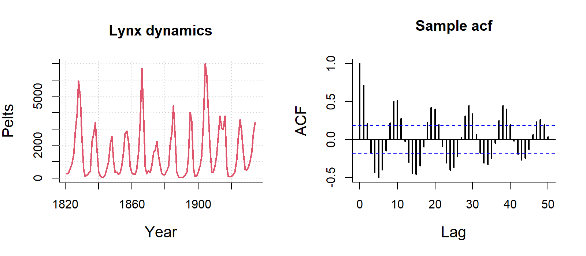
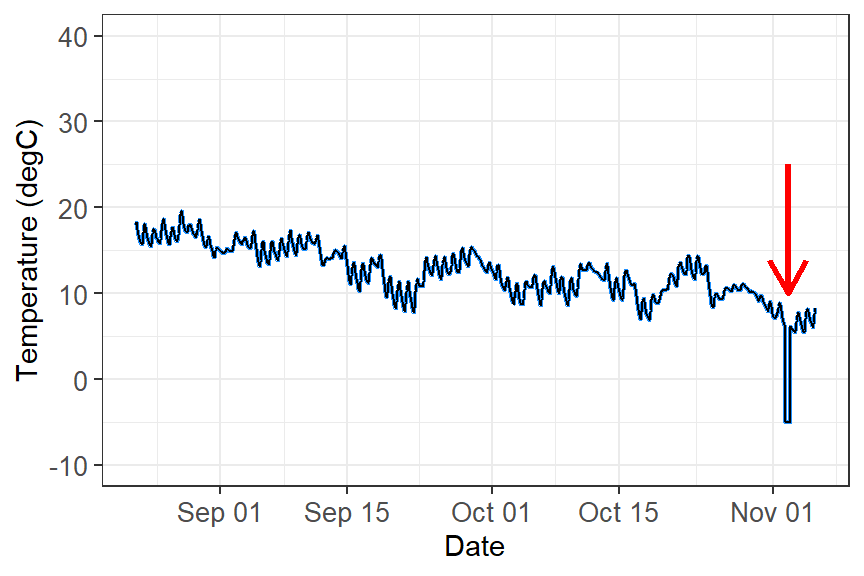

# OPTIONAL - Time Series

**Week 7** - Cleaning and plotting time series data

This is an optional tutorial if you plan to work with data that is time dependent, 
i.e time series data.


:::{.callout-note}

**THIS TUTORIAL WILL NOT BE IN THE EXAM**. It is an optional extra learning tool.

:::


This tutorial contains examples from longitudinal survey data (i.e surveying 
across time), weather data (date-based and date-time-based), and recordings of 
age data to look at growth over time.

To work with data with dates and time, we will need the R package [`lubridate`](https://lubridate.tidyverse.org/reference/lubridate-package.html).
Some of the turorials require more specialised packages to easily plot and work 
with time series data such as [`tsibble`](https://tsibble.tidyverts.org/) and [`feasts`](https://feasts.tidyverts.org/index.html).

```{r setup, message = FALSE, warning = FALSE}
# If you need to install new packages, here are code hidden in the comments.
#install.packages("tsibble")
#remotes::install_github("tidyverts/feasts")

# Load libraries
library(tidyverse)
library(lubridate) # for converting dates and time
library(lterdatasampler) # for accessing ecological data
library(tsibble) # to tidy temporal data with wrangling tools
library(feasts) # extension of tsibble to produce time series features, decompositions, statistical summaries and convenient visualisations.
library(broom)

```


# `lubridate` {.unnumbered}

All of example data in this tutorial have been pre-cleaned. Let's say for example, 
you loaded your raw data from a `csv` file, the date column is often stored as 
`character`. In this example, date is formatted as year-month-day, so to convert 
`character` to `date` format, use this following code with the `ymd()` function.

```{r}

# Use example dataset and only keep the date and temperature
test_data <- luq_streamchem %>%
  select(sample_date, temp)

# convert character to date
test_data <- test_data %>%
  dplyr::mutate(sample_date = lubridate::ymd(sample_date))

```

`lubridate` can handle many formats, but how you format them depends on how the 
original dates are written.

```{r}

dmy("05-01-1987")   # day-month-year
mdy("01/05/1987")   # month-day-year
ymd_hms("1987-01-05 14:30:00")  # date + time


```


You can also break down the dates into useful variables:


```{r}

test_data <- test_data %>%
  mutate(
    year  = lubridate::year(sample_date), # extract year only
    month = lubridate::month(sample_date), # extract month only as numeric
    month_lab = lubridate::month(sample_date, label = TRUE),  # extract month only as labels (Jan, Feb, Mar)
    doy   = lubridate::yday(sample_date),     # day of year
    week  = lubridate::isoweek(sample_date)  # present week as Monday, Tuesday, Wednesday et al.
  )

```


Some ecological time series have uneven sampling. You can check if the dates are 
evenly spaced out by the time difference with a lag of one using the `lag()` 
function.

```{r}

test_data %>%
  arrange(sample_date) %>%
  mutate(time_diff = sample_date - lag(sample_date))

```

This helps identify missing sampling periods or inconsistent effort.

# Examples {.unnumbered}


::: {.panel-tabset .nav-pills}

# Longtitudinal survey {.unnumbered}

Many of you working in consultancy or academic research will need to conduct 
experiments or surveys in the same location/animal across time. This can be days, 
weeks, months, or over multiple years.  While there are specific models that 
explicitly deal with time-series data, here you will learn how to clean and plot 
time-series data.

In this first example, We will use the `luq_streamchem` data to illustrate how to 
handle and plot longtitudinal survey data from the `lterdatasampler` R package.
This part will teach you how to explore change points in time-series, and how to 
use long format to create facet plots.

## Background {.unnumbered}

The `luq_streamchem` data sample contains a subset of **stream flow chemistry data** 
for the Quebrada Sonadora (QS) site within the Espiritu Santo drainage basin and 
the El Verde Research area of the Luquillo Experimental Forest (LEF). The Luquillo 
Experimental Forest (LEF) has been a center of tropical forestry research for 
nearly a century. In addition, the LEF is a recreation site for over a half a 
million people per year, a water supply for approximately 20% of Puerto Rico’s 
population, a regional center for electronic communication, and a refuge of 
Caribbean biodiversity. QS is the high elevation site.

<figure style="text-align:center;">
  
  <figcaption>Credit: Luquillo LTER. CC BY-SA 4.0</figcaption>
</figure>

<br>

First check what the data contains with `glimpse()`.

```{r}

# see luq_streamchem
glimpse(luq_streamchem)


```
Note, this dataset has already been cleaned and so the date column is already in the correct format. 


## Plotting one chemical {.unnumbered}

Let's look at the time-series of one of the chemicals, potassium

```{r, fig.height=5.5, fig.width=6.5}

ggplot(data = luq_streamchem, aes(x = sample_date, y = k)) +
  geom_line(color="#e82c4a") + 
  xlab("") +
  theme_bw() +
  labs(title = "Potassium [mg/L]") 

```

Wow there is definitely something going on at the end of 1989!

## Plotting all water quality indicators {.unnumbered}

We are not sure if all the chemicals and water quality indicators have been monitored 
over the same time period, or if their value will also show strong variations at 
the end of 1989.To explore this we will transform our data frame into long format 
so we can use `ggplot2::facet_wrap()` to quickly plot all observed stream chemistry 
variables at once. Note we are using the `scales = free` option since the 
concentrations (and units) vary greatly among the different variables.

```{r}

# Switching to long format
luq_streamchem_long <- luq_streamchem %>% 
  pivot_longer(cols = -c(sample_id, sample_date), names_to = "chem_param") 

ggplot(luq_streamchem_long, aes(sample_date, value)) + 
  geom_line(color = "#e82c4a") + 
  theme_bw() +
  facet_wrap(vars(chem_param), scales = "free")

```

It seems that other chemicals are also showing a jump around the end of 1989. 
Actually those jumps are due to **Hurricane Hugo** which made landfall in Puerto 
Rico at the beginning of September 1989. In its aftermath, average stream water 
exports of potassium, nitrate and ammonium increased in the year after the landfall 
by 119, 182 and 102% respectively compared to the other years of record.

## Detecting change points in a time-series {.unnumbered}

Let's first confirm that the timing of the jump in the time-series corresponds to 
Hurricane Hugo by adding a vertical line at the date of hurricane landfall.

```{r}

ggplot(luq_streamchem, aes(x = sample_date, y = k)) +
  geom_line(color = "#e82c4a") + 
  geom_vline(xintercept = as.Date("1989-09-18"), 
             linetype = "dashed") +
  xlab("") +
  theme_bw() +
  labs(title = "Potassium [mg/L]") 

```

### What could be next {.unnumbered}

There are many R packages available to help to detect change points in a time series: [`changepoint`](https://cran.r-project.org/web/packages/changepoint/index.html), [`CPM`](https://cran.r-project.org/web/packages/cpm/index.html), [`BCP`](https://cran.r-project.org/web/packages/bcp/index.html), [`ECP`](https://cran.r-project.org/web/packages/ecp/index.html) and more! 
Try to use them on this data sample.


# Seasonal data {.unnumbered}

We will use the `arc_weather` data to illustrate how to handle and plot weather 
data from the `lterdatasampler` R package.


## Background {.unnumbered}

The `arc_weather` data sample contains selected **meteorological records** from 
the Toolik Field Station at Toolik Lake, Alaska, from 1988 - 2018. This data set 
offers opportunities to explore and wrangle time series data, visualize patterns 
(e.g. seasonality), and apply different forecasting methods. 

<figure style="text-align:center;">
  
  <figcaption>LTER research station Toolik Lake, LTER CC BY-SA 4.0</figcaption>
</figure>

## Data exploration {.unnumbered}

Here, we highlight daily air temperature (the data sample also contains records 
for precipitation and wind speed) using functions from the [`tsibble`](https://tsibble.tidyverts.org/) 
and [`feasts`](https://feasts.tidyverts.org/) R packages (both part of the fantastic [`tidyverts`](https://tidyverts.org/) ecosystem of "tidy tools for time series"). 

Let's calcuate the monthly average of daily mean air temperature which we will 
call the new object as `arc_weather_ts`.

```{r}

# see arc_weather
glimpse(arc_weather)

# dmy_hm function converts format of year/month/day hour:minute which is the what the logger recorded
arc_weather <- arc_weather %>% 
  dplyr::mutate(date = lubridate::ymd(date)) 

# Calculate monthly average of daily mean air temperature and convert to tsibble: 
arc_weather_ts <- arc_weather %>% 
  dplyr::mutate(yr_mo = yearmonth(date)) %>% # Make a column with just month and year from each date
  group_by(yr_mo) %>% # Group by year-month
  summarise(avg_mean_airtemp = mean(mean_airtemp, na.rm = TRUE)) %>% # Find monthly mean air temperature
  tsibble::as_tsibble(index = yr_mo) # Convert to a tsibble (time series tibble)

```


Once the data are converted into a `tsibble` in the last line above, we can use 
helpful functions in `feasts` (like `autoplot()` and `gg_season()`) to explore 
the time series data a bit more. 

```{r, message = FALSE, warning = FALSE}

# Create a line graph of monthly average of mean daily air temperatures:
arc_weather_ts %>% 
  autoplot(avg_mean_airtemp) +
  theme_bw()

```

:::{.callout-note}

Ignore the warning message below. It's just saying that `gg_season()` is no 
longer maintained. 

Warning: `gg_season()` was deprecated in feasts 0.4.2.
ℹ Please use `ggtime::gg_season()` instead.
ℹ Graphics functions have been moved to the {ggtime} package. Please use`library(ggtime)`
instead.

:::


```{r, message = FALSE, warning = FALSE}

# Create  season plot to explore seasonality: 
arc_weather_ts %>% 
  feasts::gg_season(avg_mean_airtemp) +
  theme_bw()

```

## Decompose {.unnumbered}

We might want to decompose the time series data to further explore components. 
See Chapter 3 *Time series decomposition* in [Forecasting: Principles and Practice](https://otexts.com/fpp3/decomposition.html) by Rob J Hyndman and George 
Athanasopoulos for more information on decomposing time series data.  

Note, you can also do this by site or grouping which the [`feasts`](https://feasts.tidyverts.org/articles/feasts.html) R package provides 
from examples.

```{r, message = FALSE, warning = FALSE}

arc_weather_ts %>% 
  model(feasts::STL(avg_mean_airtemp)) %>% 
  components() %>% 
  autoplot() +
  theme_bw()

```


:::{.callout-note}

Ignore the warning message below. It's just saying that `autoplot.dcmp_ts()` is 
no longer maintained. 

Warning: `autoplot.dcmp_ts()` was deprecated in fabletools 0.6.0.
ℹ Please use `ggtime::autoplot.dcmp_ts()` instead.
ℹ Graphics functions have been moved to the {ggtime} package. Please use`library(ggtime)` 
instead.

:::


- The first plot shows the raw data from the `arc_weather_ts` dataset.

- The second plot shows the *trend*, which excludes the seasonality component. 
The trend generally shows how the average change over time, which is useful for 
climate change studies. Here the trend does not seem to be increasing or decreasing 
over time.

- The third plot shows the *seasonality*,  which excludes the trend component. 
There is a clear seasonal trend in air temperature (regular cycle).

- The last plot shows the *remainder* component, which demonstrates that the 
seasonality and trend alone cannot capture all of the variation in the observations 
over time. The more wiggly the lines, the greater the variation in the time series.


We can also explore autocorrelation, which refers to the degree of similarity 
between A) a given time series, and B) a lagged version of itself, over C) 
successive time intervals. In other words, autocorrelation is intended to measure 
the **relationship between a variable’s present value and any past values that you may have access to**.

```{r, message = FALSE, warning = FALSE}

arc_weather_ts %>% 
  ACF(avg_mean_airtemp) %>% 
  autoplot() +
  theme_bw()

```

:::{.callout-note}

Ignore the warning message below. It's just saying that `autoplot.dcmp_ts()` is 
no longer maintained. 

Warning: `autoplot.tbl_cf()` was deprecated in feasts 0.4.2.
ℹ Please use `ggtime::autoplot.tbl_cf()` instead.
ℹ Graphics functions have been moved to the {ggtime} package. Please use`library(ggtime)`
instead.

:::

You can see there is a lag of 6 months with the largest acf value occuring every 
6 months. Then you can move on to time series forecasting and further analysis! 


Some examples of autocorrelation trends what what they mean:




For visualisation, this ACF is not important, but if you are analysing data with 
strong autocorrelation, not dealing with it **violates the independence assumption of regression models**, specifically Ordinary Least Squares (OLS). While estimates remain unbiased, it 
makes them inefficient and produces underestimated standard errors, leading to 
unreliable p-values, misleading significance tests, and invalid confidence intervals.

You can deal with autocorrelation by adding lagged variables in the regression 
model to capture the dependency on past values, or using time series models that 
uses techniques like ARIMA (AutoRegressive Integrated Moving Average) that explicitly 
handle autocorrelation.


# Cave climate {.unnumbered}

Many of you might be working with environmental data (e.g. soil or air temperatures 
and humidity) collected from deployed data loggers. While, you may not not use the 
whole time series dataset for your study, it could useful to visualise the study 
period and highlight where you took your samples (e.g. using [`geom_vline()`](https://www.sthda.com/english/wiki/ggplot2-add-straight-lines-to-a-plot-horizontal-vertical-and-regression-lines).


Here is a dataset called `winter_clim_dat.csv` that includes outside (EXT) and 
inside (DEEP) cave air temperature and humidity of two sites (MAM, YES). 
This dataset contains date and time components, which include recordings of temperature 
and humidity every hour. You can create a figure like this using the [`geom_line()`](https://r-graph-gallery.com/279-plotting-time-series-with-ggplot2.html) 
function and separating temperature and humidity by location (EXT, DEEP) and site 
(MAM, YES).

The code below also includes ways of converting raw date values into meaningful 
values that R can interpret correctly. Here the date is formatted as day/month/year 
hour:minute so we need to use the `dmy_hm()` function from the lubridate package.

You can also change the dates and time with [`as.POSIXct()`](https://rpubs.com/lexieorr34/943733) 
function). The link also discusses ways of dealing with missing and weird time 
series data.

<figure style="text-align:center;">
  
  <figcaption>Tomas and Nicholas conducting survey of cave-roosting bats and thee cave microclimate. Photo: C Turbill.</figcaption>
</figure>

```{r clim dat, warning=FALSE, message=FALSE}

# lubridate way
clim_raw <- read_csv("https://raw.githubusercontent.com/nicholaswunz/ECS200-Workshop/refs/heads/main/data/winter_clim_dat.csv") %>%
  dplyr::mutate(date_time = lubridate::dmy_hm(date_time), # convert character to date and time
                DOY       = lubridate::yday(date_time), # calculate day of the year
                month     = lubridate::month(date_time), # month as numeric
                month_cat = lubridate::month(date_time, label = TRUE), # month as name
                location =  factor(location, levels = c('EXT', 'DEEP')))  


# using base R way with as.Date and as.POSIXlt
clim_raw <- read_csv("https://raw.githubusercontent.com/nicholaswunz/ECS200-Workshop/refs/heads/main/data/winter_clim_dat.csv") %>%
  dplyr::mutate(date_time = as.POSIXct(date_time, format = "%d/%m/%Y %H:%M"), # convert character to date and time
                DOY       = as.POSIXlt(date_time)$yday, # calculate day of the year
                month     = format(as.Date(date_time, format = "%m/%d/%Y"),"%m"), # month as numeric
                month_cat = format(as.Date(date_time, format = "%m/%d/%Y"),"%B"), # month as name
                location =  factor(location, levels = c('EXT', 'DEEP')))  

```


Plot temperature and humidity by sites with vertical lines representing survey 
period.

```{r, warning=FALSE, message=FALSE}

# Plot temperature with vertical lines representing survey period
temp_plot <- clim_raw %>% 
  ggplot() +
  geom_line(aes(x = date_time, y = air_temp, colour = location)) +
  scale_colour_manual(values = c("#F5C4B8", "#e82c4a")) + # manually change colour
  geom_vline(xintercept = as.POSIXct(as.Date("2023-07-10")), # add horizontal line when data were sampled
                                     linetype = "dashed") + 
  geom_vline(xintercept = as.POSIXct(as.Date("2023-08-12")),
                                     linetype = "dashed") + 
  labs(x = "Date", 
       y = "Air temperature (°C)") + 
  theme_bw() +
  facet_wrap(~ site) # separate by site

# Plot humidity with vertical lines representing survey period
RH_plot <- clim_raw %>% 
  ggplot() +
  geom_line(aes(x = date_time, y = RH, colour = location)) +
  scale_colour_manual(values = c("#B8CEF5", "darkblue")) + # manually change colour
    geom_vline(xintercept = as.POSIXct(as.Date("2023-07-10")), # add horizontal line when data were sampled
                                     linetype = "dashed") + 
  geom_vline(xintercept = as.POSIXct(as.Date("2023-08-12")),
                                     linetype = "dashed") + 
  labs(x = "Date", 
       y = "Relative humidity (%)") + 
  theme_bw() +
  facet_wrap(~ site) # separate by site
  
cowplot::plot_grid(temp_plot, 
                   RH_plot, 
                   ncol = 1, align = "v")

```


# Growth data {.unnumbered}

We will use the `knz_bison` data to illustrate how to handle and plot growth data 
from the `lterdatasampler` R package.

## Background {.unnumbered}

The `knz_bison` data provides **age and weight records for the bison herd** at 
[Konza Prairie Biological Station LTER](http://lter.konza.ksu.edu/konza-prairie-long-term-ecological-research-lter) (KPBS) in Kansas. Here, we will show you how to model bison weight as a function 
of age using the Gompertz model with `nls`.


From Konza Prairie LTER Researcher Jeffrey Taylor: "*Nearly 300 bison graze KPBS year-round without supplementary feed and with minimal human intervention, living as 'naturally' as possible. Bison were reintroduced in 1987, and collection of weight data began in 1994, making this dataset the longest continuous record of wild ungulate weight gain anywhere in the world. A round-up is conducted once annually at the end of the grazing season wherein each bison is weighed, calves are vaccinated and receive unique IDs, and excess individuals are culled.*"

<figure style="text-align:center;">
  
  <figcaption>Konza Prairie LTER bison herd, LTER CC BY-SA 4.0</figcaption>
</figure>

Let's take a look at the existing `knz_bison` data sample:

```{r}

glimpse(knz_bison)

```
We can calculate each bison's age at observation by subtracting the year of birth 
(`animal_yob`) from the record year (`rec_year`), adding a new column called 
`animal_age` using `dplyr::mutate()`: 

```{r}

knz_bison_age <- knz_bison %>% 
  mutate(animal_age = rec_year - animal_yob)

```

Now, we'll explore bison weight as a function of age (in years), separated by sex:

```{r}
# Either dot points
ggplot(data = knz_bison_age, aes(x = animal_age, y = animal_weight, group = animal_sex)) +
  geom_point(aes(color = animal_sex), 
             size = 0.5,
             position = position_jitter(width = 0.2, height = 0)) +
  labs(x = "Bison age (years)",
       y = "Recorded weight (pounds)") +
  theme_bw()


# or line plot
ggplot(data = knz_bison_age, aes(x = animal_age, y = animal_weight, group = animal_code)) +
  geom_line(aes(color = animal_sex), alpha = 0.5) +
  labs(x = "Bison age (years)",
       y = "Recorded weight (pounds)") +
  theme_bw()

```

## Gompertz model {.unnumbered}

As used by Martin and Barboza (2020), bison body mass as a function of age can 
be modelled using a sex-specific Gompertz model: 

$$BM =b1*exp(-exp(-b2*(age-b3)))$$
Where $b1$ is the *asymptotic body mass* (pounds), $b2$ is instantaneous growth-rate 
at inflection point, and $b3$ is age at inflection point (years). 

Using nonlinear least squares (nls) to estimate $b1$, $b2$ and $b3$ requires 
starting estimates for each. We will use the following (based on visualizations 
above, and estimates from Supplemental Materials for Martin and Barbosa (2020): 

Female bison parameter initial estimates: 

- $b1$ initial estimate: 1000 pounds
- $b2$ initial estimate: 1 
- $b3$ initial estimate: 0.6

### Create the Gompertz model function: {.unnumbered}

```{r}

gompertz <- function(b1, b2, b3, animal_age) {
  b1*exp(-exp(-b2*(animal_age-b3)))
}

```

### Use `nls()` to model growth for female bison {.unnumbered}

Isolate just the female bison (note that this starts from the dataset `knz_bison_age` 
created above that contains the calculated bison **age**, stored as `animal_age`): 

```{r}

bison_f <- knz_bison_age %>% 
  filter(animal_sex == "F")

```

Use `nls` to estimate parameters (note: add `trace = TRUE` to print iterative 
estimates): 

```{r}

bison_f_gompertz <- nls(animal_weight ~ gompertz(b1, b2, b3, animal_age),
                        data = bison_f,
                        start = list(b1 = 1000, b2 = 1, b3 = 0.6),
                        trace = TRUE)

```


### Plot the predicted masses with the observed data {.unnumbered}

```{r}
# Create a new series of ages
age_series <- seq(0, 22, by = 0.1)

# Make predictions using the model over those times: 
pred <- predict(bison_f_gompertz, list(animal_age = age_series))

# Bind the predictions and age sequence together into a data frame: 
bison_f_predicted <- data.frame(age_series, pred)

# Plot the observed data and predictions together:
ggplot() +
  geom_point(data = bison_f, 
             aes(x = animal_age, y = animal_weight),
             size = 0.3,
             alpha = 0.2,
             position = position_jitter(width = 0.2, height = 0)) +
  geom_line(data = bison_f_predicted, 
            aes(x = age_series, y = pred),
            color = "#e82c4a",
            size = 1) +
  theme_bw()

```

## Explore & use model outputs with `broom` {.unnumbered}

The wonderful [`broom` package](https://broom.tidymodels.org/) "**summarizes key information about models in tidy tibbles**." 
For example, the `broom::tidy()` function summarizes important model information: 

```{r}
# Put model outputs into a tidy tibble: 
bison_f_gompertz_tidy <- bison_f_gompertz %>% 
  broom::tidy()

# Check it out! 
bison_f_gompertz_tidy
```

We can also use the `broom::glance()` function to return important information 
about the model overall: 

```{r}

bison_f_gompertz %>% broom::glance()

```

We can use `broom::augment()` to added predicted values and residuals for each 
of the existing bison in the `bison_f` data frame: 

```{r}

augment(bison_f_gompertz)

```

**Note:** There are additional [related datasets for this data package](https://portal.edirepository.org/nis/metadataviewer?packageid=knb-lter-knz.78.12), 
containing information for the number of male and female bison per age category
and bison maternal parentage (calves matched to mother by ear tags). We encourage 
you to check them out for more analysis opportunities with the Konza Prairie bison! 

:::


# Bad Time Data {.unnumbered}

Bad data can happen for a number of reasons. 
Your logger may have been damaged, or exposed to something that artificially 
changed the data. The logger might have a software bug. An example dataset with 
bad recorded data (likely equipment issue) shown in this figure.





**What do you do with these data?**

These data need to filtered out of your dataset in order to perform any kind of 
analyses.  The way you filter data will be based on the type of data you are 
working with and how the data manifests. For example:

- Filter out outliers by a redefined threshold.
This example you can filter out values below zero.

- Filter out outliers based on the IQR range. See [week 1's workshop](week1_getting_started.qmd) 
for how to filter data using this method.

- Filter out outliers based on the time. 
If you know a certain time period that damaged the equipment (i.e storm event), 
you can filter out by time.


# Analysis  {.unnumbered}

You are now ready to analyse time-series data. However, time-series analysis is 
beyond this second-year unit, but here are some possibilities you can you do with 
time data:

- **Repeated measures ANOVA**: A normal ANOVA but the same individual/group measured
multiple times (longitudinal studies) or before/after treatments. 

- **Population dynamics**: You can quantify changes in populations or number of 
individuals across time using using generalised linear models or generalised 
additive models for nonlinear effects. Some simple forecasting tool can identify 
trend, seasonality (breeding seasons, migration, lunar cycles, predator/prey 
dynamics), cycles, irregular trends, and predict future numbers.

- **Forecasting**: More advanced forescasting models can deal with temporal 
autocorrelation, lagged effects, non-Gaussian data and missing observations, 
measurement, error, time-varying effects, non-linearities, and multi-series 
clustering. Some common time-series models that incorporates uncertainty in 
forecasting (i.e stochastic processes) includes include [random walk](https://en.wikipedia.org/wiki/Random_walk), [autoregressive](https://en.wikipedia.org/wiki/Autoregressive_model), 
[autoregressive integrated moving average](https://en.wikipedia.org/wiki/Autoregressive_integrated_moving_average), and exponential smoothing.
Here is an [example live forecast](https://portal.naturecast.org/) for the 
population and community dyanmics of desert rodents.


- **Movement ecology**: Temporal and spatial data from tracking animals can help 
influence where animals move, how fast they move, if there daily/seasonal patterns 
in their movement, what kind kind of habitats do they move in, and what bahavioural 
states can be inferred from the data.


# Additional resource {.unnumbered}

- Coding Club [Analysing Time Series Data](https://ourcodingclub.github.io/tutorials/time/): 
An R tutorial to understand the various temporal patterns in data by decomposing 
data into different cyclic trends.


