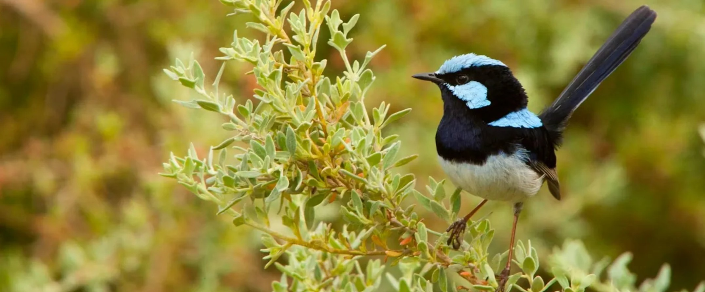

# Multivariate Analyses

**Week 8** - Multivariate analyses

In this workshop, you will fit multivariate regression models and learn how to interpret them. Workshop materials are available in the github repository [ECS200](https://github.com/nicholaswunz/ECS200-Workshop).

# Background {.unnumbered}

::: {.panel-tabset .nav-pills}

## Multiple regression {.unnumbered}

Multiple regression extends simple linear regression (lab in week 5) by allowing for **several explanatory variables, or independent variables**, to explain one numeric and preferably continuous outcome.

Coral reef health is a major concern especially in areas such as the Great Barrier Reef.

Shannon diversity index is a measure of biodiversity that captures both species richness (the number of species present) and evenness (how evenly individuals are distributed among those species). 
Higher values of the index indicate more diverse communities, while lower values suggest dominance by a few species. 
As an aside, mathematically, it sums the proportional abundances of each species weighted by the logarithm of those proportions, meaning rare species contribute less than common ones but still influence the overall value. 
This simulated data set allows us to look at coral reef health, as measured by the Shannon index, for 72 sites. 

The potential explanatory variables are:

- Sea surface temperature at the time of the site visit
- Surface water pH
- Chlorophyll-a concentration as a proxy for water clarity 
- Distance from land
- Commercial fishing allowed (yes/no)


```{r, warning=FALSE, message=FALSE}
# install.packages("GGally")  # run once if needed
library(GGally) ## for pairs plot
library(tidyverse)
library(broom)
library(ggeffects) ## for predictions
library(patchwork) ## for nice panels of figures

reef_data <- read.csv("https://raw.githubusercontent.com/nicholaswunz/ECS200-Workshop/refs/heads/main/data/coralreefdata.csv", stringsAsFactors = T)

```


### Research  question and setup {.unnumbered}

The research question is: Is there an association between coral reef health as measured by the Shannon diversity index and sea surface temperature, surface water pH, chlorophyll-a concentration distance from land and the presence of commercial fishing.

For our first model will will assume any relationships between the numeric explanatory variables and response are linear. We could state a suite of null and alternative hypotheses, but will not do so here. You should be able to write these out if needed. We will use a significance level of 0.05.


### Visualisation of the data {.unnumbered}


Let's visualise the data with the aim to check if linear relationships are suitable.


```{r , warning=FALSE}

GGally::ggpairs(
  reef_data,
  lower = list(continuous = wrap("points", alpha = 0.6, size = 1)),
  upper = list(continuous = wrap("cor", size = 4)),
  diag  = list(continuous = wrap("densityDiag"))
) +
  theme_minimal()

```

**Do we have any concerns about linear relationships between the outcome (shannon) and any of the numeric explanatory variables?**

### Assumptions {.unnumbered}

Let's create the additional visualisations to allow us to evaluate the assumptions.

The figures below are as follows:

- **The fitted values versus the standardised residuals**. 
In this we are looking for an indication that there is change in the standardised residuals over the range of the fitted values to support an assessment of the assumption of equal variances. 
There should be an equal number of residual above zero and below zero, and not too many standardised residuals more extreme than -2 and 2. 

- A **quantile–quantile (QQ) plot** is a visualisation used to check whether a set of values (say residuals from fitting a linear regression model) follows a particular distribution (say the normal distribution. 
The QQ plot which compares the theoretical quantiles from the normal distribution (x axis) and sample standardised residuals presented as quantiles (y axis) and is used to assess if the residuals are normally distributed. 
If the points follow the line then this is consistent with the residuals coming from a normal distribution. 
Systematic curvature (an S-shape) suggests the residuals may be skewed or have heavier or lighter tails than a normal distribution while a few points far from the line at the ends may indicate outliers or unusually large residuals.


- Optional: The plot of leverage versus the standardised residuals allows us to check if there are any large leverage points (leverage is how far a data point’s predictor values are from the “center” of all predictors) which also have large residuals. 
If there are any points with a large leverage and large residuals, these points are having an impact on the model and should be investigated further.


```{r}
## Firstly run the model
shannon_lm <- lm(shannon ~ sst + pH + chlorophyll + 
                   distance_from_land + fishing_allowed,
                 data = reef_data)

## Secondly create a set of visualisations that help us understand the diagnostics
### Get several key outputs including:
### - fitted values (.fitted)
### - standardised residuals (.std.resid)
### - leverage (.hat)
shannon_aug <- augment(shannon_lm) 

ggplot(shannon_aug, aes(x = .fitted, y = .std.resid)) + 
  geom_point() + 
  theme_minimal() +
  geom_hline(yintercept  = 0)+
  geom_hline(yintercept  = c(-2, 2), linetype  =3) +
  labs(title = "Coral reef health, fitted values versus standardised residuals",
       x = "Fitted values",
       y = "Standardised residuals")

ggplot(shannon_aug, aes(sample = .std.resid)) +
  stat_qq() +
  stat_qq_line() + 
  theme_minimal() +
  labs(title = "Coral reef health, QQ plot of the residuals",
        x = "Theoretical Quantiles",
       y = "Standardised residuals")


## this time add the guidance of highlighting point more than 4/number of observations
n <- nrow(shannon_aug)

ggplot(shannon_aug, 
       aes(x = .hat, y = .std.resid, colour = .cooksd > 4/n)) + 
  geom_point(size = 2) + 
  scale_colour_manual(values = c("black", "red")) +
  theme_minimal() +
  labs(title = "Coral reef health: leverage vs standardised residuals",
       x = "Leverage",
       y = "Standardised residuals",
       colour = "Influential")

## the other guide is 0.5 to 1 is moderate influence, over 1 high influence
max(abs(shannon_aug$.cooksd))

```


| Assumption | Check         | Met       |                              
|:----------:|:-----------------------------------------:|:------------------:|
| Linearity    | In the scatterplots  we do not see any particular non-linear relationships | This assumption is met.        |
| Multicolinearity    | In the scatterplots  we see a strong relationship between chlorophyll and distance from land, so we pick one of these two variables. | This assumption is not met.        |
| Equal variances    | In the plot of fitted values vs the standardised residuals we see a similar spread of residual for all fitted values.  | This assumption is met.      |
| Normally distributed residuals   | In the QQ plot we see that there is ok agreement between the theoretical and observed standardised residuals. |This assumption is not great but close to being met. |
| Influential points   | In the plot of leverage versus the standardised residuals three points might be of concern, but all are under 0.5 so this might be ok |We should re-check this after resolving concerns with multicolinearity|
| Independence      | This data is simulated but was from areas on the Great Barrier Reef so we need to assume they are sufficiently spaced apart to be considered independent | This assumption needs a caveat.                 |

We refit the model without one of chlorophyll and distance from land, here we choose to **refit the model without distance from land as this removes the concern around multicolinearity** and therefore this should stabilise the model.


```{r}
## Firstly run the model without multicolinearity issues
shannon_lm2 <- lm(shannon ~ sst + pH + chlorophyll  + fishing_allowed,
                  data = reef_data)

## Secondly create a set of visualisations that help us understand the diagnostics
### Get several key outputs including:
### - fitted values (.fitted)
### - standardised residuals (.std.resid)
### - leverage (.hat)
shannon_aug2 <- augment(shannon_lm2) 

ggplot(shannon_aug2, aes(x = .fitted, y = .std.resid)) + 
  geom_point() + 
  theme_minimal() +
  geom_hline(yintercept  = 0)+
  geom_hline(yintercept  = c(-2, 2), linetype  =3) +
  labs(title = "Coral reef health, fitted values versus standardised residuals",
       x = "Fitted values",
       y = "Standardised residuals")

ggplot(shannon_aug2, aes(sample = .std.resid)) +
  stat_qq() +
  stat_qq_line() + 
  theme_minimal() +
  labs(title = "Coral reef health, QQ plot of the residuals",
        x = "Theoretical Quantiles",
       y = "Standardised residuals")


## this time add the guidance of highlighting point more than 4/number of observations
n <- nrow(shannon_aug2)

ggplot(shannon_aug2, 
       aes(x = .hat, y = .std.resid, colour = .cooksd > 4/n)) + 
  geom_point(size = 2) + 
  scale_colour_manual(values = c("black", "red")) +
  theme_minimal() +
  labs(title = "Coral reef health: leverage vs standardised residuals",
       x = "Leverage",
       y = "Standardised residuals",
       colour = "Influential")

## the other guide is 0.5 to 1 is moderate influence, over 1 high influence
max(abs(shannon_aug2$.cooksd))


```


Now **multicolinearity has been resolved** and overall the other model diagnostics look to be improved. 

This analysis can proceed with a caveat on independence.


### Modelling {.unnumbered}

We can now get R to summarise the model. 

```{r}
## summarise the model
summary(shannon_lm2)
confint(shannon_lm2)

```
We would benefit from model selection (pH) is not significant, so let's also do that.

```{r}
## looks like we could simplify the model
## set up the null model as an intercept only model
shannon_null <- lm(shannon ~ 1,data = reef_data)

## take as the final model the best model as choosen by stepwise model selection
shannon_lm_fin <- step(shannon_null, scope = (list(lower = shannon_null, upper = shannon_lm2)), 
                       direction = "both", trace = T)

```

**Extension**: You should re-run all the diagnostics to ensure no further issues, so run these here. 
The assumptions here should be followed up with a full evaluation like the initial one above. 


```{r}
## summarise the model
summary(shannon_lm_fin)
confint(shannon_lm_fin)

```

These suggest that we have a good model, **associations between the diversity and chlorophyll-alpha, sea surface temperature and commercial fishing**. 


Let's explore the model visually. One option we have is to look at the adjusted predictions. These hold other variable constant and calculate predictions over a valid (observed) range of the explanatory variables.

```{r}

## visualise the model

## first we need the adjusted predictions for each variable
## the ggeffects package has a very handy way of predicting these in more
## complex multivariate models
pred_sst  <- ggeffects::ggpredict(shannon_lm_fin, terms = "sst [all]")
pred_chl  <- ggeffects::ggpredict(shannon_lm_fin, terms = "chlorophyll [all]")
pred_fish <- ggeffects::ggpredict(shannon_lm_fin, terms = "fishing_allowed")

## if you look at these it will specifically give the values of the other variable in
## the model used in the adjustment, see the variable held constant in the output
pred_sst
# Adjusted for:
# *     chlorophyll = 0.30
# * fishing_allowed =   No
pred_chl
pred_fish

## a function that works for continuous explanatory vars
plot_adjustedpreds <- function(pred, raw_data, xvar, yvar, xvarlabel, title_text) {
  ggplot(pred, aes(x = x, y = predicted)) +
    geom_line() +
    geom_ribbon(aes(ymin = conf.low, ymax = conf.high), alpha = 0.2) +
    geom_point(data = raw_data,aes(x = .data[[xvar]], y = .data[[yvar]]),alpha = 0.4) +
    labs(
      y = "Shannon diversity",
      x = xvarlabel,
      title = title_text
    ) +
    theme_minimal()
}

p_sst  <- plot_adjustedpreds(pred_sst, reef_data, "sst", "shannon","Sea surface temperature (degrees Celsius)", "Adjusted predictions: Sea surface temperature")
p_chl  <- plot_adjustedpreds(pred_chl, reef_data, "chlorophyll", "shannon", "Chlorophyll-alpha (water clarity)", "Adjusted predictions: Chlorophyll-alpha")

## not a function, just an example for the categorial variable 
p_fish <- ggplot(pred_fish, aes(x = x, y = predicted)) +
  geom_point(size = 3) +
  geom_errorbar(aes(ymin = conf.low, ymax = conf.high), width = 0.1) +
  geom_jitter(
    data = reef_data,
    aes(x = fishing_allowed, y = shannon),
    width = 0.1,
    alpha = 0.4
  ) +
  labs(
    y = "Shannon diversity",
    x = "Fishing allowed",
    title = "Adjusted predictions: Commercial fishing allowed"
  ) +
  theme_minimal()

## optional (using the patch work package), one nice figure
p_sst / p_chl / p_fish
```


The final model includes **sea surface temperature, chlorophyll-alpha and presence of commercial fishing but not pH**. The fitted model can be written as:

$\widehat{Shannon diversity} = 10.9 - 3.70 chlorophyll -0.259 sea surface temperature - 0.255 commercial fishing present$

Increasing chlorophyll-alpha decreases the Shannon index (coeff = -3.70, 95% CI -4.24 to -3.16, p-value <0.001), sea surface temperature decreases the Shannon index (coeff -0.259, 95% CI -0.372 to -0.146, p-value <0.001) and the presence of commercial fishing decreases the Shannon index by 0.255 (95% CI 0.119 to 0.390, p-value 0.0004).

The overall F-test for the model is significant ($F(3,68) = 74.49$, $p < 0.001$), indicating that the regression model provides a better fit to the data than a model with no predictors.

The figures show the adjusted prediction models, meaning, for example, that the sea surface temperature assumes an average chlorophyll-alpha and no commercial fishing etc. Specifically we see that as sea surface temperature increases we see a decrease in diversity, as chlorophyll-alpha increases we see a decrease in diversity and the presence of commercial fishing also decreases diversity. 

## Two-way ANOVA with interaction

### Background {.unnumbered}

Inspired by the paper: Schlotfeldt, B. E., & Kleindorfer, S. (2006). Adaptive divergence in the superb fairy-wren (*Malurus cyaneus*): A mainland versus island comparison of morphology and foraging behaviour. Emu 0 Austral Ornithology, 106(4), we have the following scenario.

The Superb Fairy-wren is a small Australian passerine of the family Maluridae (subfamily Malurinae). 
This species inhabits woodlands and heaths and often forages in clearings. They are insectivorous ground-foraging birds, and tend to forage socially in small family groups. 
We are interested in the mean foraging height by sex (easy to do as this species is sexually dichromatic and dimorphic) and location (Kangaroo Island vs Mount Lofty Ranges). 
Location is of interest as several passerine species on Kangaroo Island differ sufficiently from the mainland SA populations to be treated as subspecies). 
Only one foraging observation per individual bird per day was made to avoid statistical non-independence of the data.





### Research question {.unnumbered}

**Optional**: write the null and alternative hypotheses associated with the research question: Is there an association between foraging height (m) and the interaction between sex and location? You can also write the null and alternative hypothesis for the main effects. 

### Descriptive statistics and visualisations {.unnumbered}

Now we read in the data.

```{r}
## read in the data from the csv

foraging <- read.csv("https://raw.githubusercontent.com/nicholaswunz/ECS200-Workshop/refs/heads/main/data/foraging.csv")

```


We can create a table of descriptive statistics and a couple of visualisations to understand the data and check the assumptions of two-way ANOVA.

```{r}
## basic summaries by sex and location
summary_stats <- foraging %>%
  group_by(sex, location) %>%
  summarise(
    count = n(),
    mean = mean(foraging_height),
    median = median(foraging_height),
    sd = sd(foraging_height),
    min = min(foraging_height),
    max = max(foraging_height)
    
  )

summary_stats

## boxplots to look at spread  (and a little bit shape)
ggplot(foraging, aes(x = interaction(sex, location), y = foraging_height, fill = sex)) +
  geom_boxplot(alpha = 0.7) +
  labs(
    x = "Group (Sex × Location)",
    y = "Foraging height (m)",
    title = "Foraging Height by Sex and Location"
  ) +
  theme_minimal()


## visualise the means
ggplot(foraging, aes(x = location, y = foraging_height, color = sex, group = sex)) +
  stat_summary(fun = mean, geom = "point", size = 3) +
  stat_summary(fun = mean, geom = "line") +
  labs(
    y = "Foraging height (m)",
    x = "Location",
    color = "Sex",
    title = "Interaction between Sex and Location"
  ) +
  theme_minimal()

```

The summary and visualisations suggest the presence of an interaction effect. 


### Assumptions {.unnumbered}

Let's create the additional visualisations to allow us to evaluate the assumptions.

The figures below are as follows:

- The fitted values versus the standardised residuals. 
- A quantile–quantile (QQ) plot.


```{r}
## Run the two-way ANOVA with interaction model
forgaging_aov <- lm(foraging_height ~ sex * location, data = foraging)

## Secondly create a set of visualisations that help us understand the diagnostics
### Get several key outputs including:
### - fitted values (.fitted)
### - standardised residuals (.std.resid)
### - leverage (.hat)
forgaging_aug <- augment(forgaging_aov) 

ggplot(forgaging_aug, aes(x = .fitted, y = .std.resid)) + 
  geom_point() + 
  theme_minimal() +
  geom_hline(yintercept  = 0)+
  geom_hline(yintercept  = c(-2, 2), linetype  =3) +
  labs(title = "Foraging heights, fitted values versus standardised residuals",
       x = "Fitted values",
       y = "Standardised residuals")

ggplot(forgaging_aug, aes(sample = .std.resid)) +
  stat_qq() +
  stat_qq_line() + 
  theme_minimal() +
  labs(title = "Foraging heights, QQ plot of the residuals",
        x = "Theoretical Quantiles",
       y = "Standardised residuals")


```


| Assumption | Check         | Met       |                              
|:----------:|:-----------------------------------------:|:------------------:|
| Equal variances    | In the plot of fitted values vs the standardised residuals we see a similar spread of residual for all fitted values. OR the ratio of the largest to the smallest standard deviation (0.752 / 0.542) is less than 2 | This assumption is met.      |
| Normally distributed residuals   | In the QQ plot we see that there is agreement between the theoretical and observed standardised residuals OR the boxplots suggest each group is consistent with the normal distribution and has similar spread. |This assumption  met. |
| Independence      | This data is simulated but the original study was carefully designed to ensure independence observations | This assumption is met. |                 |


**All the assumptions are met.**

### Modelling {.unnumbered}

```{r}
# We can now look at the model
# We look first at the anova table
anova(forgaging_aov)

# We see strong evidence in both the main effects and the interaction effects.
summary(forgaging_aov)

```

### Interpretation  {.unnumbered}


There is evidence **against the null hypothesis** that there is no association between foraging height and the interaction between sex and location among the Superb Fairy-wren in the non-breeding season (*t*(116) = -16,62, *P* <0.001). 
On Kangaroo Island, foraging heights were much higher (means of 0.433 m and 0.883 m for females and males respectively) compared with those on the mainline, specifically Mount Lofty Ranges (means of 0.143 m and 0.200 m for females and males respectively). 


:::


# Assessment {.unnumbered}

Task to complete before the end of the workshop.

Analyse the relationship between foraging height and mean shrub size (PC2), accounting for foraging substrate ((1) bark, (2) foliage (leaves and flowers), (3) ground, and (4) air) and sex (male, female). Note: this scenario was not described in the paper and has been created for teaching purposes.

First download the `foraging_shrub.csv` file on [GitHub](https://github.com/nicholaswunz/ECS200-Workshop) in the 'data' folder and load it in R.

Your tasks are to:

**1. Fit a suitable model and create the  visualisations for diagnostics checking**

- Create one figure to look at the data and the assumption of linearity
- Create one figure to look at the assumption of equal variances.
- Create one figure to look at the assumption that the residuals have a normal distribution
- Optional: Plot leverage versus the standardised residual plots and note if there are any concerning high leverage points.
- Consider model selection via stepwise selection. Note the model should have an interaction between the two categorical variables. 

**2. Assess if each assumption is met for the final model**


**3. Provide a summary of the model and visualise the model**

- Report the p-values in context (you can write this as a comment in the code), you may want to run both anova and summary on your model.
- Report the slope and confidence interval for each coefficients (you can write this as a comment in the code too)
- Visualise the model and/or the full relationship. These two snippets of code might help:

```{r, include=FALSE}
## just it's here to make the code snippet work
foraging_shrub <- read.csv('https://raw.githubusercontent.com/nicholaswunz/ECS200-Workshop/refs/heads/main/data/foraging_shrub.csv', stringsAsFactors = T)

foraging_shrub_lm <- lm(foraging_height_m ~ mean_shrub_size + sex_mf * substrate, data = foraging_shrub)

```


```{r}

foraging_shrub_pred <- ggpredict(foraging_shrub_lm, terms = c("mean_shrub_size", "sex_mf", "substrate"))
## take a look at it and think of some ways to look at the model visually

```


```{r}

## Optional: Run this visualisation of everything to see the impact of sex and substrate on the relationship
ggplot(foraging_shrub, aes(x = mean_shrub_size, y = foraging_height_m,
                           colour = sex_mf)) + 
  geom_point(aes(shape = substrate))+
  theme_minimal() +
  labs(title = "Foraging heights vs mean shrub size (PC2)",
       x = "Mean shrub size (PC)",
       y = "Foraging height (m)")
```


```{r ans 1 hide, include=FALSE}
## read in the data
foraging_shrub <- read.csv('https://raw.githubusercontent.com/nicholaswunz/ECS200-Workshop/refs/heads/main/data/foraging_shrub.csv', stringsAsFactors = T)


## I would start with a pairs plot to look at the bivariate relationships
ggpairs(
  foraging_shrub,
  lower = list(continuous = wrap("points", alpha = 0.6, size = 1)),
  upper = list(continuous = wrap("cor", size = 4)),
  diag  = list(continuous = wrap("densityDiag"))
) +
  theme_minimal()
## fairly strong relationship between foraging height and 
## mean shrub height, is linear so assumption is met


## fit the model
foraging_shrub_lm <- lm(foraging_height_m ~ mean_shrub_size + sex_mf * substrate, data = foraging_shrub)


## Secondly create a set of visualisations that help us understand the diagnostics
### Get several key outputs including:
### - fitted values (.fitted)
### - standardised residuals (.std.resid)
### - leverage (.hat)
foraging_shrub_aug <- augment(foraging_shrub_lm) 

ggplot(foraging_shrub_aug, aes(x = .fitted, y = .std.resid)) + 
  geom_point() + 
  theme_minimal() +
  geom_hline(yintercept  = 0)+
  geom_hline(yintercept  = c(-2, 2), linetype  =3) +
  labs(title = "Foraging of Superb Fairy-wren, fitted values versus standardised residuals",
       x = "Fitted values",
       y = "Standardised residuals")

ggplot(foraging_shrub_aug, aes(sample = .std.resid)) +
  stat_qq() +
  stat_qq_line() + 
  theme_minimal() +
  labs(title = "Foraging of Superb Fairy-wren, QQ plot of the residuals",
        x = "Theoretical Quantiles",
       y = "Standardised residuals")


## this time add the guidance of highlighting point more than 4/number of observations
n <- nrow(foraging_shrub_aug)

ggplot(foraging_shrub_aug, 
       aes(x = .hat, y = .std.resid, colour = .cooksd > 4/n)) + 
  geom_point(size = 2) + 
  scale_colour_manual(values = c("black", "red")) +
  theme_minimal() +
  labs(title = "Foraging of Superb Fairy-wren, leverage vs standardised residuals",
       x = "Leverage",
       y = "Standardised residuals",
       colour = "Influential")

## the other guide is 0.5 to 1 is moderate influence, over 1 high influence
max(abs(foraging_shrub_aug$.cooksd))

## Assumptions ##
## Linearity: the relationship between mean shrub size and foraging height is linear. Met
## Equal variances: the plot of the fitted values vs the standardised residuals looks consistent
##  for all values of fitted values. This assumption is met.
## Normality of the residuals: The QQplot shows that the standardised residuals
##  are aligned with the theoretical quantiles expected by the normal distribution. 
##  This assumption is met.
## Influential points: No Cook's distance values are large (smallest is 0.07)
## Independence: The authors ensured independence with good study design

## This model is valid

## Look at the ANOVA table
anova(foraging_shrub_lm)
## all p-values are significant, we do not apply model selection

summary(foraging_shrub_lm)
## all these are significant too

confint(foraging_shrub_lm)
## good for reporting the CIs for each coeffs like above

## visualise the model
foraging_shrub_pred <- ggpredict(foraging_shrub_lm, terms = c("mean_shrub_size", "sex_mf", "substrate")) %>%
  rename(sex_mf = group, substrate = facet)

## can do fitted lines like before, this is fairly clean but seperate visuals would be ok too
ggplot() +
  geom_line(data = foraging_shrub_pred, aes(x = x, y = predicted, color = sex_mf),size = 1) +
  geom_ribbon(data =foraging_shrub_pred, aes(x=x, ymin = conf.low, ymax = conf.high, fill = sex_mf), alpha = 0.2) +
  geom_point(data = foraging_shrub, aes(x = mean_shrub_size, y = foraging_height_m, colour = sex_mf)) +
  facet_wrap(~substrate) +
  labs(x = "Mean shrub size (PC2)", 
       y = "Predicted foraging height (m)", 
       title = "Predicted Foraging Height") +
  theme_minimal()


## Or a visualisation of everything
ggplot(foraging_shrub, aes(x = mean_shrub_size, y = foraging_height_m,
                           colour = sex_mf)) + 
  geom_point(aes(shape = substrate))+
  theme_minimal() +
  labs(title = "Foraging heights vs mean shrub size (PC2)",
       x = "Mean shrub size (PC)",
       y = "Foraging height (m)")
```

# Extra Stuff {.unnumbered}


