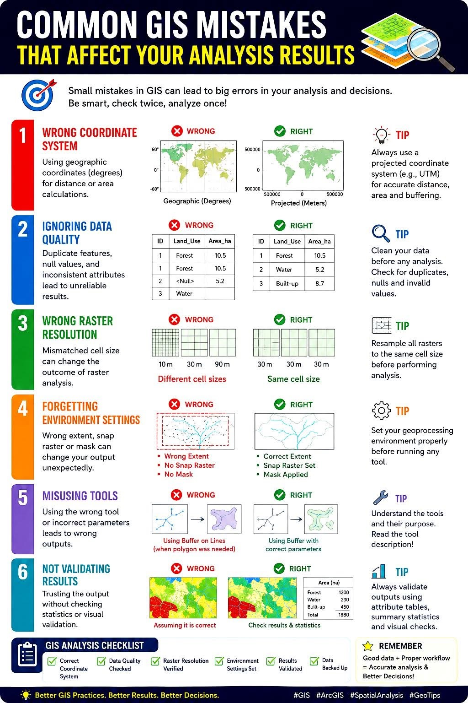

# OPTIONAL - Spatial Data

**Week 9** - Plotting species observation data

This is an optional tutorial if you plan to work with species occurrence data.

:::{.callout-note}

**THIS TUTORIAL WILL NOT BE IN THE EXAM**. It is an optional extra learning tool.

:::

This tutorial contains examples occurrence spatial data, and was heavily inspired 
by Amanda Buyan and Dax Kellie's tutorial from the [Atlas of Living Australia](https://labs.ala.org.au/posts/).


Maps are one of the most common and useful data visualisation tools in an 
ecologist’s tool belt. Making a quick and simple map of species observations is 
especially useful when first investigating where a species has occurred. Viewing 
locations of points can also help to understand the extent of your data (and spot 
possible errors or outliers). We will make a map of observations of the motorbike 
(*Litoria moorei*) in Western Australia since 2000 recorded by FrogID.


First, let’s load some packages.

```{r setup, message = FALSE, warning = FALSE}
# If you need to install new packages, here are code hidden in the comments.
#install.packages("sf")

# Load libraries
library(tidyverse)
library(galah) # ALAs R package
library(sf) # work with spatial data

```


# Download the Data {.unnumbered}

## Search for taxa {.unnumbered}

When trying to download data about any species or clade, we can search using 
`search_taxa()`. It’s recommended to use `search_taxa()` to check whether a 
taxonomic search returns what you were expecting (even if you know the scientific 
name)! We can check taxonomic information about motorbike frog with `search_taxa()`, 
which returns extra details about the species when a match is found.

```{r}

galah::search_taxa("Litoria peronii")

```

## Search for fields {.unnumbered}

Next, we can search for fields and field IDs for filtering our query. In this case, 
we are interested in filtering to a specific year, state/territory and data resource.

We can start by searching for any fields containing the word “year” using 
`search_all()`.

```{r}

galah::search_all(fields, "year")

```

We can do the same kind of search to find fields with information of australian 
states/territories and data resource names.

```{r}

galah::search_all(fields, "states")

galah::search_all(fields, "resource")

```

If you are ever uncertain which field ID to choose, you can use `show_values()` 
to see what possible values are within a field. For example, let’s see what values 
are in field ID cl22.


```{r}
options(timeout = 120)

galah::search_all(fields, "cl22") %>%
  show_values()

```


## Download observations {.unnumbered}


Now we are ready to build our query to download observations of motorbike frog in 
Western Australia since 2000 recorded by FrogID.

First, let’s find the number of records that match our query. This is good practice 
before downloading occurrence records because you can check exactly how many 
records you are intending to download (and avoid an accidental massive download)!

We’ll use `atlas_counts()` to download record counts, specifying the taxon using 
`galah_identify()`, and narrowing the year range, state/territory and data resource 
using `galah_filter()`.

```{r}

galah::galah_call() %>%                          # Begin a query
  galah::galah_identify("Litoria moorei")  %>%   # motorbike frog
  galah::galah_filter(year >= 2000,              # since 2000
               cl22 == "Western Australia",      # in Western Australia
               dataResourceName == "FrogID") %>% # by FrogID
  galah::atlas_counts()   

```

Now we can use `atlas_occurrences()` to download occurrence records, which returns 
each observation’s location coordinates and event date.

You will need to first provide a [registered email with the ALA](https://auth.ala.org.au/userdetails/registration/createAccount) using 
`galah_config()` before retrieving records.


```{r, eval=FALSE}

galah_config(email = "your-email-here")

```


```{r hide, include=FALSE}

galah::galah_config(email = "nikywu1990@hotmail.com")

```


```{r}

frogs <- galah::galah_call() %>%                         # Begin a query
  galah::galah_identify("Litoria moorei")  %>%  # motorbike frog
  galah::galah_filter(year >= 2000,             # since 2000
               cl22 == "Western Australia",     # in Western Australia
               dataResourceName == "FrogID") %>%
  galah::atlas_occurrences()


frogs

```

# Make a Map {.unnumbered}

It’s time to make our map!

Let’s load our States and Territories shapefile from the [`ozmaps`](https://cran.r-project.org/web/packages/ozmaps/vignettes/ozmaps.html) 
R package.
Then, we will filter the shapefile to Western Australia and quickly plot it to 
check it plots correctly (specifying that the border is grey, and the inside is 
white).

```{r}
library(ozmaps)

au_map <- ozmaps::ozmap_data("abs_ste")
WA_map <- au_map[au_map$NAME == "Western Australia",]

ggplot() +
  geom_sf(data = WA_map,
          colour = "grey60",
          fill = "#F5F5F5") +
  theme_bw()

```

Our shapefile has plotted nicely, but there are many different ways to display our 
shape of WA, which exists on a spherical globe (the Earth), onto a flat surface 
(our map). Our shapefile already has a projection, determined by its Coordinate 
Reference System (CRS) of GDA94.

```{r}

sf::st_geometry(WA_map)

```

To make it clearer how the CRS changes the projection of a map, here are 3 maps 
of NSW projected with 3 different CRS:

- GDA94 (the current projection of our NSW shapefile)
- EPSG:7850 (a state/territory-specific projection for WA)
- EPSG:2955 (intended for Canadian territories)


```{r, message = FALSE, warning = FALSE}
library(cowplot)

p1 <- WA_map %>% 
  ggplot() +
  geom_sf(colour = "grey60",
          fill = "#F5F5F5") +
  labs(title = "GDA94") +
  theme_bw()

p2 <- WA_map %>% 
  st_transform(crs = st_crs(7850)) |>
  ggplot() +
  geom_sf(colour = "grey60",
          fill = "#F5F5F5") +
  labs(title = "EPSG:7850") +
  theme_bw()

p3 <- WA_map %>% 
  st_transform(crs = st_crs(2955)) |>
  ggplot() +
  geom_sf(colour = "grey60",
          fill = "#F5F5F5") +
  labs(title = "EPSG:2955") +
  theme_bw()

cowplot::plot_grid(p1, p2, p3, align = "h", nrow = 1)

```

Now, we will add species observations to our map. First, we will plot our shapefile. 
Then, we will overlay a scatter plot using decimalLongitude as your x axis and 
decimalLatitude as your y axis. We’ll set the colour and adjust the alpha to make 
our points partially transparent.

```{r}

ggplot() +
  geom_sf(data = WA_map,
          colour = "grey60",
          fill = "#F5F5F5") +
  geom_point(data = frogs,
             aes(x = decimalLongitude,
                 y = decimalLatitude),
             colour = "#e82c4a",
             alpha = 0.5,
             size = 1.1) +
  theme_bw()

```

# Density Map {.unnumbered}

We can use the [`ggpointdensity`](https://github.com/LKremer/ggpointdensity) 
package to visualise locations with many overlapping occurrences. With over 40,000 
points plotted on our map, `geom_pointdensity()` allows us to see areas with 
higher densities of observations.

```{r}
library(ggpointdensity)

ggplot() +
  geom_sf(data = WA_map, 
          colour = "grey60", 
          fill = "#F5F5F5") +
  ggpointdensity::geom_pointdensity(data = frogs,
             aes(x = decimalLongitude, 
                 y = decimalLatitude),
             alpha = 0.5,
             size = 1.1) +
  scale_colour_viridis_c(option = "viridis", # palette
                         direction = -1) +   # reverse light-to-dark
  guides(
    colour = guide_colourbar(
      title = "Number of\noverlapping\nobservations")
    ) +
  theme_void()
```

You can see most of the observations occur around the Perth metropolitan area.

# Interactive Map {.unnumbered}

You can also use the `leaflet` package to produce interactive maps:

```{r}
#install.packages("leaflet")

library(leaflet)

# convert to sf object and give crs 4326
frogs_sf <- sf::st_as_sf(frogs, coords = c("decimalLongitude", "decimalLatitude"), crs = 4326)


leaflet::leaflet() %>% 
  leaflet::addTiles() %>% 
  leaflet::addCircles(data = frogs_sf, 
                      label = ~eventDate,
                      color = "#e82c4a")

```

You can learn more about the leaflet package [here](https://rstudio.github.io/leaflet/articles/leaflet.html). 
There is also a cheat sheet available [here](https://rstudio.github.io/cheatsheets/leaflet.pdf).


# Seasonality {.unnumbered}

Now we can make a bar chart or time series plot to see observations over the year. 

```{r}

# from the time-series tutorial
month_frogs <- galah::galah_call() %>%                         # Begin a query
  galah::galah_identify("Litoria moorei")  %>%  # motorbike frog
  galah::galah_filter(year >= 2000,             # since 2000
               cl22 == "Western Australia",     # in Western Australia
               dataResourceName == "FrogID") %>%
  galah::galah_group_by(month) %>%
  galah::atlas_counts() %>%
  mutate(month = lubridate::month(as.numeric(month), label = TRUE) # format month
         )

ggplot(data = month_frogs, aes(x = month, y = count)) +
  geom_bar(stat = "identity", fill = "#e82c4a") +
  labs(x = "Month", 
       y = "No. of observations") +
  scale_x_discrete(expand = c(0,0)) +
  scale_y_continuous(limits = c(0, 1000),
                     expand = c(0,0)) +
  theme_bw()

```

:::{.callout-important}

## Important
Because the ALA database is based on both citizen and scientist submissions,
**recordings are not standardised** and may be biased based on when people are 
aviabale to record such data, even for common species. For rare species, this is 
even more true. This type of time series plot for inferring seasonal activity or 
abundance over time is only reliable if you are standardising your survey across 
time. i.e no detection means you tried to look but they are not there vs not 
detected because you didnt survey in that time.

:::


# Cartographic Data {.unnumbered}

There are four main types of spatial cartographic data that R can handle.
Cartographic data is represented by either *vector* or *raster* data.

**Vector data** is made up of *points* (x, y locations), *lines* (at least two 
connected points), and *polygons* (3 or more points that are connected and closed).
These are used to represented discrete entities like survey plots/occurance (points), 
roads/rivers (lines), or boundary/country/lakes (polygons). How to best represent 
something depends on the scale at which the map will be shown. 

**Raster data** is used to represent **continuous information** like rainfall or 
elevation per cell block (can be pixal size or actual units). These are phenomena 
that occur everywhere but to varying degrees. Each cell of the raster represents 
a numeric unit of data like feet above sea level.


This tutorial showed you how to load and plot point (occurance data) and polygon 
data (Western Australia map).


# Common Mistakes {.unnumbered}

Make sure you check the quality of your spatial data before plotting and conducting
formal analysis. This tutorial does not go through how to check and clean your 
spatial data, but here is a handy infographic on what to keep out for:




# Analysis {.unnumbered}

You are now ready to analyse spatial data. However, spatial analysis is beyond 
this second-year unit, but here are some possibilities you can you do with such 
data:

- **Spatially-explicit regression models**: This is your standard multilevel model 
but includes spatial distance between sites/populations as a covariance matrix in 
the model to account for similar responses in closely related sites. An example 
tutorial using a Baysian framework can be found [here](https://ourcodingclub.github.io/tutorials/spatial-modelling-inla/#increasecomplexity). 

- **Species distribution modeling** (environmental niche modelling): Uses 
algorithms to predict a species' potential geographic distribution by relating 
known occurrence locations to environmental predictors (e.g., climate, soil, habitat). 
These models are crucial for conservation planning, climate change impact assessments, 
and invasive species management. 

- **Movement ecology**: Temporal and spatial data from tracking animals can help 
influence where animals move, how fast they move, if there daily/seasonal patterns 
in their movement, what kind kind of habitats do they move in, and what bahavioural 
states can be inferred from the data.

## Additional resource {.unnumbered}

- [Cleaning Biodiversity data in R](ttps://cleaning-data-r.ala.org.au): A practical 
guide for cleaning geo-referenced biodiversity data using R. It focuses specifically 
on the processes and challenges you’ll face with biodiversity data.

- Coding Club [Working with Rasters and Remote-Sensing Data](https://ourcodingclub.github.io/tutorials/spatial/): 
An R tutorial to explore spatial analysis using satellite data to answer ecological 
questions such as what are the characteristics of species’ habitats.

- [Species distribution modelling](https://labs.ala.org.au/posts/2024-04-30_sdm-tidymodels/) 
using `tidysdm` & `tidymodels`: An introduction to species distribution modelling 
with fundamental steps to build, assess and use models to predict species distributions.


